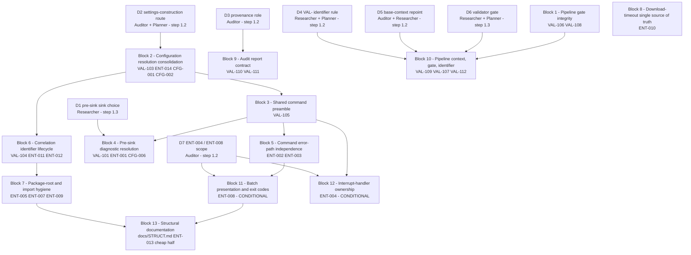

# Plan 05 — Entry & Architecture Audit Fixes

> **Source (read-only):** `.ai/audit/99-validation/01-entry-architecture-validated-findings.md` — its
> **Required Fixes** (10 items) and **Advisory Recommendations** (9 rows), plus the
> `VAL-101`…`VAL-112` pipeline findings it filed.
> **Cross-phase input (read-only):** `.ai/audit/02-config/findings.md` — `CFG-001`, `CFG-002`, `CFG-006`
> only, and only because Required-Fixes items 4 and 6 name them.
> **Baseline this plan is written against:** commit `eedfff0`, working tree clean for `src/ tests/ docs/`.
> Re-measured at planning time: `ruff check` 0, `ruff format --check` 0, `mypy src` 0,
> `pytest -q -rs` → **486 passed, 4 skipped** (the 4 skips are the D-11 Windows permission-mode skips).
> The plan file's `481` is stale; **486 is the truth** and is the count every block must not reduce.
> **Platform:** Windows. **Package manager:** `uv`. Verification commands: `.ai/context/commands.md`.
> **Working revision:** `eedfff0` fixed none of `ENT-001`…`ENT-014`; all 14 are still anchored.

---

## 0. Audit Status (2026-10-08)

**Completed:** Blocks 1–6 (commits `d62671b`–`0790157`).
`ruff check`, `ruff format --check`, `mypy src`, and `pytest` (excl. packaging)
all pass.

**Not implemented — proceed:** Blocks 7, 8, 13.
These are low-risk, high-value changes:
- **B7** (4 `__init__.py` roots → docstring only, hoist deferred import in
  `exceptions.py`, add `test_import_graph.py` invariant): removes two import
  cycles, enables hoisting the `exceptions.py:97` deferral.
- **B8** (nine `300` literals → one constant): removes drift-prone duplication;
  the constant already exists, just needs renaming and wiring.
- **B13** (STRUCT.md entry-layer import cost): one-line documentation update.

**Partially done — accepted as-is:** Blocks 9, 10.
Commits `e443448`, `feb0a40`, `19143b1`, `0a8fa97` achieved the functional goals
(label set, decision slot, evaluable gate, counter-based output) through a
divergent approach. Per Tech Lead decision, do NOT rewrite these to match the
plan's exact prose. **One follow-up remains:** fix the broken `AGENTS.md`
reference in `audit-refine.md` line 19 (the file does not exist in the
repository; should point to `.ai/context/commands.md`).

**Deferred — confirmed:** Blocks 11, 12 (D7 = DEFER by default).
ENT-008 remains classified `mandatory` in `findings.md`, which conflicts with
the deferral. Recommendation: reclassify ENT-008 as `advisory` in
`01-entry-architecture/findings.md` to align the finding with the plan's
defer-the-block decision.

**Verification commands:** `ruff check src tests`, `ruff format --check src tests`,
`mypy src`, `pytest -q -rs --ignore=tests/test_packaging.py` (934 passed,
3 skipped). Packaging tests fail due to a pre-existing `.python-version`
deletion (commit `009f9fc`); see `.ai/audit/problems/` for the full report.

---

## 1. Scope

### 1.1 How the scope was derived

The request names the **Required Fixes list (10 items)** and the **Advisory Recommendations table
(9 rows)** of the phase-01 validation record. Those two lists, and nothing else, are the scope.
Everything else in the corpus is named here only so its exclusion is on the record.

| Source list | Items | Fate |
|---|---|---|
| Required Fixes 1–3, 7–10 (`VAL-106`, `VAL-108`, `VAL-110`, `VAL-107`, `VAL-109`, `VAL-111`, `VAL-112`) | 7 | **IN** → Blocks 1, 9, 10 |
| Required Fixes 4 (`VAL-103`) | 1 | **IN** → Block 2 |
| Required Fixes 5 (`VAL-104`) | 1 | **IN** → Block 6 |
| Required Fixes 6 (`VAL-101`) | 1 | **IN** → Block 4 |
| Advisory rows: `ENT-005`/`ENT-007`, `ENT-009`, `ENT-010` | 3 | **IN** → Blocks 7, 8 |
| Advisory row: `ENT-013` (cheap half only) | 1 | **IN, reduced** → Block 13 |
| Advisory row: `ENT-006` | 1 | **OUT** — see §1.3 |
| Advisory rows: `ENT-004`, `ENT-008` | 2 | **DEFERRED, D7** — see §1.4 |
| Advisory row: `ENT-014` | 1 | **IN as part of `VAL-103`** — Block 2. Its standalone row is "blocked on `VAL-103`" by its own text; landing it separately is exactly the unsafe order `VAL-103` forbids. |
| Advisory row: `docs/STRUCT.md` | 1 | **IN** → Blocks 7 and 13 |

### 1.2 IN — the full list

1. `VAL-106` — the orchestrator writes one validation filename and gates on another.
2. `VAL-108` — the orchestrator orders rejected findings deleted, against the retention rule the
   validator handbook and the validation record are built on.
3. `VAL-110` — the report format defines four type labels and names a role the pipeline cannot launch.
4. `VAL-103` — `ENT-014` resolved with `CFG-001` and `CFG-002`, in one edit.
5. `VAL-104` — `ENT-011` before `ENT-012`, in that order, as one change.
6. `VAL-101` — `ENT-001`'s sink ordering **or** `CFG-006`'s stderr rendering, never both.
7. `VAL-107` — the unevaluable validator gate and the unconditional coverage claim.
8. `VAL-109` — the mandatory project-guidelines read names a file the repository does not hold.
9. `VAL-111` — the finding block has no slot for the validation decision.
10. `VAL-112` — `VAL-` is minted per run, so one ID names two subjects.
11. `ENT-005` + `ENT-007` (merged) — empty the four eager package roots; the two deferrals become
    ordinary module-scope imports.
12. `ENT-009` — hoist the unjustified deferred correlation import.
13. `ENT-010` — one source of truth for the download timeout; delete the nine literals.
14. `ENT-013`, cheap half only — **re-measure and state** the entry-layer import cost in
    `docs/STRUCT.md`. The lazy-import refactor is **not** in scope (see §1.3).

### 1.3 OUT — with rationale

| Item | Why it is out |
|---|---|
| **`ENT-006`** (the 26-entry compatibility facade in `services/downloader.py`) | The ratio is bad and one binding rule cuts directly against the recommendation. (a) Effort is stated as "small" but the measured cost is rewriting the facade-import surface in `tests/test_hls_downloader.py` (73 references), `tests/test_cli.py` (61) and `tests/test_downloader.py` (45) — on the order of 180 test references. (b) `downloader.py`'s ownership comment **documents** the facade as an intentional, deliberately maintained public surface, and `.kilo/agents/auditor.md`'s Dead Code Policy states that a component which exists but is unused **and is documented** is future-proofing, not dead code, and that dead-code findings should recommend investigation, not deletion. (c) Project rule 5 (Avoid Overengineering) cuts against deleting a working compatibility surface to satisfy an advisory finding. A second unofficial public API is a real smell; fixing it is a separate, deliberate decision, not an audit-fix side effect. |
| **`ENT-013`'s lazy-import refactor** | Explicitly "recommended, not urgent", effort "medium", and **its A/B evidence is the one stale experiment in the corpus** — the refactor was never re-verified after `eedfff0` added a new module-scope `services → exceptions` edge in `ffmpeg_utils.py`. Shipping an unverified import-graph refactor on advisory evidence violates the plan's own safety constraint. The cheap half (re-measure and document) is IN as Block 13. |
| **`CFG-003`, `CFG-004`, `CFG-005`, `CFG-007`, `CFG-008`** | They belong to the phase-02 report's own Required-Fixes / Advisory lists and are owned by `.ai/audit/99-validation/02-config-validated-findings.md`. Only `CFG-001`, `CFG-002` and `CFG-006` enter this plan, and only because `VAL-103` and `VAL-101` name them by ID. Pulling the rest in would be scope capture. |
| **`.ai/audit/**` catalogue churn** | 19 tracked deletions of the previous `.ai/audit/` catalogue plus 7 untracked new artefacts are in the working tree. Commit-hygiene rule R4 applies to every block: no block stages `.ai/`, no `git add -A`, no `git reset`, no `git checkout`, no history rewrite. This also constrains `D3` (§6.3). |
| **A new module for a shared constant** | No block in this plan may add a file under `src/`. `tests/test_packaging.py` hard-codes `EXPECTED_SDIST_ENTRIES` as a frozenset and asserts it against a real sdist build; a new module that is not added to that frozenset in the same change fails the suite. Every block below is designed to be a no-new-file change. If an Implementor concludes a new module is unavoidable, that is a stop-and-escalate, not a judgement call. |
| **The audit corpus' own informational observations** (the lost `\n` escape at the orchestrator's prompt line, the retry-budget arithmetic, the tallies no stage produces, the declared-but-unused parallel ceiling, the undefined "merge" stage, the duplicated frontmatter description, the dangling "Correction 2" reference) | Recorded in the corpus as *not filed as findings*. Promoting them to work would widen scope on the Planner's own authority. They are named here so the omission is deliberate and visible, not forgotten. |

### 1.4 DEFERRED — behind an explicit decision

`ENT-004` (interrupt-handler ownership) and `ENT-008` (batch presentation and exit-code ownership) are
**advisory or best-practice**, and `ENT-008` is by far the most expensive change in the corpus for a
benefit that is architectural hygiene rather than a live defect. They are carried as
**Blocks 11 and 12, conditional on `D7`** (§6.7). The **default is DEFER**; the default is a
recommendation, not a decision, and `D7` is owned by the Auditor at step 1.2.

`ENT-004`'s standalone recommendation is a *side effect* of Block 5's shared failure path, so it is the
cheaper of the two to add later. `ENT-008` is not: it changes `run_batch`'s signature and the whole
user-visible text contract of the batch command, and it collides with Block 2's own signature change to
`run_batch`. If `D7 = IN`, Blocks 11 and 12 must be sequenced **after** Block 2 — see §3.3.

---

## 2. Blocks

> Every block is one commit. Every block is independently committable and independently revertible.
> Task specifications name **modules, functions, classes and symbols** only. Line numbers appear solely
> in the `Evidence` line of each block, as locator hints for the Implementor, and are never part of a
> task specification.
> **Commit hygiene applies to every block:** stage by explicit path only. Never `git add -A`,
> `git add .`, `git add -u`, `git reset`, `git checkout`, `git restore`, `git stash`, amend, or force.

---

### Block 1 — Pipeline gate integrity

**Findings covered:** `VAL-106` (CRITICAL), `VAL-108` (HIGH).

**Goal.** Make the audit pipeline's own validation gate able to close, and stop the orchestrator
destroying the decision record the validation stage exists to produce. Both defects are live prose
contradictions inside one file, and neither touches product code. `VAL-106` is the single highest-value
item in the corpus by ratio: one string, zero product risk, and it is the reason every audited phase has
so far been reported as a failed validation. This block retires that before any research cycle begins,
because nothing in the rest of the plan depends on it and everything that follows benefits from it.

**Files to be touched**

| File | Semantic unit | Change |
|---|---|---|
| `.kilo/commands/audit/audit-multi-phase.md` | the validator-output verification step of the phase loop | Align the checked validation-artifact filename with the filename the validator is instructed to write. The **check** side is the defective one: the write side is the form the pipeline has always produced and is the form `phases/99-audit-validate.md` names as the one it writes. Change the check string; do not change the write string. |
| `.kilo/commands/audit/audit-multi-phase.md` | the retry-rules list | Remove the instruction that rejected findings are cleaned from the file before merge. The validator handbook's binding rule 2 and its reporting section state that rejected content is retained in full and must never be deleted, and that where two documents disagree the preserving side governs. If a "merge" step is genuinely wanted, it is not defined by this command and is not this block's job to invent (rule 5). |

**Evidence (locator only).** `audit-multi-phase.md` — the write string in the validator `Task(...)` prompt
versus the existence check in the step that follows it; the rejected-cleanup line in `<retry_rules>`.
Preserving side: `.kilo/commands/audit/phases/99-audit-validate.md` — binding rule 2, the retention row in
its reporting section, and the "an instruction that deletes the record of a decision" rejection ground.

**Dependencies.** `depends_on:` *none*. Placed first because it has no prerequisite, no decision, and no
product-code coupling, and because `Block 10` edits the same file and must not run concurrently.

**Agent matrix**

| Agent | | Reason |
|---|---|---|
| Auditor | not required | Both sides of both contradictions are quoted verbatim in the finding and in the document they contradict; there is no finding to adjudicate and no severity to re-derive. |
| Researcher | not required | No technical uncertainty. This is string equality and rule precedence between two documents, both present in the tree. |
| Planner | not required | No sequencing or interface decision — the block has one edit in one file and no dependents inside this plan. |
| Validator | **required** | The block edits the document that governs the validator's own launch and output gate. Only the validator can confirm from its own handbook that the aligned string is the one it writes, and that removing the cleanup instruction leaves no second site in the pipeline still instructing deletion. |

**Open decisions.** None.

**Risks and mitigation.**
*Risk:* the check string is changed and the write string was the typo instead. *Mitigation:* the Validator
independently confirms which side is authoritative before the change is committed; if the Validator
disagrees, the block stops rather than guessing.
*Risk:* a third filename string exists elsewhere in the pipeline. *Mitigation:* the block's read-back check
is a whole-tree search for the validation-artifact filename pattern, not a single-string edit.

**Tests required.** None executable — the artefact is prose and has no runtime. Verification is a Validator
read-back recorded in the commit body: the two strings now agree, and a whole-tree search finds no second
site naming the superseded form. This is proportional; a test asserting on markdown would be noise.

**Commit**

```
git add .kilo/commands/audit/audit-multi-phase.md
```
`fix(audit): align validation gate filename and stop destroying rejected findings`

---

### Block 2 — Configuration resolution consolidation

**Findings covered:** `VAL-103` (CRITICAL) — `ENT-014` + `CFG-001` + `CFG-002`, in one edit.

**Goal.** Make every configuration source reachable for the three settings the entry layer currently
hides, and remove the second, unvalidated configuration object the service layer builds behind the
command's back. Today both commands construct `Settings` with two unconditional constructor keywords
whose Typer defaults are never `None`, so the constructor always wins the model's own documented
precedence and `VKDOWNLOADER_SSL_VERIFY` and `VKDOWNLOADER_COOKIE_SOURCE` can never reach their fields.
The service layer then rebuilds the object with `model_copy(update=...)`, which performs no validation,
so the object `setup_logging` configured is not the object the download runs on, and an out-of-range or
wrong-typed `max_retries` reaches the retry loop. This block resolves all three in a single construction
and deletes the second construction. It is the only CRITICAL product-code item in the plan.

**Files to be touched**

| File | Semantic unit | Change |
|---|---|---|
| `src/vkdownloader/cli.py` | `download` option parameters | `cookie_source` and `ssl_verify` become `None`-able with `None` as the option default, so an option the user did not type occupies no configuration source. `max_retries` keeps its existing `int \| None` option shape. |
| `src/vkdownloader/cli.py` | `batch_download` option parameters | The identical change, applied to the second command. The two command surfaces must not diverge again. |
| `src/vkdownloader/cli.py` | the settings construction inside each command | One conditional-overrides construction per command: build an overrides mapping, populate an entry only for an option the user actually supplied, and construct the model from it. Do **not** use a bare `None` pass-through — `max_retries` is declared `int` with a non-`None` default, so passing `None` is a validation failure, not a pass-through. |
| `src/vkdownloader/services/downloader.py` | `download_video` | Resolve per the `D2` decision (see §6.2). Either delete the `max_retries_override` parameter and the `model_copy` block outright, or — under the retaining route — replace the `model_copy` with a re-validating construction so the declared range and type still apply to any programmatic caller. **Applying both routes, or applying `ENT-014` as written while leaving the shadowed keywords, is forbidden.** |
| `src/vkdownloader/services/batch_downloader.py` | `_download_single`, `_run_batch_with_progress`, `run_batch` | Propagate whatever `D2` decides about `max_retries_override`. Under the deleting route the override parameter chain is removed end to end; under the retaining route the chain stays and the value is re-validated at the point of use. Do not leave a parameter that is accepted and then ignored — that is the same class of dead surface `ENT-006` is not being fixed for. |
| `tests/test_cli.py` | new test class for entry-point source precedence | See *Tests required*. |
| `tests/test_config.py` | new test class for the override bound | See *Tests required*. |
| `tests/test_batch_downloader.py` | the call sites that pass a `max_retries` override | Update to the surviving signature. |

**Evidence (locator only).** `cli.py` — the two command bodies' option declarations and their settings
construction; `services/downloader.py` — `download_video`'s optional `max_retries_override` parameter and
the `model_copy` re-construction at the top of its body; `services/batch_downloader.py` — the same
parameter threaded through three functions; `config.py` — the `max_retries` field declaration carrying
`ge=1, le=10`, and the model's own four-level source-precedence docstring.

**Dependencies.** `depends_on:` *none* in the DAG. It is blocked in practice only on decision `D2`, which is
resolved at step 1.2, before any block is implemented. Placed immediately after Block 1 and **before
Block 3** — see §3.2 for the ordering defence.

**Agent matrix**

| Agent | | Reason |
|---|---|---|
| Auditor | **required** | `VAL-103` is composed CRITICAL precisely because `ENT-014` is unsafe to act on without its siblings, and because the two candidate routes are **mutually exclusive** with `CFG-002`, not sequential with it. The Auditor adjudicates which route is applied and records that the other was not partially applied. |
| Researcher | not required | The two live routes differ in blast radius, not in external fact; every fact needed to price them is in-repo and was already measured (call-site counts, signature surfaces, test reference counts). This is a design adjudication, which is `D2`'s assigned home, not a research question. |
| Planner | **required** | Owns the shape of the one conditional-overrides construction, its `mypy --strict` typing under rule 9, and the interaction with the Block 3 helper signature. |
| Validator | **required** | A CRITICAL change to configuration resolution that alters what an operator's `.env` can reach. The Validator must re-derive source reachability per field after the change and confirm no field became unreachable, and confirm the rollout is revertable without leaving a shadowed keyword behind. |

**Open decisions.** `D2` — which route. Resolved by **Auditor + Planner** at step 1.2. Alternatives and the
evidence needed to choose are in §6.2. **The Planner must not pick silently.**

**Risks and mitigation.**
*Risk:* the two commands' option surfaces drift apart again, reintroducing the defect on one command.
*Mitigation:* the new test class runs the same four assertions against **both** commands.
*Risk:* changing the option defaults to `None` changes `--help` output, which is a user-visible contract.
*Mitigation:* the help text must state the default explicitly where `None` means "not supplied", and the
existing help tests in `tests/test_cli.py` are the gate. If the help text becomes materially worse, that
is evidence for the retaining route and must be reported, not worked around.
*Risk:* the autouse `isolate_settings_source` fixture chdirs to `tmp_path` and deletes every
`VKDOWNLOADER_*` variable suite-wide, so a new precedence test cannot rely on the repository `.env`.
*Mitigation:* the test writes its own `.env` into `tmp_path` and uses `monkeypatch.chdir`; this is stated
in the task so the Implementor does not discover it as a confusing failure.
*Risk (ordering):* reverting this block after Block 3 has landed leaves the construction inside the Block 3
helper. *Mitigation:* documented in §3.2; the revert is a two-hunk hand edit inside one function and is
mechanically trivial. This is the accepted cost of the chosen order.

**Tests required.** Logic and component interaction only.
1. `tests/test_cli.py`, new class, run for **each** of `download` and `batch` separately:
   * a `.env` in `tmp_path` setting `VKDOWNLOADER_SSL_VERIFY=false` and `VKDOWNLOADER_COOKIE_SOURCE=browser`,
     invoked with **no** corresponding CLI option → the `Settings` object the stubbed service call receives
     holds those two values. A positive control on a non-shadowed field travels in the same `.env` so the
     test proves the file reached the model at all.
   * the same `.env`, invoked **with** the option supplied → the option wins, which is the documented
     precedence and must not regress.
   * `--max-retries 0` and `--max-retries 11` → exit code `1`, the redacted validation rendering names
     `max_retries`, and the service function is **never called**. This regression test does not exist
     today in any form; it is the whole point of `CFG-002`.
   * `--max-retries 5` → the object the service receives holds `5`, and under the deleting route that
     object **is** the object `setup_logging` was given (identity assertion, not equality).
2. `tests/test_config.py`, new test: the declared bound is enforced on the construction path this block
   introduces — floor-minus-one and ceiling-plus-one both rejected, floor and ceiling both accepted. This
   pins that the single source of the bound is the field, not a second literal.
3. `tests/test_batch_downloader.py`: the call site that currently passes a `max_retries` override is updated
   to the surviving signature and continues to drive the same behaviour.

**Commit**

```
git add src/vkdownloader/cli.py src/vkdownloader/services/downloader.py src/vkdownloader/services/batch_downloader.py tests/test_cli.py tests/test_config.py tests/test_batch_downloader.py
```
`fix(config): make env and CLI sources both reachable and drop the unvalidated settings copy`

---

### Block 3 — Shared command preamble

**Findings covered:** `VAL-105` (MEDIUM) — the duplicated four-step preamble; the extraction half of
`ENT-003`'s recommendation.

**Goal.** Replace the two hand-maintained copies of the command bootstrap with one private function in
`cli.py` that both commands call. Today `ENT-001`, `ENT-002`, `ENT-003` and `VAL-103` all target the same
four statements, twice, with no shared function behind them, and a fourth divergence in this class is the
expected outcome of patching it three more times. Extracting once converts three future fixes into
one-line edits inside one place and stops the class recurring. This block is a **pure code motion plus the
one construction Block 2 already wrote** — no behaviour change of its own, and the new helper's structure
is fixed by whatever `D2` decided in Block 2.

**Files to be touched**

| File | Semantic unit | Change |
|---|---|---|
| `src/vkdownloader/cli.py` | new module-private helper in `cli.py` | One function that performs the bootstrap both commands share: detect unrecognised `VKDOWNLOADER_*` variables, construct `Settings` from the supplied overrides, configure logging from it, and report the resolved environment file. It returns the constructed `Settings`. It must resolve `warn_unknown_env_vars` through `cli.py`'s own module namespace. |
| `src/vkdownloader/cli.py` | `download` | Replace the inline bootstrap with one call to the helper. |
| `src/vkdownloader/cli.py` | `batch_download` | Same, **preserving the two ordering contracts the D-03 tests pinned**: the URL-collection accumulators stay bound before the `try:` that can fail, and the `try:` still begins above the environment scan. |
| `src/vkdownloader/cli.py` | the module's own imports | The helper needs no new import; `warn_unknown_env_vars` must remain a name bound in this module. |
| `tests/test_cli.py` | new test class for the shared preamble | See *Tests required*. |

**Evidence (locator only).** `cli.py` — the two command bodies' identical four-statement bootstrap; the
D-03 accumulator bindings that sit above `batch_download`'s `try:`. Binding test evidence:
`tests/test_cli.py` patches `"vkdownloader.cli.warn_unknown_env_vars"` by string path and asserts the
designed batch error message for three distinct pre-URL-read failures — all three must stay green
unchanged.

**Dependencies.** `depends_on:` **Block 2.** The helper moves the conditional-overrides construction
Block 2 wrote; extracting first would freeze a construction whose shape `D2` had not yet fixed. Ordering
defence in §3.2.

**Agent matrix**

| Agent | | Reason |
|---|---|---|
| Auditor | not required | `VAL-105` is explicitly composed at MEDIUM and states the ordering constraint is a shared anchor, not a blocking prerequisite. There is no finding to adjudicate and no decision to re-derive. |
| Researcher | not required | The extraction is code motion whose only genuine uncertainty — what the helper's body must do — is already fixed by Block 2 and Block 4. |
| Planner | not required | The interface is dictated: one private function in `cli.py`, returning `Settings`, resolving the environment scan through this module's namespace. There is no shape left to choose. |
| Validator | **required** | The block's whole risk is ordering: a code motion that silently breaks a pinned binding contract or a string-path patch. The Validator confirms the three D-03 tests and the string-path patch still address the executed code, not a dead name. |

**Open decisions.** None. Signature is inherited from `D2`'s outcome.

**Risks and mitigation.**
*Risk (highest in this block):* the helper moves `warn_unknown_env_vars` out of `cli.py`'s module scope, and
`tests/test_cli.py` patches it **by string path** in `cli.py`'s namespace. The patch would then bind an
attribute nothing reads and the three D-03 tests would pass for the wrong reason. *Mitigation:* the
helper is defined **in `cli.py`**, not in a new module, and calls the name through the module global. The
Implementor must confirm by running the three D-03 tests, not by reading the diff.
*Risk:* the accumulator bindings move relative to the `try:`. *Mitigation:* the ordering is an explicit
acceptance criterion and the D-03 tests are the gate.
*Risk:* a new module becomes tempting to avoid the namespace constraint. *Mitigation:* the packaging gate
forbids it. The constraint is a reason the helper stays in `cli.py`.

**Tests required.**
1. `tests/test_cli.py`, new class: call the extracted helper directly with a `tmp_path` `.env` and assert
   the four observable outcomes — the environment scan ran, the returned `Settings` honours the file, the
   logging configuration was given **that same object**, and the environment-file report ran. This is
   component interaction, not an implementation-detail assertion.
2. `tests/test_cli.py`, new test: patch the helper **by name in `cli.py`'s namespace**, invoke each command
   separately, and assert each invoked it exactly once. This is the only test that actually proves the
   duplication is gone; the rest prove the helper works.
3. The four existing D-03 tests and the existing help tests stay green **unchanged**. No existing assertion
   in `tests/test_cli.py` may be edited by this block — the block must be provably behaviour-neutral.

**Commit**

```
git add src/vkdownloader/cli.py tests/test_cli.py
```
`refactor(cli): extract one shared command bootstrap`

---

### Block 4 — Pre-sink diagnostic resolution

**Findings covered:** `VAL-101` (MEDIUM) — `ENT-001` (HIGH) merged with `CFG-006` (MEDIUM).

**Goal.** Stop emitting configuration diagnostics through a log record that is written before the log
system exists, and resolve the one subject the two findings state twice. Today the unknown-variable
warning and the empty-`download_dir` notice are both rendered by structlog's library default to stdout
in a third format, and neither reaches the log artifact the operator configured. The two findings propose
genuinely different fixes and **applying both double-emits the record**; choosing one is decision `D1` and
is not the Implementor's to make. This block implements whichever route `D1` selected, in the Block 3
helper.

**Files to be touched**

| File | Semantic unit | Change |
|---|---|---|
| `src/vkdownloader/cli.py` | the Block 3 helper, its environment-scan step | Implement the `D1`-selected route, once. |
| `src/vkdownloader/config.py` | `warn_unknown_env_vars` | The function already returns the unknown names and the command currently discards the return. Under the stderr route, the helper consumes the return value and renders it. Under the reorder route, the emission is deferred until after the sink is configured. Change exactly one; leave the other shape alone. Do **not** both render to stderr *and* log the same record. |
| `tests/test_cli.py` | new test class for the pre-sink diagnostic | See *Tests required*. |
| `tests/test_config.py` | `TestSetupLogging` | Must remain green; the existing scan tests assert the return value and are unaffected. |

**Evidence (locator only).** `config.py` — the warning emission at the end of `warn_unknown_env_vars`, and
the `logger.debug` inside the `download_dir` before-validator, which fires during model construction.
`config.setup_logging` is the only caller of `structlog.configure`, and its file-creation and handler
installation both sit **below** the construction that triggers the first record.

**Dependencies.** `depends_on:` **Block 3** (the fix lands inside the extracted helper; patching the two
inline copies is what created the contention). Blocked on decision `D1`, resolved at step 1.3.

**Agent matrix**

| Agent | | Reason |
|---|---|---|
| Auditor | not required | `VAL-101` already names the absorbing identifier, records that `CFG-006` is a strict subset, and states the non-negotiable constraint (never both). Nothing is left to adjudicate. |
| Researcher | **required** | `D1` is a genuine technical choice between two differently-shaped fixes with different costs and different observable behaviour, and the corpus explicitly declines to pick. The Researcher prices both and returns one recommendation. |
| Planner | not required | Once `D1` returns a route, the change is a few statements inside one already-existing helper. There is no shape left to design. |
| Validator | **required** | The block's defining risk is double-emission, which is invisible to any test that only asserts presence. The Validator must confirm the record appears **exactly once**, on the stream and in the format the `D1` route specifies, across both commands. |

**Open decisions.** `D1` — sink reordering versus stderr rendering. **Researcher**, at step 1.3.
Alternatives and required evidence in §6.1.

**Risks and mitigation.**
*Risk:* double-emission — the exact failure `VAL-101` warns about. *Mitigation:* the anti-double-emission
assertion is a mandatory test, not a review note; presence is not sufficient, count is.
*Risk:* routing the warning to stderr changes what a caller scraping stdout sees. *Mitigation:* this is
the `D1` route's whole point and is a deliberate, documented behaviour change; `tests/test_cli.py`'s
existing output assertions are the gate.
*Risk:* a pre-sink record nobody named — the empty-`download-dir` notice — is missed because the finding
was filed about the warning. *Mitigation:* the second record is named explicitly in this block's
acceptance criteria and has its own test.

**Tests required.**
1. `tests/test_cli.py`: a `.env` in `tmp_path` carrying one unrecognised `VKDOWNLOADER_*` key, each command
   invoked separately, streams captured separately. Assert the `D1` route's contract **and** assert the
   record appears **exactly once**. Under the reorder route also assert it is present in the configured log
   artifact; under the stderr route assert it is on stderr and **not** on stdout.
2. `tests/test_cli.py`: the **second** pre-sink record. `VKDOWNLOADER_DOWNLOAD_DIR` set to the empty string,
   `VKDOWNLOADER_LOG_LEVEL=DEBUG`, `VKDOWNLOADER_LOG_FILE` configured → the empty-string notice appears in
   the configured log artifact under the reorder route. `CFG-006` never identified this record; leaving it
   uncovered is how `VAL-101`'s merge would silently lose part of `ENT-001`.
3. `tests/test_config.py::TestSetupLogging` and the existing `warn_unknown_env_vars` tests stay green
   unchanged.

**Commit**

```
git add src/vkdownloader/cli.py src/vkdownloader/config.py tests/test_cli.py
```
`fix(logging): route pre-configuration diagnostics to their selected sink`

---

### Block 5 — Command error-path independence

**Findings covered:** `ENT-002` (HIGH), `ENT-003` (MEDIUM, handler half).

**Goal.** Make each command's failure reporting independent of the log sink whose own creation can fail,
and stop the batch command reporting a log-directory failure as a URL-file read failure. Today
`setup_logging` can raise `OSError` before it configures anything, and the single-download catch-all then
runs `logger.exception` on structlog's library default — sending a multi-frame traceback naming absolute
source paths and the whole `Settings` object to stdout, in a third format, while stderr receives only a
one-liner; and on this platform the same content can raise `UnicodeEncodeError` outright. The batch
command's `OSError` handler wraps the entire body and hard-codes a "Failed to read URL file" prefix over a
read that has not started. Both commands must gain a preamble-level failure path, and the URL-file handler
must cover only the URL-file read.

**Files to be touched**

| File | Semantic unit | Change |
|---|---|---|
| `src/vkdownloader/cli.py` | `download`'s catch-all handler | The handler must not depend on a configured sink. Report the failure on stderr through the entry layer's existing error-presentation mechanism, and emit a log record only when one can be received. The record must not carry a rendered traceback, an absolute source path, or the settings object. |
| `src/vkdownloader/cli.py` | `batch_download`'s `OSError` handler | Narrow to the URL-file read. |
| `src/vkdownloader/cli.py` | one shared preamble-failure path, reachable from both commands | A single function that renders a configuration-or-bootstrap failure. Both commands must reach it, and both must render **the same message** for the same failure, so the two commands cannot diverge again. |
| `tests/test_cli.py` | new test class for the error paths | See *Tests required*. |

**Evidence (locator only).** `cli.py` — `download`'s terminal catch-all; `batch_download`'s `OSError` arm
and the two `OSError` sources it currently covers (the shared bootstrap's logging setup, and the URL-file
read). `config.setup_logging` — the directory-creation `raise` and its position relative to
`logging.basicConfig` and `structlog.configure`. `tests/test_cli.py` pins the literal
`"Failed to read URL file"` for a `Path.read_text` failure, which is an `OSError` and must keep producing
that message after the narrowing.

**Dependencies.** `depends_on:` **Block 3** — the shared preamble-failure path is defined in terms of the
extracted bootstrap, and the bootstrap's boundary is what determines which failures are preamble failures.
No decision gate.

**Agent matrix**

| Agent | | Reason |
|---|---|---|
| Auditor | not required | Both findings are validated with exact source anchors and reproduced traces; neither leaves a defect uncharacterised. |
| Researcher | not required | The constraint is fully specified by the findings — a handler must not depend on a sink it may not have, and one handler must cover only the read it names. The implementation is a guard and a narrowed `except` clause, not a choice between researched alternatives. |
| Planner | not required | The shared path's shape is dictated: one private renderer in `cli.py`, called from both commands, rendering one message. |
| Validator | **required** | The block narrows an exception handler. Over-narrowing silently reclassifies a real `OSError` as a generic failure; under-narrowing leaves `ENT-003` half-fixed. Only the Validator can confirm the narrowing is exact and that no failure class lost its designed message. |

**Open decisions.** None.

**Risks and mitigation.**
*Risk:* the narrowed `OSError` handler is too narrow and a real URL-file read failure falls into the
generic catch-all. *Mitigation:* the existing test that pins the URL-file message for a `read_text`
`PermissionError` is exactly the boundary probe; it must stay green and unedited.
*Risk:* the shared path's message text collides with an existing pinned literal in `tests/test_cli.py` or
`tests/test_batch_downloader.py`. *Mitigation:* the Implementor greps the pinned user-facing strings
**before** choosing the wording, and the new message is checked against that list.
*Risk:* suppressing the traceback loses operator diagnostics. *Mitigation:* the suppression is scoped to the
preamble-failure path only; genuine download failures keep their traceback in the configured sink. State
this boundary explicitly in the commit body.

**Tests required.**
1. `tests/test_cli.py`: force `setup_logging` to fail by pointing the log file's parent at an existing
   regular file. For **each** command separately: exit code `1`; a single-line designed message on stderr;
   no traceback frame, no absolute source path, and no settings object in the output. The current behaviour
   prints a multi-frame traceback to stdout — this is the regression test that does not exist today.
2. `tests/test_cli.py`: the same forced failure, both commands, asserting the two rendered messages are
   **equal**. This is the test that makes "one shared failure path" a fact rather than a claim.
3. `tests/test_cli.py`: the batch URL-file read failure still renders the URL-file message — the existing
   test, unchanged, is this assertion; the block must not edit it.

**Commit**

```
git add src/vkdownloader/cli.py tests/test_cli.py
```
`fix(cli): decouple command error reporting from the log sink and narrow the batch OSError arm`

---

### Block 6 — Correlation identifier lifecycle

**Findings covered:** `VAL-104` (CRITICAL) — `ENT-011` then `ENT-012`, in that order, as one change.

**Goal.** Make the correlation identifier mean what its own module docstring promises: one identifier per
logical operation, inherited by nested work, removed by the operation that bound it, and joined across the
whole extract → select → download pipeline including in concurrent batch mode. Today the clear helper
empties the entire structlog context while promising to remove one key, and the batch path binds an
identifier at two nesting levels where the inner bind overwrites the outer one and the inner clear then
removes the enclosing identifier too — leaving every record inside a download carrying an identifier that
appears nowhere else and every record after it carrying none. Neither half resolves the other's stated
consequence, and neither names the other. The order is fixed: the keyed clear lands first, then the
redundant inner bind/clear is removed.

**Files to be touched**

| File | Semantic unit | Change |
|---|---|---|
| `src/vkdownloader/utils/correlation.py` | `clear_correlation_id` | Remove only the correlation key. Its name, its docstring and its behaviour must agree (rule 8). |
| `src/vkdownloader/services/downloader.py` | `download_video`'s bind, its `finally` clear, and the deferred import that brings the helpers in | Remove the inner bind and its clear, so the function **inherits** the enclosing identifier rather than generating and destroying one. This is the step that is only safe once the clear is keyed. |
| `src/vkdownloader/services/batch_downloader.py` | `_download_single`'s per-item bind and `finally` clear | Keep. This is the operation that legitimately owns an identifier. |
| `src/vkdownloader/services/batch_downloader.py` | `_download_single`'s exception arms that pass the identifier as an explicit log field; `_run_batch_with_progress`'s run-level identifier argument on the batch-start record | With the inner bind gone, the bound context now supplies the value to records inside the download, so these explicit-field workarounds are redundant. Remove them **unless** a test shows the value would then be absent or duplicated — if so, keep them and say why in the commit body. This is specified, not left open. |
| `tests/test_correlation.py` | new tests | See *Tests required*. |
| `tests/test_batch_downloader.py` | any assertion that depends on the two explicit fields | Update only if the previous row's removal changed an observed value. |

**Evidence (locator only).** `utils/correlation.py` — the clear helper's body against its own name and
docstring. `services/downloader.py` — `download_video`'s generated-and-bound identifier, its `finally`, and
its function-scope import of the three helpers. `services/batch_downloader.py` — the per-item and run-level
binds, the two `finally` clears, and the two exception arms that pass the identifier as an explicit field.
`download_video` is awaited **directly** from `_download_single` with no task boundary, so the two binds
share one context.

**Dependencies.** `depends_on:` **Block 2** — both blocks edit the body of `download_video`. Block 2 is
CRITICAL and runs first. No decision gate; the ordering inside the block is fixed by `VAL-104`.

**Agent matrix**

| Agent | | Reason |
|---|---|---|
| Auditor | not required | `VAL-104` states the required sequence explicitly, names the exact trap, and already corrected the overstated blast radius. There is nothing to adjudicate. |
| Researcher | not required | The mechanism is fully characterised in-repo: `asyncio.Task` copies the context, so the residual defect is confined to keys bound in the same context, and the keyed unbind is the standard structlog operation. No external or uncertain fact is involved. |
| Planner | not required | The shape is dictated: unbind one key, delete a bind and a clear that are then redundant. |
| Validator | **required** | `VAL-104` is CRITICAL precisely because a fixer can apply either half alone and believe the lifecycle is fixed. The Validator must confirm **both** halves are present and that a same-context unrelated key survives the clear — the case no existing test covers in either direction. |

**Open decisions.** None. The one judgement in the block (removing the explicit-field workarounds) is
specified above with its escape condition.

**Risks and mitigation.**
*Risk:* the two workarounds are removed and a record loses its identifier, or keeps two. *Mitigation:* the
removal is conditional on an observed test result, not on reasoning; the commit body records which way it
went.
*Risk:* a partial application — the keyed clear without the bind removal — leaves the batch path working by
accident, since the outer identifier is no longer destroyed. The defect would then be invisible. *Mitigation:*
the required test asserts the identifier **inside** `download_video` equals the item's, not merely that
something is bound.
*Risk:* the module docstring in `utils/correlation.py` is the declaration the finding holds the code to; if
the docstring is not updated the fix is incomplete. *Mitigation:* named in the acceptance criteria.

**Tests required.**
1. `tests/test_correlation.py`, new: bind an unrelated context key alongside a correlation identifier, call
   `clear_correlation_id()`, and assert the correlation identifier is gone **and** the unrelated key
   survives. No existing test binds a second key; this is the assertion in both directions that the corpus
   records as missing.
2. `tests/test_correlation.py`: the five existing tests stay green **unedited** — a keyed unbind still
   satisfies them, and that must be demonstrated rather than assumed.
3. Component interaction, new: through the real batch shape, assert the identifier bound **inside**
   `download_video` for a given item equals that item's identifier rather than a fresh one, and that the
   run-level identifier is still bound after `download_video` returns. Probe through
   `structlog.contextvars.get_contextvars()` at two observable points — one inside the download and one
   after it in `_download_single` — rather than by scraping rendered log text, so the test does not couple
   to the renderer.

**Commit**

```
git add src/vkdownloader/utils/correlation.py src/vkdownloader/services/downloader.py src/vkdownloader/services/batch_downloader.py tests/test_correlation.py
```
`fix(correlation): scope the clear to its own key and let nested downloads inherit the identifier`

---

### Block 7 — Package-root and deferred-import hygiene

**Findings covered:** `ENT-005` (MEDIUM, absorbs `ENT-007`), `ENT-009` (LOW).

**Goal.** Stop the four eager package roots from republishing sibling names nothing imports, and stop them
from being the reason two cross-layer cycles must be deferred around. The re-export is load-bearing: the
validator's controlled A/B proved that emptying the four roots and hoisting the three function-scope
imports makes every module in the package import cleanly, and restoring the roots makes exactly one import
fail. The same A/B proved `ENT-009`'s hoist is safe, because the target module has no module-level
`vkdownloader` imports of its own. This is the highest ratio in the corpus: a small, proven, test-neutral
change that also unblocks a future `ENT-013` and removes the two deferral comments that mislead the next
reader.

**Files to be touched**

| File | Semantic unit | Change |
|---|---|---|
| `src/vkdownloader/services/__init__.py` | module body | Reduce to the package docstring. Remove the re-exports and `__all__`. |
| `src/vkdownloader/utils/__init__.py` | module body | Same. Note this file publishes two names their own declaring modules treat as private (`ENT-007`'s substance). |
| `src/vkdownloader/models/__init__.py` | module body | Same. |
| `src/vkdownloader/infrastructure/__init__.py` | module body | Same. |
| `src/vkdownloader/exceptions.py` | `InvalidVideoUrlError.__init__`, the deferred import | Hoist to a module-scope import and replace the deferral comment with nothing — the cycle it named no longer exists, so a comment asserting a cycle that is not there is worse than no comment. |
| `src/vkdownloader/infrastructure/browser.py` | the close path, the deferred import | Same. |
| `src/vkdownloader/services/downloader.py` | the module-scope import block; `download_video`'s function-scope correlation import | Hoist the correlation helpers to the module's import block next to the other `utils` imports, and delete the function-scope import and the comment that states what rather than why. Also drop the `noqa` suppression comments that exist only to keep unused re-export imports alive, if the block's other removals make any import unused. |
| `tests/test_import_graph.py` | new module | See *Tests required*. **This is a new file under `tests/`, not under `src/`, so `EXPECTED_SDIST_ENTRIES` must be updated in the same change** — see below. |
| `docs/STRUCT.md` | the `utils/` package-root listing line | Correct the export list, which becomes wrong the moment the roots are emptied. Carried here rather than deferred, because it is `ENT-007`'s surviving obligation and leaving it stale in the same commit that makes it stale would be a documentation defect created by this block. |

**Evidence (locator only).** The four package-root modules; the two deferral sites and the comments naming
the cycle each was working around; the function-scope correlation import inside `download_video` and the
purpose-only comment above it; `docs/STRUCT.md`'s `utils/` listing line, which names three exports against
five. Consumer scan: zero imports of any published name through any of the four roots, in production **or**
test; the only five consumers of the `services` root all use the submodule form and therefore still resolve
against an empty `__init__.py`.

**Dependencies.** `depends_on:` **Block 6** — `ENT-009`'s hoist deletes the function-scope import inside
`download_video`, which is the same region Block 6 edits. Serialised, not parallel.

**Agent matrix**

| Agent | | Reason |
|---|---|---|
| Auditor | not required | The A/B experiment is the finding's own evidence and it reproduces. There is no uncharacterised claim to adjudicate. |
| Researcher | not required | The experiment is already performed, the result is already recorded, and the block's only judgement — whether to keep any re-export for a consumer the scan did not find — is answerable from the consumer scan in the finding. |
| Planner | not required | Four files reduced to docstrings and two imports hoisted. The pattern is already established in the codebase. |
| Validator | **required** | The block removes a public-looking surface and two comments that assert a cycle. Only the Validator can confirm the A/B result still holds against the current tree — including against the module-scope service-to-exceptions edge added by `eedfff0`, which the original experiment predates — and that no consumer was missed. |

**Open decisions.** None.

**Risks and mitigation.**
*Risk:* a consumer the scan missed imports through a root and breaks at runtime. *Mitigation:* the block's
mandatory new test imports **every** module in the package in isolation, which catches the cycle class
directly; plus the five known consumer sites are re-run explicitly.
*Risk (documented):* `eedfff0` added a module-scope `services → exceptions` edge after the A/B was run, so
the original experiment is stale for that edge. *Mitigation:* the isolated-import test is the re-verification.
This is the one place in the plan where the audit's own evidence is known to predate the current tree, and
the new test is what closes it.
*Risk:* stale `noqa` suppression comments survive. *Mitigation:* ruff's selected rule set does not include
the unused-suppression check and mypy's `warn_unused_ignores` covers `type: ignore` only, so a stale
suppression passes silently. The Implementor must read the diff, not rely on the gates.
*Risk:* the `docs/STRUCT.md` line is corrected here and again in Block 13. *Mitigation:* Block 13 owns only
the layer-description and import-cost lines; the root listing is Block 7's alone.

**Tests required.**
1. `tests/test_import_graph.py`, new: assert **every** module in the package imports cleanly in isolation —
   one fresh interpreter per module, so a partially-initialised sibling cannot mask a cycle. This is the
   regression guard for the whole defect class and the direct successor to the one-off A/B the auditor ran
   by hand. It contacts no network and launches no browser: importing the browser and extractor modules
   does not open one.
2. `tests/test_import_graph.py`: assert the four package roots no longer re-export, by checking that a
   published name is not an attribute of its root. Cheap, and it stops the surface being rebuilt by
   accident.
3. **Zero edits to existing tests.** The five known root consumers use the submodule form and resolve
   against an empty root; the Implementor re-runs all five named sites to prove it rather than assuming it.
4. `ruff check`, `ruff format --check` and `mypy src` clean.

**Packaging gate.** This block adds exactly one new file, `tests/test_import_graph.py`. `sdist` ships
`/tests`, and `tests/test_packaging.py` pins `EXPECTED_SDIST_ENTRIES` as a frozenset asserted against a
real sdist build — so `tests/test_import_graph.py` **must** be added to that frozenset in this same commit
or `tests/test_packaging.py` fails. No new module is added under `src/`.

**Commit**

```
git add src/vkdownloader/services/__init__.py src/vkdownloader/utils/__init__.py src/vkdownloader/models/__init__.py src/vkdownloader/infrastructure/__init__.py src/vkdownloader/exceptions.py src/vkdownloader/infrastructure/browser.py src/vkdownloader/services/downloader.py tests/test_import_graph.py tests/test_packaging.py docs/STRUCT.md
```
`refactor(imports): empty the eager package roots and hoist the justified deferrals`

---

### Block 8 — Download-timeout single source of truth

**Findings covered:** `ENT-010` (MEDIUM).

**Goal.** Make the comment that claims a single source of truth for the download timeout true. One
module-scope constant is derived by reflecting over the settings schema at import time, and the same value
is then reproduced as a literal in nine parameter and field defaults across two modules. The two mechanisms
can never re-converge, and the constant is frozen at first import. Every production call site that matters
passes the value explicitly, so this is a latent break rather than a live one — which is exactly why the
nine literals are the cheapest defect in the corpus to remove and the easiest to leave in place.

**Files to be touched**

| File | Semantic unit | Change |
|---|---|---|
| `src/vkdownloader/services/segment_downloader.py` | the `DownloadPolicy` field default and the five function-parameter defaults that hardcode the value | Default each to the single constant instead of a literal. |
| `src/vkdownloader/services/ffmpeg_utils.py` | the three function-parameter defaults that hardcode the value | Same, and add the import that reaches the constant. Note the three `ffmpeg` defaults govern the ffmpeg **subprocess** timeout, a different quantity that shares only the name — but a production call site passes `settings.download_timeout` into that path, so the same declared value really does reach all three. |
| `src/vkdownloader/services/downloader_throttle.py` | the module-scope constant and the comment above it | Keep the constant where it is and make it the one source both modules import. Rename it to a public, accurately named module constant (rule 8) and rewrite the comment to state what it now guarantees. Drop the `Settings` import if nothing else in the module still references it. |
| `tests/test_config.py` | new invariant test | See *Tests required*. |

**Evidence (locator only).** The nine hardcoded defaults — one field default in `segment_downloader`, five
function-parameter defaults in the same module, three in `ffmpeg_utils` — against the one derived constant
and its comment, and against the schema default in `config.py`. Import graph, verified: `ffmpeg_utils`
imports only `..exceptions` and `..utils.formatting`; `downloader_throttle` does **not** import
`ffmpeg_utils`, so the new edge from `ffmpeg_utils` to `downloader_throttle` is acyclic and needs no
deferral. `config.py` is deliberately **not** touched, which keeps this block free of any overlap with
Block 4.

**Dependencies.** `depends_on:` *none*. It shares no file with any other block (`config.py` avoided by
construction) and is the only block that can run fully in parallel with the rest of the product chain if
the serialisation budget is ever relaxed.

**Agent matrix**

| Agent | | Reason |
|---|---|---|
| Auditor | not required | All nine locations are enumerated exactly and the validator re-measured each default at runtime. Nothing is uncharacterised. |
| Researcher | not required | The finding explicitly challenges and survives its own framing on the ffmpeg-versus-HTTP distinction. There is no open technical question. |
| Planner | not required | Nine literal-to-constant substitutions plus one import. The placement decision is settled in the block spec above, with the acyclicity already verified. |
| Validator | **required** | The failure mode is a **silent** divergence: nothing raises, the values simply stop agreeing. Only the Validator can confirm the comment's claim is now enforced rather than merely restated. |

**Open decisions.** None.

**Risks and mitigation.**
*Risk:* the change is invisible if wrong — no exception, no test failure, just a timeout that no longer
tracks the setting. *Mitigation:* the invariant test below is the only thing standing between this block
and a silent regression, which is why it is mandatory rather than optional.
*Risk:* a reviewer prefers the constant to live in `config.py` beside the schema it mirrors. *Mitigation:*
that alternative is named and its cost stated in the block spec — it edits `config.py`, which Block 4 also
edits, for no behavioural gain. The minimal placement is chosen deliberately.
*Risk:* a Python default that is a module constant is evaluated at definition time, so a later mutation of
the schema default would not propagate. *Mitigation:* stated explicitly, and the invariant test asserts
equality at import rather than promising live binding.

**Tests required.**
1. `tests/test_config.py`, new: the constant equals `Settings.model_fields["download_timeout"].default`.
   One assertion, and it is the one that makes the "single source of truth" claim falsifiable.
2. `tests/test_config.py`: each of the ten defaults (the field plus the nine parameters) equals the
   constant. Introspected by signature, not by reading source, so a reintroduced literal fails the test.
3. The existing `Settings` default assertions stay green **unedited** — the block is test-neutral for
   behaviour and only adds the invariant that was missing.

**Commit**

```
git add src/vkdownloader/services/segment_downloader.py src/vkdownloader/services/ffmpeg_utils.py src/vkdownloader/services/downloader_throttle.py tests/test_config.py
```
`refactor(config): source every download-timeout default from one constant`

---

### Block 9 — Audit report contract

**Findings covered:** `VAL-110` (HIGH), `VAL-111` (MEDIUM).

**Goal.** Make the findings template legal to the roles that must write it, and give a validation decision
somewhere to live. The template fixes four type labels and names an executor role the pipeline cannot
launch; both role files list three labels, so a legal report is illegal to the agent that writes it — and
the missing label is exactly the one the three most severe runtime findings need. Separately, the finding
block runs from its heading straight into a fixed field table whose nine mandatory fields carry no
decision, so every validator has deviated in the same way and every deviation is undiscoverable to a
reader holding the template. Both defects are prose contracts, and both are in the same template.

**Files to be touched**

| File | Semantic unit | Change |
|---|---|---|
| `.ai/audit/templates/audit-findings.md` | frontmatter provenance field and the provenance line in the report header | Replace the unreachable executor role with a role the orchestrator actually launches. Which role is decision `D3`. |
| `.ai/audit/templates/audit-findings.md` | the type-label enumeration in the field reference | No change to the label set — the template's four labels are correct and the role files are the side that is short. |
| `.ai/audit/templates/audit-findings.md` | the finding block | Add the decision slot between the heading and the field table, carrying the decision, its rationale, and a cross-reference. It must accommodate all four decisions the pipeline recognises, and it must be placed where the validator handbook already puts its `Validation Note` so the existing artifact becomes conformant rather than exceptional. |
| `.ai/audit/templates/audit-findings.md` | the mandatory-fields reference table | Add the new field to the reference and to the classification guide. |
| `.kilo/agents/auditor.md` | the recommendation label list | Add the fourth type label. |
| `.kilo/agents/validator.md` | both label lists — the classification section and the output-format section | Add the fourth type label in both. Leaving one of the two produces a role file that contradicts itself, which is the same defect class as the one being fixed. |

**Evidence (locator only).** Template — the provenance field in frontmatter, the matching provenance line
in the report header, the type-label enumeration in the field reference, the finding block, and the
mandatory-fields table. Role files — the three-label lists. Role roster: nine files in `.kilo/agents/`,
which does not include the role the template names. Repository searches for this block **must exclude**
`.kilo/worktrees/`, which holds a full stale copy of every pipeline document at a divergent revision.

**Dependencies.** `depends_on:` *none*. Shares no file with any other block. Blocked on decision `D3`.

**Agent matrix**

| Agent | | Reason |
|---|---|---|
| Auditor | **required** | `D3` is assigned to the Auditor: whether to retemplate the provenance to the launched role, create a new role, or restate it, and — critically — what happens to the provenance stamped on the findings files that already exist. The role roster is the Auditor's subject. |
| Researcher | not required | The defect is an internal disagreement between documents in this repository. There is no external or best-practice question to research. |
| Planner | not required | Adding a field to a template and a label to two lists is mechanical once `D3` returns a role name. |
| Validator | **required** | The check is a cross-reference the Validator can perform exactly: every label the template defines appears in both role files and every label they list appears in the template. A count is not a check; the cross-reference is. |

**Open decisions.** `D3` — which role replaces the unreachable one. **Auditor**, at step 1.2. Alternatives
and the decisive constraint in §6.3.

**Risks and mitigation.**
*Risk (decisive):* the obvious remedy — restamping the provenance line on the findings files that already
exist — would edit `.ai/audit/01-entry-architecture/findings.md` and the three sibling reports, which are
**untracked working-tree churn** that commit-hygiene rule R4 forbids staging alongside the product work.
*Mitigation:* the default route is template and role files only. Existing reports keep the historical
stamp: they are a record of what ran, and a record is not a defect. The Implementor must not restamp them.
*Risk:* a decision slot is added with a shape no validator can fill consistently. *Mitigation:* the slot is
specified to carry decision, rationale and cross-reference, matching the shape the validation record
already uses, so the artifact that motivated the finding becomes conformant.
*Risk:* the duplicate frontmatter description between the orchestrator and the refine command is noticed and
folded in. *Mitigation:* not this block's scope; it is on the explicit out-of-scope list in §1.3.

**Tests required.** None executable — the artefact is a template. The verification is the Validator's
cross-reference check described in the agent matrix, recorded in the commit body: the label sets in the
template and in both role files are equal in both directions, and the provenance role is a member of the
launched roster.

**Commit**

```
git add .ai/audit/templates/audit-findings.md .kilo/agents/auditor.md .kilo/agents/validator.md
```
`fix(audit): make the findings template legal to the roles that write it`

---

### Block 10 — Pipeline context, gate and identifier honesty

**Findings covered:** `VAL-109` (MEDIUM), `VAL-107` (HIGH), `VAL-112` (MEDIUM).

**Goal.** Stop the pipeline from claiming coverage and context it does not have. Three independent
defects in the pipeline's own documents: the mandatory base-context read names a project-guidelines file
the repository does not hold, so every executor and validator in a run receives a half-missing base
context with no report of the miss; the condition that launches the validator uses two undefined terms and
carries a typo, so it can never be evaluated, while the closing output prints a validation count
unconditionally; and the `VAL-` identifier prefix is minted independently by every per-phase run, so one
identifier already names two different subjects in two stores. Together these are the reason a pipeline
whose findings are sound reports gates that do not close.

**Files to be touched**

| File | Semantic unit | Change |
|---|---|---|
| `.kilo/commands/audit/audit-multi-phase.md` | the base-context gather step | Repoint the project-guidelines read at the files that hold the rules, per `D5`. If `D5` concludes the generic rules file is itself partly wrong for this project, that conclusion is recorded here and escalated — it is not silently patched in this block. |
| `.kilo/commands/audit/audit-refine.md` | the same base-context gather step | The same repoint. Leaving the second site is how this class recurs, and the finding names both. |
| `.kilo/commands/audit/audit-multi-phase.md` | the validator-launch condition in the phase loop | Implement `D6`: either give the two undefined terms real, checkable thresholds, or remove the condition. Whichever, the closing output must report what actually ran rather than asserting coverage unconditionally. |
| `.kilo/commands/audit/audit-multi-phase.md` | the closing output block | The tallies must be derived from counters the pipeline actually maintains, and the validation count must be conditional on the validator having run. |
| `.kilo/commands/audit/phases/99-audit-validate.md` | the finding-prefix section | Implement `D4`: make the prefix carry the phase, or consolidate the validation store. The section's own existing constraints on the prefix must survive whichever route is taken. |

**Evidence (locator only).** The orchestrator's base-context step and its closing output block; the
refine command's base-context step; the validator handbook's finding-prefix section. Repository searches
**must exclude** `.kilo/worktrees/`.

**Dependencies.** `depends_on:` **Block 1** — Block 10 edits the same orchestrator file Block 1 edits, and
two agents must not write the same file. No code dependency. Blocked on decisions `D4`, `D5`, `D6`.

**Agent matrix**

| Agent | | Reason |
|---|---|---|
| Auditor | **required** | `D5` is assigned to the Auditor together with the Researcher: the rules file the pipeline is repointed at is a **generic cross-project template** that mandates a TypeScript frontend, a Polars data pipeline and database migrations, none of which exist in this Python CLI. Repointing at it hands every auditor and validator a partly-wrong rule set, and adjudicating that is a scoping judgement, not a research result. |
| Researcher | **required** | `D4` needs the trade-off between a phase-qualified prefix and a consolidated store, priced against what cross-phase adjudication actually needs; `D6` needs real threshold values or a defensible case for removal. Both are alternatives-with-costs, which is research. |
| Planner | not required | Three independent text edits whose content is fixed by `D4`/`D5`/`D6`; no interface and no sequencing decision remains. |
| Validator | **required** | The whole block is about the pipeline's output describing itself. The Validator is the only role that can confirm, from inside the pipeline, that a run's closing report matches what the run did — and it is the role whose own handbook this block edits. |

**Open decisions.** `D4` (Researcher + Planner), `D5` (Auditor + Researcher), `D6` (Researcher + Planner).
Resolved at steps 1.2 and 1.3. Alternatives in §6.4, §6.5, §6.6.

**Risks and mitigation.**
*Risk:* `D5` concludes the correct fix is a **new** project-rules file scoped to this repository, which
would be a new artefact outside every block's file list. *Mitigation:* that is an explicit escalation
outcome, stated in §6.5, not an Implementor's licence to create a file.
*Risk:* defining real thresholds for the validator gate is a judgement that could make validation fire
less often than today, which would be a regression dressed as a fix. *Mitigation:* the block's acceptance
criterion is that the closing output is **truthful**, not that the gate fires more or less; the Validator
checks truthfulness, not frequency.
*Risk:* the identifier change invalidates identifiers already published in three existing stores.
*Mitigation:* `VAL-112`'s own rule is that renumbering must not invalidate a published identifier; the
`D4` route must preserve the existing `VAL-001`…`VAL-006` and `VAL-101`…`VAL-112` identifiers in place.
Stated as a hard constraint, not a preference.
*Risk:* the retry-budget arithmetic and the other unfiled observations get folded in. *Mitigation:* the
explicit out-of-scope list in §1.3.

**Tests required.** None executable. Verification is a Validator read-back, recorded in the commit body:
the write and check filenames still agree after Block 1's change; no `AGENTS.md` read remains in either
command; the closing output is derived from maintained counters and its validation line is conditional;
and a test identifier minted under the new prefix rule cannot collide with any identifier in any existing
store.

**Commit**

```
git add .kilo/commands/audit/audit-multi-phase.md .kilo/commands/audit/audit-refine.md .kilo/commands/audit/phases/99-audit-validate.md
```
`fix(audit): make the pipeline report the context, gating and identifiers it actually has`

---

### Block 11 — Batch presentation and exit-code ownership *(CONDITIONAL — only if `D7` = IN)*

**Findings covered:** `ENT-008` (MEDIUM, `SPEC-DEVIATION`).

**Goal.** Return the entry layer's own responsibilities to the entry layer: the service module currently
imports the presentation framework at module scope, formats every user-facing batch line, and computes
the process exit status that the command raises verbatim — while its own docstring still claims the
extraction left the entry layer doing "result presentation". `docs/STRUCT.md` assigns error presentation
and exit codes to the entry layer, so this is a declared-boundary violation, not a preference. The service
should return data plus the outcome the model layer already has; the command should choose the text and
the exit status. **This block is deferred by default** — see `D7` and §1.4.

**Files to be touched**

| File | Semantic unit | Change |
|---|---|---|
| `src/vkdownloader/services/batch_downloader.py` | module-scope imports; `_print_batch_summary`; `run_batch` | Drop the presentation-framework import. Replace the summary printer with one that computes and returns the outcome data and leaves text and exit status to the caller. Update the module docstring so it no longer claims the opposite of what the module does. |
| `src/vkdownloader/cli.py` | `batch_download`, the region that consumes the batch result | Own the rendering and the exit-status choice. |
| `src/vkdownloader/services/batch_downloader.py` | `run_batch` signature | It changes shape. Note it may already have changed in Block 2 under the deleting route; the two changes must compose, not conflict. |
| `tests/test_batch_downloader.py` | the summary and `run_batch` tests | The expensive part — see below. |
| `docs/STRUCT.md` | the entry-layer description line | Carried in Block 13. |

**Evidence (locator only).** `batch_downloader.py` — the presentation-framework import, the summary
printer's eleven user-facing emissions, the two exit-status returns, and the module docstring's claim.
`cli.py` — the single line that raises the status verbatim. `docs/STRUCT.md`'s entry-layer line, which is
the declared rule the finding holds the module to.

**Dependencies.** `depends_on:` **Block 2** and **Block 5**. Block 2 may already have changed `run_batch`'s
signature; Block 5 owns the exception surface immediately above the region this block rewrites. Running
this block earlier guarantees two writers in one region.

**Agent matrix**

| Agent | | Reason |
|---|---|---|
| Auditor | **required** | `D7` — whether this is in scope at all. The finding is `SPEC-DEVIATION` against a declared rule, but it is the most expensive change in the corpus for a hygiene benefit rather than a live defect, and that trade is an adjudication. |
| Researcher | not required | The shape is fixed by the finding and by the model layer's existing outcome enum. There is no alternative to price. |
| Planner | **required** | Only if `D7` = IN: the data-versus-presentation split and the outcome type the service returns are a real interface decision, and it must compose with Block 2's `run_video` signature change. |
| Validator | **required** | The block's cost is concentrated in the user-visible text contract. The Validator must confirm the rendered output is **byte-identical** and the three exit codes unchanged, not merely equivalent. |

**Open decisions.** `D7`. **Auditor**, at step 1.2. If `D7` = DEFER, this block does not run and Block 13's
scope shrinks accordingly.

**Risks and mitigation.**
*Risk (dominant):* the split changes the batch command's user-visible text. *Mitigation:* project rule 2
applies in full — the exact strings and the three exit codes are the contract, and the roughly fifteen
exact-string assertions in `tests/test_batch_downloader.py` are the gate. If the new split cannot reproduce
the text byte-for-byte, **the text is what must be preserved and the split must be re-designed**; the
tests are not to be relaxed to accommodate the refactor.
*Risk:* a summary function that no longer prints is used by a caller that expects output. *Mitigation:*
the module's remaining callers are enumerated before the signature change, and the boundary is asserted.
*Risk:* the block is expensive and the finding is advisory. *Mitigation:* `D7` decides that before any
work starts. This block is the clearest candidate for descoping and the plan is built so that descoping
it costs exactly one block.

**Tests required.** The existing `tests/test_batch_downloader.py` summary and `run_batch` tests, rewritten
to assert against the entry layer's renderer while **preserving every pinned string and all three exit
codes verbatim** — a test edit that changes an expected literal is a failed block, not a passing one.
Plus one new test asserting the service function returns outcome data and emits no user-facing text, which
is the assertion that makes the boundary a fact.

**Commit**

```
git add src/vkdownloader/services/batch_downloader.py src/vkdownloader/cli.py tests/test_batch_downloader.py
```
`refactor(cli): return batch presentation and exit status to the entry layer`

---

### Block 12 — Interrupt-handler ownership *(CONDITIONAL — only if `D7` = IN)*

**Findings covered:** `ENT-004` (MEDIUM, reclassified to `BEST-PRACTICE`).

**Goal.** Make registration and deregistration of the interrupt handlers one `try`/`finally` in one layer
for both commands. Today the single-download command registers in the entry layer with the deregistration
outside the `try` that guarantees it, while the batch command registers inside a service module. Both
import the same helper and call it from different layers, so a process-wide side effect lives below the
entry layer for one of two commands. **Deferred by default** — see `D7` and §1.4.

**Files to be touched**

| File | Semantic unit | Change |
|---|---|---|
| `src/vkdownloader/cli.py` | `batch_download` | The command's own bootstrap now owns registration, with deregistration in the same `try`/`finally` that guarantees it — the shape the single-download command already approximates. |
| `src/vkdownloader/services/batch_downloader.py` | the batch run's registration and cleanup | Remove them; the layer that owns the process-wide side effect is the entry layer, consistently. |
| `tests/test_batch_downloader.py` | tests that exercise the batch run's signal lifecycle | The service-level lifecycle no longer exists, so tests that assert it move or are removed. |

**Evidence (locator only).** The registration and deregistration pair in each of the two modules, and the
fact that both import the same helper. On this platform the platform-specific registration raises
`NotImplementedError` for both handled signals and the documented fallback is what runs, so the layer
placement is not masked by platform behaviour.

**Dependencies.** `depends_on:` **Block 3** and **Block 5** — both rewrite the `cli.py` region where the
registration and its `try`/`finally` live. If `D7` = IN, this block runs after Block 11 or before it, and
in either case not concurrently.

**Agent matrix**

| Agent | | Reason |
|---|---|---|
| Auditor | **required** | Shares `D7` with Block 11. The finding was reclassified away from `SPEC-DEVIATION` precisely because no declared rule requires this placement, so the in-scope call rests on the reclassification, and the Auditor is the role that made it. |
| Researcher | not required | The mechanism is documented in-repo and the platform behaviour was already observed on this machine. |
| Planner | not required | One `try`/`finally` in one layer, matching the shape the sibling command already uses. |
| Validator | **required** | The block moves a process-wide side effect between layers. The Validator must confirm registration and deregistration are still paired on both the success and the cancellation path. |

**Open decisions.** `D7`.

**Risks and mitigation.**
*Risk:* deregistration stops running on some path, leaving the handler registered across a second
invocation. *Mitigation:* the block's acceptance criterion is that registration and deregistration are
lexically inside one `try`/`finally` on both commands; this is a read check, not a behavioural one, and
the Validator performs it.
*Risk:* the change is bundled with Block 11 and its expensive test rewrite. *Mitigation:* they are
separate blocks with separate commits, and `D7` can admit one without the other.

**Tests required.** Existing batch-run tests updated to the service no longer owning the lifecycle, plus one
new assertion that both commands pair registration with deregistration in a single `try`/`finally` — a
structural assertion, appropriate here because the defect is structural.

**Commit**

```
git add src/vkdownloader/cli.py src/vkdownloader/services/batch_downloader.py tests/test_batch_downloader.py
```
`refactor(cli): own interrupt-handler lifecycle in the entry layer for both commands`

---

### Block 13 — Structural documentation reconciliation

**Findings covered:** the `docs/STRUCT.md` advisory row of the plan's source table; `ENT-013`'s cheap half.

**Goal.** Bring the structural documentation back in line with the code the previous blocks produced, and
pay the debt `ENT-013` explicitly identified: the finding's own text says that if the import cost is
judged acceptable, **saying so is worth more than the refactor**. That is the half in scope. State the
measured cost where the next reader will find it instead of making them measure it again.

**Files to be touched**

| File | Semantic unit | Change |
|---|---|---|
| `docs/STRUCT.md` | the entry-layer description line | Record the measured entry-layer import cost, so the cost of loading the integration stack on every command path is a stated fact rather than a measurement someone must repeat. If Blocks 11 and 12 ran, the same line must also describe where presentation and exit-status ownership now live. If they did not run, the line stays as it is and says nothing false. |
| `docs/STRUCT.md` | the service-layer description line | If Block 11 ran, this line's "imports private symbols from `utils/` internally" framing must be reconciled with the new boundary. If Block 11 did not run, no change. |
| `docs/11-guides/configuration.md` | the `VKDOWNLOADER_SSL_VERIFY` / `VKDOWNLOADER_COOKIE_SOURCE` source claims | **Verify, and change only if the check fails.** After Block 2 the guide's claim that these are environment-file-sourced settings becomes **true**, and the model's documented four-level precedence already describes the fixed behaviour. The expected outcome of this row is *no change*; changing it would reintroduce the inaccuracy `CFG-001` was fixed to remove. |

**Evidence (locator only).** The layer-description lines in `docs/STRUCT.md`, and the two settings-guide
lines the phase-02 report's documentation ledger names for `CFG-001`.

**Dependencies.** `depends_on:` **Block 7** for the `utils/` root listing (carried in Block 7 itself, so
this block must not re-edit it), and **Block 11** if `D7` = IN. It must run **after** the re-measurement
target is stable, because the cost it states must be measured on the post-Block-7 tree.

**Agent matrix**

| Agent | | Reason |
|---|---|---|
| Auditor | not required | The documentation obligations are enumerated in the plan's own source table with the claim to correct named for each. |
| Researcher | not required | The only measurement needed is a fresh run of a documented command on this tree, which the plan specifies. |
| Planner | not required | The block is transcription of a measurement into three declared lines, with one explicit no-change expectation. |
| Validator | **required** | A documentation block that silently claims something untrue is worse than no block. The Validator must confirm every stated line matches the current code, and must confirm the settings-guide row was genuinely left alone when the fix made the guide correct. |

**Open decisions.** None, unless `D7` = IN, in which case this block inherits Blocks 11 and 12's outcome.

**Risks and mitigation.**
*Risk:* a stale number. The audit's own timings varied between runs and at least one measurement predates
`eedfff0`. *Mitigation:* the number must be re-measured on the post-Block-7 tree by the Implementor, and the
measurement command recorded in the commit body. Quoting a figure from the audit report is a failed block.
*Risk:* the block edits a line Block 7 also edits. *Mitigation:* the split is explicit — Block 7 owns the
package-root listing, Block 13 owns the layer descriptions and the import cost.
*Risk:* the settings-guide row is "helpfully" edited. *Mitigation:* the no-change expectation is stated as
an acceptance criterion, and over-editing it is a block failure.

**Tests required.** None executable. Verification is a Validator line-by-line read of each touched
description against the current source, plus the recorded measurement command and its output in the commit
body.

**Commit**

```
git add docs/STRUCT.md docs/11-guides/configuration.md
```
`docs(structure): record the entry-layer import cost and reconcile the layer descriptions`

---

## 3. Dependency graph and execution order

### 3.1 Graph



### 3.2 The ordering edge the plan is asked to defend: `VAL-103` before the preamble extraction

**Decision: the `Settings`-construction fix (Block 2) lands BEFORE the preamble extraction (Block 3).**

The two blocks touch the same statements, so the order is forced; the question is only which goes first.
Four reasons, in order of weight:

1. **The extraction must move code whose content is not yet decided.** `VAL-103` leaves the shape of the
   construction open (`D2`). The helper's whole reason to exist is to hold one construction of
   `Settings`; extracting a helper around a construction that `D2` is about to change means the very next
   commit edits a one-commit-old function, and the helper's first reviewer sees provisional code presented
   as final. Content before position.
2. **Severity ordering, and the corpus's own statement about it.** `VAL-103` is CRITICAL. `VAL-105` is
   explicitly composed at **MEDIUM** with the note that the constraint is the shared anchor, not a blocking
   prerequisite — the validation record itself says any sequence is safe. Where one order is *forbidden* and
   the other is *merely suboptimal*, the forbidden one loses.
3. **Revert risk falls on the right commit.** The configuration-resolution change is the one most likely
   to need reverting in the field. Under this order it is a self-contained two-hunk commit; the extraction
   that later absorbs it is the cheaper loss. Under the reverse order the CRITICAL change is the later
   commit, so reverting the surrounding refactor first becomes the prerequisite for ever reverting it.
4. **The one cost, stated and accepted.** For exactly one commit, the conditional-overrides construction
   exists twice — once per command. That is the duplication `VAL-105` is about, present for one commit and
   removed by the next. The alternative costs a knowingly-wrong function signature at creation.

**This also satisfies the audit's own risk advice.** The stated risk is that `ENT-001`, `ENT-002`, `ENT-003`
and `CFG-001`/`ENT-014` all edit the same block and that the fix is to *extract the preamble once, then let
each fix be a one-line edit inside the helper*. Every one of those five fixes lands **after** both Block 2
and Block 3, so the advice is fully honoured; the only thing ordered ahead of the extraction is the CRITICAL
item it was not written about.

### 3.3 Justification for every ordering edge

| Edge | Why it is forced |
|---|---|
| `D1 → B4` | `ENT-001`'s and `CFG-006`'s recommendations are mutually exclusive in shape. Choosing is research, not implementation. |
| `D2 → B2` | `VAL-103` is unsafe to act on without the siblings, and the two routes are mutually exclusive with `CFG-002`. |
| `D3 → B9`, `D4/D5/D6 → B10`, `D7 → B11/B12` | Each block's content **is** its decision. The decision precedes the work; no work may be speculatively drafted against both routes. |
| `B1 → B10` | Same file (`.kilo/commands/audit/audit-multi-phase.md`), and only one Implementor may write at a time. `VAL-109`, `VAL-107` and the closing-tally fix all edit it; `VAL-106` and `VAL-108` edit it. Serialising is the conflict avoidance. |
| `B2 → B3` | §3.2. |
| `B2 → B6` | Both edit the body of `download_video` — `B2` deletes the re-construction at its top, `B6` deletes the correlation bind and its `finally`. `B2` is CRITICAL and runs first; `B6` re-reads the post-`B2` body rather than colliding with a half-applied change. |
| `B3 → B4` | `ENT-001`'s fix is an edit inside the bootstrap. Patching the two inline copies is what created the four-way contention; the extraction must exist first for this to be a one-line change. |
| `B3 → B5` | The shared preamble-failure path is defined in terms of the extracted bootstrap's boundary — which failures are *preamble* failures is a property of the helper, not of the inline copies. |
| `B3 → B12` | `B12` moves registration into the `cli.py` region `B3` rewrote. |
| `B5 → B11` | `B11` rewrites the batch result-consumption region immediately below the exception surface `B5` narrows. |
| `B6 → B7` | `ENT-009`'s hoist deletes the function-scope import inside `download_video` — the same region `B6` deletes the bind and clear from. Directly overlapping; strictly serial. |
| `B7 → B13` | Block 13 states a measurement of the post-Block-7 import graph. Measuring before it lands states a number that is already wrong. |
| `B11 → B13` | The layer descriptions must describe where presentation and exit status live, which is Block 11's outcome. |
| **`B8` has no incoming edge** | It shares no file with any other block; `config.py` is deliberately avoided so it cannot collide with Block 4. It is the only block that could run in parallel. |
| **`B9` has no incoming edge** | It shares no file with any other block. |
| **`B1` has no incoming edge** | Pure prose, no decision, no product coupling. |

### 3.4 Strictly serialised order

```
Step 1.2  decisions   D2, D3, D7  (Auditor)  ||  D4, D5            (Researcher)
Step 1.3  decisions   D1, D6                  (Researcher)
         ↓
Block 1   pipeline gate integrity                        (VAL-106, VAL-108)
Block 2   configuration resolution consolidation         (VAL-103)
Block 3   shared command preamble                        (VAL-105)
Block 4   pre-sink diagnostic resolution                 (VAL-101)
Block 5   command error-path independence                (ENT-002, ENT-003)
Block 6   correlation identifier lifecycle                (VAL-104)
Block 7   package-root and import hygiene                (ENT-005/007, ENT-009)
Block 8   download-timeout single source of truth        (ENT-010)
Block 9   audit report contract                          (VAL-110, VAL-111)
Block 10  pipeline context, gate and identifier honesty  (VAL-109, VAL-107, VAL-112)
Block 11  batch presentation and exit-code ownership     (ENT-008)   ← only if D7 = IN
Block 12  interrupt-handler ownership                    (ENT-004)   ← only if D7 = IN
Block 13  structural documentation                       (docs/STRUCT.md, ENT-013 half)
         ↓
Step 4    plan close-out validation                      (no commit)
```

**Why the product chain comes before the pipeline chain after Block 1.** All three CRITICAL items
(`VAL-103`, `VAL-104`, and the two pipeline items retired by Block 1) sit at the head. The product chain is
what the request leads with, it carries the only CRITICAL product item, and keeping it contiguous means the
single most valuable work is never queued behind a decision cycle about markdown. Block 1 is pulled to the
front precisely because it has no decision and no coupling — it retires the pipeline's blocking gate in
minutes and every later audit run benefits.

### 3.5 Where serialisation is forced

Maximum 2 parallel subagents, no background agents, **one Implementor at a time**.

- **Fully forced — the implementation chain.** Blocks 2 → 3 → 4 → 5 → 6 → 7 → 13 is a single-writer chain
  through `cli.py`, then `services/downloader.py`, then `services/batch_downloader.py`. Nine of the eleven
  default blocks share a file with another block. No amount of agent parallelism changes this; it is a
  write-conflict limit, not a scheduling limit.
- **Forced — the pipeline-document chain.** Block 1 → Block 10 share one file.
- **Genuinely parallel — the decision phase only.** Two agents, two decision sets, no shared file:
  * slot 1: **Auditor** on `D2`, `D3`, `D7` (adjudications against findings the Auditor owns);
  * slot 2: **Researcher** on `D4`, `D5` (alternatives needing cost and evidence).
  `D1` and `D6` follow in the second wave once a slot frees.
- **Available second slot during implementation — Validator on the previous block.** While the Implementor
  works Block N, the second agent is the Validator reviewing Block N−1's landed diff. This is the only
  productive parallelism during execution and it is worth using, because the Validator is `required` on
  eight of the eleven default blocks.
- **Not parallelisable:** `B9` and `B8` are dependency-free but both are Implementor work, and only one
  Implementor may run. They are queued, not dropped.

---

## 4. Cross-block integration

### 4.1 Shared files and the conflict-avoidance rule

| File | Blocks that write it | Rule that prevents conflict |
|---|---|---|
| `src/vkdownloader/cli.py` | 2, 3, 4, 5, 11 *(cond.)*, 12 *(cond.)* | Strictly serial in the order 2 → 3 → 4 → 5 → 11 → 12. Each block's diff must be confined to the region the previous block finished; the Implementor re-reads the current state of the file before editing and never applies a stored patch. |
| `src/vkdownloader/services/downloader.py` | 2, 6, 7 | Serial 2 → 6 → 7. The three edits are in different regions of the module but two of them are in the same function body, so they are ordered rather than merged. |
| `src/vkdownloader/services/batch_downloader.py` | 2, 5 *(reads)*, 6, 11 *(cond.)*, 12 *(cond.)* | Serial 2 → 6 → 11 → 12. Block 5 does not write this file; it writes the handler in `cli.py` that governs it. |
| `src/vkdownloader/config.py` | 4 only | **Deliberately single-writer.** Block 8 could have touched it and was routed away from it on purpose (§4.2). |
| `.kilo/commands/audit/audit-multi-phase.md` | 1, 10 | Serial 1 → 10. |
| `docs/STRUCT.md` | 7 (root listing), 11 *(cond.)* via 13, 13 (layer descriptions) | Explicit line ownership: Block 7 owns the package-root listing; Block 13 owns the layer descriptions and the import cost. Block 13 must not re-edit Block 7's line. |
| `tests/test_batch_downloader.py` | 2, 11 *(cond.)*, 12 *(cond.)* | Serial 2 → 11 → 12. Block 2's edit is a call-site signature update; Blocks 11 and 12 rewrite assertions. |
| `tests/test_packaging.py` | 7 only | Single-writer by design; see §4.2. |
| `.kilo/agents/*.md` | 9 only | Single-writer by design. |
| `.ai/audit/**` | **nobody** | Hard exclusion — see §4.2. |

### 4.2 Four integration invariants

1. **The packaging gate.** `tests/test_packaging.py` pins `EXPECTED_SDIST_ENTRIES` as a frozenset asserted
   against a real sdist build. **Exactly one block in this plan adds a file, and it is under `tests/`, not
   under `src/`** — Block 7's `tests/test_import_graph.py`, which must be added to the frozenset in the
   same commit. No block adds a module under `src/`. If an Implementor concludes a new module is required,
   that is a stop-and-escalate, not a judgement call. This invariant is the reason Block 8's constant stays
   in `downloader_throttle` rather than moving to `config.py`, and the reason Block 3's helper stays in
   `cli.py` rather than moving to a new bootstrap module.
2. **The `.ai/` exclusion.** No block stages anything under `.ai/`, with the single exception of
   `.ai/audit/templates/audit-findings.md` in Block 9 — which is a **tracked, currently-unmodified** file
   and not part of the 19-deletion churn. The three untracked validation stores and the four untracked
   findings directories are never staged, and in particular **Block 9 must not restamp the provenance line
   on findings files that already exist** (§6.3).
3. **The test-authority rule.** Project rule 2 — production code is king. In exactly two places the tests
   pin something the code must not lose: the URL-file error message in `tests/test_cli.py` (which survives
   Block 5's narrowing and is its boundary probe) and the ~15 exact strings and three exit codes in
   `tests/test_batch_downloader.py` (which govern Block 11). In both, the **assertion wins** and the
   implementation is re-designed. Elsewhere, a test that conflicts with a deliberate behaviour change —
   notably a help-text change in Block 2 or a stream change in Block 4 — is updated, and the change is
   named in the commit body.
4. **Ordering contracts that must survive, verbatim.**
   * The environment scan must remain a name bound in `cli.py`'s namespace, because a test patches it by
     string path there.
   * The batch command's URL-collection accumulators stay bound **above** the `try` that can fail, and
     that `try` starts **above** the environment scan. Three tests exist to hold this; they must stay green
     **unedited** through Blocks 3, 4 and 5.
   * The 4 Windows D-11 permission-mode skips are expected. A fifth skip is a block failure.

### 4.3 What each block hands to the next

| Block | Hands forward |
|---|---|
| 1 | A pipeline whose validation gate can close, and a `audit-multi-phase.md` that Block 10 can edit without a conflict. |
| 2 | A single correct settings construction per command, the `D2`-chosen parameter surface on `download_video` and `run_batch`, and the conditional-overrides body that Block 3 moves. |
| 3 | One bootstrap function in `cli.py` whose signature Block 4 edits and whose boundary Block 5 uses. |
| 4 | A resolved sink contract, and a `config.py` that Block 8 deliberately never touches. |
| 5 | Two commands sharing one failure path, and a narrowed handler whose boundary is pinned by an existing test. |
| 6 | A keyed clear, and a `download_video` body free of the inner bind — the precondition for Block 7's hoist out of that same body. |
| 7 | Empty roots, hoisted imports, an isolated-import regression test, and the corrected `utils/` listing that Block 13 must not re-edit. |
| 8 | One constant every timeout default derives from, plus the invariant test that makes the claim falsifiable. |
| 9 | A legal template and consistent role files, on a provenance decision that did **not** touch the untracked audit corpus. |
| 10 | A pipeline whose closing report describes what actually ran, and a prefix rule that cannot collide. |
| 11 *(cond.)* | The entry layer owning presentation and exit status — and the `docs/STRUCT.md` line Block 13 must reconcile. |
| 13 | Documentation that matches the code, and a recorded measurement that replaced a stale one. |

---

## 5. Rollout, regression and compatibility assessment

| Block | Rollout risk | Backward compatibility | Regression surface | Revert shape |
|---|---|---|---|---|
| 1 | None — prose only | No runtime effect | None | Single file, no product dependency |
| 2 | **Highest in the plan.** Changes which configuration sources are reachable; a user whose `.env` values were silently ignored will suddenly get them | **Breaking by intent** for anyone relying on the CLI option default outranking their `.env`. The precedence is the model's own documented order, so the fix restores the contract rather than changing it. `--help` text changes | `tests/test_cli.py`, `tests/test_config.py`, `tests/test_batch_downloader.py`; `download_video` and `run_batch` signatures | Self-contained two-hunk commit. After Block 3, the revert is a two-hunk hand edit inside the helper — accepted and documented |
| 3 | Low — code motion, behaviour-neutral by contract | Helper is private; no public surface changes | Four D-03 tests, the help tests, the string-path patch | Clean revert while no later block has landed. After Block 4 it must be reverted by hand or forward-fixed |
| 4 | Medium — changes which stream a diagnostic lands on | **Observable**: a caller scraping stdout no longer receives the structlog dump. This is the `D1` route's deliberate purpose | `tests/test_cli.py` new class; `tests/test_config.py::TestSetupLogging` | Clean — one function's body and one `config.py` function |
| 5 | Medium — changes failure output on both commands | **Observable**: the batch command no longer reports a log-directory failure as a URL-file failure. The URL-file path is unchanged | `tests/test_cli.py`; the pinned URL-file literal is the boundary probe | Clean — two handler clauses and one new function |
| 6 | Low — log-correlation behaviour only | No public API change; the module's own docstring becomes true | `tests/test_correlation.py` (5 existing + new), `tests/test_batch_downloader.py` | Clean — and the block is one commit, so there is no half-applied state to revert |
| 7 | Low-to-medium — removes a public-looking surface across four packages | **Technically breaking** for any external consumer importing through a root. The consumer scan found none in this repository, and the package is an application, not a library | `tests/test_import_graph.py` (new); the five known root consumers; all four gates | Clean — the roots are restored by restoring four files. Note the hoist is what makes the restore safe |
| 8 | **Very low** — the one silent-failure block. Nothing raises if it is wrong | No public API change; the values are identical by construction | `tests/test_config.py` new invariant; `tests/test_segment_downloader.py`, `tests/test_ffmpeg_utils.py` unaffected | Clean — and if reverted, the invariant test correctly fails, which is the point |
| 9 | None — prose only | No runtime effect | None | Single commit, three files |
| 10 | Low for the context repoint; medium for the identifier rule | The `D4` route is hard-constrained to preserve every already-published identifier | None | Clean, but `D5` may conclude the correct fix is a new artefact — an escalation, not a revert |
| 11 *(cond.)* | **Highest test-rework risk in the plan.** The batch command's entire user-visible text and all three exit codes are the contract | The rendered text and exit codes must be **byte-identical**; anything else is a failed block, not a new contract | ~15 exact-string assertions plus exit-code assertions in `tests/test_batch_downloader.py` | Clean, and independent of every other block. The one block the plan is built so it can be descoped for free |
| 12 *(cond.)* | Low — process-wide side effect relocated | No API change; the service no longer owns a lifecycle | `tests/test_batch_downloader.py` | Clean, and independent of Block 11 |
| 13 | None — documentation only | None | None | Clean |

**Aggregate rollout assessment.** Three blocks change observable behaviour and need a note in the release
description: **Block 2** (configuration sources become reachable), **Block 4** (a diagnostic changes
stream), **Block 5** (a misreported failure is reported correctly). One block is technically breaking with
no in-repo consumer: **Block 7**. Everything else is internal. No block touches the schema, the packaging
manifest, the entry point, or the startup path, so no deployment-order coordination is required and no
block can leave the application unable to start.

---

## 6. Implementation-path alternatives

**The Planner does not choose any of these.** Each is handed to the agent named, with the evidence it must
return, in step 1.2 or 1.3, before the corresponding block is implemented.

### 6.1 `D1` — Pre-sink diagnostic: which fix shape? *(Block 4 — **Researcher**, step 1.3)*

| Route | What it does | Cost | Cost avoided |
|---|---|---|---|
| **A — Reorder the sink** | Configure logging before the emission that needs it, so the record lands in the configured artifact in the configured format | Must solve the bootstrapping circle: logging configuration needs `Settings`, `Settings` construction emits a record. A buffered flush after configuration, or a narrow pre-configuration bootstrap, is needed | Does not change which stream a scripted caller sees; the warning stays in the log artifact |
| **B — Render to stderr** | Consume the scan's return value and render it through the entry layer's existing error-presentation mechanism, leaving the logging path entirely | Near-free: the function already returns the names and both command sites already discard them | The record no longer reaches the log artifact at all — the operator who greps the log for configuration problems finds nothing |
| **C — Both** | — | — | **Forbidden.** `VAL-101` states the two recommendations are mutually exclusive in shape and applying both yields the record twice. The corpus offers one reconciliation clause — emit to stderr *and* re-emit into the log after configuration — and that is a deliberate third shape, not "both" |

**Evidence the Researcher must return, for each live route:** whether the bootstrapping circle in Route A
is solvable without a second `Settings` construction; what the operator-visible stream and format become
under each route; whether Route A preserves the second pre-sink record the second finding never named; and
a single recommended route with its residual cost. **The recommendation must state which record ends up in
the configured log artifact and which stream carries the user-facing warning**, because that is the
observable contract Block 4's mandatory tests assert.

### 6.2 `D2` — How the three overrides are resolved? *(Block 2 — **Auditor + Planner**, step 1.2)*

The plan's Required-Fixes item 4 fixes the *shape* — one conditional-overrides construction over
`cookie_source`, `ssl_verify` and `max_retries` — but not the route, and `VAL-103` records that
`ENT-014` and `CFG-002` are **mutually exclusive rather than sequential**.

| Route | What it does | Cost | Fails a requirement? |
|---|---|---|---|
| **A — Delete the service-layer override entirely** | The command resolves all three options into one construction; the service layer stops building a second object; the override parameter is removed from `download_video` and its chain through `batch_downloader` | Largest: removes a parameter from `download_video` and a positional parameter from `run_batch`; ~7 test call sites; two signatures change | No. Resolves `ENT-014`, `CFG-001` and `CFG-002` in one construction |
| **B — Re-validate in the service layer** | Replace the unvalidated copy with a re-validating construction; the command-side shape stays as it is | Smallest: a two-line change in one function | **Yes.** Leaves `ENT-014` unfixed — the object logging configured is still not the object the download runs on — and the Required-Fixes item mandates the single conditional-overrides construction. Listed so the rejection is on the record, not because it is live |
| **C — Preamble resolves, service re-validates as a programmatic escape hatch** | The command resolves all three into one construction; the service keeps an optional override parameter but applies it through re-validating construction instead of an unchecked copy | Small: the command change plus a two-line change in the service | No. Satisfies both halves — the production path runs on one object, and any programmatic caller is still bound by the declared range. Keeps a documented second construction path |

**Evidence the Auditor and Planner must return:** which route satisfies the Required-Fixes item literally;
whether Route C's retained escape hatch is a documented boundary or a second unofficial surface (and, if the
latter, whether that argument defeats it); the exact test-call-site count per route; and — because Route A
changes `run_batch`'s signature and Block 11 would change it again — whether the two compose. **The plan is
written to be agnostic between A and C**: only Block 2's internals and Block 3's helper parameter list
depend on the answer, and §3.3 records where that propagates.

### 6.3 `D3` — Which role replaces the unreachable one? *(Block 9 — **Auditor**, step 1.2)*

| Route | What it does | Cost |
|---|---|---|
| **A — Retemplate provenance to the launched role** | The template's provenance names the role the orchestrator actually launches, so every future report records a role that exists | One field plus one header line. Does not touch the existing untracked audit corpus |
| **B — Create the missing role** | Add a new agent file for the role the template names | A new roster member that no command launches — reproduces the defect one level up. Rule 5 cuts against it |
| **C — Retemplate *and* restamp the existing reports** | A, plus correcting the provenance on the findings files already produced | **Blocked by commit hygiene.** Those files are untracked working-tree churn that rule R4 forbids staging alongside the product work. They are a record of what ran; a record is not a defect. Available only as a separate, explicitly authorised change |

**Evidence the Auditor must return:** the role roster as it exists, which role the orchestrator actually
launches for each artifact type, and whether A leaves any artifact with a provenance the pipeline cannot
reproduce. **C must be stated as blocked unless the user separately authorises it.**

### 6.4 `D4` — How does the `VAL-` prefix stop colliding? *(Block 10 — **Researcher + Planner**, step 1.2)*

| Route | What it does | Cost |
|---|---|---|
| **A — Phase-qualified prefix** | The identifier carries the phase, matching how the product prefixes already work | Every existing published identifier must be re-expressed or grandfathered; the prefix section's own "renumbering never invalidates a published ID" constraint must survive |
| **B — Consolidated validation store** | One store for all phases instead of one per phase | Changes the store layout the orchestrator writes to and the validator handbook's output contract — a larger change to more load-bearing documents than the defect requires |
| **C — Per-run offset, documented** | Keep the current scheme and require each run to continue from the highest identifier in the tree | Cheapest, and the corpus records that one run already did exactly this and the next run did not follow. It relies on discipline the pipeline has already failed to exercise once |

**Hard constraint on every route:** the already-published `VAL-001`…`VAL-006` and `VAL-101`…`VAL-112`
identifiers must remain valid. A route that renumbers them fails regardless of its other merits.
**Evidence the Researcher must return:** which route keeps cross-phase adjudication joinable by identifier,
and what each costs the validator handbook and the orchestrator's write step.

### 6.5 `D5` — Where do the project guidelines come from? *(Block 10 — **Auditor + Researcher**, step 1.2)*

The finding's own required fix names `.kilo/rules/project.md` and `.kilo/rules/commands.md`. Repointing at
them is the literal fix and is probably wrong: that file is a **generic cross-project template** and it
mandates a strict TypeScript frontend, Polars for all data processing, and database migrations — none of
which exist in this Python CLI. Repointing at it hands every executor and every validator a partly-wrong
rule set, which is a different defect wearing the same shape.

| Route | What it does | Cost |
|---|---|---|
| **A — Literal repoint** | Point both commands at the two rules files | Free, and hands every subagent a rule set where three rules mandate technology this project does not use |
| **B — Repoint and record the mismatch** | A, plus a note in the pipeline that the rules file is a cross-project template and which rules do not apply here | Near-free; puts the caveat where every subagent will see it |
| **C — Author a repository-scoped rules file** | A new file holding this project's real rules, and repoint at that | Correct long-term, and **out of every block's file list** — an escalation to the user, not an Implementor's call |

**Evidence the Researcher must return:** which of the generic rules are actively wrong for this repository
and which are simply irrelevant. **Evidence the Auditor must return:** whether B is sufficient or whether the
pipeline is handing subagents a rule set that will produce false findings.

### 6.6 `D6` — Define the gate, or remove it? *(Block 10 — **Researcher + Planner**, step 1.3)*

| Route | What it does | Cost |
|---|---|---|
| **A — Real thresholds** | Give "not trivial" and "significant" checkable definitions — most plausibly by finding count, severity floor, or whether a declared boundary is touched | Makes the gate evaluable, but any threshold is a judgement about when validation is worth its cost, and a badly chosen one makes validation fire less often than today |
| **B — Remove the condition** | Always launch the validator, delete the undefined terms | Simplest and most honest; costs a validator run per phase including for phases with no findings |
| **C — Keep the condition, make the output honest** | Leave the gate as prose and change only the closing output so it reports what actually ran | Fixes the half that lies about coverage and leaves the half that cannot be evaluated. Incomplete on its own |

**Non-negotiable across every route:** the closing output must be **derived from counters the pipeline
actually maintains**, and the validation line must be conditional on the validator having run. A route that
leaves the unconditional claim in place has fixed nothing. **Evidence the Researcher must return:** a cost
estimate for B against the phase count in this repository, and for A, threshold values with the reason each
is defensible. **The Validator's acceptance test is truthfulness of the report, not frequency of the gate.**

### 6.7 `D7` — Are `ENT-004` and `ENT-008` in scope? *(Blocks 11, 12 — **Auditor**, step 1.2)*

| Item | In-scope case | Out-of-scope case | The Planner's recommendation, stated as a recommendation |
|---|---|---|---|
| **`ENT-004`** | The asymmetry is real, the fix is small, and it removes a process-wide side effect from the wrong layer. It is also a natural by-product of Block 5's shared failure path | The finding was reclassified away from `SPEC-DEVIATION` because **no declared rule requires this placement** — it is a consistency gap in a defensible arrangement | **DEFER.** The finding itself concedes the placement difference is not masked by platform behaviour and that no step in the window was observed to fail. The benefit is symmetry, and symmetry for its own sake is rule 5 territory |
| **`ENT-008`** | It is the one advisory finding typed `SPEC-DEVIATION` against a rule the project **actually declares** twice over, and the module's own docstring asserts the opposite of what the module does. A declared boundary that the code contradicts is a real defect | It is the most expensive change in the corpus — roughly fifteen exact-string assertions plus every exit-code assertion in `tests/test_batch_downloader.py` — for a benefit that is architectural hygiene with no live failure attached. It also collides with Block 2's own signature change to `run_batch` | **DEFER**, and this is the block the plan is most explicitly built to descope for free. Admitting it is a defensible call; it should be a **deliberate** one rather than a side effect of "fix everything the audit found" |

**Evidence the Auditor must return:** for each item, whether the declared-boundary violation is live
(user-visible or operational) or structural, and whether the block's cost lands mostly on tests or on
production code. If `D7` splits — one in, one out — the plan supports it: Blocks 11 and 12 are independent
of each other and either may be dropped without affecting the other eleven blocks.

---

## 7. Conventions to preserve

### 7.1 Binding project rules (`.kilo/rules/project.md`)

| Rule | How this plan obeys it |
|---|---|
| **1 — English only** | Every docstring, comment, log message and documentation string introduced by any block is English. Block 5's new failure message and Block 8's rewritten comment are the two places a message is authored. |
| **2 — Production code is king** | Invoked explicitly twice: Block 5 must not narrow the URL-file handler past the boundary a test pins, and Block 11 must reproduce the batch text and exit codes byte-for-byte rather than relaxing the assertions. Invoked once in the other direction: a test that conflicts with a deliberate behaviour change is updated, and the change is named in the commit body. |
| **3 — Strict separation of concerns** | The plan's whole spine. Block 3 removes a duplicated bootstrap; Block 5 gives both commands one failure path; Blocks 11 and 12 (conditional) return presentation and exit status to the layer that owns them. |
| **4 / 15 — Single responsibility, small modules and functions** | Blocks 2, 3 and 5 each add **one** small private function. No block introduces a class, a base type, a registry, or a strategy object. Every block's net effect is a reduction in the number of places one thing is decided. |
| **5 — Avoid overengineering** | The primary filter on scope. It is why `ENT-006` is out (§1.3), why `ENT-013`'s refactor is out, why no block creates a new module, and why the `D5` route that creates a new file is an escalation rather than a task. |
| **6 — Composition over inheritance** | No block introduces inheritance. Block 8's single constant is composed into ten default sites rather than a mixin or a policy object; Block 2's overrides are a plain mapping. |
| **7 — Follow existing patterns** | Blocks 3, 5 and 8 reuse the patterns already in the codebase — the existing `downloader_throttle` constant, the existing `typer.echo(..., err=True)` presentation mechanism, the existing `try`/`finally` shape. Block 7's new test follows the existing per-module isolation approach. No new abstraction is introduced without the recorded justification. |
| **8 — Meaningful and consistent naming** | Block 6 is this rule's own finding: the clear helper's name must match its body. Block 8 renames the timeout constant from private-and-claimed to public-and-accurate. |
| **9 — Type safety** | `mypy src` runs `strict`. The Block 2 overrides mapping must be typed so `Settings(**overrides)` type-checks — an untyped `dict[str, object]` splat will not, and this is the most likely static-analysis failure in the plan. No `Any` is introduced anywhere. |
| **10 — `StrEnum` for constants** | Block 2's option defaults are `CookieSource` members and `bool | None`; no new constant is introduced as a bare value. Block 11 (conditional) returns the outcome the model layer's existing enum already provides rather than a new ad-hoc type. |
| **11 — Pydantic** | `config.py` is the model layer and is touched by Block 4 only, and only in a return-value consumer — the model is not restructured. |
| **12 — No `print()`** | Every new user-facing line goes through the entry layer's existing presentation mechanism; every diagnostic goes through `structlog`. No block introduces `print()`. |
| **13 — Database migrations** | Not applicable; there is no database. Recorded as a non-applicable rule rather than silently ignored. |
| **14 — Keep documentation updated** | Block 7 corrects the structural listing in the commit that makes it wrong. Block 13 reconciles the layer descriptions and records the measured import cost. The settings-guide row is verified and, on the expected path, deliberately **not** changed. |
| **15 — Small modules** | As rule 4. The one new file in the plan is a focused test module, not a production module. |

### 7.2 `docs/STRUCT.md` constraints

| Line | Constraint | Effect on this plan |
|---|---|---|
| The `utils/` package-root listing | Documents a three-name export list against a five-name `__all__` | **Becomes wrong the moment Block 7 empties the roots.** Block 7 corrects it in the same commit (project rule 14); Block 13 must not re-edit it. |
| Entry-layer line | "argument parsing, Settings construction, error presentation, exit codes. No business logic or private-symbol imports from service/utils layers." | **Constrains Block 3**: the helper must live in `cli.py` and must not reach into a private symbol of the service or utils layer. **Also motivates Blocks 11 and 12** — the service layer currently reaches upward for presentation and exit status, contradicting this line. |
| Service-layer line | "Imports private symbols from `utils/` internally" | Permits `ENT-007`'s pattern, which is why `ENT-007` merged into `ENT-005` rather than being filed as a rule violation. Block 13 reconciles this line only if Block 11 runs. |
| The three deferral comments in `exceptions.py` and `browser.py` | Assert a cycle that the eager roots manufacture | Block 7 deletes the deferrals **and** the comments. A comment asserting a cycle that no longer exists is worse than no comment. |

### 7.3 The packaging gate

`tests/test_packaging.py` hard-codes `EXPECTED_SDIST_ENTRIES` as a frozenset and asserts it against a real
sdist build; `sdist` ships `/src`, `/tests` and `/docs`. **Any new file under `src/` or `tests/` must be
added to that frozenset in the same change or the suite fails.** This plan adds exactly one file — Block 7's
`tests/test_import_graph.py` — and Block 7's commit already includes the frozenset update. No block adds a
module under `src/`, and two candidate placements were routed away from new modules *because* of this gate:
Block 3's helper stays in `cli.py`, and Block 8's constant stays in `downloader_throttle`.

---

## 8. Definition of done

The plan is complete when **all** of the following hold.

**Scope**
1. All 10 Required-Fixes items are closed, each by a named block, with the implementation matching the
   adjudication its decision recorded.
2. The 14 in-scope items of §1.2 are closed, except where §1.4 defers two behind `D7`.
3. Every excluded item in §1.3 has a written reason that survives review.
4. No item outside this plan's scope was fixed, even where the fix was obvious — scope capture is a
   definition-of-done failure, not a bonus.
5. `D1`…`D7` each have a recorded resolution naming the agent that made it and the evidence it returned.
   Any block whose decision returned "defer" or "defer with a named trigger" is recorded as such and the
   block is not implemented.

**Verification — all four commands, from `.ai/context/commands.md`**
6. `uv run ruff check src tests` — clean.
7. `uv run ruff format --check src tests` — clean.
8. `uv run mypy src` — clean under `strict`.
9. `uv run pytest -q -rs` — **no failures; the pass count is at least the pre-implementation count of 486
   plus the tests this plan adds; skips remain exactly 4**, the D-11 Windows permission-mode skips. A fifth
   skip is a failure.

**Blocks and commits**
10. Every implemented block is **one commit** with the message template from §2, staging only the files that
    block names.
11. `git status --short src tests docs` is clean at the end of every block.
12. No commit stages anything under `.ai/` except Block 9's tracked, unmodified template. No commit uses
    `git add -A`, `git add .`, `git add -u`, `git reset`, `git checkout`, `git restore`, or `git stash`; no
    commit amends or force-pushes.
13. Every block is revertible in isolation. Where a later block has absorbed an earlier one's code, the
    recovery shape is the one recorded in §2 and §5 — stated in the commit body of the later block.
14. Each block's commit body records: the findings closed, the decision it implemented, the measurement or
    count it observed, and any test assertion intentionally changed with the reason.

**Integrity of the plan's own constraints**
15. The four `VAL-101`-forbidden double-fixes were not applied: the sink was reordered **or** the warning
    rendered to stderr, never both. The record appears **exactly once** and the mandatory test proves the
    count, not the presence.
16. The `VAL-103` exclusivity was honoured: the conditional-overrides construction and the re-validating
    override were not both applied.
17. The `VAL-104` ordering was honoured: the keyed clear landed before the inner bind was removed, in one
    commit.
18. The Block 3 ordering contracts survive — the string-path patch still addresses executed code, the three
    D-03 tests are green **unedited**, and the batch accumulators remain bound above the `try`.
19. No new module exists under `src/`, and `EXPECTED_SDIST_ENTRIES` matches the tree exactly.
20. Repository-wide searches performed by any block excluded `.kilo/worktrees/`, which holds a full stale
    copy of every pipeline document at a divergent revision.

**Documentation**
21. `docs/STRUCT.md` matches the tree: the package-root listing, both layer descriptions, and the
    recorded import cost.
22. The import cost recorded in `docs/STRUCT.md` was measured on the **post-Block-7** tree, and the
    measurement command and its output are in Block 13's commit body. A figure quoted from the audit report
    is a failure.
23. `docs/11-guides/configuration.md` was **checked** and, on the expected path, left unchanged — because
    Block 2 made its existing claim true. If it was changed, the commit body explains why.
24. Every new or changed public message is English and free of absolute paths, rendered tracebacks and
    settings-object content.

**Close-out validation (Step 4, no commit)**
25. The Validator runs the full four-command gate and reviews the complete diff as one change set.
26. No finding in this plan's scope remains anchored without either a landed fix or a written reason it was
    not landed.
27. No finding outside this plan's scope was silently fixed, and no excluded item reappears in the diff.
28. A short closing note records: the final pass and skip counts, the blocks implemented, the blocks
    descoped by decision, the decisions and their agents, and the measured entry-layer import cost.

---

## 9. Task briefs (generated)

> **Origin.** This section is generated by the Planner from §2 Block 2 and §2 Block 9, with `D2` (§6.2) and
> `D3` (§6.3) already resolved by the Auditor. It adds nothing above it. Everything above this line is
> unchanged.
>
> **Decisions folded in.** `D2` = **Route A — delete the service-layer override entirely.**
> `D3` = **Route A — retemplate provenance to the launched role, split into two slots.**
>
> **Search hygiene (DoD item 20).** Every repository-wide search either brief performs **must exclude
> `.kilo/worktrees/`**. That directory holds a full stale copy of every pipeline document at a divergent
> revision; a search that includes it returns hits for files nobody is editing. In PowerShell:
> `Get-ChildItem -Recurse -Path <scope> | Where-Object { $_.FullName -notlike "*\.kilo\worktrees\*" }`.
> With ripgrep installed: `rg -g '!.kilo/worktrees/**'`.
>
> **Working revision.** These briefs were measured against `d62671b` (Block 1 has landed). The plan's
> §header baseline is `eedfff0`; the suite count was re-measured at planning time and is **486 passed,
> 4 skipped** — unchanged from `eedfff0`, as Block 1 was prose-only.

### 9.0 Rules that bind both briefs

```yaml
commit_hygiene:
  stage_by: explicit path only, exactly the file list named in the brief
  never:
    - "git add -A"
    - "git add ."
    - "git add -u"
    - "git reset"
    - "git checkout"
    - "git checkout --"
    - "git restore"
    - "git stash"
    - "git commit --amend"
    - "git commit --fixup"
    - "git push --force"
    - "git rebase"
  ai_staging:
    rule: "No brief may stage anything under .ai/ except the single named template file in Brief 2."
    working_tree_note: >
      The tree carries 19 tracked deletions and 7 untracked directories under .ai/. They are
      working-tree churn, not this plan's work. They stay unstaged and untouched.
  history: "One block is one commit. Never amend, never rewrite, never force."
  end_of_block_check: "git status --short src tests docs must be clean at the end of the block."

verification_commands:
  - uv run ruff check src tests
  - uv run ruff format --check src tests
  - uv run mypy src
  - uv run pytest -q -rs

verification_floor:
  baseline: "486 passed, 4 skipped"
  measured_at: "d62671b, full suite, uv run pytest -q -rs"
  rule: >
    Zero failures. The passed count is at least 486 plus the number of tests this block adds.
    Skips are exactly 4 — the D-11 Windows permission-mode skips in tests/test_config.py and
    tests/test_hls_downloader.py. A fifth skip is a block failure.
  skip_identity:
    - "tests/test_config.py — owner-only confinement is not offered on Windows (D-11)"
    - "tests/test_hls_downloader.py — owner-only confinement is not offered on Windows (D-11)"

block_delivery_rules:
  - "One block is one commit with the stated subject. Do not split it and do not merge it with another block."
  - "Edit by symbol. Re-read the current state of every file before editing; never apply a stored patch."
  - "The commit body records: the findings closed, the decision implemented, the measurement observed,
     and any existing test assertion intentionally changed together with the reason."
  - "English only: every new comment, docstring, help string and log message (project rule 1)."
  - "No print(); every new user-facing line goes through the entry layer's existing presentation
     mechanism; every diagnostic through structlog (project rule 12)."
  - "No Any is introduced anywhere. No new module is added under src/ or tests/ (project rule 5 and the
     packaging gate: tests/test_packaging.py pins EXPECTED_SDIST_ENTRIES)."
```

---

### 9.1 Brief 1 — Block 2, Configuration resolution consolidation

```yaml
id: block-02-config-resolution-consolidation

title: >
  Consolidate configuration resolution so every source reaches its field and exactly one validated
  Settings object is built per command invocation

priority: critical

depends_on:
  decision_gate: "D2 — resolved. Route A: delete the service-layer override entirely."
  plan_dependencies: []
  must_land_before:
    - "Block 3 — shared command preamble (moves the construction this block writes)"
    - "Block 6 — correlation identifier lifecycle (edits the body of download_video)"
    - "Block 11 — batch presentation and exit-code ownership (conditional, composes with run_batch's new signature)"
  note: >
    D2 is resolved, so there is no open gate. Block 2 has no block dependency inside the plan; it is
    ordered only by the product chain (Block 1 -> 2 -> 3 -> ...), §3.2.

source_reference: .ai/plans/05-entry-architecture-audit-fixes.md
source_section: "§2 Block 2 — Configuration resolution consolidation"
source_file:
  - .ai/audit/99-validation/01-entry-architecture-validated-findings.md   # ENT-014, VAL-103
  - .ai/audit/02-config/findings.md                                       # CFG-001, CFG-002
source_blocks:
  - "§1 Scope"
  - "§2 Block 2 — Configuration resolution consolidation"
  - "§3.2 The ordering edge the plan is asked to defend"
  - "§4.1 Shared files and the conflict-avoidance rule"
  - "§4.2 Four integration invariants"
  - "§5 Rollout, regression and compatibility assessment"
  - "§6.2 D2 — How the three overrides are resolved?"
  - "§7.1 Binding project rules"
  - "§8 Definition of done"
findings_closed:
  - VAL-103   # CRITICAL — ENT-014 anchored to the mechanism CFG-001 classifies CRITICAL, exclusive with CFG-002
  - ENT-014   # MEDIUM  — the configuration object is rebuilt inside the service layer
  - CFG-001   # CRITICAL — two documented settings have a source that can never reach them
  - CFG-002   # HIGH    — the post-construction max_retries override bypasses the declared range and type
decision_implemented: "D2 Route A — delete the service-layer override entirely"

description: >
  Both commands construct Settings with two unconditional constructor keywords — cookie_source and
  ssl_verify — whose Typer defaults are CookieSource.NONE and True, never None. The constructor therefore
  always wins the model's own documented four-level precedence, and VKDOWNLOADER_COOKIE_SOURCE and
  VKDOWNLOADER_SSL_VERIFY can never reach their fields from either the .env file or the process
  environment. The service layer then rebuilds the object with model_copy(update=...), which performs no
  validation, so the object setup_logging configured is not the object the download runs on and an
  out-of-range or wrong-typed max_retries reaches the retry loop.


  This block resolves all three findings in one construction and deletes the second construction. Three
  options are resolved together, not three separate edits: max_retries is declared int with default 3, so
  passing None to it is a validation failure rather than a pass-through, and the Required-Fixes item
  mandates one conditional-overrides construction applied to all three at once.


  The net effect is user-visible and breaking by intent: a user whose .env values were silently ignored
  will suddenly get them. That is the fix, not a regression.


  Executed as D2 Route A: the max_retries_override parameter chain is deleted end to end, not deprecated.
  There is no override branch left in download_video and no dict[str, Any] fallback.


  The result is one Settings object per command invocation, constructed once from a TypedDict of only the
  options the user actually supplied, validated by the model, and handed unchanged to setup_logging, to
  the service entry point, and to every consumer below it.

goals:
  - "Make VKDOWNLOADER_COOKIE_SOURCE and VKDOWNLOADER_SSL_VERIFY reachable from the .env file and from the process environment (CFG-001)."
  - "Enforce the declared max_retries ge/le bound on the production path instead of after construction (CFG-002)."
  - "Construct Settings exactly once per command invocation, and hand that same object to setup_logging and to the service (ENT-014)."
  - "Delete the max_retries_override parameter chain end to end (D2 Route A)."
  - "Keep the two commands' option surfaces byte-identical so the defect cannot recur on one command."
  - "Pass uv run mypy src under strict with no Any introduced (project rule 9)."

mandatory_preflight_probe:
  rationale: >
    A bool | None Typer option declared as a --flag/--no-flag pair can resolve None out of the union and
    take the flag branch, silently turning a tri-state option back into a two-state one with a non-None
    default — which is the exact defect this block removes. This must be probed before the change is
    committed, not discovered by the tests.
  planner_prior_measurement:
    status: "Run by the Planner at brief-generation time, on the installed toolchain."
    result: >
      PASS on typer 0.26.8. --help lists both --ssl-verify and --no-ssl-verify; an invocation with
      neither flag yields ssl_verify is None; --ssl-verify yields True and --no-ssl-verify yields False;
      a CookieSource | None option parses, converts its enum value, and rejects an invalid value at parse
      time with exit code 2.
    caveat: >
      The installed toolchain on the Implementor's machine is not guaranteed to be this one. The probe is
      therefore still mandatory and is not waived by this prior measurement.
  implementer_steps:
    - step: "Run `uv run vkdownloader download --help`. Confirm BOTH `--ssl-verify` and `--no-ssl-verify` are listed, and that `--cookie-source`/`-c` and `--max-retries`/`-r` are still listed."
    - step: "Run `uv run vkdownloader batch --help`. Confirm the identical option list."
    - step: "Run a scratch invocation supplying neither SSL flag and confirm the option resolves to None rather than to True or False."
    - step: "Confirm the two commands' rendered help for these options is identical."
    - step: >
        Record the probe result in the commit body. If it fails — for example if Typer collapses
        bool | None to a single flag with a non-None default — STOP and escalate. Do not work around it by
        passing the option default through unconditionally; that is the defect being removed.

files:

  - path: src/vkdownloader/cli.py
    targets:
      - type: module
        name: vkdownloader.cli
      - type: import
        name: typing.TypedDict
      - type: class
        name: _SettingsOverrides
      - type: function
        name: _build_settings
      - type: function
        name: download
      - type: function
        name: batch_download
      - type: parameter
        name: download.cookie_source
      - type: parameter
        name: download.ssl_verify
      - type: parameter
        name: download.max_retries
      - type: parameter
        name: batch_download.cookie_source
      - type: parameter
        name: batch_download.ssl_verify
      - type: parameter
        name: batch_download.max_retries
      - type: nested_function
        name: download._download
    semantic_anchors:
      insert_after:
        type: function
        value: _log_env_file_path
      insert_before:
        type: module_attribute
        value: "app = typer.Typer("
    evidence:
      - locator: "download's cookie_source and ssl_verify option declarations; its Settings construction and the download_video call inside _download"
      - locator: "batch_download's cookie_source and ssl_verify option declarations; its Settings construction and its run_batch call"
      - note: "Current line numbers, to be re-verified by the Implementor — edit by symbol, not by line."

  - path: src/vkdownloader/services/downloader.py
    targets:
      - type: function
        name: download_video
      - type: parameter
        name: download_video.max_retries_override
    semantic_anchors:
      delete:
        - type: parameter
          value: max_retries_override
        - type: docstring_entry
          value: "max_retries_override: Optional max_retries override from CLI."
        - type: conditional_block
          value: "if max_retries_override is not None: settings = settings.model_copy(update=...)"
    evidence:
      - locator: "download_video's optional max_retries_override parameter, its docstring line, and the model_copy re-construction at the top of the body"

  - path: src/vkdownloader/services/batch_downloader.py
    targets:
      - type: function
        name: _download_single
      - type: function
        name: _run_batch_with_progress
      - type: function
        name: run_batch
    semantic_anchors:
      delete:
        - type: parameter
          value: _download_single.max_retries_override
        - type: parameter
          value: _run_batch_with_progress.max_retries
        - type: parameter
          value: run_batch.max_retries
        - type: docstring_entry
          value: "_download_single.max_retries_override: Optional max_retries override from CLI."
        - type: docstring_entry
          value: "_run_batch_with_progress.max_retries: Maximum retry attempts for failed segment downloads."
        - type: docstring_entry
          value: "run_batch.max_retries: Maximum retry attempts for failed segment downloads."
        - type: call_argument
          value: "the max_retries_override=... argument at the download_video call inside _download_single"
        - type: call_argument
          value: "the positional max_retries argument at the _download_single call inside _run_batch_with_progress"
        - type: call_argument
          value: "the positional max_retries argument at the _run_batch_with_progress call inside run_batch"
    evidence:
      - locator: "the same parameter threaded through three functions: _download_single, _run_batch_with_progress, run_batch"

  - path: tests/test_cli.py
    targets:
      - type: class
        name: TestEntryPointSourcePrecedence
    semantic_anchors:
      evidence:
        - locator: "the existing ssl_verify assertions that read call_kwargs.get(...) — these survive unchanged"
        - locator: "the existing test_download_file_cookie_source_rejected_at_parsing test"
        - locator: "the existing TestCliHelp tests"
    evidence:
      - note: >
          Do not edit the existing call_kwargs.get("ssl_verify", True) or
          call_kwargs.get("ssl_verify") is False assertions. After this block the key is absent when the
          option was not supplied, and the .get default covers exactly that. Changing them is scope
          capture, not a fix.

  - path: tests/test_config.py
    targets:
      - type: class
        name: TestConditionalOverridesConstruction
    semantic_anchors:
      evidence:
        - locator: "the module-level Settings construction tests and the TestSetupLogging class"

  - path: tests/test_batch_downloader.py
    targets:
      - type: call_site
        name: _run_batch_with_progress
      - type: call_site
        name: _download_single
      - type: call_site
        name: run_batch
    semantic_anchors:
      delete:
        - type: call_argument
          value: "max_retries=1 keyword at the _run_batch_with_progress call sites"
        - type: call_argument
          value: "max_retries_override=1 keyword at the _download_single call site"
        - type: call_argument
          value: "the positional 1 (max_retries) argument at the run_batch call sites"
    evidence:
      - measured_call_sites:
          note: "Seven test call sites in total. Re-verify by symbol before editing."
          _run_batch_with_progress:
            count: 4
            in_tests:
              - "test_batch_completes_without_deadlock_when_max_reached"
              - "test_interrupted_batch_reports_cancelled_not_failed"
              - "test_uninterrupted_failed_download_is_still_a_failure"
              - "test_mixed_outcomes_classify_independently"
          _download_single:
            count: 1
            in_tests:
              - "test_permit_leak_after_completed_batch"
          run_batch:
            count: 2
            in_tests:
              - "test_interrupted_batch_summary_does_not_count_cancellations_as_failures"
              - "test_clean_run_prints_no_cancelled_line"
        reconciliation: >
          The Auditor's measurement recorded three _run_batch_with_progress call sites. There are four.
          The totals still reconcile at seven test call sites, and therefore nine edits including the two
          production call sites in cli.py — but the Implementor must edit all four, and must re-verify by
          symbol rather than trusting either count.
        behaviour_note: >
          Every one of these tests builds its Settings with max_retries=1 already, so deleting the
          argument preserves the behaviour each test drives. No test expectation changes.

changes:

  - action: add_import
    description: >
      Import TypedDict in src/vkdownloader/cli.py. The module already carries `from __future__ import
      annotations`; TypedDict is imported from typing, not typing_extensions (requires-python is >=3.12).
    code_hint: |
      from typing import TypedDict

  - action: add_code
    description: >
      Add one module-private TypedDict and one module-private helper to cli.py. This is the single
      conditional-overrides construction, kept as its own small function so Block 3 can move it by
      deletion-and-recall rather than by rewriting it (project rule 4, §3.2 item 4, and §4.3).


      The TypedDict is NOT optional. Measured on this repository's exact toolchain (mypy 2.1.0, strict =
      true), a plain `dict[str, object]` splatted into Settings(**overrides) produces seven arg-type
      errors — the unpack is mapped onto every remaining formal of the model constructor. A total=False
      TypedDict type-checks clean, because mypy has a dedicated TypedDict ** branch that maps unmatched
      keys to **values: Any. This is the single most likely static-analysis failure in the block.


      All three parameters are keyword-only so a positional call cannot drift.


      `max_retries` must be handled exactly as the other two: `is not None`, never a truthiness test,
      and never passed through as None — Settings is declared int, so Settings(max_retries=None) is a
      validation failure, not a pass-through.
    code_hint: |
      class _SettingsOverrides(TypedDict, total=False):
          """Constructor keywords for the options a user actually supplied.

          A key is present only when the user typed the option. An unsupplied option therefore
          occupies no configuration source, leaving VKDOWNLOADER_* variables and the .env file
          reachable for that field (CFG-001).
          """

          cookie_source: CookieSource
          ssl_verify: bool
          max_retries: int


      def _build_settings(
          *,
          cookie_source: CookieSource | None,
          ssl_verify: bool | None,
          max_retries: int | None,
      ) -> Settings:
          """Construct the one Settings object a command invocation runs on.

          Only options the user actually supplied become constructor keywords. Every supplied
          value is validated by the model, so the declared bounds on ``max_retries`` still apply
          (CFG-002). An option the user did not type is left to the model's own documented
          precedence: constructor keyword, VKDOWNLOADER_* variable, .env file, field default.
          """
          overrides: _SettingsOverrides = {}
          if cookie_source is not None:
              overrides["cookie_source"] = cookie_source
          if ssl_verify is not None:
              overrides["ssl_verify"] = ssl_verify
          if max_retries is not None:
              overrides["max_retries"] = max_retries
          return Settings(**overrides)

  - action: modify
    description: >
      download: change the cookie_source option from `CookieSource` to `CookieSource | None` with None
      as the Typer default. Typer prints no default for None, so the help string must name the effective
      default and say where an omitted option now resolves from.
    code_hint: |
      cookie_source: CookieSource | None = typer.Option(
          None,
          "--cookie-source",
          "-c",
          help=(
              "Cookie source: none or browser. Omit to use the .env file, the "
              "VKDOWNLOADER_COOKIE_SOURCE variable, or the default (none)."
          ),
      ),

  - action: modify
    description: >
      download: change the ssl_verify option from `bool` to `bool | None` with None as the Typer default.
      The `--ssl-verify/--no-ssl-verify` flag pair is retained. Help names the default explicitly.
    code_hint: |
      ssl_verify: bool | None = typer.Option(
          None,
          "--ssl-verify/--no-ssl-verify",
          help=(
              "Verify SSL certificates for CDN connections. Omit to use the .env file, the "
              "VKDOWNLOADER_SSL_VERIFY variable, or the default (true)."
          ),
      ),

  - action: modify
    description: >
      download: leave the max_retries option exactly as it is — `int | None`, default None, flags
      `--max-retries`/`-r`. It changes shape only in where its value goes, not in how it is declared.
    code_hint: |
      max_retries: int | None = typer.Option(
          None,
          "--max-retries",
          "-r",
          help="Maximum retry attempts for failed downloads",
      ),

  - action: modify
    description: >
      batch_download: apply the cookie_source change. The two command option surfaces must be identical;
      they must not be allowed to diverge again.
    code_hint: "Identical to the download declaration, including the help string."

  - action: modify
    description: >
      batch_download: apply the ssl_verify change, identically.
    code_hint: "Identical to the download declaration, including the help string."

  - action: modify
    description: >
      batch_download: leave its max_retries option exactly as it is (`int | None`, default None, flags
      `--max-retries`/`-r`). Its help string differs from download's by design and stays as it is.
    code_hint: |
      max_retries: int | None = typer.Option(
          None,
          "--max-retries",
          "-r",
          help="Maximum retry attempts for failed segment downloads",
      ),

  - action: modify
    description: >
      download: replace the unconditional two-keyword construction with one call to _build_settings,
      resolving all three options together. The settings local keeps its name — Block 5 and Block 3 both
      read this region.
    code_hint: |
      # Create Settings once; only options the user supplied outrank the other sources.
      settings = _build_settings(
          cookie_source=cookie_source,
          ssl_verify=ssl_verify,
          max_retries=max_retries,
      )

  - action: modify
    description: >
      batch_download: the identical replacement. The two commands' constructions must read identically.
    code_hint: "Identical to the download construction."

  - action: modify
    description: >
      download's nested _download: delete the max_retries_override keyword from the download_video call.
      The settings object already carries the resolved max_retries.
    code_hint: |
      result = await download_video(
          url,
          quality,
          output,
          method,
          settings,
          log_available_qualities=True,
      )

  - action: modify
    description: >
      batch_download: delete the positional max_retries argument from the run_batch call. The remaining
      positional order becomes urls, quality, method, settings, output, skipped_count.
    code_hint: |
      exit_code = asyncio.run(
          run_batch(
              valid_urls,
              quality,
              method,
              settings,
              output,
              skipped_count,
          )
      )

  - action: delete_code
    description: >
      services/downloader.py, download_video: delete the max_retries_override parameter, its docstring
      line, and the two-statement model_copy re-construction at the top of the body. Delete; do not
      deprecate, do not keep a branch, do not add a dict[str, Any] fallback. The function's remaining
      parameters, including the keyword-only marker, are unchanged.
    code_hint: |
      # REMOVE
      #   max_retries_override: int | None = None,        (parameter)
      #   max_retries_override: Optional max_retries override from CLI.   (docstring)
      #   if max_retries_override is not None:
      #       settings = settings.model_copy(update={"max_retries": max_retries_override})

  - action: delete_code
    description: >
      services/batch_downloader.py, _download_single: delete the max_retries_override parameter, its
      docstring line, and the max_retries_override=... argument at the download_video call. `context`
      remains the sixth parameter and its own default is unchanged.
    code_hint: |
      async def _download_single(
          url: str,
          quality: QualityEnum,
          output: Path,
          method: DownloadMethod,
          settings: Settings,
          context: DownloadContext | None = None,
      ) -> tuple[str, str, str]:

  - action: delete_code
    description: >
      services/batch_downloader.py, _run_batch_with_progress: delete the positional max_retries
      parameter, its docstring line, and the positional max_retries argument at the _download_single
      call. settings becomes the fifth parameter and output the sixth.
    code_hint: |
      async def _run_batch_with_progress(
          urls: list[str],
          quality: QualityEnum,
          method: DownloadMethod,
          settings: Settings,
          output: Path,
      ) -> tuple[list[tuple[str, str, str]], int]:

  - action: delete_code
    description: >
      services/batch_downloader.py, run_batch: delete the positional max_retries parameter, its
      docstring line, and the positional max_retries argument at the _run_batch_with_progress call.
      skipped_count keeps its default of 0 and keeps its sixth position.
    code_hint: |
      async def run_batch(
          urls: list[str],
          quality: QualityEnum,
          method: DownloadMethod,
          settings: Settings,
          output: Path,
          skipped_count: int = 0,
      ) -> int:

  - action: modify
    description: >
      tests/test_batch_downloader.py: update the seven call sites to the surviving signatures. Delete
      the max_retries keyword at the four _run_batch_with_progress call sites, the max_retries_override
      keyword at the one _download_single call site, and the positional max_retries argument at the two
      run_batch call sites. Change nothing else in the file — no expectation, no assertion, no string.
    code_hint: |
      # _run_batch_with_progress(..., settings, max_retries=1, output=tmp_path)  becomes
      # _run_batch_with_progress(..., settings, output=tmp_path)
      # _download_single(..., settings, max_retries_override=1, context=context)  becomes
      # _download_single(..., settings, context=context)
      # run_batch(..., settings, 1, tmp_path)  becomes
      # run_batch(..., settings, tmp_path)

  - action: add_code
    description: >
      tests/test_cli.py: add TestEntryPointSourcePrecedence with the five required assertions, A1 to A5.
      A1 to A4 run for each of download and batch separately — same assertions, two commands, never
      once for both.


      Fixture constraint that will otherwise surface as a confusing failure: the autouse
      isolate_settings_source fixture chdirs to tmp_path and deletes every VKDOWNLOADER_* variable
      suite-wide, so no test here may rely on the repository's own .env. Each precedence test writes its
      own .env into tmp_path and calls monkeypatch.chdir(tmp_path).


      Follow the module's existing idiom: patch the deep consumers (VKVideoExtractor, QualitySelector,
      perform_download, and for batch RichProgressReporter and batch_downloader.download_video) rather
      than the service boundary, so the identity assertion observes the real chain rather than a stub's
      copy of it. Where a Settings mock is used, the mock must return a real Settings instance, never a
      MagicMock, or the assertions become vacuous.


      A1 — .env reaches all three fields, plus a positive control. Write a .env into tmp_path setting
      VKDOWNLOADER_COOKIE_SOURCE=browser, VKDOWNLOADER_SSL_VERIFY=false and VKDOWNLOADER_MAX_RETRIES=5,
      invoke the command with none of the three options, and assert the Settings object the service
      receives holds all three. Carry a positive control on a field this block does not touch in the same
      .env (for example VKDOWNLOADER_THROTTLED_RATE) so the test proves the file reached the model at all
      and cannot pass on a file that was silently ignored.


      A2 — options beat .env. The same .env, invoked with --cookie-source, --no-ssl-verify and
      --max-retries supplied: the option values win. This is the model's own documented precedence and
      must not regress.


      A3 — the bound is enforced before the service. Invoke with --max-retries 0 and with --max-retries
      11. For each: exit code 1, the redacted validation rendering names max_retries, and the service
      function is never called. Assert the service was never called by asserting call_count == 0 on the
      patched service, not by reading output alone. This regression test does not exist today in any
      form; it is the whole point of CFG-002.


      A4 — object identity across the preamble. Invoke with --max-retries 5. Capture the object handed to
      setup_logging and the object the deepest patched consumer (the extractor) received, and assert they
      are the same object with `is`, not merely equal. This is what makes ENT-014 a fact: if the service
      still rebuilt the object, the extractor would see a different one. Equality is not sufficient.


      A5 — see tests/test_config.py below. It is the fifth required assertion and lives there because it
      exercises the helper directly rather than through a command.
    code_hint: |
      class TestEntryPointSourcePrecedence:
          """CFG-001/CFG-002/ENT-014: every documented source reaches its field, and one object runs the command."""

  - action: add_code
    description: >
      tests/test_config.py: add TestConditionalOverridesConstruction with the fifth required assertion —
      the declared max_retries bound is enforced on the construction path this block introduces.


      Derive the floor and the ceiling from the field's own declared metadata rather than hardcoding 1 and
      10. The point of the test is that the single source of the bound is the field; a test that restates
      the numbers asserts a literal the field already owns and would not catch a change to the field.


      Assert floor-minus-one and ceiling-plus-one are both rejected with a ValidationError naming
      max_retries, and that floor and ceiling are both accepted and survive on the constructed object.
      Drive it through _build_settings, which is the construction path production now uses, so the test
      proves the helper does not bypass validation.
    code_hint: |
      class TestConditionalOverridesConstruction:
          """CFG-002: the declared bound is enforced on the command's construction path."""

tests_required:
  philosophy: >
    Verify logic and component interaction only. Do not assert a literal that the field already owns, do
    not assert on source text, and do not assert that a symbol is absent — assert that behaviour is
    observed through the public surface.
  count: >
    Nine new tests at minimum (A1 to A4 across two commands, plus A5), giving a floor of 486 + 9 = 495
    passed. Parametrising A3 over the two rejected values instead of asserting both inside one test gives
    eleven new tests and a floor of 497.
  in_tests_test_cli_py:
    class: TestEntryPointSourcePrecedence
    tests:
      - id: A1
        name: env_file_reaches_all_three_fields
        runs_for: [download, batch]
      - id: A2
        name: cli_option_outranks_env_file
        runs_for: [download, batch]
      - id: A3
        name: max_retries_out_of_range_is_rejected_before_the_service
        runs_for: [download, batch]
        values: [0, 11]
      - id: A4
        name: settings_object_identity_across_preamble_and_service
        runs_for: [download, batch]
  in_tests_test_config_py:
    class: TestConditionalOverridesConstruction
    tests:
      - id: A5
        name: max_retries_bound_is_enforced_by_the_command_construction_path
  in_tests_test_batch_downloader_py:
    tests: []
    note: >
      Signature-only edits at the seven call sites. Every test in this file must stay green unedited and
      keep its existing assertions; a changed expectation here is a failed block.

acceptance_criteria:
  - id: AC1
    criterion: >
      cli.py constructs Settings through _build_settings in both commands; no call site passes
      cookie_source or ssl_verify unconditionally any more.
    assertable_by: "read the two command bodies"
  - id: AC2
    criterion: >
      `_SettingsOverrides` is a total=False TypedDict and `Settings(**overrides)` type-checks under
      strict. No `dict[str, object]` fallback and no Any anywhere in the block.
    assertable_by: "uv run mypy src"
  - id: AC3
    criterion: >
      download_video has no max_retries_override parameter, no model_copy re-construction, and no
      override branch of any kind. _download_single, _run_batch_with_progress and run_batch no longer
      accept or thread max_retries.
    assertable_by: "read the three functions; the identity test A4 fails if any of them survives"
  - id: AC4
    criterion: >
      Both commands declare cookie_source and ssl_verify identically, with None defaults and help strings
      that name the effective default.
    assertable_by: "diff the two declaration blocks"
  - id: AC5
    criterion: >
      A1 passes for both commands: VKDOWNLOADER_COOKIE_SOURCE=browser, VKDOWNLOADER_SSL_VERIFY=false and
      VKDOWNLOADER_MAX_RETRIES=5 in a .env, with no option supplied, all three reach the Settings object
      the service receives; and the positive-control field is also honoured.
    assertable_by: "uv run pytest tests/test_cli.py::TestEntryPointSourcePrecedence"
  - id: AC6
    criterion: >
      A2 passes for both commands: supplying the options makes them win over the same .env.
    assertable_by: "same"
  - id: AC7
    criterion: >
      A3 passes for both commands and both values 0 and 11: exit code 1, the rendered message names
      max_retries, no traceback is rendered, and the patched service was called zero times.
    assertable_by: "same"
  - id: AC8
    criterion: >
      A4 passes for both commands: the object passed to setup_logging and the object received by the
      deepest patched consumer are the same object, compared with `is`.
    assertable_by: "same"
  - id: AC9
    criterion: >
      A5 passes: floor-minus-one and ceiling-plus-one are rejected by _build_settings, floor and ceiling
      are accepted, with the bounds read from the field's declared metadata.
    assertable_by: "uv run pytest tests/test_config.py::TestConditionalOverridesConstruction"
  - id: AC10
    criterion: >
      --help on both commands still lists --ssl-verify and --no-ssl-verify, --cookie-source/-c and
      --max-retries/-r. The probe result is recorded in the commit body.
    assertable_by: "uv run vkdownloader download --help; uv run vkdownloader batch --help"
  - id: AC11
    criterion: >
      The four verification commands are clean; passed is at least 486 + the number of new tests; skips
      are exactly 4.
    assertable_by: "the four verification commands"
  - id: AC12
    criterion: >
      All pre-existing tests are green unedited, including the two ssl_verify call_kwargs assertions in
      TestSslVerifyOption, the three D-03 batch error-handler tests, the TestCliHelp tests, and all of
      tests/test_batch_downloader.py.
    assertable_by: "the diff on those files shows only additions and the seven call-site edits"
  - id: AC13
    criterion: "git status --short src tests docs is clean at the end of the block."
    assertable_by: "git status --short src tests docs"

validator_acceptance_ledger:
  purpose: >
    The Validator re-derives source reachability per field after the change and confirms no
    configuration source became unreachable. This block changes what an operator's .env can reach, and
    the Validator must not accept the block's own claim about that; the table below is the ledger to be
    confirmed by observation, not copied into the commit.
  per_field_before_after:
    - field: cookie_source
      constructor_keyword_before: "always (CookieSource.NONE)"
      constructor_keyword_after: "only when --cookie-source is supplied"
      env_source_reachable_before: false
      env_source_reachable_after: true
      covered_by: A1
    - field: ssl_verify
      constructor_keyword_before: "always (True)"
      constructor_keyword_after: "only when --ssl-verify/--no-ssl-verify is supplied"
      env_source_reachable_before: false
      env_source_reachable_after: true
      covered_by: A1
    - field: max_retries
      constructor_keyword_before: "never (applied after construction, unvalidated)"
      constructor_keyword_after: "only when --max-retries is supplied"
      env_source_reachable_before: true
      env_source_reachable_after: true
      covered_by: [A1, A5]
    - field: "the other 14 declared fields"
      constructor_keyword_before: never
      constructor_keyword_after: never
      env_source_reachable_before: true
      env_source_reachable_after: true
      covered_by: "A1's positive control, plus the unchanged suite"
  source_reachability_assertion: >
    No configuration source became unreachable. Before the block two fields had no reachable
    environment source; after the block every declared field has all four documented sources reachable in
    the model's own documented order.
  single_construction_assertion: >
    Exactly one Settings is constructed per command invocation, and it is the same object at all three
    observation points: at setup_logging, at the service entry, and inside the service's own downstream
    construction. Concretely — the object passed to setup_logging, the object the service function
    receives, and the object the deepest patched consumer receives are all one object, compared by
    identity. After this block the service constructs nothing at all, so the third point is the deepest
    consumer's, not a second model.
  counted_by: "vkdownloader.cli.Settings constructed exactly once per invocation (call_count == 1)"
  rollout_confirmation: >
    Confirm the block is revertable in isolation as a two-hunk change (the cli.py construction and the
    service-layer deletion) and that no shadowed keyword survives the revert.
  recorded_in: "the commit body, per §8 item 14"

commit:
  git_add:
    - src/vkdownloader/cli.py
    - src/vkdownloader/services/downloader.py
    - src/vkdownloader/services/batch_downloader.py
    - tests/test_cli.py
    - tests/test_config.py
    - tests/test_batch_downloader.py
  subject: "fix(config): make env and CLI sources both reachable and drop the unvalidated settings copy"
  body_must_record:
    - "the findings closed: VAL-103, ENT-014, CFG-001, CFG-002"
    - "the decision implemented: D2 Route A, and that the re-validating override was NOT also applied (DoD item 16)"
    - "the Typer tri-state probe result"
    - "the seven test call sites updated and the confirmation that no expectation changed"
    - "the validator's per-field before/after ledger"

out_of_scope:
  - "config.py — not edited by this block. The model already declares ge/le and the documented precedence; Block 4 owns config.py."
  - "Block 3's shared command preamble helper — this block leaves the construction as its own small function so Block 3 can move it."
  - "Block 4's pre-sink diagnostic resolution and D1."
  - "Block 5's error-path independence and its narrowing of the batch OSError arm."
  - "Block 6's correlation lifecycle edits inside download_video's body."
  - "docs/11-guides/configuration.md — verified by Block 13, deliberately not changed here; after this block its existing claim becomes true."
  - "docs/STRUCT.md — Block 13 owns the layer descriptions."
  - "The existing ssl_verify assertions in tests/test_cli.py::TestSslVerifyOption — they survive unchanged and editing them is scope capture."
  - "A deprecation shim, an override branch, or a dict[str, Any] fallback on the removed parameter."
  - "Any new module under src/ or tests/."
  - "Blocks 11 and 12 — conditional on D7, and both are sequenced after this block."
  - "Staging anything under .ai/."
```

---

### 9.2 Brief 2 — Block 9, Audit report contract

```yaml
id: block-09-audit-report-contract

title: Make the findings template legal to the roles that write it and give a validation decision a slot

priority: high

depends_on:
  decision_gate: "D3 — resolved. Route A: retemplate provenance to the launched role, with provenance split into two slots."
  plan_dependencies: []
  note: >
    D3 is resolved, so there is no open gate. Block 9 shares no file with any other block and is the only
    block with no incoming edge besides Blocks 1 and 8 (§3.3).

source_reference: .ai/plans/05-entry-architecture-audit-fixes.md
source_section: "§2 Block 9 — Audit report contract"
source_file:
  - .ai/audit/99-validation/01-entry-architecture-validated-findings.md   # VAL-110, VAL-111
source_blocks:
  - "§1 Scope"
  - "§2 Block 9 — Audit report contract"
  - "§4.1 Shared files and the conflict-avoidance rule"
  - "§4.2 Four integration invariants"
  - "§5 Rollout, regression and compatibility assessment"
  - "§6.3 D3 — Which role replaces the unreachable one?"
  - "§7.1 Binding project rules"
  - "§8 Definition of done"
findings_closed:
  - VAL-110   # HIGH   — four type labels in the format, three in each role file, and an executor role the pipeline cannot launch
  - VAL-111   # MEDIUM — the finding block has no slot for the per-finding validation decision
decision_implemented: "D3 Route A — retemplate provenance to the launched role, split into two slots"

description: >
  Three prose contracts disagree with each other, and two of them make a legal report illegal to the agent
  that writes it.


  First, the template's frontmatter declares a provenance role that is not in the nine-file roster in
  .kilo/agents/, and every artifact it governs records that unreachable name. D3 Route A retemplates the
  provenance onto auditor, which is the role the orchestrator actually launches for a findings file, and
  splits the single header line into two adjacent slots so that authorship and validation are recorded
  separately rather than collapsed into one unreachable name.


  Second, the template fixes four type labels while the auditor's list and both of the validator's lists
  fix three. The missing label is RUNTIME-ERROR, which is exactly the label the three most severe runtime
  findings in the source report need. The template's four labels are correct; the role files are the
  short side. Adding the label in all three role-file locations is required, because leaving one of the
  validator's two lists produces a role file that contradicts itself — the same defect class as the one
  being fixed.


  Third, the finding block runs from its heading straight into a fixed field table whose nine mandatory
  fields carry no decision. There is nowhere to record validated / reclassified / merged / rejected, a
  rationale, or a cross-reference, which is why every validator has deviated in the same way and every
  deviation is undiscoverable to a reader holding the template. The block gains a decision slot in the
  exact position the validator handbook prescribes, so the artifact that motivated the finding becomes
  conformant rather than exceptional.


  D3 Route C — restamping the provenance on the findings and validation files that already exist — is
  BLOCKED. Those files are untracked working-tree churn that the plan's commit-hygiene rule forbids any
  block from staging. A record of what ran is not a defect, and it is not this block's to rewrite.

goals:
  - "Replace the unreachable executor role in the template with the role the orchestrator actually launches (VAL-110, D3 Route A)."
  - "Record authorship and validation as two adjacent provenance slots rather than one."
  - "Add RUNTIME-ERROR to the auditor's label list and to both of the validator's label lists (VAL-110)."
  - "Add a decision slot — decision, rationale, cross-reference — to the finding block, in the position the validator handbook prescribes (VAL-111)."
  - "Register the new field in the template's mandatory-fields reference and in its classification guide."
  - "Leave every existing findings file and validation file untouched."

search_hygiene: >
  Every repository-wide search for this block must exclude .kilo/worktrees/. That directory holds a full
  stale copy of every pipeline document at a divergent revision, and it is the reason a search for
  audit-executor or for the type labels returns hits that describe files nobody is editing.

files:

  - path: .ai/audit/templates/audit-findings.md
    targets:
      - type: frontmatter
        name: agent
      - type: report_header
        name: provenance slots
      - type: section
        name: Findings
      - type: block
        name: the per-finding block (heading, decision slot, field table)
      - type: section
        name: Template Field Reference
      - type: subsection
        name: Mandatory Fields Per Finding
      - type: subsection
        name: Classification Guide
      - type: label_enumeration
        name: the type-label enumeration in the mandatory-fields reference
    semantic_anchors:
      insert_after:
        type: heading
        value: "### {ID}: {Title}"
      insert_before:
        type: table
        value: "| Field | Value |"
    evidence:
      - locator: "the provenance field in frontmatter; the matching provenance line in the report header; the finding block; the mandatory-fields table; the label-reference row inside that table"
      - note: >
          The label-reference row inside the mandatory-fields table is CORRECT and must not be changed.
          It is named here only so the prohibition is unambiguous.

  - path: .kilo/agents/auditor.md
    targets:
      - type: list
        name: the recommendation label list
    semantic_anchors:
      insert_after:
        type: list_item
        value: "`[DOC-UPDATE]` — docs should be updated to reflect reality or new direction"
    evidence:
      - locator: "the three-item label list under the recommendations section"

  - path: .kilo/agents/validator.md
    targets:
      - type: list
        name: the classification label list under Responsibilities
      - type: list
        name: the label list under Output Format / Approved Findings
    semantic_anchors:
      insert_after:
        - type: list_item
          value: "`DOC-UPDATE` — code is correct, documentation is outdated"
        - type: list_item
          value: "`DOC-UPDATE`"
    evidence:
      - locator: "both three-item label lists — the classification section and the output-format section"
      - note: "Both must be changed. Leaving one produces a role file that contradicts itself."

  - path: NOT-A-FILE-BLOCKED
    targets:
      - type: prohibition
        name: existing audit artifacts
    semantic_anchors:
      never_touch:
        - ".ai/audit/**/findings.md"
        - ".ai/audit/99-validation/*.md"
    evidence:
      - note: >
          D3 Route C is blocked. These files are untracked working-tree churn; the plan's commit-hygiene
          rule forbids any block from staging them, and a record of what ran is not a defect.

changes:

  - action: modify
    description: >
      .ai/audit/templates/audit-findings.md — frontmatter. Replace the unreachable executor role with the
      role the orchestrator actually launches for a findings file. Change the key's value only; the
      frontmatter's name, description, alwaysApply keys and its ordering are untouched.
    code_hint: |
      ---
      name: audit-findings
      description: Structured findings template for audit phase output
      agent: auditor
      alwaysApply: false
      ---

  - action: modify
    description: >
      .ai/audit/templates/audit-findings.md — report header. Replace the single provenance line with two
      adjacent slots occupying the same position, before the **Template:** line. Author takes the launched
      findings-writing role; the validated-by slot takes the validation role or the literal `not run`.


      Keep the existing `**Validated:** {yes|no}` status line exactly as it is. It is the report-level
      status; `**Validated by:**` is the role. They are different fields and must not be merged, renamed,
      or reordered relative to the rest of the header.
    code_hint: |
      **Author:** auditor
      **Validated by:** {validator | not run}
      **Template:** {phase-template-file}
      **Status:** {pending|in-progress|complete}
      **Validated:** {yes|no}

  - action: add_code
    description: >
      .ai/audit/templates/audit-findings.md — the finding block. Insert the decision slot between the
      `### {ID}: {Title}` heading and the field table. That position is the one the validator handbook
      prescribes for its Validation Note, so an artifact written today against the handbook becomes
      conformant the moment the template admits it — which is the requirement, not a stylistic choice.


      The slot must accommodate all four decisions the pipeline recognises (validated, reclassified,
      merged, rejected) and must carry three things: the decision, the rationale, and a cross-reference.
      Use the handbook's own names for those three so the two documents agree: Action, Detail, See also.
      Rationale is required for every decision except `validated`.


      Place the slot once, in the template's finding block. Do not also add it to the Rejected-findings
      shape: the handbook's rejection form is a distinct, already-specified rendering.
    code_hint: |
      ### {ID}: {Title}

      > **Validation Note:**
      > - **Action:** {validated | reclassified | merged | rejected}
      > - **Detail:** {rationale — required for every decision except `validated`}
      > - **See also:** {other finding IDs or sections}

      | Field | Value |
      |-------|-------|
      | **ID** | {id} |
      | **Severity** | {severity} |
      | **Type** | {type} |
      | **Affected Modules** | {modules} |
      | **Classification** | {mandatory\|advisory} |

  - action: add_code
    description: >
      .ai/audit/templates/audit-findings.md — the mandatory-fields reference table. Add the new field so
      the reference counts ten mandatory fields rather than nine. Insert the row after the
      `classification` row so the table's order matches the finding block's order.
    code_hint: |
      | `validation_note` | block | Decision (`validated`, `reclassified`, `merged`, `rejected`), the rationale, and the cross-reference. Placed between the finding heading and the field table. |

  - action: add_code
    description: >
      .ai/audit/templates/audit-findings.md — the classification guide. Extend the guide so the decision
      vocabulary is defined next to the classification vocabulary it accompanies, and so the one rule that
      makes the decision column safe to compare across reports is stated rather than assumed: a decision
      is recorded in the decision slot, never in the severity column.
    code_hint: |
      ### Classification Guide

      - **mandatory**: Security vulnerabilities, data loss risks, correctness issues, spec deviations requiring immediate fix
      - **advisory**: Code quality improvements, refactoring suggestions, best practice enhancements
      - **decision**: `validated`, `reclassified`, `merged` or `rejected`, recorded in `validation_note`.
        A decision is never a severity and is never recorded in the severity column; a rejected finding
        keeps the severity it carried and a reclassified finding keeps it.

  - action: no_change
    description: >
      .ai/audit/templates/audit-findings.md — the type-label enumeration inside the mandatory-fields
      reference table is CORRECT and MUST NOT be changed. The template's four labels are the short side's
      counterpart, not the defect. Changing them would delete the contract this block exists to make the
      role files obey.
    code_hint: |
      # UNCHANGED — the four labels remain:
      #   `SPEC-DEVIATION`, `BEST-PRACTICE`, `DOC-UPDATE`, `RUNTIME-ERROR`

  - action: modify
    description: >
      .kilo/agents/auditor.md — the recommendation label list. Add the fourth type label so the role that
      files findings may file the label its own findings need. Match the list's existing backtick-bracket
      style and its em-dash gloss style.
    code_hint: |
      - `[SPEC-DEVIATION]` — code differs from docs
      - `[BEST-PRACTICE]` — improvement beyond current spec
      - `[DOC-UPDATE]` — docs should be updated to reflect reality or new direction
      - `[RUNTIME-ERROR]` — a failure observed at runtime

  - action: modify
    description: >
      .kilo/agents/validator.md — the classification label list under Responsibilities. Add the fourth
      type label, matching this list's own bare-backtick style and its em-dash gloss style.
    code_hint: |
      - `SPEC-DEVIATION` — implementation violates requirements
      - `BEST-PRACTICE` — valid improvement that strengthens architecture, reliability, or maintainability
      - `DOC-UPDATE` — code is correct, documentation is outdated
      - `RUNTIME-ERROR` — a failure observed at runtime

  - action: modify
    description: >
      .kilo/agents/validator.md — the label list under Output Format / Approved Findings. Add the fourth
      type label here as well. This list is bare, with no gloss, and stays that way.
    code_hint: |
      Validated findings with type:

      - `SPEC-DEVIATION`
      - `BEST-PRACTICE`
      - `DOC-UPDATE`
      - `RUNTIME-ERROR`

  - action: no_change
    description: >
      PROHIBITION — do not restamp, reformat, re-header or otherwise edit ANY existing findings file or
      validation file, including .ai/audit/01-entry-architecture/findings.md, .ai/audit/02-config/findings.md
      and the untracked validation stores under .ai/audit/99-validation/. D3 Route C is blocked by the
      plan's commit-hygiene rule: those files are untracked working-tree churn that no block may stage.
      They are a record of what ran, and a record is not a defect.


      Consequence to accept explicitly: the existing reports keep the historical audit-executor stamp. That
      is the intended outcome, not an oversight, and it must not be "corrected" later in this block.
    code_hint: |
      # DO NOT EDIT ANY EXISTING findings.md OR VALIDATION FILE.
      # DO NOT STAGE ANYTHING UNDER .ai/ EXCEPT .ai/audit/templates/audit-findings.md.

tests_required:
  executable: none
  rationale: >
    The artefact is a template and two role documents; they have no runtime and a test asserting on
    markdown would be noise. Verification is the Validator's cross-reference check below, recorded in the
    commit body. This is proportional to the change.

validator_acceptance_checks:
  - id: V1
    name: label-set cross-reference, both directions
    check: >
      The set of type labels defined by the template equals the set listed by the auditor equals the set
      listed by the validator's classification section equals the set listed by the validator's
      output-format section — as set equality, asserted in both directions: every label the template
      defines appears in each of the three role-file lists, and every label any of the three role-file
      lists names appears in the template. A count is not a check; the cross-reference is.
    expected: "Four labels — SPEC-DEVIATION, BEST-PRACTICE, DOC-UPDATE, RUNTIME-ERROR — in all four places."
  - id: V2
    name: roster membership
    check: >
      Every role named in the template is a member of the nine-file roster in .kilo/agents/ — analyst,
      auditor, docs-specialist, implementor, planner, researcher, tech-lead, test-engineer, validator.
    expected: "auditor and validator; audit-executor names nothing."
  - id: V3
    name: launchability
    check: >
      Every role named in the template is a role the pipeline actually launches: confirm the orchestrator
      launches agent="auditor" for the findings file and agent="validator" for the validation store. A
      name that exists but is never launched reproduces the defect one level up.
    expected: "both provenance slots resolve to launched roles."
  - id: V4
    name: decision-slot completeness
    check: >
      The decision slot sits between the finding heading and the field table, carries a decision, a
      rationale and a cross-reference, accommodates all four decisions the pipeline recognises, and is
      registered in both the mandatory-fields reference and the classification guide.
    expected: "the validation record that motivated VAL-111 becomes conformant without any edit to itself."
  - id: V5
    name: honesty of the validated-by slot
    check: >
      The validated-by slot's placeholder admits `not run`, and Block 10's closing-output work must not
      cause a report to claim a validator ran when the gate did not fire. The launch gate cannot currently
      be evaluated, so `not run` is the only truthful value a current run can write.
    expected: "no artifact claims a validation that did not happen."
  - id: V6
    name: blast radius
    check: >
      git status shows exactly the three named files modified, plus whatever unrelated working-tree churn
      was already present. No findings file and no validation file is modified by this block.
    expected: "no .ai/audit artifact outside the template is touched."

acceptance_criteria:
  - "The template's frontmatter names auditor and no longer names audit-executor."
  - "The report header carries two adjacent provenance slots, Author and Validated by, and the existing **Validated:** status line is unchanged."
  - "RUNTIME-ERROR appears in the auditor's label list and in both of the validator's label lists — three locations, all three changed."
  - "The template's own four-label enumeration is unchanged."
  - "The finding block carries the decision slot between the heading and the field table, with decision, rationale and cross-reference."
  - "The mandatory-fields reference table lists the new field, and the classification guide defines the decision vocabulary."
  - "The mandatory-fields reference table now describes ten mandatory fields, not nine."
  - "No existing findings file and no existing validation file is modified, restamped, staged or reformatted."
  - "The three verification commands that apply to a documentation-only change are clean and nothing else in the tree moved."
  - "git status --short src tests docs is clean and unchanged by this block."

commit:
  git_add:
    - .ai/audit/templates/audit-findings.md
    - .kilo/agents/auditor.md
    - .kilo/agents/validator.md
  subject: "fix(audit): make the report template legal to the roles that write it"
  subject_note: >
    The plan's §2 Block 9 renders this subject with the word "findings" ("…make the findings template
    legal…"). The brief standardises on "report", matching the brief generation instruction. One word;
    either form is acceptable to the plan's intent, but the Implementor must pick one and use it exactly.
  staging_note: >
    .ai/audit/templates/audit-findings.md is the ONLY .ai/ path any block in this plan may stage. It is a
    tracked, currently-unmodified file and is not part of the 19-deletion / 7-untracked-directory churn in
    the working tree. Stage it by that exact explicit path and nothing else under .ai/.
  body_must_record:
    - "the findings closed: VAL-110 and VAL-111"
    - "the decision implemented: D3 Route A, and that Route C restamping was blocked by commit hygiene"
    - "the validator's cross-reference results V1 through V6"

out_of_scope:
  - "Any existing findings file or validation file — restamping them is D3 Route C and is BLOCKED."
  - "The duplicate frontmatter description between the orchestrator and the refine command — named in §1.3 as an unfiled corpus observation; promoting it is scope capture."
  - "The template's own four-label enumeration — it is correct and is the contract, not the defect."
  - "The validator handbook's own Validation Note Format section in .kilo/commands/audit/phases/99-audit-validate.md — Block 10 owns that document; this block conforms the template to it."
  - "audit-multi-phase.md, audit-refine.md and 99-audit-validate.md — Blocks 1 and 10 own those files."
  - "The D4 / D5 / D6 decisions and the validator-launch gate — Block 10."
  - "Creating a new agent role file — D3 Route B, rejected as reproducing the defect one level up."
  - "Restructuring the template beyond the four named edits. The Summary, Mandatory Fixes, Advisory Recommendations and Doc Updates Needed sections are untouched."
```

---

## 10. Task brief — Block 10

```yaml
id: block-10-pipeline-truthful-context-and-identifiers

title: Make the pipeline's context reachable, its gate evaluable, its closing report truthful, and its finding identifiers non-colliding

priority: high

depends_on:
  decision_gate: "D4, D5, D6 — all resolved. No open gate."
  plan_dependencies: []
  note: >
    This block has no incoming edge. It depends on Block 1 only in the sense that Block 1
    landed first and left one loose end for it to close; it depends on Blocks 2 and 3 not at
    all, because both touch only src/ and tests/. Nothing in this block writes product code,
    and no other block writes a pipeline document.

source_reference: .ai/plans/05-entry-architecture-audit-fixes.md
source_section: "§2 Block 10 — Pipeline context, gate and identifier defects"
source_file:
  - .ai/audit/99-validation/01-entry-architecture-validated-findings.md   # VAL-107, VAL-109, VAL-112
source_blocks:
  - "§1 Scope"
  - "§2 Block 10 — Pipeline context, gate and identifier defects"
  - "§3.3 Ordering edges"
  - "§4.1 Shared files and the conflict-avoidance rule"
  - "§4.2 Four integration invariants"
  - "§5 Rollout, regression and compatibility assessment"
  - "§6.4 D4 — Per-run numbering, a consolidated store, or a phase-qualified identifier"
  - "§6.5 D5 — Which file carries the project rules?"
  - "§6.6 D6 — What to do with a gate whose condition nothing evaluates"
  - "§7.1 Binding project rules"
  - "§8 Definition of done"
findings_closed:
  - VAL-107   # HIGH   — an unevaluable validator-launch gate, and a closing output that reports validation coverage unconditionally
  - VAL-109   # MEDIUM — both commands read AGENTS.md for project guidelines; that file exists nowhere in the repository
  - VAL-112   # MEDIUM — VAL- is minted per run, so VAL-001 names two different subjects in two stores
also_closes:
  - "Block 1's residual: the stale cross-reference in 99-audit-validate.md that names a pipeline rule Block 1 deleted"
decisions_implemented:
  - "D4 Route A — phase-qualified identifier VAL-{NN}-{NNN}, all published blocks grandfathered, (store, identifier) authority clause for legacy IDs"
  - "D5 Route B — repoint both commands at .ai/context/python-code-standards.md and record the mismatch"
  - "D6 Route B — remove the unevaluable gate and rebuild the closing output on maintained counters"

description: >
  Three of the pipeline's own documents are wrong in ways that make a run of it lie about
  itself, and one of them is wrong in a way that makes two runs of it mean different things
  by the same name. This block fixes all three in one commit, plus the one loose end Block 1
  left behind.


  **D5 — the base context is assembled from a read that yields nothing.** Both
  audit-multi-phase.md and audit-refine.md read AGENTS.md for project guidelines. That file
  does not exist anywhere in the repository. {BASE_CONTEXT} — the only channel by which an
  executor or a validator subagent receives project rules, confirmed by the absence of any
  rules reference in .kilo/agents/ — is therefore built from a missing read, and the command
  reports nothing about the miss. The obvious repoint target, .kilo/rules/project.md, is a
  generic cross-project template: of its fifteen rules, eleven are correct here, one is right
  in principle but names layers this repository does not have (cli / services / models /
  infrastructure / utils, not UI / API / business logic / data), two are half actively wrong
  (there is no frontend and no HTTP API, and no polars dependency anywhere in src/), and one
  is irrelevant rather than wrong (there is no ORM, no migration tool and no schema). Repointing
  there would convert a silent miss into a generator of false findings, and rule 11 alone would
  fire on every list-building construct in the codebase. The chosen target is
  .ai/context/python-code-standards.md: nineteen lines, alwaysApply: true, tracked, and every
  line applicable here with none mandating absent technology. Both command files change in
  one commit, because a commit that fixes one and not the other is a failed block.


  **D6 — a gate that cannot be evaluated sits in front of the stage whose absence the closing
  output then denies.** The orchestrator launches the validator "only when Findings are not
  trivial ands relate to significant code changes or architecture modifications". Neither
  "not trivial" nor "significant" is defined anywhere in the pipeline, nothing evaluates the
  condition, and the closing output prints "Validated findings: {N} total" unconditionally
  with no counter, no conditional, and no record of whether the gate fired. A stage that never
  runs and a summary asserting it ran are one defect. Route A — inventing a real threshold —
  is rejected: on the findings that actually exist, every defensible threshold is either a
  restatement of the non-empty-artifact gate that already exists or would have skipped phase
  01, the single most consequential run in the corpus, and a threshold chosen after the fact
  to match one run's outcome is not a threshold. Route C is rejected because the handbook
  treats the two halves as one defect. The chosen route deletes the undefined terms, launches
  the validator for every selected phase, and rebuilds the entire closing output so that every
  number in it comes from a counter the loop actually maintains, with the validation line
  conditional on the validator having run. The acceptance test is the truthfulness of the
  report, not the frequency of the gate.


  **D4 — the same identifier means two different subjects.** VAL- is minted independently by
  every per-phase validation run, so VAL-001 through VAL-006 are each defined twice, naming
  unrelated subjects in the phase-02 and phase-03 stores, and a reader joining the two reports
  by ID joins the wrong subjects. The new format is phase-qualified, VAL-{NN}-{NNN}, so the
  phase is part of the identifier and the string matches ^VAL-[0-9]{2}-[0-9]{3}$ — a form a
  check can test. Every identifier already published keeps the exact string its store gave it:
  the hard constraint is that none is renumbered, re-expressed, re-issued or deleted, and a
  legacy identifier cited outside the store that published it must name that store, because a
  bare legacy ID is an incomplete reference. Routes B and C are rejected: consolidating the
  stores would require moving untracked .ai/ files that no block may stage, and a per-run
  offset is structurally incapable of preventing two runs of the same phase from colliding —
  a discipline the tree already shows failing.


  **And the loose end.** Block 1 deleted the orchestrator's rule that stripped rejected content
  from an artifact before merge. The validator handbook still asserts that its retention rule is
  the direct opposite of that rule, and orders a contradiction to be filed. The rule it names
  no longer exists. This is the smallest correct fix in the block, and it is free here and
  nowhere else: the handbook is already being edited.

goals:
  - "Every path either audit command reads for project rules exists on disk, and AGENTS.md appears zero times in either file (VAL-109, D5)."
  - "Both command files name an identical set of rule paths, and neither cross-project template appears in either read list."
  - "Delete the undefined gate terms; the validator is launched for every selected phase (VAL-107, D6)."
  - "Rebuild the closing output so every number maps to exactly one maintained counter, and the validation line is conditional on the validator having run (VAL-107, D6)."
  - "Make the handbook's identifier format phase-qualified and checkable, with every published identifier grandfathered and a (store, identifier) authority clause (VAL-112, D4)."
  - "Close Block 1's stale cross-reference in the handbook's Reporting section, past-tense, keeping the preserving-side clause."

search_hygiene: >
  Every repository-wide search for this block must exclude .kilo/worktrees/. That directory holds
  a full stale copy of every pipeline document at a divergent revision; a search for AGENTS.md,
  for the identifier rule, or for the gate condition returns hits there that describe files nobody
  is editing, and it is the reason a collision count taken from it is wrong. PowerShell
  equivalents must use -Path against .kilo/commands and .kilo/agents directly, or a
  -notlike '*\.kilo\worktrees\*' filter. Note that ripgrep is NOT installed in this environment;
  the collision check below is given in PowerShell for that reason.

files:

  - path: .kilo/commands/audit/audit-multi-phase.md
    targets:
      - type: section
        name: the Gather Base Layer Context step (heading "1. Gather Base Layer Context (once)")
      - type: read_list
        name: the three reads inside that step
      - type: section
        name: the Execute Phase Loop step (heading "2. Execute Phase Loop")
      - type: step
        name: Verify Executor Output (heading "2.3 Verify Executor Output")
      - type: step
        name: Launch Validator (heading "2.4 Launch Validator (skip for Phase 99)")
      - type: step
        name: Verify Validation Output (heading "2.5 Verify Validation Output")
      - type: block
        name: the closing output template (between the <output> and </output> tags)
    changes_ownership: "D5 (context read) and D6 (gate, counters, closing output). Nothing in D4 touches this file."
    evidence:
      - locator_hint: "as of commit a335b2a the read is at L43, the loop header at L54, step 2.3 at L81, step 2.4 at L85, step 2.5 at L104, the closing output between L112 and L127. Re-verify by heading text, not by these numbers."
        note: "Block 1 deleted the last line of the file and made a same-line substitution, so no anchor moved."

  - path: .kilo/commands/audit/audit-refine.md
    targets:
      - type: section
        name: the Gather Base Layer Context step (heading "Gather Base Layer Context (once)", no numeric prefix)
      - type: read_list
        name: the three reads inside that step
      - type: variable_list
        name: the Set variables list inside that step
    changes_ownership: "D5 only. No other edit in this block touches this file."
    evidence:
      - locator_hint: "as of commit a335b3d the read is at L19 and the step's Set variables list follows immediately. Re-verify by heading text."
        note: >
          This step's heading has no numeric prefix and the file has no angle-bracket wrapper
          around it, unlike the orchestrator's. Match the file's own form; the two files must
          nevertheless name an identical set of paths.

  - path: .kilo/commands/audit/phases/99-audit-validate.md
    targets:
      - type: list_item
        name: R0 item 2, the identifier map, in the Discovery block of the Runtime Verification section
      - type: list_item
        name: the sequence item for the validator subagent, in Recommended Sequence
      - type: section
        name: Finding Prefix
      - type: list_item
        name: the edge case in Edge Cases beginning "An identifier in the corpus that no phase prefix claims"
      - type: paragraph
        name: the retained-rows paragraph in Reporting, beginning "The retained Rejected and Merged rows"
      - type: table_row
        name: the VAL- row in the Validation Summary worked example
    changes_ownership: "D4 (all four identifier locations) plus the Block-1 stale cross-reference, plus one D6-coupled sentence in Recommended Sequence."
    semantic_anchors:
      never_touch:
        - "the per-finding decision record and the Validation Note format"
        - "binding rules 1, 2 and 3"
        - "the no-adoption clause in Finding Prefix"
        - "the sixth cross-cutting subject, the phase-number rule, and the seventh subject's worktree exemption"
    evidence:
      - locator_hint: "as of commit a335b2a the R0 identifier map is at L109, the Edge Cases bullet at L350, the validator subagent sequence item at L397, the Finding Prefix section at L430, the retained-rows paragraph at L489, and the VAL- worked-example row at L544. Re-verify by heading text and by the quoted opening words of each item."

  - path: NOT-A-FILE-BLOCKED
    targets:
      - type: prohibition
        name: every audit artefact
    semantic_anchors:
      never_touch:
        - ".ai/audit/**/findings.md"
        - ".ai/audit/99-validation/*.md"
        - ".ai/audit/templates/audit-findings.md"
    evidence:
      - note: >
          Block 9, not this block, owns the report template. D3 Route C restamping is blocked by
          the plan's commit-hygiene rule: those files are untracked working-tree churn that no
          block may stage, and a record of what ran is not a defect.

application_order:
  sequence:
    - step: 1
      edit: "D6 — orchestrator gate removal, counter initialisation and increment sites, and the closing-output rebuild"
      why: >
        It is the only edit that changes what a run does, as opposed to what a run is told.
        Applying it first means the counter read-back is captured against an otherwise untouched
        pipeline, so every number in the commit body is attributable to the counters and not to
        a later edit having changed what a run reports.
    - step: 2
      edit: "D5 — the context repoint, in both command files"
      why: >
        It is the only edit that must land atomically across two files, and it is the cheapest
        to verify. Doing it second, while the handbook is still untouched, keeps each
        verification pass scoped to one concern: a failure at this point is provably a context
        problem and nothing else.
    - step: 3
      edit: "D4 — the four identifier locations in the handbook, plus the D6-coupled sentence in Recommended Sequence"
      why: >
        It is the largest single-document edit and the one with the hardest constraint, because
        38 published identifiers across five stores are frozen. It goes last so that if the
        block has to be stopped part-way, the two cheap atomic edits are already committed
        rather than half-applied with the expensive one in flight.
    - step: 4
      edit: "The Block-1 stale cross-reference in the handbook's Reporting section"
      why: >
        Same file as step 3 and the same editing pass, so the handbook is opened once, verified
        once, and never reopened for a second concern.

changes:

  # ---------------------------------------------------------------- D6, orchestrator

  - action: modify
    decision: D6
    description: >
      .kilo/commands/audit/audit-multi-phase.md — the Execute Phase Loop step. Insert the counter
      block after the step's blank line and before the "For each phase file" line. This is the
      single initialisation site for every counter the closing output prints.
    code_hint: |
      ## 2. Execute Phase Loop

      Set every counter below before the loop starts. **Each number the closing output prints
      comes from exactly one of them, and no counter is printed that is not named here.**

      - `{PHASES_SELECTED}` — the count of files in `{SELECTED_PHASES}`. Set here, never incremented.
      - `{PHASES_COMPLETED}` = 0.
      - `{PHASES_VALIDATED}` = 0.
      - `{FINDINGS_VALIDATED}` = 0 — findings counted from a validation store.
      - `{FINDINGS_UNVALIDATED}` = 0 — findings counted from a source report, because the
        validator did not run for that phase.
      - `{SEV_CRITICAL}` = 0, `{SEV_HIGH}` = 0, `{SEV_MEDIUM}` = 0, `{SEV_LOW}` = 0.

      For each phase file in `{SELECTED_PHASES}`

  - action: modify
    decision: D6
    description: >
      .kilo/commands/audit/audit-multi-phase.md — the Verify Executor Output step. Append the
      increment immediately after the existing escalation sentence. The increment is attached to
      the gate's pass path and to nothing else.
    code_hint: |
      ### 2.3 Verify Executor Output
      Check that `{OUTPUT_PATH}` exists and is not empty.
      If missing or empty: retry once, then escalate on second failure.

      On a pass: `{PHASES_COMPLETED}` = `{PHASES_COMPLETED}` + 1.

  - action: modify
    decision: D6
    description: >
      .kilo/commands/audit/audit-multi-phase.md — the Launch Validator step. Delete the sentence
      containing "not trivial" and "significant", and delete the "In all other cases — skip." line
      with the blank line between them. Keep the step heading exactly as it is; the parenthetical
      about phase 99 stays truthful because phase 99 is filtered out at phase selection and is
      never in {SELECTED_PHASES}. The Task(...) block below is unchanged, including the write
      string — that string is Block 1's and is not this block's to touch.
    code_hint: |
      ### 2.4 Launch Validator (skip for Phase 99)
      Launch the Validator for **every** selected phase. There is no precondition and no
      threshold: this step states no condition, so none is evaluated and none can be silently
      skipped.

  - action: modify
    decision: D6
    description: >
      .kilo/commands/audit/audit-multi-phase.md — the Verify Validation Output step. Append the
      increment and the tally read immediately after the existing escalation sentence. Keep the
      existing path string byte-for-byte: it is the write string Block 1 aligned the check to, and
      changing it reopens a closed defect.
    code_hint: |
      ### 2.5 Verify Validation Output
      Check that `.ai/audit/99-validation/{PHASE_NUMBER}-{PHASE_NAME}-validated-findings.md` exists.
      If missing or empty: retry once, then escalate on second failure.

      On a pass: `{PHASES_VALIDATED}` = `{PHASES_VALIDATED}` + 1, and accumulate this phase's
      counts into the counters from one read of the store:

      - `{FINDINGS_VALIDATED}` += the `Validated (unchanged)` count in the store's **Validation
        Summary** table. Read the number the store states. Do not recount the identifiers it
        lists, and do not sum a repeated table.
      - `{SEV_CRITICAL}`, `{SEV_HIGH}`, `{SEV_MEDIUM}`, `{SEV_LOW}` += that store's per-severity
        counts, from the same read.

      If the validator did not run for this phase, accumulate from `{OUTPUT_PATH}` instead and
      label the source: `{FINDINGS_UNVALIDATED}` += its finding count, and the four `{SEV_*}`
      bands += its per-severity counts, from the same read.

  - action: modify
    decision: D6
    description: >
      .kilo/commands/audit/audit-multi-phase.md — the closing output template, between the <output>
      and </output> tags. Replace the whole block. The three defects fixed here are all in this
      block and all must go together: the phase line reuses one placeholder as both numerator and
      denominator, the "Validated findings" line claims coverage unconditionally, and the severity
      breakdown has no maintained source. The acceptance test is that every printed number is a
      counter the loop maintains and that the validation claim is conditional.
    code_hint: |
      <output>

      ---------------------
      AUDIT COMPLETE

      Phases completed: {PHASES_COMPLETED}/{PHASES_SELECTED}

      Phases validated: {PHASES_VALIDATED}/{PHASES_SELECTED}
      Validated findings: {FINDINGS_VALIDATED} (read from validation stores)
      Findings not validated: {FINDINGS_UNVALIDATED} (read from source reports; the validator did not run for these phases)

      By severity:
      - CRITICAL: {SEV_CRITICAL}
      - HIGH: {SEV_HIGH}
      - MEDIUM: {SEV_MEDIUM}
      - LOW: {SEV_LOW}
      ---------------------

      **Two lines are conditional, and the report says so.**
      - When `{PHASES_VALIDATED}` is 0, the `Phases validated:` line and the `Validated findings:`
        line are replaced by the single line `Validated phases: 0 — the validator was launched for
        no phase.` No validation coverage is claimed.
      - When `{FINDINGS_UNVALIDATED}` is 0, omit the `Findings not validated:` line.

      Every placeholder above names exactly one counter initialised in `## 2`, and every counter
      initialised in `## 2` is printed. The severity bands count the findings in scope for the
      run, read from the validation store for each phase whose validator ran and from the source
      report for each phase whose validator did not.

      </output>

  - action: no_change
    decision: D6
    description: >
      .kilo/commands/audit/audit-multi-phase.md — the retry rules block, and the Task(...) blocks
      in the Launch Executor and Launch Validator steps, are NOT changed. The retry budget states
      "3 total attempts maximum" while the two gates say "retry once" (two attempts); that
      arithmetic is inconsistent and is out of scope. The Task(...) write string is Block 1's.

  # ---------------------------------------------------------------- D5, both commands

  - action: modify
    decision: D5
    description: >
      .kilo/commands/audit/audit-multi-phase.md — the read list inside the Gather Base Layer
      Context step. Replace the AGENTS.md read with the standards file, keeping the surrounding
      three-read list and its order intact. Then insert the existence guard after the step's
      Set variables list.
    code_hint: |
      Read `.ai/context/commands.md` for verification commands.
      Read `.ai/context/python-code-standards.md` for project code standards.
      List documentation structure from `docs/` folder.

      Set variables:
      - `{BASE_CONTEXT}` = summary of the above files
      - `{REPORT_TEMPLATE_PATH}` = `.ai/audit/templates/audit-findings.md`

      Every file named in this step must exist. If one does not, name the missing file in the
      run's closing output and continue with what is present — a read that silently yields nothing
      is the defect this step exists to prevent.

  - action: modify
    decision: D5
    description: >
      .kilo/commands/audit/audit-refine.md — the read list inside its Gather Base Layer Context
      step. The same single-line replacement and the same guard paragraph, in the same relative
      position, so that the two files name an identical set of paths. This file's heading carries
      no numeric prefix; keep that form.
    code_hint: |
      ## Gather Base Layer Context (once)
      Read `.ai/context/commands.md` for verification commands.
      Read `.ai/context/python-code-standards.md` for project code standards.
      List documentation structure from `docs/` folder.

      Set variables:
      - `{BASE_CONTEXT}` = summary of the above files
      - `{AUDIT_FILES}` = list of files in `.ai/audit/99-validation`

      Every file named in this step must exist. If one does not, name the missing file in the
      run's summary and continue with what is present — a read that silently yields nothing is the
      defect this step exists to prevent.

  - action: no_change
    decision: D5
    description: >
      NEITHER command file may name .kilo/rules/project.md or docs/00-overview/doc-maintenance-rules.md
      in a read list. The first is a generic cross-project template whose rules 3, 9, 11 and 13 do
      not hold here; the second names core/, app.py, 01-auth/, 02-dashboards/, database tables and
      API endpoints, none of which exist in this repository. Repointing at either would be worse
      than the defect being fixed. This is a prohibition, not an edit.

  # ---------------------------------------------------------------- D4, handbook

  - action: modify
    decision: D4
    description: >
      .kilo/commands/audit/phases/99-audit-validate.md — Finding Prefix. Replace the first
      paragraph only, splitting the closing sentence so that the clause "does not encode the phase
      number" is deleted and the words "renumbering never invalidates a published finding ID"
      survive unchanged and land on a single line. The three new paragraphs state the new format,
      the grandfather clause, and the (store, identifier) authority clause.


      The grandfather inventory below is a snapshot of the validation stores at the time this
      brief was written: six stores, 40 definitions, 34 distinct strings, 6 live collisions. The
      Implementor must re-run the measurement in the validator_acceptance_checks immediately
      before pasting. If the set has grown, update the inventory and the commit body to match —
      never by renumbering anything.
    code_hint: |
      Use `VAL-` for all findings in this phase. `VAL-` is unique among the phase
      prefixes, shares no first two characters with any of them (`EN CF NE CO PR SE AR
      OU QL TS DE VA` are all distinct), and is obtainable from no other prefix by a
      single plausible edit.

      **A finding this phase mints carries the phase it belongs to: `VAL-{NN}-{NNN}`**,
      where `{NN}` is the phase number of the source findings file named in `## 3`, and
      `{NNN}` is a per-phase sequence starting at `001`. A phase-`02` finding is
      `VAL-02-001`, not `VAL-001`, and the form matches `^VAL-[0-9]{2}-[0-9]{3}$` — a
      shape a check can test. Two runs of the same phase against the same corpus are the
      only way two identifiers can still collide, and R0's identifier map is where that
      is caught.

      **Renumbering never invalidates a published finding ID.** The identifier encodes the
      phase, not the subject, and a number is never reused for a different subject.

      **Published identifiers are grandfathered, and are never renumbered, re-expressed,
      re-issued or deleted.** Every identifier already present in a validation store keeps
      the exact string that store gave it. As of this revision that is `VAL-101`…`VAL-112`
      in the phase-01 store, `VAL-001`…`VAL-006` in phase-02, `VAL-001`…`VAL-007` in
      phase-03,       `VAL-401`…`VAL-410` in phase-04, `VAL-501`…`VAL-502` in phase-05, and
      `VAL-601`…`VAL-603` in phase-06.
      `VAL-001`…`VAL-006` name a different subject in each of the two stores that hold
      them. This phase does not resolve that, does not renumber either occurrence, and does
      not re-issue it.

      **A published identifier is cited as `(store, identifier)`, never as a bare
      identifier.** `VAL-001` alone names two subjects; the phase-02 store's `VAL-001`
      names one. The store path is part of an existing identifier's authority, so every
      cross-reference to one — in a `Validation Note`, in the `Merged Findings` table, in
      an R0 identifier-map row — carries it. A bare legacy identifier in a cross-reference
      is an incomplete reference.

  - action: modify
    decision: D4
    description: >
      .kilo/commands/audit/phases/99-audit-validate.md — the R0 Discovery item that maps
      identifiers. The map gains the defining store as a third key, because under the new rule a
      bare identifier is no longer a key. The collision condition becomes store-scoped.
    code_hint: |
      2. **Identifier map** — every finding identifier in the corpus, its prefix, the
         store that defines it, and the phase that owns it. A prefix no phase claims, and
         two stores that define the same identifier string, are recorded here — the second
         as a live collision, whether or not the two strings turn out to name the same
         subject.

  - action: modify
    decision: D4
    description: >
      .kilo/commands/audit/phases/99-audit-validate.md — the Edge Cases bullet about an
      identifier no phase claims or that two live prefixes share. The collision condition changes
      to two stores defining one string, the citation form changes to (store, identifier), and an
      explicit non-renumbering clause is added so a future validator does not "fix" the live
      collisions by renumbering. The final sentence is preserved as-is.
    code_hint: |
      - **An identifier in the corpus that no phase prefix claims, or that two stores define.** A string two stores define names two subjects until the evidence shows otherwise, and `VAL-001`…`VAL-006` are live instances today; it is recorded in R0's identifier map, cited as `(store, identifier)`, and filed once here. **Existing stores are never renumbered to resolve it** — the grandfather clause in `## 10` governs. The test suite and other artifacts may already carry forms of this shape, and this phase adopts none of them.

  - action: modify
    decision: D4
    description: >
      .kilo/commands/audit/phases/99-audit-validate.md — the Validation Summary worked example.
      Change the one VAL- row's details cell to the new format. The other three rows of that
      example carry source-report identifiers (ENT-, CFG-, NET-) and are left exactly as they are.
    code_hint: |
      | VAL- (cross-phase / rollout) | N | VAL-{NN}-{NNN}, ... |

  - action: no_change
    decision: D4
    description: >
      .kilo/commands/audit/audit-multi-phase.md is NOT touched for D4, and this is the
      confirmation the decision requires. The orchestrator's write step names the store PATH —
      .ai/audit/99-validation/{PHASE_NUMBER}-{PHASE_NAME}-validated-findings.md — and names no
      identifier of any kind. The validator is handed the source findings path
      .ai/audit/{NN}-{slug}/findings.md, from which {NN} is directly derivable, so the new format
      needs nothing from the orchestrator. The identifier rule is the handbook's alone.


      The consolidation route (Route B) was rejected because it would require moving untracked
      .ai/ files that no block may stage. The per-run offset route (Route C) was rejected because
      it is structurally incapable of preventing two runs of the same phase from colliding, and
      the tree already shows the offset discipline used four different ways across four stores.

  # ------------------------------------------- Block 1 residue + D6-coupled, same file

  - action: modify
    decision: "Block-1 residue"
    description: >
      .kilo/commands/audit/phases/99-audit-validate.md — the Reporting paragraph that opens "The
      retained Rejected and Merged rows". Block 1 deleted the orchestrator rule this paragraph
      names, so the paragraph now asserts a rule that does not exist and orders a contradiction to
      be filed. Apply the smallest correct fix: drop or past-tense the clause, keep the
      preserving-side sentence, and keep the cross-reference to the cross-cutting subject that
      carries it. The phrase "the preserving side governs this phase's output" is retained.
    code_hint: |
      **The retained Rejected and Merged rows are not a concession to the format. They
      are the reason the exemption exists.** A command rule that stripped rejected content
      from the artifact before merge was the direct opposite of this one; the pipeline no
      longer carries it. Where two documents disagree, the preserving side governs this
      phase's output (`## 6` subject 3).

  - action: no_change
    decision: "Block-1 residue"
    description: >
      The corresponding cross-cutting subject — the one headed "An instruction that deletes the
      record of a decision" — is deliberately NOT changed. It is written as a subject to verify,
      not as a finding, and its own section preamble says a subject that checks out is not written
      down. Now that the rule it names no longer exists, the check succeeds and nothing is filed,
      which is the behaviour the section already prescribes. Changing it would turn a live check
      into a description of a fixed defect, which is the pre-answered report that section exists
      to prevent.

  - action: modify
    decision: D6
    description: >
      .kilo/commands/audit/phases/99-audit-validate.md — the Recommended Sequence item for the
      validator subagent. This edit is coupled to the D6 orchestrator change and is part of step 3
      of the application order: the same commit deletes the condition from the command, so the
      handbook must stop describing a condition the command no longer has. One sentence and its
      parenthetical; the artifact path and the gate line are unchanged.
    code_hint: |
      2. **Validator subagent — this file**, launched for **every** selected phase. The
         command states no precondition and defines no threshold; the gate below is the
         only one. (What the command used to state instead is `## 6` subject 2 — a
         subject to verify, not an assertion that such a condition still exists.)
         → `.ai/audit/99-validation/{NN}-{slug}-validated-findings.md`.
         Gate: the artifact exists. One retry, then escalation.

tests_required:
  executable: none
  rationale: >
    Every artefact this block changes is prose with no runtime. A test asserting on markdown would
    be noise, and asserting on the text of a plan or a command is a test that breaks on rewrap.
    Verification is the Validator's read-back below, recorded verbatim in the commit body. This is
    proportional to the change.
  gates_still_run: >
    Run all four baseline gates and record the result. They are expected to be unchanged by this
    block and an unexpected movement is a signal that the wrong file was edited.
    - "uv run ruff check src tests — expected clean"
    - "uv run ruff format --check src tests — expected clean"
    - "uv run mypy src — expected clean under strict"
    - "uv run pytest -q -rs — expected 495 passed, 4 skipped"

validator_acceptance_checks:

  # ---- D5
  - id: V1
    name: AGENTS.md is gone from both commands
    check: >
      Count occurrences of the literal AGENTS.md in .kilo/commands/audit/audit-multi-phase.md and
      in .kilo/commands/audit/audit-refine.md. Both counts must be zero.
    expected: "0 and 0."
    scope_note: >
      The search is scoped to the two audit command files. Four OTHER command files still name
      AGENTS.md — implement-multiple-tasks.md, implement-plan.md, implement-task.md and
      plan/discuss-phase.md — and they are out of scope. A tree-wide search for AGENTS.md that
      includes them is expected to return hits and is not a failed assertion.
  - id: V2
    name: identical rule-path sets
    check: >
      Extract the path list from each file's Gather Base Layer Context step and compare the two
      sets for equality, in both directions, ignoring order. Set equality, not a count.
    expected: >
      Both files name exactly: .ai/context/commands.md, .ai/context/python-code-standards.md, and
      docs/. The refine file additionally names .ai/audit/99-validation in its Set variables
      list, which is its own variable and not a read; exclude the variables list from the
      comparison and say so in the read-back.
  - id: V3
    name: neither cross-project template is in either read list
    check: >
      Assert absence of ".kilo/rules/project.md" and of "doc-maintenance-rules" in both command
      files, scoped to the gather step's read list.
    expected: "neither string appears in either file."
  - id: V4
    name: every named path exists and is tracked
    check: >
      For each path in each read list, assert Test-Path is true and that "git ls-files --" returns
      the path. The standards file must be tracked: a repoint onto an untracked file would
      reproduce the defect it replaces.
    expected: ".ai/context/commands.md, .ai/context/python-code-standards.md and docs/ all exist and are tracked."
  - id: V5
    name: BASE_CONTEXT remains the only rules channel
    check: >
      Search .kilo/agents/ for "rules/", "python-code-standards", "project.md" and "AGENTS.md".
      Read-only observation, recorded not fixed.
    expected: >
      zero hits. This is what establishes that the gather step is the only place the pipeline can
      put project rules in front of a subagent, and it is why the repoint has to happen in both
      command files.
  - id: V6
    name: every line of the chosen rules file applies here
    check: >
      Read .ai/context/python-code-standards.md in full and confirm no line mandates technology
      absent from this repository. Record the file's line count and its alwaysApply value.
    expected: "19 lines, alwaysApply: true, no line names a frontend, an HTTP API, a database or a dataframe library."

  # ---- D6
  - id: V7
    name: the undefined terms are gone
    check: >
      Search audit-multi-phase.md for "not trivial" and for "significant". Both must return zero
      hits. Also confirm the "In all other cases — skip." line is gone.
    expected: "0, 0, and the skip line absent."
  - id: V8
    name: no placeholder denotes two quantities
    check: >
      Read the closing output block and map every placeholder to a counter initialised in the loop
      step. A placeholder used for both a numerator and a denominator is a failure. The old
      "{N}/{N}" phase line is the specific regression this asserts against.
    expected: >
      each placeholder appears exactly once and names exactly one counter. {PHASES_COMPLETED} and
      {PHASES_SELECTED} are distinct placeholders.
  - id: V9
    name: the validation line is conditional
    check: >
      Confirm the closing block states, in the document rather than in a comment, what is printed
      when the validated counter is zero, and that the conditional coverage claim is present.
    expected: >
      an explicit zero-case rendering exists and no unconditional "Validated findings: {N} total"
      survives anywhere in the file.
  - id: V10
    name: every counter has an initialisation site and an increment site
    check: >
      Produce a table of the six counters against two columns: where each is initialised, and where
      each is incremented. An unattached counter fails. {PHASES_SELECTED} must have an
      initialisation and no increment site.
    expected: >
      PHASES_SELECTED set in the loop step, never incremented. PHASES_COMPLETED incremented only
      after the findings-artifact existence check passes. PHASES_VALIDATED incremented only after
      the validation-artifact existence check passes. FINDINGS_VALIDATED, FINDINGS_UNVALIDATED and
      the four SEV_* bands accumulated only at those same pass points.
  - id: V11
    name: closing output traced for a zero-findings phase
    check: >
      Trace one phase whose source report holds no findings and whose validator ran and wrote its
      store. The store records a tally of zeros. Confirm the counters move as: PHASES_VALIDATED
      +1, PHASES_COMPLETED +1, FINDINGS_VALIDATED +0, all four SEV_* +0, FINDINGS_UNVALIDATED
      unchanged. Confirm the closing block prints no fabricated severity entry and no findings
      total, and that the "Findings not validated" line is omitted when that counter is 0.
    expected: >
      the run reports 1 phase completed and 1 phase validated with zero findings, and does not
      claim a finding count it did not observe.
  - id: V12
    name: closing output traced for a run where the validator was launched for zero phases
    check: >
      Trace a run in which PHASES_VALIDATED is 0. Confirm the two lines are replaced by the
      single zero line, that no validation coverage is claimed, and that the report still prints
      the phase-completion line truthfully.
    expected: >
      "Validated phases: 0 — the validator was launched for no phase." and no findings count
      presented as validated.
  - id: V13
    name: the live corpus already contains both traced cases
    check: >
      Read-only evidence that the assertions are not hypothetical. At the time of measurement the
      tree held findings files for phases 01 to 07 and validation stores for only six of them, so
      phase 07 had produced findings and never been validated — the exact situation the old
      unconditional template reported as full coverage.
    expected: >
      record the store count and the findings-file count and state the difference. Re-take both
      counts when the check is run; they move as sibling validators write. Do not create or delete
      a store to make the numbers agree.

  # ---- D4
  - id: V14
    name: the identifier format is stated and checkable
    check: >
      Confirm the handbook states the new format, that the regular expression
      ^VAL-[0-9]{2}-[0-9]{3}$ appears, and that the clause "does not encode the phase number" no
      longer appears anywhere in the file.
    expected: "format stated, regex stated, false sentence absent."
  - id: V15
    name: the two preserved phrases survive
    check: >
      Confirm both survive word-for-word: "renumbering never invalidates a published finding ID",
      and the no-adoption clause opening "This phase adopts no identifier already present in the
      tree".
    method_note: >
      Both are line-wrapped in the source, so a single-line grep for either returns nothing and a
      grep that MATCHES is not proof of absence of the other. Match on whitespace-normalised
      text, or read the paragraph. For the renumbering phrase, the replacement deliberately lands
      it on one line so this assertion becomes a plain single-line match; the no-adoption clause is
      untouched and therefore still wrapped.
  - id: V16
    name: mechanical identifier-collision check over the validation stores
    check: >
      Re-run this before pasting the grandfather inventory and again after the commit, and record
      both results. ripgrep is not installed in this environment; use the PowerShell form.
    code_hint: |
      $files = Get-ChildItem -Path ".ai\audit\99-validation" -File
      $map = @{}
      foreach ($f in $files) {
        $map[$f.Name] = @(Select-String -Path $f.FullName -Pattern '^#{2,4}\s*(VAL-\d{3})' -AllMatches |
          ForEach-Object { $_.Matches } | ForEach-Object { $_.Groups[1].Value })
      }
      "definitions: " + (($map.Values | ForEach-Object { $_ }).Count)
      "distinct:    " + (($map.Values | ForEach-Object { $_ } | Sort-Object -Unique).Count)
      foreach ($id in ($map.Values | ForEach-Object { $_ } | Sort-Object -Unique)) {
        $owners = @($map.Keys | Where-Object { $map[$_] -contains $id })
        if ($owners.Count -gt 1) { "COLLISION {0} -> {1}" -f $id, ($owners -join ' ; ') }
      }
      "new-format:  " + (Select-String -Path $files.FullName -Pattern 'VAL-\d{2}-\d{3}' -AllMatches |
        ForEach-Object { $_.Matches } | ForEach-Object { $_.Value } | Sort-Object -Unique).Count
    baseline_measured: >
      Six stores. 40 definitions, 34 distinct strings, 6 live collisions — VAL-001 through
      VAL-006, each between 02-config and 03-network-resilience, each naming a different subject.
      Per store: 01-entry-architecture VAL-101..VAL-112 (12); 02-config VAL-001..VAL-006 (6);
      03-network-resilience VAL-001..VAL-007 (7); 04-concurrency-cancellation VAL-401..VAL-410 (10);
      05-subprocess-browser VAL-501..VAL-502 (2); 06-credentials-secrets VAL-601..VAL-603 (3).
      Zero occurrences of the new format anywhere in the stores. The phase-01 store holds no
      second generation of its own; VAL-001..VAL-006 appear there only as citations inside
      VAL-112's collision table.


      The corpus is a moving target — sibling validators keep writing, and this inventory grew
      from four stores to five to six while the decision was being implemented. The Implementor
      MUST run the check immediately before pasting the grandfather inventory, and use what it
      returns then, not the figures above. What may never change is that no existing identifier
      moves: the assertion below is about the set being stable across this block, not about it
      having a particular size.
    assertion: >
      Run the check before the edit and again after the commit, and record both results. After the
      commit no published identifier is renumbered, re-expressed, re-issued or deleted, and the
      four blocks cited in the plan's decision — 01, 02, 03, 04 — are byte-for-byte unchanged. No
      VAL-001..VAL-006 pair is newly duplicated. If stores were added while the block was in
      flight, the counts may legitimately rise; what may not change is that no existing identifier
      moved, and the growth is recorded in the commit body rather than renumbered away. A new store
      that collides is a finding about that run, not a reason to renumber either occurrence.
  - id: V17
    name: the orchestrator is untouched for D4
    check: >
      Confirm the orchestrator's write string still names the store path and no identifier, and
      that the only orchestrator changes are the D5 read line, the D5 guard, and the D6 edits.
    expected: "no identifier appears in the orchestrator."
  - id: V18
    name: the four D4 locations are all changed
    check: >
      Confirm all four landed: the identifier section, the R0 identifier-map line, the Edge Cases
      bullet, and the Validation Summary worked-example row.
    expected: "four locations, none left on the old text."

  # ---- regression
  - id: V19
    name: Block 1's two fixes are still intact
    check: >
      Confirm the orchestrator's write string and its check string both name
      "-validated-findings.md", and that the retry-rules list contains no instruction to delete,
      strip or clean any findings or validation artifact.
    expected: "write and check agree; no such instruction survives."
  - id: V20
    name: the Block-1 stale cross-reference is closed
    check: >
      Confirm the handbook no longer asserts a pipeline rule that strips rejected content, and no
      longer orders a contradiction to be filed; and that the phrase "the preserving side governs
      this phase's output" survives in the Reporting section.
    expected: "clause past-tense or dropped; preserving-side sentence retained."
  - id: V21
    name: the handbook's own invariants are untouched
    check: >
      Confirm the three binding rules, the decision-record requirements, the Validation Note
      format, the per-checkpoint re-entry order, the "this file is never renamed" constraint, and
      the no-adoption clause are all as they were.
    expected: "no change outside the named locations."
  - id: V22
    name: blast radius
    check: >
      git status shows exactly the three named files modified, plus whatever unrelated
      working-tree churn was already present under .ai/.
    expected: >
      three files. No .ai/audit artefact touched, and the plan file is not staged — it is
      untracked churn belonging to another line of work.

recorded_in_commit_body:
  - "the findings closed: VAL-107, VAL-109, VAL-112"
  - "the decisions implemented: D4 Route A, D5 Route B retargeted to .ai/context/python-code-standards.md, D6 Route B — and that D4 Route B and Route C, D5 Route C, and D6 Route A and Route C were rejected with the reason"
  - "the Block-1 stale cross-reference fix, quoted: the clause that named the deleted pipeline rule, and its replacement"
  - "the D5 residual, NOT repaired: the plan binds eight blocks to project rules 2/5/8/9/10/11/14/15 by number, and the audit corpus cites rules by number in prose — ENT-011's reclassification rationale says 'project rule 8'. After this repoint those numbers no longer reach a file in the base context. This inconsistency is created by this block and lives in the plan, which this block does not touch. It is recorded here rather than silently repaired."
  - "the read-back results V1 through V22, including both the pre-change and post-change text of the closing output block"
  - "the counters' values for the run that produced this commit"
  - "the observed residue, NOT fixed: the handbook's R1 step still says the orchestrator's verification step 'is being corrected' to match the write string, in future tense, although Block 1 already made that correction. Recorded, not changed."

counter_values_for_the_commit:
  instruction: >
    Record these in the commit body as the counters' values for the run that produced the commit,
    computed from the artefacts on disk at commit time. If the run that produced the commit is not
    reconstructible, say so and give the values the current artefacts imply — do not invent a
    selection that was never made.
  anchors_measured_at_time_of_writing:
    phases_selected: "the count of phases the last run selected — state it, or state that it is not reconstructible"
    phases_completed: "7 findings files exist (phases 01 through 07)"
    phases_validated: "6 validation stores exist (01, 02, 03, 04, 05, 06) — phase 07 produced findings and has none"
    findings_validated: "11 + 7 + 15 + 10 + 11 + 7 = 61, each store's own stated 'Validated (unchanged)' count"
    findings_unvalidated: "0 across the stores; the phase-07 findings file was never validated, so under the old gate its count would have landed here"
    severity_bands: "read per store from its own summary; record the per-store read rather than a pre-computed total"
  caveat: >
    These figures are a snapshot, not a constant. Sibling validators were still writing during
    planning, and the store set grew from four to five to six while this brief was produced. The
    Implementor re-takes every one of them at commit time and records what it finds. Recording a
    stale number here as if it were current would be exactly the defect D6 exists to remove.
  read_traps:
    - >
      The phase-03 store states 15 in its 'Validated (unchanged)' row while naming 16 identifiers.
      Read the number the store states. Do not recount, and do not correct the store — it is a
      read-only artefact.
    - >
      The phase-06 store prints its tally twice: once under a checkpoint-style table and again
      under the Validation Summary heading. Read the table under the '## Validation Summary'
      heading, once. A naive sum over matching lines double-counts that store.

acceptance_criteria:
  - "AGENTS.md appears zero times in audit-multi-phase.md and zero times in audit-refine.md, and both files name an identical set of rule paths."
  - "Both named paths exist and are tracked, and neither cross-project template appears in either read list."
  - "audit-multi-phase.md no longer contains the words 'not trivial' or 'significant', and the validator is launched for every selected phase."
  - "Every counter in the closing output is initialised in the loop step and incremented at a named gate; no placeholder denotes two quantities; the validation line is conditional and has a defined zero-case rendering."
  - "The closing output, traced for a zero-findings phase and for a run with zero phases validated, claims nothing it did not observe."
  - "The handbook's identifier rule is phase-qualified and states ^VAL-[0-9]{2}-[0-9]{3}$; the clause 'does not encode the phase number' is gone; 'renumbering never invalidates a published finding ID' and the no-adoption clause survive word-for-word."
  - "The mechanical collision check, run before and after, shows no published identifier moved: the collision set is unchanged, every store's identifier block is identical, and 0 new-format identifiers exist. The counts themselves may rise if sibling validators write during the block; the recorded before-and-after pair is what proves nothing moved."
  - "The orchestrator is not touched for D4 and names no identifier."
  - "Block 1's two fixes are intact and its stale cross-reference is closed, with the preserving-side sentence retained."
  - "The four baseline gates are clean and pytest is 495 passed, 4 skipped."
  - "git status --short src tests docs is clean and unchanged by this block."

commit:
  git_add:
    - .kilo/commands/audit/audit-multi-phase.md
    - .kilo/commands/audit/audit-refine.md
    - .kilo/commands/audit/phases/99-audit-validate.md
  staging_note: >
    Exactly three paths. Nothing under .ai/ may be staged by this block — the validation stores,
    the findings files and the plan file are untracked churn belonging to another line of work.
    Stage by explicit path, never "git add .".
  subject: "fix(audit): give the pipeline truthful context, an evaluable gate and non-colliding identifiers"
  body_must_record:
    - "the findings closed: VAL-107, VAL-109, VAL-112"
    - "the Block-1 stale cross-reference fix, quoted before and after"
    - "the D5 rule-number-citation breakage in the plan, recorded and not repaired"
    - "the read-back results V1 through V22"
    - "the pre-change and post-change text of the closing output block"
    - "the counters' values for the run that produced this commit"
    - "the R1 future-tense residue, recorded and not fixed"

out_of_scope:
  - "The lost newline escape in the orchestrator's Launch Executor prompt — the task-path line ends in a bare n rather than \\n. A real defect, in a line this block does not otherwise touch, and fixing it would alter the prompt string of a stage this block is not changing. Recorded, not fixed."
  - "The retry-budget arithmetic in the orchestrator's retry rules — '3 total attempts maximum' against two gates that each say 'retry once', which is two attempts. The plan's scope section excludes it explicitly."
  - "The duplicated frontmatter description shared by audit-multi-phase.md and audit-refine.md. Named in the plan's scope section as an unfiled corpus observation; promoting it is scope capture."
  - "The undefined 'merge' stage. Block 1 removed the instruction that referenced it without inventing a stage; the command's stages are the phase-selection step, the context step, and the loop. Do not add a merge stage, and do not add one to resolve the wording elsewhere."
  - "The dangling 'Correction 2' reference in the handbook's Prerequisites. A pre-existing reference to text that no longer exists; correcting it is an editorial act on a document this block changes for other reasons."
  - "Every .ai/audit/** artefact — the findings files, the validation stores, and the report template. They are a record of what ran; no published identifier moves, no store is consolidated, and no source report is restamped."
  - "The .ai/plans/05-entry-architecture-audit-fixes.md plan file, including its own rule-number bindings. The inconsistency this block creates there is recorded in the commit body, not repaired."
  - "AGENTS.md references in implement-multiple-tasks.md, implement-plan.md, implement-task.md and plan/discuss-phase.md. Those commands are outside this block's file set and outside the findings this block closes."
  - "The handbook's cross-cutting subject headed 'An instruction that deletes the record of a decision'. It is a subject to verify, and it now verifies clean."
  - "D4 Route B (consolidating the stores) and Route C (a per-run offset); D5 Route C (authoring a new rules file); D6 Route A (real thresholds) and Route C (keep the condition). All rejected; the reasons are in the commit body."
  - "Any change to src/, tests/ or docs/. The four baseline gates run to prove this block touched none of them."
```
