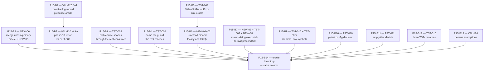

# Plan 15 — Phase 10 Audit Fixes: Test Coverage & Oracles

**Source catalogue:** `.ai/audit/99-validation/10-test-coverage-validated-findings.md` (validated against `a335b2a`, now 51+ commits back)
**Repository:** `vkdownloader` (`C:\py_exp\mko_vkideo`) · branch `main` · Windows · `uv`
**Prepared at:** HEAD `58bb7ce` (re-baselined; the tree moved three times during preparation)
**Blocks:** 14 · one commit each · all independently revertible
**Block namespace:** `P15-B1` … `P15-B14`. Plans 05–14 and 16 all mint bare `B1…Bn`; a bare `B3` means something different in every plan, so every identifier in this document is prefixed.

> ## Product Owner rulings folded in (Decisions A–D)
>
> These are **binding scope decisions**, not proposals. They close `D-2`, change two baselines, create one new oracle gap this plan owns, and reshape three blocks. Section references are given inline at each affected point.
>
> **Decision A — ffmpeg.** yt-dlp is the loader. ffmpeg is **not** a download/loader transport. Segment download stays; **ffmpeg stays as the segment merge engine.**
>
> - **Permanently deleted:** `DownloadMethod.FFMPEG`, `HLSDownloader`, `download_with_ffmpeg`, `_temp_argfile`, `_format_argfile`, `FfmpegProgress`, `ProgressParser`, `read_progress`, `_PROGRESS_KEY_HANDLERS`, and every ffmpeg-loader path. The retirement committed as `d572d96` is **correct and permanent**.
> - **Permanent product surface:** `check_ffmpeg_available`, `_merge_batch_segments`, `_perform_final_merge`, `_merge_segments_batched`, `_build_ffmpeg_concat_command`, `_required_merge_bytes`, `_check_merge_space`, `_await_ffmpeg_with_timeout`, `_MERGE_SPACE_MARGIN_BYTES`, `iter_process_lines`, `cancel_subprocess`, `cancel_ffmpeg_process`. **`ffmpeg_utils.py` can never be deleted whole.**
> - **`services/downloader.py`'s `_cookies_to_netscape` re-export** remains — it is a backward-compat re-export, unrelated to the loader, and `TST-002` does not touch it.
>
> **Decision B — exit code `3`.** `0` success · `1` download failure **and nothing else** · `2` usage error · `3` configuration error (`--max-retries` out of range **and** preamble failure) · `4`+ unallocated. **Plan 13 implements it.** Two blocks here live on it (§3 `P15-B5`, `P15-B2`).
>
> **Decision C — non-progress child output.** **One log record per line; stderr stays clean.** This rewrites a live test rather than relaxing it (§1.5 `NEW-06`).
>
> **Decision D — Python floor.** `requires-python` becomes `>=3.14`. **Plan 16 owns it.** The phase-10 answer is recorded in §2.6 and constrains `P15-B9`.

> **This plan implements; it does not redefine.** Every recommendation is subordinate to `.kilo/rules/project.md` (binding — `AGENTS.md` does not exist), to the plan-ownership rulings of the sibling plans, and to the corpus de-duplication rulings in §1.4. Where the catalogue's recommendation is stale, wrong, or duplicated against another plan, this plan records the correction and the evidence rather than restating it.
>
> **Production code is king.** No finding in this catalogue asks production code to change for a test. Nothing in this plan changes a line under `src/`.

---

## §1 Scope

### §1.1 How the scope was derived

Five inputs, in this precedence order:

1. **The corpus de-duplication rulings** — `TST-005`/`DEP-002` ratified as **one** defect, `VAL-125` states *"Do not land both fixes independently."*
2. **Re-measurement at the current HEAD.** The catalogue is 51+ commits stale; the ffmpeg retirement (`d572d96`) and two later commits changed the test tree materially. Every quantitative claim below was re-measured by the Planner, and **three did not survive** (§1.1.3).
3. **The sibling plans' ownership boundaries** — plans 10, 11, 12, 13, 14 and 16 each name specific oracles as theirs. Ceding a duplicate is not a scope reduction; it is the only way two plans can both land.
4. **The `## Findings` records** `TST-001` … `TST-016`, plus `VAL-120` … `VAL-125`.
5. **The retirement's own diff.** `d572d96` deleted 34 oracles and added 3 (net **−31**) and left five defects that are in **no** store and are claimed by **nobody** — `NEW-01` … `NEW-05` (§1.2.2). These are the highest-yield work in the plan precisely because they are unowned.

#### §1.1.1 Catalogue findings → verdict → IN/OUT → block

| ID | Severity | Class. | Verdict at HEAD `58bb7ce` | Disposition | Block |
|---|---|---|---|---|---|
| `TST-001` | CRITICAL | mandatory | **ALREADY_FIXED** — the `ffmpeg @argfile` secrecy guarantee's subject (`_temp_argfile`) was **deleted** by the retirement. The guarantee is vacuously satisfied and can no longer regress. | **OUT** (§1.3) | — |
| `TST-002` | CRITICAL | mandatory | **STILL_PRESENT, unchanged.** `tests/test_cookies.py` is 4 tests in one class over 137 measured lines; module constant `_DOMAIN = ".vkvideo.ru"` is the **domain** (dotted) shape, hard-coded by all three builders. The host-only shape is never constructed. | **IN** | **P15-B1** |
| `TST-003` | CRITICAL | mandatory | **ALREADY_FIXED** by `e2d65c4` — three green oracles now prove segment survival across a failed final merge. | **OUT** (§1.3) | — |
| `TST-004` | HIGH | mandatory | **STILL_PRESENT.** `TestValidateOutputPathTraversal::test_validate_output_path_rejects_traversal_even_if_resolved` names the post-resolution guard; its own comments name the pre-resolution guard; it asserts `match="Path traversal detected"`, a string **both** guards produce verbatim. | **IN** | **P15-B4** |
| `TST-005` | HIGH | mandatory | **STILL_PRESENT**, and ratified as **one** defect with `DEP-002`. Plan 16 owns it as `P16-B3`. | **OUT — ceded** (§1.3) | — |
| `TST-006` | MEDIUM | mandatory | **STALE CLAIM, corrected.** *"The `aiohttp` body has zero references in the test tree"* is **false**: `tests/test_segment_downloader.py` imports it and calls `_create_connector` **twice**. Only `_await_and_cancel` and `_parse_retry_after`'s HTTP-date branch remain unexercised. | **IN (residual only)** | **P15-B9** |
| `TST-007` | HIGH | advisory | **PARTIAL.** The subject-self half is fixed. **24** `patch("vkdownloader.cli.Settings")` sites and **37** `create_subprocess_exec` patch sites remain. | **IN (subprocess half)** | **P15-B7** |
| `TST-008` | HIGH | mandatory | **PARTIAL.** 25 `exit_code == 1` assertions now exist, but the `download` command's `VideoNotFoundError` arm still has **no** oracle. | **IN** | **P15-B5** |
| `TST-009` | LOW | advisory | **ALREADY_FIXED** — largely; the environment-file-path case is pinned. | **OUT** (§1.3) | — |
| `TST-010` | MEDIUM | advisory | **STILL_PRESENT.** No `[tool.pytest.ini_options]` exists. `asyncio_mode` is unstated, so `pytest-asyncio`'s installed default (**strict**) governs 174 markers by accident. | **IN** | **P15-B9** |
| `TST-011` | MEDIUM | advisory | **STILL_PRESENT.** `tests/integration/` ships an `__init__.py`, is packaging-asserted in `EXPECTED_SDIST_ENTRIES`, and contains **0 tests**. A stale `.pyc` proves a deleted sibling module. | **IN (decide)** | **P15-B9** |
| `TST-012` | LOW | advisory | **LARGELY FIXED** — the residual is folded into `TST-009`'s closure. | **OUT** (§1.3) | — |
| `TST-013` | MEDIUM | mandatory | **STILL_PRESENT, and the claim is now wrong.** The catalogue names **four** `0o600` oracles; there are **three**, because `test_temp_argfile_permissions_are_0600` and its subject `_temp_argfile` died with the transport. **Owner is plan 11 `P11-B3`**, which is now unblocked and has **two unsatisfiable acceptance criteria**. | **OUT — ceded + escalated** (§1.3, §2.5) | — |
| `TST-014` | MEDIUM | mandatory | **ALREADY_FIXED.** | **OUT** (§1.3) | — |
| `TST-015` | LOW | DOC-UPDATE | **STILL_PRESENT.** Three `TST-`-prefixed identifiers in the test tree collide with the audit's own prefix. The `VAL-105` half is plan 14's `P14-B13`. | **IN (test-tree half)** | **P15-B9** |
| `TST-016` | LOW | advisory | **STILL_PRESENT.** Eight graceful-degradation `except` arms never execute. Two of them are the merge-timeout sinks, which plan 10's `P10-B14` owns. | **IN (six arms)** | **P15-B9** |
| `VAL-120` | CRITICAL | mandatory | **STILL_PRESENT, two halves.** (a) The cross-phase contradiction between phase 10's non-reproduction and phase 08's `OUT-002` is live. (b) The residual oracle gap: no test asserts a log record's **presence**. | **IN (split)** | **P15-B2** + **P15-B3** |
| `VAL-121` | MEDIUM | mandatory | **ALREADY_FIXED.** | **OUT** (§1.3) | — |
| `VAL-122` | MEDIUM | mandatory | **ALREADY_FIXED.** | **OUT** (§1.3) | — |
| `VAL-123` | MEDIUM | mandatory | **ALREADY_FIXED.** | **OUT** (§1.3) | — |
| `VAL-124` | MEDIUM | mandatory | **STILL_PRESENT.** The reachability census has no exemption for the audit corpus, the phase catalogue, or a worktree. | **IN** | **P15-B9** |
| `VAL-125` | MEDIUM | advisory | **RESOLVED by ratification** — `DEP-002` absorbs `TST-005`. Plan 16 lands it as `P16-B3`. | **OUT — ceded** (§1.3) | — |

**Actionable set: 11 catalogue findings + 7 ruling-created = 18 subjects across `P15-B1` … `P15-B14`.**

#### §1.1.2 The retirement's oracle ledger

`d572d96` **killed 34 oracles and added 3** — net **−31**. **Decision A ratifies that retirement as correct and permanent**, so the ledger below is not a list of work to restore: it is the measured **permanent deficit** this plan partially offsets. `tests/test_ffmpeg_utils.py` survived **entirely**: 834 lines, 32 tests, byte-identical, because its import block already covered only group-C and group-A surface. That survival is the accident that made the boundary invisible — and under Decision A the group-C surface it protects is now **the product's only merge path**, which raises the stakes on `NEW-03` (§1.5).

| Lost class | Count | Includes a D-11 oracle? |
|---|---|---|
| `TestHLSDownloaderDownload` | 6 | — |
| `TestTempArgfile` | 5 | **yes — the fourth `0o600` guard** |
| `TestReadProgress` | 5 | — |
| `TestProgressParser` | 5 | — |
| `TestDownloadMethodLogging` | 3 | — |
| `TestPerformDownload` cases 5/6/7 | 3 | — |
| `TestFfmpegCookiePassing` | 2 | — |
| `TestFfmpegProgress` | 2 | — |
| `TestHLSDownloader` | 2 | — |
| `TestSslVerifyFfmpegWarning` | 1 | — |
| **Total** | **34** | |

Added: three tests in `TestMethodFfmpegRemoved` and one whole-`--help` substring test. **The three added tests do not cover the surface the retirement changed** — see `NEW-01`, `NEW-02`.

#### §1.1.3 Four claims measured rather than restated — **three did not survive**

**(a) `TST-006`'s "`aiohttp` has zero references in the test tree" is false.** Measured: `tests/test_segment_downloader.py` imports `aiohttp` and calls `_create_connector` **twice**. The real residual is two symbols, not a module: `_await_and_cancel` (`services/segment_downloader.py`) and the **HTTP-date branch** of `_parse_retry_after` (`services/downloader_throttle.py`, re-exported to `segment_downloader`). The four existing `_parse_retry_after` tests in `tests/test_downloader_throttle.py` cover the numeric-header path only. **Consequence: the block scope shrinks from "substitute `aiohttp.ClientSession` at its own name" (a large refactor) to two targeted tests.** Executing the catalogue's recommendation as written would be speculative scope inflation.

**(b) `TST-013`'s "four POSIX-only oracles" is three.** `test_temp_argfile_permissions_are_0600` and its subject `_temp_argfile` were removed by the retirement. Measured surviving permission oracles: **two** in `tests/test_config.py` and **one** in `tests/test_hls_downloader.py::TestCreateTempCookieFile::test_file_permissions_are_0600`, all `skipif(os.name == "nt")` with the same D-11 reason. The finding's prescription — *substitute `os.chmod` itself and assert the call is made with `0o600`* — is unaffected by the count and remains the right remedy, but **plan 11 `P11-B3` is the owner** and its acceptance criteria now name a subject that no longer exists (§2.5).

**(c) "No test anywhere reads the log file" is false as worded — and the correction *strengthens* the finding.** `tests/test_cli.py` contains exactly one log-content read: `log_contents = log_path.read_text(...) if log_path.exists() else ""`, asserted as `assert "download_dir_empty_string_using_default" not in log_contents`. So a reader **exists**; what does not exist is a **positive** assertion on record presence. The residual is narrower and cheaper than stated: `P15-B2` **extends an existing read** rather than building one, and the `VAL-120` premise should be restated as *"no test asserts that a record the product emitted is present in the log file."*

**(d) The baseline floor moved again.** `HEAD` was `435ba0b` when this plan opened and is `b0fb032` now. Measured pass/skip counts differ from the brief (§2.1). **The floor in this plan is the measured figure, not the inherited one.**

### §1.2 IN — the scope

#### §1.2.1 Catalogue findings

1. **`TST-002`** (CRITICAL · mandatory) — the host-only cookie shape must be driven through the real consumer, not the dotted shape that the format cannot reject.
2. **`TST-004`** (HIGH · mandatory) — the traversal test must be named for the guard it actually reaches, and the class docstring must stop claiming coverage of the one it does not.
3. **`TST-006` residual** (MEDIUM · mandatory) — `_await_and_cancel` and `_parse_retry_after`'s HTTP-date branch.
4. **`TST-007` subprocess half** (HIGH · advisory) — the patch sites that substitute the very thing they name.
5. **`TST-008` residual** (HIGH · mandatory) — the `download` command's `VideoNotFoundError` arm.
6. **`TST-010`** (MEDIUM · advisory) — the pytest configuration must be declared, not inherited from an installed plugin's default.
7. **`TST-011`** (MEDIUM · advisory) — an empty, shipped, manifest-asserted tier.
8. **`TST-015` test-tree half** (LOW · DOC-UPDATE) — three `TST-` identifiers in the test tree.
9. **`TST-016` six arms** (LOW · advisory) — the graceful-degradation arms phase 10 owns.
10. **`VAL-120` forward half** (CRITICAL · mandatory) — a positive log-record oracle.
11. **`VAL-124`** (MEDIUM · mandatory) — the reachability-census exemption.

#### §1.2.2 Retirement-created findings — in no store, claimed by nobody

| # | Sev. | Defect | Block |
|---|---|---|---|
| **`NEW-01`** | HIGH | `TestMethodFfmpegRemoved::test_download_method_ffmpeg_rejected` and its `batch` sibling assert **only** `exit_code == 2`. Exit 2 is Typer's generic usage-error code. **Delete the whole `--method` option and all three new tests still pass.** Plan 10's `P10-B10` asked for the exit code **and** the absence of `ffmpeg` in the help text; the message-absence half landed only as a separate whole-`--help` substring test, which is a different assertion about a different scope. | **P15-B6** |
| **`NEW-02`** | MEDIUM | `test_method_help_text_excludes_ffmpeg` asserts `"ffmpeg" not in result.output.lower()` over the **entire** help output rather than the `--method` value list. It cannot localise a regression and would fail on an unrelated mention. | **P15-B6** |
| **`NEW-03`** | MEDIUM | `TestMergeSegmentsBatchedRealExecution` is named for real execution but patches `asyncio.create_subprocess_exec` with a bare `MagicMock(spec=asyncio.subprocess.Process)` and **does not use the `_failing_exec` helper** that materialises the output file. This is the artefact's own defect class — *"a test that substitutes the very thing it names"* — applied to the surviving group-C surface. | **P15-B7** |
| **`NEW-04`** | HIGH | `check_ffmpeg_available` was an irreconcilable **three-way** conflict: plan 10 `P10-B10` **preserves** it and forbids deletion, plan 12 `§2.4.5` says it **retires**, and the committed retirement **preserved** it. Its only behavioural oracle `TestFfmpegAvailabilityCheck` tests a symbol a decision said to delete. | **CLOSED by Decision A** — the symbol is **permanent product surface** and plan 12 was wrong. Reclassified: not a hazard, a **live oracle** (§2.4, §3 `P15-B8`). |
| **`NEW-05`** | MEDIUM | Plan 14 `§2.2` pins a **4**-skip ceiling that is now **3**, lowered by an unrelated commit, and one of its four named subjects no longer exists. | **IN** — collapsed into `P15-B8` (§3). |
| **`NEW-06`** | HIGH | **Created by Decision A.** The ruling makes ffmpeg a **required component of the segment path**, but `_merge_batch_segments` and `_perform_final_merge` have **no `OSError` arm**: a missing binary produces an uncaught `FileNotFoundError` at merge time. | **IN** — the **oracle** lands here, the arms land in plan 16 `P16-B9`. |
| **`NEW-07`** | HIGH | **Created by Decision B.** The preamble-failure exit status has **no oracle at all**, which is why `OUT-001`'s status half stayed open. | **IN** — folded into `P15-B2` (§3), no new block. |
| **`NEW-08`** | MEDIUM | **Created by Decision C.** The live test asserting `echo=False` on a **non-progress** line emits no record now asserts the **wrong behaviour**. It must be **rewritten**, not relaxed. | **IN** — folded into `P15-B7` (§3), single named owner. |

`NEW-01` and `NEW-02` are **one block**, not two: they are the same class, in the same file, about the same option, and `NEW-02`'s fix (scope the assertion to the `--method` value list) is precisely what makes `NEW-01`'s presence-oracle possible. Splitting them would put two edits to one test class in two commits.

### §1.3 OUT

| ID / item | Closing evidence | Why it is out |
|---|---|---|
| `TST-001` | subject deleted by `d572d96` | The CRITICAL `ffmpeg @argfile` secrecy guarantee's subject no longer exists. The finding is vacuously satisfied. **Re-filing it would resurrect a deleted transport.** |
| `TST-003` | `e2d65c4` | Three green oracles prove segment survival across a failed final merge. |
| `TST-009` | — | Largely fixed; folded into `TST-012`'s closure. |
| `TST-012` | — | Largely fixed. |
| `TST-014` | — | Fixed. |
| `VAL-121`, `VAL-122`, `VAL-123` | — | Fixed. |
| **`TST-005`** | ratified merge, `VAL-125` | **Ceded to plan 16 `P16-B3`.** `VAL-125`: *"Do not land both fixes independently."* Two commits inserting into the same single-`run:` step list of the same 53-line workflow produce two identical steps or a merge conflict. **Land one step, not two.** See the rollout dependency in §5.2 R-1. |
| **`VAL-125`** | the ruling it produced | The finding is *satisfied by* the ratification. Nothing to implement here. |
| **`TST-013`** | owner is plan 11 `P11-B3` | **Ceded.** The finding names the same oracles the owner names. **This plan's obligation is the escalation in §2.5, not a second implementation.** |
| **`TST-007`'s `cli.Settings` half** | owner is plan 14 `P14-B4` | **Ceded.** 24 sites, one convention, one owner. A second pass would double the diff and halve the review. |
| **`TST-015`'s `VAL-105` half** | owner is plan 14 `P14-B13` | **Ceded.** Two of the five sites point into `.ai/`, which the sdist forbids. |
| **`TST-016`'s two merge-timeout sinks** | owner is plan 10 `P10-B14` | **Ceded.** |
| **`TST-006`'s `aiohttp.ClientSession` substitution** | §1.1.3(a) | **Falsified premise.** The module *is* referenced. Executing the recommendation as written is speculative refactoring of passing tests. |

| **`NEW-04` / the `check_ffmpeg_available` escalation** | **Decision A** | **CLOSED.** The Product Owner ruled the symbol is **permanent product surface** and that **plan 12 was wrong**. There is no three-way conflict left, so there is nothing to escalate and no convergence block to justify. `P15-B8` is collapsed — see §1.6. |

**Named residual that must not be lost:** `NEW-05` — plan 14's skip ceiling is **wrong by one** and names a dead subject.

**Named residual under Decision A:** the ruling that keeps `check_ffmpeg_available` **also created the gap this plan now owns** — `NEW-06` in §1.5. Decision A closes `NEW-04` and opens `NEW-06`; the two are the same coin.
### §1.4 Deferred

| # | Deferred item | Why | Default | Owner |
|---|---|---|---|---|
| **DEF-1** | A **positive** oracle that a failing download's log records are parseable JSON. | `OUT-002` (phase 08) is the surviving finding on this subject and plan 13 owns its product fix. Any oracle written here would have to assert today's broken shape as a characterisation, and would then fail the day plan 13 lands — the worst of both worlds. | `P15-B2` lands the **positive oracle on the success path only**, which is true today and stays true after plan 13. The failure-path oracle is left to `OUT-002`'s owner. | Plan 13 / `OUT-002`. |
| **DEF-2** | Owner-only confinement on Windows — all three `0o600` oracles `skipif(os.name == "nt")`, and no test asserts `os.chmod(…, 0o600)` is even **called**. | Ceded with `TST-013` to `P11-B3`, which owns the identical prescription (substitute `os.chmod`, assert the request). | Nothing here. Recorded so it is not lost when the ceded block's two stale acceptance criteria are repaired. | Plan 11 `P11-B3`. |
| **DEF-3** | A **coverage tool** or threshold. | `VAL-125`/`P16-B3` absorbs the measurement axis. A threshold is a policy the project has never set. | `P15-B14` publishes a **recorded inventory** — a regression baseline that is not a gate and not a threshold. This is the one element phase 10 can add without colliding with `P16-B3`. | Plan 16 `P16-B3` (tool/threshold); this plan (inventory). |
| **DEF-4** | The `ART-013` `.ts.tmp` residue and `ART-009`'s `repo_root` mis-derivation. | Phase 07 findings; plan 12 owns both (`P12-B6`, `P12-B2`). Listed in the §2.4 inventory as **no oracle** so the gap is visible, not so it is fixed here. | Named, not actioned. | Plan 12. |
| **DEF-5** | The **exit-code `3` implementation** — reserving `3` for configuration errors and re-partitioning `1` to mean download failure **and nothing else**. | **Decision B assigns it to plan 13.** Writing it here would make this plan a second writer of the CLI's exit-status contract, which plan 13 owns together with the `docs/99-reference/cli-reference.md` edit. | This plan writes the **oracles** only (`NEW-07` in `P15-B2`, and the partition half in `P15-B5`), and states their expected outcomes precisely enough for plan 13 to implement against. | Plan 13. |
| **DEF-6** | The **`OSError` arms** on `_merge_batch_segments` and `_perform_final_merge`. | `NEW-06`. Production code, and **plan 16 `P16-B9` owns it**. | `P15-B8` carries the **oracle**; §3 gives it a two-route shape so the suite is green whether or not `P16-B9` has landed. | Plan 16 `P16-B9`. |
| **DEF-7** | The **Decision C record emission** for non-progress child lines. | Production behaviour. | `NEW-08`: `P15-B7` **rewrites** the existing test to assert the ruling rather than relaxing it. If the emitting code has not yet changed, the rewritten test is written against Decision C's contract with the same two-route shape as `DEF-6`. | The plan that lands the product half. |

**Open decisions carried into execution** — stated with defaults and criteria in §3 and §6:

| # | Open decision | Block |
|---|---|---|---|
| **D-1** | How `TST-002`'s host-only oracle is expressed so the suite stays green while the gap is recorded and **self-removing** when plan 11's `B1` lands. | `P15-B1` |
| **D-3** | `TST-011`'s route: drop-and-delete, write-the-tests, or defer-and-escalate. | `P15-B11` |
| **D-4** | `asyncio_mode = "strict"` (a no-op that names today's behaviour) vs `"auto"` (a behaviour change). Constrained by Decision D — see §2.6. | `P15-B10` |
| **D-5** | The breadth of the `TST-007` subprocess-patch conversion. | `P15-B7` |
| **D-6** | Whether `.ai/audit/10-test-coverage/findings.md` is editable by this plan or frozen as a validated artefact. | `P15-B3` |
| **D-7** | Whether `P15-B2`'s log-reader belongs in `tests/test_cli.py` (where the runner is) or in a shared `tests/conftest.py` helper, given plan 13's concurrent work in the same file. | `P15-B2` |
| **D-8** | Whether `NEW-07`'s exit-code distinguishability is written as **one parameterised table** (recommended) or as three separate tests. | `P15-B2` |
| **D-9** | Whether `NEW-06`'s missing-binary oracle is written **now, against Decision A's contract** (green only if `P16-B9` has landed) or **against today's behaviour** (green now, red after `P16-B9`). | `P15-B8` |

**`D-2` is CLOSED and deleted from this list.** Decision A ruled `check_ffmpeg_available` is **permanent product surface** and that plan 12's retirement position was wrong. The three-way conflict this decision was escalated for no longer exists, and `P15-B8`'s escalation remit is gone with it (§1.6). There is nothing left to decide about that symbol's fate.

**Namespace rule — `VAL-` is flat, validation-store-only.** ~1200 occurrences, 53 distinct identifiers, **three mutually exclusive definitions of `VAL-003`**, and `VAL-001` alone at 105 occurrences. `VAL-120`–`VAL-125` are the best-behaved band. **This plan mints nothing in `VAL-`.** `NEW-01`…`NEW-08` are **plan-local labels for defects that exist in no store**, documented here and in no other namespace; a store entry for them belongs to whoever next re-runs phase 10, not to this plan.


### §1.5 Ruling-created findings

These did not exist when the catalogue was validated. Each is a defect **created or exposed** by a Product Owner ruling, and each is owned here for its **oracle** only.

#### `NEW-06` — The merge engine has no `OSError` arm (HIGH)

**Decision A makes ffmpeg a required component of the segment path.** That is the right call and it has a consequence the ruling cannot itself discharge: `_merge_batch_segments` and `_perform_final_merge` have **no `OSError` arm**. On a machine without ffmpeg — the exact machine Decision A says must have it — the merge raises an **uncaught `FileNotFoundError`** at merge time rather than a classified failure with a message that names the missing tool.

**Ownership is split deliberately, and the split is the point:**

| Half | Owner | Content |
|---|---|---|
| The **`OSError` arms** in `services/ffmpeg_utils.py` | **plan 16 `P16-B9`** | Production code. Plan 16 owns it. |
| **The oracle** that proves the behaviour afterwards | **this plan** (`P15-B8`) | A test that drives a missing-binary merge and asserts the classified outcome. |

**Why the oracle must land *with* the fix, not after it.** If the oracle lands after, it is a test written against an already-fixed behaviour, and nothing in the sequence forces `P16-B9` to produce the behaviour the test demands. `P15-B8` therefore carries the oracle in the **same sequence position** as the fix's contract: its acceptance criteria state the expected outcome precisely enough that `P16-B9`'s Implementor can implement against them without reading this plan, and `D-9` decides the route for the case where `P16-B9` has not landed yet. **A block permanently red until another plan lands is not acceptable** — hence the two-route shape in §3.

**Not a production change here.** Project rule 2, and no production line changes in this plan at all.

#### `NEW-07` — The preamble-failure exit status has no oracle (HIGH)

Created by **Decision B**. A configuration error must be distinguishable from a download failure, and the ruling assigns `3` to it. Today **no test asserts the preamble-failure exit status**, which is exactly why `OUT-001`'s status half was open. The oracle lands in **`P15-B2`**, which already writes `tests/test_cli.py` and already reads the log file — a fourteenth block for a fourth assertion in the same class would be fragmentation, not isolation.

**The three-vs-one question, decided here:** `3` versus `1` versus `2` distinguishability is **one test, not three**, when written as a **table** — one parameterised case per code, asserting that the *same* invocation shape yields a *different* status, and that each status means **exactly one** thing. That exclusivity is the assertion that makes `1` meaningful. Three separate tests would each assert one fact and none would assert the partition, which is precisely the property Decision B was written to establish. `P15-B5` needs the same shape for the same reason, from the other side.

#### `NEW-08` — The `echo=False` non-progress test asserts the wrong behaviour (MEDIUM)

**Decision C requires one log record per line and a clean stderr.** There is a **live test** — in `tests/test_hls_downloader.py`, documented as *"echo=False on a non-progress line writes nothing and emits no debug log"* — that pins the **opposite** of the ruling. It is the same test plan 11 identified.

**It must be rewritten, not relaxed.** Relaxing it (`xfail`, `xfail_strict`, or deletion) would remove the only evidence that the ruling was applied. Rewriting it asserts the ruling: a non-progress line with `echo=False` produces **exactly one log record** and **nothing on stderr**. The assertion *gains* a positive half under Decision C where it previously had only a negative one — the same shape as `P15-B2`'s presence oracle.

**Single named owner: `P15-B7`.** The test lives in `tests/test_hls_downloader.py`, which this plan already writes, and `P15-B7` already owns the merge-surface oracles `NEW-03` and `TST-007` land on. **Plan 11 must not also edit it.** Ceding it to plan 11 was rejected: the file is this plan's, the rewrite is a merge-surface test under Decision A, and two plans editing one test is the hazard §4.4 exists to prevent. §3 `P15-B7` records the ownership so plan 11's owner can cite rather than duplicate.

### §1.6 `P15-B8` collapsed and re-scoped

`P15-B8` existed to escalate `D-2` (the `check_ffmpeg_available` three-way conflict) and carry `NEW-05`'s stale skip ceiling. **Decision A resolves `D-2`.** What remains splits by kind:

| Item | Kind | Where it now lives |
|---|---|---|
| `NEW-04` — the three-way conflict | **Resolved by ruling.** Plan 12 was wrong; the symbol is permanent surface. | **Gone.** No escalation exists. `TestFfmpegAvailabilityCheck` is reclassified as a **live oracle for permanent surface** (§2.4) and must stay green and unmodified. |
| `NEW-06` — no `OSError` arm on the merge engine | **A new defect created by the ruling.** | **`P15-B8`, re-scoped.** |
| `NEW-05` — plan 14's 4-skip ceiling is 3 | **A stale number in another plan's text.** | **`P15-B8`, re-scoped** — reported, not edited. Not worth a block of its own; folded into the commit it now shares. |

**`P15-B8` is re-scoped, not deleted: "one oracle for the permanent merge surface's missing-binary path, plus the `NEW-05` correction."** It is **not** a convergence block, it **does** write code, and it no longer exists to record that a conflict was resolved. **A block whose only purpose is to record a resolved conflict would not be a block** — that is not what this one is now.

### §1.7 No renumbering was required

**No renumbering was required.** `P15-B8` was **re-scoped, not removed**, so the plan remains **fourteen blocks**, `P15-B1` … `P15-B14`, and every block keeps the number it was first assigned. Only two blocks changed **subject**, not position:

| Block | Number | What changed |
|---|---|---|
| `P15-B7` | unchanged | absorbed `NEW-08` (the Decision C rewrite) and the §2.1.2 format precondition |
| `P15-B8` | unchanged | re-scoped from convergence-and-escalation to the `NEW-06` merge oracle |

**A block whose only remaining purpose was to record that a conflict had been resolved would not be a block** — but `P15-B8` did not land in that state. Decision A closed the `check_ffmpeg_available` conflict *and* opened the `NEW-06` gap, and the block was re-scoped onto the gap. It still writes code, still has its own commit, and is still independently revertible.

---

## §2 Baseline

**Measured by the Planner, not inherited.** `HEAD` moved three times during preparation: `435ba0b` → `b0fb032` → **`58bb7ce`**. **Every figure below is from `58bb7ce`**, where the `src/` and `tests/` trees are clean. The re-baseline is required because **two gates moved**, not one.

### §2.1 Gates, re-run

| Command | Result at `58bb7ce` | Exit |
|---|---|---|
| `uv run pytest -q -rs` | **see §2.1.1 — re-measured** | **0** |
| `uv run pytest tests/test_packaging.py -q --collect-only` | **14 tests collected** | 0 |
| `uv run ruff check src tests` | All checks passed! | **0** |
| `uv run ruff format --check src tests` | **RED — 1 file would be reformatted, 53 already formatted** (§2.1.2) | **1** |
| `uv run mypy src` | Success: no issues found in 31 source files | **0** |
| `uv run mypy src tests` | delta gate only — errors in test files at baseline | 1 |

#### §2.1.1 The corrected floor

**Floor: `752 passed, 3 skipped`, `755 collected`.** This is **+3** on the previous measurement of `749 passed / 3 skipped / 752 collected`, and it moved for reasons unrelated to this plan.

**Skip floor is 3, not 4 — unchanged, and unchanged for a structural reason.** The three are `tests/test_config.py` ×2 and `tests/test_hls_downloader.py::TestCreateTempCookieFile::test_file_permissions_are_0600`, all `skipif(os.name == "nt")` with the same D-11 reason. The fourth — `test_temp_argfile_permissions_are_0600` — died with `_temp_argfile` in the retirement. **Decision A ratifies that deletion**, so the skip ceiling is **permanently 3** and will never return to 4. **A fourth skip is a review-blocking event.**

**`xfail` is not a skip and is not a pass.** Any block adding a strict `xfail` (see **D-1**) changes the reported counts: `collected − xfailed − skipped = passed`. The floor rule must be applied to that identity, and the xfail count may only rise by a **named** strict xfail whose reason cites the owning finding.

**CI arithmetic:** `755 collected − 14 packaging tests =` **741 tests never execute in CI** (plan 16's `P16-B3` measured 736 at `435ba0b` and 738 at `b0fb032`).

**`mypy`** is `strict = true` with one override (`module = "vkdownloader.cli"`, `disallow_untyped_decorators = false`) and `ignore_missing_imports = true`. **Bare `uv run mypy` has no default target** — it is not a usable gate; the gates are `mypy src` (must stay 0) and `mypy src tests` (delta only).

#### §2.1.2 `ruff format --check src tests` is RED — precondition, narrow fallback

**On a clean tree at `58bb7ce`, the format gate fails.** This is a change from the previous baseline, where it was green.

```
Would reformat: tests\test_hls_downloader.py
1 file would be reformatted, 53 files already formatted
```

**The scope is exactly two `with patch(...)` blocks**, both inside `tests/test_hls_downloader.py::TestYtDlpSubprocessShutdown`, both of the form:

```
with patch(
    "vkdownloader.services.ytdlp_downloader.logger"
) as mock_logger:
```

collapsed by the formatter to a single line. Nothing else in the file — and nothing in any other file — is unformatted.

**Why this is a precondition and not a finding.** A red gate on a clean tree means **no block in this plan can report a green format run** until it is addressed, and a block that reformats the whole file would sweep in whatever else the next few plans touch. This is scoped exactly as plan 13 scoped it: **the two blocks only, never a blanket reformat.**

| Rule | Statement |
|---|---|
| **Narrow fallback** | Collapse **only** those two `with patch(...)` call sites in `TestYtDlpSubprocessShutdown`. A targeted edit to each site. |
| **Prohibited** | `uv run ruff format tests/` or `uv run ruff format .` as a fix step. **Never** a whole-file reformat. |
| **Prohibited** | Treating a whole-file reformat as "just the formatter" when `git diff` then shows changes to tests this plan never intended to touch. |
| **Who fixes it** | **Whichever block first writes `tests/test_hls_downloader.py`.** That is `P15-B7`. The fix is **in scope for `P15-B7`**, in its own right, because that block cannot otherwise satisfy §7.1. |
| **Standing gate** | §7.1 keeps `ruff format --check src tests` as a per-block command. After `P15-B7` lands, the expected result is **all files already formatted**, and a block reporting red has reported an unfixed precondition. |

### §2.2 The packaging manifests

`tests/test_packaging.py` pins **four** frozensets against a **real build**:

| Constant | Size | Asserts |
|---|---|---|
| `EXPECTED_SDIST_ENTRIES` | **73** | sdist entry set |
| `EXPECTED_WHEEL_ENTRIES` | **32** | wheel entry set |
| `BUILDER_ADDED_SDIST_ENTRIES` | **2** | `.gitignore`, `PKG-INFO` |
| `EXPECTED_DIST_INFO_ENTRIES` | **4** | `METADATA`, `RECORD`, `WHEEL`, `entry_points.txt` |

**Any new file under `src/`, `tests/` or `docs/` requires editing the relevant frozenset in the same commit.** `tests/integration/__init__.py` is one of the 73 sdist entries — which is exactly why an empty directory is a *packaging-asserted promise* (`TST-011`). `pyproject.toml`, `uv.lock`, `README.md`, `.env.example`, `.python-version` are already listed, so `P15-B9`'s `pyproject.toml` edit needs **no** frozenset change.

### §2.3 Test layout and the coupling model

20 test modules. Every one imports its subjects **by name at module scope**; the suite is coupled by **import, not by interface**.

- **A renamed private symbol breaks collection of a whole module.** One orphaned decorator once took out **144 tests**.
- **`create=True` appears 0 times in `tests/`.** This is a **feature** for rename detection (a stale patch target fails loudly) and a **hazard** for symbol retirement (a deletion breaks a module's entire collection, not one test). `downloader.py`'s `__all__` carries **25** re-exported names; a deleted entry breaks every patch string that resolves through it.
- **`asyncio_mode` is unstated**, so `pytest-asyncio`'s installed default (**strict**) governs **174** markers. Every async test already carries an explicit `@pytest.mark.asyncio`; nothing depends on the default's *absence*, so declaring `strict` is a no-op that removes the accident (**D-4**).
- **Per-file ownership is de facto.** `check_ffmpeg_available`'s and `iter_process_lines`'s only oracles **both** live in `tests/test_hls_downloader.py` while their subjects live in `services/ffmpeg_utils.py`. `tests/test_ffmpeg_utils.py` is the only file matching the module's surviving content — and that split is precisely how the group-A/C boundary became invisible: the retirement left the correctly-named file byte-identical and orphaned every oracle that had migrated to the other one.
- **House-rule divergences to record, not to introduce.** Rule 11 requires Polars for data processing; the project has **no** Polars and all test data is plain `list` / `dict` / `namedtuple`. Rule 12 prescribes stdlib `logging`; the codebase uses **structlog** — so the correct patch target is **`module.logger.<level>`**, not `module.logging.<level>`.
- **English only.** `AGENTS.md` does not exist; `.kilo/rules/project.md` is binding.

### §2.4 The oracle inventory — this plan's core deliverable

Classification is per subject area: **REAL** (a real executable oracle), **INDIRECT** (asserts a call or a return, never the body), **NONE**.

| Subject area | Class | Detail |
|---|---|---|
| Group-C merge engine | **REAL** | `TestMergeFreeSpaceProbe` pins the `2×` multiplier in **3** exact assertions; `TestMergeSegmentsBatched::test_uses_correct_batch_size` records real concat groupings through a `side_effect` exec stub that materialises the output file. **Under Decision A this is the product's only merge path and it is permanent surface** — which raises the cost of `NEW-03` from cosmetic to structural. |
| `iter_process_lines` | **REAL** | 10 tests. Permanent surface under Decision A. |
| `cancel_subprocess` + its alias | **REAL** | 4 tests; hardened by `b0fb032`. Permanent surface under Decision A, alongside `cancel_ffmpeg_process`. |
| TLS connector ceiling | **REAL** | `tests/test_segment_downloader.py` drives `_create_connector` twice. |
| Cookie serialiser → consumer | **REAL but one-sided** | 4 round-trip tests, all through the **dotted** shape only. `TST-002`. |
| **`check_ffmpeg_available` — RE-CLASSIFIED** | **REAL (permanent surface), with one stated blind spot** | **Decision A ruled the symbol permanent and plan 12 wrong**, so `TestFfmpegAvailabilityCheck` is **no longer a hazard — it is load-bearing coverage for permanent product surface, and it must stay green and unmodified.** No block renames, weakens or deletes it. **The blind spot, stated precisely: `services/downloader.py` calls `check_ffmpeg_available()` and discards the return value**, so the oracle asserts the **return type** and the **module cache** — it does not assert that anything acts on the result, because nothing does. Its other 10 patches in `tests/test_downloader.py` remain **suppressions, never assertions**. |
| **Missing-binary merge (`NEW-06`)** | **NONE** | **Created by Decision A.** `_merge_batch_segments` and `_perform_final_merge` have **no `OSError` arm**; a missing binary raises an uncaught `FileNotFoundError` at merge time. Decision A makes ffmpeg *required*, so this is the most likely real failure of the required component. **Arms: plan 16 `P16-B9`. Oracle: `P15-B8`.** |
| **Preamble-failure exit status (`NEW-07`)** | **NONE** | **Created by Decision B.** No test asserts the preamble-failure exit status, which is why `OUT-001`'s status half was open. Decision B assigns it `3`. **Oracle: `P15-B2`.** |
| **Non-progress child output (`NEW-08`)** | **REAL but WRONG** | **Created by Decision C.** A live test in `tests/test_hls_downloader.py` asserts `echo=False` on a non-progress line *writes nothing and emits no debug log*. Decision C requires **one log record per line**. The test must be **rewritten**, not relaxed. **Owner: `P15-B7`.** |
| `perform_download`'s ffmpeg patches | **INDIRECT** | All **10** `check_ffmpeg_available` patches are suppression sites. |
| `batch_merge_timeout` / `final_merge_timeout` / `merge_space_probe_failed` log events | **INDIRECT** | The events are **read back**, never **entered**. |
| Signal-handler registration | **INDIRECT** | Read back from `signal.signal` calls. |
| `--method ffmpeg` rejection | **NONE** | Exit code only. Delete the option; three tests pass. `NEW-01`. |
| **Stream discipline** (human message → stderr, record → file) | **NONE** | `CliRunner()` is **module-level** with merged streams, and `mix_stderr` appears **0** times in `tests/`. Nothing can assert the split. **This is exactly the surface plan 11 `P11-B6` needs.** |
| **Log-file content, positive** | **NONE** | One `read_text` exists but asserts only **absence**. `VAL-120`. |
| Merge entry guard reaching a real ffmpeg | **NONE** | |
| `_await_and_cancel` | **NONE** | Referenced in comments and type-level assertions; no body execution. |
| `_parse_retry_after`'s HTTP-date branch | **NONE** | Four tests cover the numeric-header path only. |
| `ART-013`'s `.ts.tmp` residue | **NONE** | `os.replace` appears **0** times in `tests/`. Plan 12 owns. |
| `ART-009`'s `repo_root` mis-derivation | **NONE** | The test mocks `Path.resolve`, so `relative_to` always succeeds. Plan 12 owns. |
| Owner-only confinement on Windows | **NONE** | All three oracles skip; no test asserts `os.chmod(…, 0o600)` is called. Plan 11 owns. |
| Any regression net on the retirement itself | **NONE** | See `NEW-01` … `NEW-04`. |

**Measured support figures:** `patch("vkdownloader.cli.Settings")` — **24** sites (plan 14 owns). `create_subprocess_exec` patch sites — **37** (34 exact-string, 3 `patch.object`) across `tests/test_hls_downloader.py` (32) and `tests/test_ffmpeg_utils.py` (22 lines). `mix_stderr` — **0**. `os.replace` in `tests/` — **0**. `create=True` in `tests/` — **0**. `aiohttp` in `tests/` — 4. `chmod` in `tests/` — 4 (3 skip reasons, 1 real `os.chmod(log_file, 0o644)`). `logger.exception` in `src/` — **3** (`services/batch_downloader.py`, `cli.py` ×2), which is what `VAL-120`'s two live non-JSON sites consist of.

**`TestFfmpegAvailabilityCheck` must stay green and unmodified.** Recorded here as a **standing constraint on every block**, not only on those that touch `ffmpeg_utils`: it is the sole behavioural oracle for a symbol Decision A made permanent, and a block that "improves" its `isinstance(result, bool)` assertion would be removing the only thing standing between a deleted probe and an undetected regression. Plan 12's `ART-007` half — *"zero runnable oracles"* — is closed by Decision A for this symbol.

`P15-B14` republishes this table as a maintained artefact and refreshes it after the other blocks land.

### §2.6 Decision D — the Python 3.14 floor: what it changes for phase 10

`requires-python` becomes `>=3.14`; **`target-version = "py312"` becomes `py314`**. **Plan 16 owns both.** Only what touches this phase is recorded here.

**Measured at `58bb7ce`:** `requires-python = ">=3.12"`, `target-version = "py312"`, `pytest-asyncio>=0.23.0` declared, **installed `pytest-asyncio 1.4.0`** (`Requires-Python: >=3.10`), installed `pytest 9.1.1` (`Requires-Python: >=3.10`).

| Question | Answer |
|---|---|
| Does 3.14 change **`asyncio_mode`** (`D-4`)? | **No.** `strict` and `auto` both exist in the installed 1.x plugin and neither is version-gated on the interpreter. **`D-4` is unaffected.** |
| Does `pytest-asyncio`'s declared floor support 3.14? | **The installed version does** (1.4.0, `>=3.10`). **The declared floor does not guarantee it:** `>=0.23.0` predates 3.14 by roughly a year and has no 3.14 CI. A resolver may legally select 0.23.0 on a 3.14 floor. **That is plan 16's dependency edit;** `P15-B9` (was `B10`) records it and does not change `pyproject.toml`'s dependency block. |
| Does an **async-test convention** this plan relies on change under 3.14? | **One does, and it is the reason `P15-B10` must measure before declaring.** Python 3.14 removes the implicit event-loop creation from `asyncio.get_event_loop()`. The suite's **174** `asyncio_mode`-dependent markers all run under an explicit `pytest-asyncio` loop, so they are structurally safe — **but any test that calls `asyncio.get_event_loop()` outside a running loop, or constructs its own loop, would now raise rather than warn.** The `Researcher` brief for `P15-B10` includes a search for exactly those two patterns. **If any exist, they are a plan-16 subject (the 3.14 floor), reported not fixed here.** |
| Does 3.14 change anything else this plan asserts? | No path, subprocess, filesystem or `structlog` behaviour this plan's oracles depend on. The `os.chmod` blind spot (`DEF-2`) is a Windows property, not a version property, and is unchanged. |

**The one constraint Decision D places on this plan:** `P15-B10`'s `[tool.pytest.ini_options]` block declares **test-suitesttings**, so it must declare a **target consistent with 3.14**. It does not set `python_requires` or `target-version` — those are `pyproject.toml`'s build and ruff sections and belong to plan 16 — but it must not hard-code anything that contradicts them, and its `asyncio_mode` value must be one the 3.14-compatible plugin offers. **`strict` satisfies both** (see `D-4`).

### §2.5 Collision table — hard boundaries against sibling plans

| Subject | This plan | Sibling owner | Rule |
|---|---|---|---|
| `TST-005` / `DEP-002` | **nothing** | **plan 16 `P16-B3`** | *"Do not land both fixes independently."* `VAL-125` ratified. **One step.** |
| `TST-013`'s three `0o600` oracles | **nothing** | **plan 11 `P11-B3`** | **Escalation, not implementation.** `P11-B3` is now unblocked and **two of its six acceptance criteria are unsatisfiable as written**: they name four guards and at least one deleted subject. **The owner must repair them; this plan must not edit plan 11's file to do it.** Recorded as §5.4 X-4. |
| `TST-016`'s two merge-timeout sinks | **nothing** | **plan 10 `P10-B14`** | Six non-merge arms only. |
| `TST-007`'s 24 `cli.Settings` sites | **nothing** | **plan 14 `P14-B4`** | Subprocess half only. |
| `TST-015`'s two `VAL-105` sites | **nothing** | **plan 14 `P14-B13`** | Test-tree half only. |
| `TST-004` | **`P15-B4` owns the test-side rename + class docstring** | **plan 12 `P12-B1` / `P12-B2` own `utils/security.py`** | **DANGER — a duplicate oracle.** Both plans edit `tests/test_security.py` and the same class docstring. **One owner per assertion: this plan owns the rename, the comment relocation and the docstring sentence; plan 12 owns every new oracles it adds.** Serialised (§4.3). `P15-B4` must re-read the class **after** `P12-B1`/`P12-B2` land and must not delete a test `P12-B1` has extended. |
| `TST-002` | **`P15-B1` owns the test** | **plan 11 `P11-B1` owns the product** (`SEC-009`, the hard-coded include-subdomains column) | **A correct complement, not a duplicate.** Same mechanism, two owners, cross-referenced. `P15-B1` writes the test; `P11-B1` makes it green. |
| `NEW-01` / `NEW-02` | **`P15-B6`** | plan 10 `P10-B10` (historical) | Plan 10 asked for the exit code **and** the message-absence half; only the first landed as an assertion on the option. `P15-B6` completes it locally. |
| **`NEW-04` — `check_ffmpeg_available`** | **nothing to escalate — CLOSED** | — | **Decision A ruled the symbol permanent and plan 12 wrong.** There is no conflict left. `TestFfmpegAvailabilityCheck` becomes a standing **"must stay green and unmodified"** oracle (§2.4). **No plan may edit it.** |
| **`NEW-05`** | **`P15-B8`** (report only) | plan 14 `§2.2` (the 4-skip ceiling) | Folded into the merge-oracle block it now shares a commit with. **Plan 14's file is not edited** — recorded and reported. |
| **`NEW-06` — missing-binary merge** | **`P15-B8` owns the ORACLE** | **plan 16 `P16-B9` owns the `OSError` ARMS** | **Split ownership, deliberately.** Production is plan 16's; the test is this plan's. `P15-B8` states the expected outcome precisely enough for `P16-B9` to implement against, and `D-9` resolves the case where `P16-B9` has not yet landed. |
| **`NEW-07` — preamble-failure exit status** | **`P15-B2` owns the ORACLE** | **plan 13 owns the `3` implementation** | `D-8` decides one-parameterised-table vs three tests. **Coupled to `docs/99-reference/cli-reference.md`,** which `tests/test_cli.py` asserts — plan 13's reference edit and any oracle about the contract **must land together**. See §3 `P15-B2` acceptance criterion 6. |
| **`NEW-08` — the `echo=False` non-progress test** | **`P15-B7` — SINGLE NAMED OWNER** | **plan 11 identified the same test; it must NOT also edit it** | The file is this plan's and the Decision C rewrite is a merge-surface test under Decision A. **Two plans editing one test is the hazard §4.4 exists to prevent.** `P15-B7` records the ownership so plan 11's owner cites rather than duplicates. |
| `OUT-002` (log JSON) | **defers its failure-path oracle (DEF-1)** | **plan 13** (phase 08) | Serialisation hazard: `P15-B2` and plan 13 both want `tests/test_cli.py`. One writer at a time; **D-7**. |
| `ART-002`/`ART-013`/`ART-009` | **names them in §2.4 only** | plan 12 | Visibility, not ownership. |
| `DEP-002`'s "nothing to regress against" | **`P15-B14` publishes a recorded inventory** | plan 16 owns the *tool* and *threshold* | An inventory is a baseline, not a gate and not a threshold. `P15-B14` must check `P16-B3` first and must not add a dependency. |

Plans **13** (phase 08) and **16** (phase 11) are being written concurrently and may move while this plan executes. §7 defines the re-anchor procedure for every block that touches a file another plan owns.

## §3 Blocks

**Fourteen blocks.** `P15-B8` was **re-scoped** by Decision A, not removed (§1.6, §1.7). **Every block is one commit and independently revertible.** **No block touches a line under `src/`.**

```
P15-B1  TST-002 ─────────────────────────────► P15-B14 (inventory)
P15-B2  VAL-120f + NEW-07 ──┐
P15-B3  VAL-120s ───────────┴────────────────► P15-B14
P15-B4  TST-004 ─────────────────────────────► P15-B14
P15-B5  TST-008 (+ Decision B partition) ─┐   (one writer: tests/test_cli.py)
P15-B6  NEW-01+02 ────────────────────────┤
P15-B9  TST-016+006 ──────────────────────┘─────────────────────────► P15-B14
P15-B7  NEW-03 + TST-007 (subprocess) + NEW-08 + format precondition ──► P15-B14
P15-B8  NEW-06 (merge OSError oracle) + NEW-05 correction ─────────────► P15-B14
P15-B10 TST-010 ─── independent (pyproject.toml only) ───────────────► P15-B14
P15-B11 TST-011 ─── independent (tests/integration/, test_packaging.py) ─► P15-B14
P15-B12 TST-015 ─── independent (tests/ docstrings) ─────────────────► P15-B14
P15-B13 VAL-124 ─── independent (.kilo/commands/audit/) ─────────────► P15-B14
```

**No renumbering was required.** `P15-B8` was re-scoped, not removed (§1.7), so `P15-B7` and `P15-B8` are the only blocks whose *subject* changed — `B7` absorbed `NEW-08` and the format precondition, `B8` moved from escalation to the `NEW-06` oracle.

**Binding scope limits for every block in this section.**

- **Ceded, not re-filed.** These subjects belong to another plan and **no block in this plan edits their files**: `TST-005` and `VAL-125` → plan 16 `P16-B3`; `TST-013`'s three `0o600` oracles → plan 11 `P11-B3`; `TST-007`'s 24 `cli.Settings` sites → plan 14 `P14-B4`; `TST-015`'s two `VAL-105` sites → plan 14 `P14-B13`; `TST-016`'s two merge-timeout sinks → plan 10 `P10-B14`. Each block that touches a neighbouring subject **cites** it and stops.
- **Decision A splits ownership at the merge.** The `OSError` arms on `_merge_batch_segments` and `_perform_final_merge` are **plan 16 `P16-B9`'s**. The **oracle** is `P15-B8`'s. Neither half re-implements the other.
- **`TestFfmpegAvailabilityCheck` is untouchable.** Decision A made its subject permanent product surface. **No block in this plan renames, weakens, or deletes it** (§2.4).
- **Decision B splits ownership at the exit status.** The `3` implementation and the `docs/99-reference/cli-reference.md` edit are **plan 13's**. The **oracles** are `P15-B2`'s (`NEW-07`) and `P15-B5`'s (the `1`-means-only-download-failure partition).
- **No block stages anything under `.ai/audit/99-validation/`.** Validated artefacts are immutable. `P15-B3` is the single exception-shaped case and is scoped to a *phase report*, subject to **D-6**.
- **No new file under `src/`, `tests/` or `docs/`** unless the block's acceptance criteria name the frozenset edit (§2.2). `P15-B9` writes under `.ai/context/`, which is **not** shipped and therefore needs no frozenset edit.
- **Anchor discipline.** Every scope statement below names a **symbol** — a function, class, method, constant, config key, workflow step or manifest constant. **No line numbers appear anywhere in this plan.** A sibling plan's text may be cited by its block id and section name; a code symbol may not be cited positionally.

---

### P15-B1 — Drive both cookie domain shapes through the real consumer

**Findings covered:** `TST-002` — CRITICAL · SPEC-DEVIATION · mandatory.

**Goal.** `services/cookies.py` is at **100 % statement coverage with 0 missed** and ships a defect. That is the whole finding: the instrument cannot see a serialisation bug because the suite never varies the input that distinguishes the two shapes. A Netscape cookie file whose domain is **host-only** (`vkvideo.ru`) is refused *in its entirety* by `http.cookiejar` — the assertion `domain_specified == initial_dot` fails and the whole file is rejected, not one line. This block makes the suite construct both shapes and drive both through `jar.load()`, which is the only consumer oracle the tree has.

**Exact semantic scope**

| File | Symbol | Change |
|---|---|---|
| `tests/test_cookies.py` | `_DOMAIN`, `_URL`, `_TEN_YEARS_SECONDS` | **Keep `_DOMAIN` as the dotted shape.** Add a second module constant for the host-only shape (`vkvideo.ru`, no leading dot). Do **not** change `_DOMAIN`'s value — three existing assertions and three builders depend on it, and flipping it would turn all four round-trip tests red. |
| `tests/test_cookies.py` | `_cookie`, `_cookie_without_expiry_key`, `_cookie_with_null_expiry` | Give each a `domain` parameter **defaulting to the current `_DOMAIN`**, so every existing call site is byte-compatible and no existing assertion moves. |
| `tests/test_cookies.py` | `TestCookieRoundTripThroughConsumer` | Extend in place. **Do not create a parallel class** — the module's own docstring states the standard this block exists to satisfy, and a second class would fork it. |

**Out of scope, named so it is not grabbed.** `services/cookies.py` — the hard-coded include-subdomains column is `SEC-009`, phase 06, and plan 11 `P11-B1` owns the **product** fix. This block writes the test that proves the fix landed and nothing else. Also out: `tests/test_extractor.py`'s `test_cookies_to_netscape_preserves_domain`, whose assertion (`"vkvideo.ru" in result`) is satisfied by the substring alone and which is cited by the finding as part of the in-tree contradiction — **plan 11's territory**, recorded in `P15-B9`'s inventory.

**Alternative — how the host-only case is expressed.** This is **D-1**, and it is **not resolved here.**

- **(a) Strict `xfail` with `reason` naming `SEC-009`.** The suite stays green; the test is red-pending and **self-removing** — `strict=True` turns an `XPASS` into a failure, so the moment `P11-B1` makes the writer correct, this test fails loudly and must be deleted. Cost: the reported counts change shape (§2.1's identity `collected − xfailed − skipped = passed`), and an `xfail` is weaker evidence than a pass.
- **(b) Plain assertion against the consumer's verdict for each shape.** The dotted shape asserts *loads*; the host-only shape asserts *`LoadError`*. Green today, no `xfail`, but it **pins the bug as expected behaviour** — a future fix turns it red with no signal that the fix is good. This is the shape the finding's own phrase *"write the test before `SEC-009`'s fix; the test fails until then, and that is the point"* literally asks for.
- **(c) Assert only the mechanism, not the outcome.** Drive both shapes through the writer and assert the emitted file's include-subdomains column **agrees** with the input domain. Green today, survives the fix, and would have caught the hard-coded `TRUE` — but it is an **indirect** oracle, the exact class this plan exists to reduce.

**Criterion.** If `P11-B1` is **already merged** at execution time, take **(b)** with the host-only case inverted to *loads* — the finding is then a regression net, not a pending assertion. If it is **not** merged, the default is **(a)**: it is the only option that is green, self-removing, and does not enshrine the defect. **(c)** is rejected as the primary because a passing suite that asserts a serialiser's *inputs* rather than its *effect* is the failure mode `NEW-03` documents.

**Required agents** — all four. This is the plan's only CRITICAL.

| Agent | Status | The question it answers |
|---|---|---|
| Auditor | **REQUIRED** | Before the new assertions land: does `tests/test_cookies.py`'s docstring standard ("assertions are made against the jar, never against the file's text") actually hold for all three builders, or does one of them assert on text? A builder that asserts on text would make the new case unsound. |
| Researcher | **REQUIRED** | Re-run the two-shape probe **against the currently pinned** `yt-dlp` and the currently installed `yt-dlp.cookies.load_cookies`, not against the catalogue's transcript. The finding's transcript is from `a335b2a`. **The Researcher reports which of `(b)`'s two shapes each entry point accepts today.** |
| Planner | **REQUIRED** | Chooses among (a)/(b)/(c) under **D-1** once the Researcher's answer arrives, and fixes the parameterisation shape that keeps all existing call sites byte-compatible. |
| Validator | **REQUIRED** | **"After the change, is the host-only shape driven through the real consumer on both write and read, and does the dotted shape's four existing tests still pass unmodified?"** A `LoadError` assertion is only evidence if the loader really ran. |

**Acceptance criteria**

1. `_cookie`, `_cookie_without_expiry_key` and `_cookie_with_null_expiry` each accept a `domain` keyword **defaulting to `_DOMAIN`**, and every pre-existing call site is textually unchanged.
2. A host-only case drives the product's own writer (`_cookies_to_netscape`) and then `http.cookiejar.CookieJar.load()` on the produced file. The assertion is on the **consumer's outcome**, never on the file's text.
3. The dotted shape still loads and still sends to the cookie jar, asserted on the jar's contents — the four existing tests pass **unmodified**.
4. The three builder helpers contain **no** assertion on the file's text.
5. The choice among (a)/(b)/(c) is recorded in the block report with the **D-1** criterion that selected it, and the `xfail` route — if taken — carries a `reason` naming `SEC-009` and `strict=True`.
6. `uv run pytest tests/test_cookies.py -q -rs` passes; the full suite reports **0 failed**, the skip count is **still 3**, and `collected − xfailed − skipped ≥ 752`.
7. `tests/test_packaging.py` is untouched and still passes — no frozenset edit, no new file.

---

### P15-B2 — A positive oracle for a log record's presence

**Findings covered:** `VAL-120`, forward half (CRITICAL · SPEC-DEVIATION · mandatory) **+ `NEW-07` (HIGH)** — created by Decision B.

**Goal.** Two gaps, one file, one reader.

**(a) `VAL-120`'s residual.** Its premise — *"no test in the tree reads the log file's content at all"* — is **false as worded and true in substance**: `tests/test_cli.py` contains exactly one log read, `log_contents = log_path.read_text(...) if log_path.exists() else ""`, asserting only **absence**. A reader exists; **nothing asserts that a record the product emitted is present.**

**(b) `NEW-07` — Decision B's unoracled status.** The preamble-failure exit status has **no oracle at all**, which is why `OUT-001`'s status half stayed open. Decision B assigns configuration errors the dedicated code **`3`**, and reserves `1` for download failure **and nothing else**. This block adds the status case to the file it already writes and the reader it already builds.

**Why `NEW-07` folds in here rather than becoming a fourteenth block.** `P15-B2` already writes `tests/test_cli.py` and already parses the log file. A separate block for a fourth assertion in the same class would be fragmentation without isolation benefit. **What it must not do** is assert the failure-path record *shape* — that is `DEF-1`, plan 13's `OUT-002`.

**Exact semantic scope**

| File | Symbol | Change |
|---|---|---|
| `tests/test_cli.py` | the existing log-content read in the test that sets `VKDOWNLOADER_LOG_FILE` to a `tmp_path` file | **Extend this read into a parse step** — split the text into non-empty lines, attempt `json.loads` on each, collect parsed records and unparseable lines. No new module, no new dependency (`json` is stdlib). |
| `tests/test_cli.py` | the `download`/`batch` success-path class that owns that read | Add assertions that the **event the run is known to emit** appears among the parsed records, with its own expected field values. **Positive presence, not absence.** |
| `tests/test_cli.py` | the preamble-failure case (`--max-retries` out of range, and the other configuration failures) | **Assert the exit status is `3`.** Today the status is whatever `1`/generic it happens to be; Decision B's contract says `3`. |
| `tests/conftest.py` — **only if D-7 resolves to "shared"** | a new module-level helper | A single parse helper, so plan 13 does not write a second one. If **D-7** resolves to "local", nothing is added here. |

**Out of scope, named.** Any assertion about the **failure** path's log record *shape*. `services/batch_downloader.py` and `cli.py` each carry a live `logger.exception` site emitting multi-line non-JSON output; `OUT-002` (phase 08) owns that defect and plan 13 owns its fix — `DEF-1`. Also out: **implementing exit code `3`** (`DEF-5`, plan 13's); changing `format_exc_info` or any renderer under `src/`; and asserting a *count* of records, which would be brittle against any future record.

**Alternative — one test or three.** This is **D-8**, and it is **not resolved here.**

- **(a) One parameterised case per code, asserting the partition** — a table of `{configuration failure → 3, download failure → 1, usage error → 2}`, asserting that the *same* invocation shape yields a *different* status and that each status means **exactly one** thing.
- **(b) Three separate tests**, one per code, each asserting only its own value.

**Criterion.** Take **(a)**. The finding is a **contract about a partition**, and three tests each asserting one code assert three facts and none of them asserts the partition — which is the only property that makes `1` meaningful, and the same property `P15-B5` needs. **(b) is rejected**: it is the shape that let the contract stay unoracled in the first place, since no single test would notice that two different failures shared a code. **Default: (a).**

**Alternative — where the parse helper lives.** This is **D-7**, unchanged and still open.

- **(a) Local to `tests/test_cli.py`.** Smallest diff, but plan 13 may then write its own parse logic and two parsers drift.
- **(b) Shared in `tests/conftest.py`.** One parser for the whole tree; plan 13 can reuse it. Cost: a new shared symbol in a file every block imports.

**Criterion.** If plan 13 has **already landed** a log-oracle helper, take **(a)** and re-anchor onto what exists — never create a second. Otherwise take **(b)**, because the collision is certain rather than hypothetical. **Either way `tests/test_cli.py` has exactly one log parser at the end, and exactly one test owning the exit-status partition.**

**Required agents** — all four. This block now carries a CRITICAL and a ruling-created HIGH, and writes an assertion about a contract another plan is still implementing.

| Agent | Status | The question it answers |
|---|---|---|
| Auditor | **REQUIRED** | Two questions. (1) Is the existing negative assertion load-bearing for a different finding — if so, converting it to parsed records is a behaviour change to that test. (2) **Enumerate the configuration failures that must map to `3`** and confirm none of them currently returns a distinct status. |
| Researcher | **REQUIRED** | (1) Which records does the **success** path emit, and are they all single-line JSON on every platform? The "N records, all parseable" number must be measured here, not taken from the catalogue's phase-08 table, which was measured at `a335b2a`. (2) **What status does each configuration failure return today?** Measured, so `D-8`'s table is written from fact. |
| Planner | **REQUIRED** | Decides **(a)** under `D-8` and the route under `D-7`, and fixes the shape of the partition assertion so it cannot pass vacuously on an empty file. |
| Validator | **REQUIRED** | **Two questions.** (1) Is the presence assertion positive — would it fail if the record were not written — and does the success path remain free of unparseable lines? (2) **Does the status table actually assert a partition**, or does it merely restate three codes? A presence assertion on an empty file is worse than none, because it looks like coverage. |

**Acceptance criteria**

1. The existing negative assertion on the log file is **retained**, in whatever form the Auditor's audit preserves its intent.
2. A **positive** assertion exists: at least one named event the run provably emits is found among the records parsed from the log file, with an expected field value asserted — not merely the event name.
3. The parse step asserts that every non-empty line of the **success-path** log file parses as JSON. It asserts nothing about the **failure** path (`DEF-1`).
4. **The exit-status partition is asserted as a table** (`D-8` route (a)): each configuration failure maps to `3`, each download failure to `1`, a usage error to `2`, and the assertion establishes that no status is shared across two of those categories. The preamble-failure case is included.
5. Exactly **one** log parser and **one** partition test exist for the tree after this block (`D-7` and `D-8` criteria).
6. **The `cli-reference.md` coupling is recorded.** `docs/99-reference/cli-reference.md` is asserted by `tests/test_cli.py`; if plan 13's reference edit has not landed, the block report states that criterion 4 is **pending plan 13's reference edit** and names the coupling, rather than editing `docs/` itself. **No `docs/` file is edited by this block.**
7. The log file is read through the path the existing test already sets (`VKDOWNLOADER_LOG_FILE`), not through a new mechanism.
8. `uv run pytest tests/test_cli.py -q -rs` passes; skip count **still 3**; full suite **0 failed**; `collected − xfailed − skipped ≥ 752`.

---

### P15-B3 — Strike the phase-10 non-reproduction that `VAL-120` names

**Findings covered:** `VAL-120`, strike half — CRITICAL · SPEC-DEVIATION · mandatory.

**Goal.** Two **validated** reports in one corpus assert incompatible facts about one file: phase 10 records a non-reproduction ("4 of 4 lines parse as JSON … I did not observe a product path that does it"), phase 08's `OUT-002` records 130 of 141 lines not parsing, from a real failing download. `VAL-120` is CRITICAL because **an operator can reach either conclusion**. The remedy `VAL-120` names is surgical: strike the non-reproduction from phase 10's report and replace it with the measured shape table. **`OUT-002` is not touched.**

**Exact semantic scope**

| File | Unit | Change |
|---|---|---|
| `.ai/audit/10-test-coverage/findings.md` | the non-reproduction appendix paragraph about the log-file format contract | Remove the claim that no product path emits a non-JSON record. Replace it with the measured shape table **as `VAL-120` records it**: the success path, one single-link `logger.exception` record, and one two-link chained record — lines versus parseable lines for each. |
| `.ai/audit/10-test-coverage/findings.md` | the ranking table's "log-file format contract (08)" row | Cross-reference `OUT-002` as the surviving finding, and state that the product path named is a structlog `BoundLogger`, not "a raw stdlib `logging` call". |
| `.ai/audit/10-test-coverage/findings.md` | the sentence asserting no test reads the log file's content | **Restate precisely** (§1.1.3c): one test reads the file and asserts absence; **no test asserts the presence of a record.** This is the correction measured in §1.1.3. |

**Out of scope, named.** `.ai/audit/99-validation/**` — immutable, never staged. `.ai/audit/08-cli-observability/**` and `OUT-002` — the surviving finding; `VAL-120` forbids touching it and this block does not. Phase 10's **coverage-gap ranking** — it is the only place the ranking is written down and `VAL-125` requires it left in place.

**Alternative — is the file editable at all.** This is **D-6**, and it is **not resolved here.**

- **(a) The phase report is a working artefact and editable.** Then this block edits it directly.
- **(b) The phase directory is frozen** because phase 10's validation is closed and re-running the audit is the only sanctioned writer. Then the strike is executed by the audit orchestrator, and this block's deliverable degrades to a **ready-to-apply diff plus the escalation**, with no commit.

**Criterion.** If `.ai/audit/10-test-coverage/findings.md` is listed as a validated or frozen artefact by the audit orchestrator's own rules, take **(b)** — a plan must not become the second writer of another phase's validated claims. Otherwise **(a)**. **Default: escalate first, edit second.** The cost of (b) is one deferred commit; the cost of wrongly choosing (a) is two corpora disagreeing about which corpus is authoritative.

**Required agents** — all four. Editing another phase's claims is the highest-authority-risk action in this plan.

| Agent | Status | The question it answers |
|---|---|---|
| Auditor | **REQUIRED** | Is the paragraph being struck load-bearing for any **other** finding in phase 10's report? A non-reproduction that two findings rely on cannot be deleted without rewriting them. Establish the dependency set before editing. |
| Researcher | **REQUIRED** | **Re-measure the shape table at the current HEAD** — the three rows, lines versus parseable. The catalogue's figures are from `a335b2a` and the renderer has not changed, but the table is the replacement text and must not be copied unverified. |
| Planner | **REQUIRED** | Decides **(a)** vs **(b)** under **D-6**, and sequences the strike against `P15-B2`'s new oracle so the report's wording matches what the suite now proves. |
| Validator | **REQUIRED** | **"After the change, do phase 10's report and phase 08's `OUT-002` assert the same thing, is `OUT-002` byte-unchanged, and is nothing under `.ai/audit/99-validation/` staged?"** |

**Acceptance criteria**

1. The non-reproduction claim that no product path emits a non-JSON record **does not appear** in the phase-10 report, in any wording.
2. The replacement carries a measured shape table with at least three rows (success, single-link exception record, two-link chained record), each with lines and parseable-lines counts, measured at execution time.
3. The ranking table's log-file row cross-references `OUT-002` and names the structlog `BoundLogger` path rather than "a raw stdlib `logging` call".
4. The "no test reads the log file" sentence is restated as the measured fact: one test reads it and asserts **absence**; no test asserts **presence**.
5. `.ai/audit/08-cli-observability/**` is **byte-unchanged**, and `git status --porcelain -- .ai/audit/99-validation` is **empty**.
6. Phase 10's coverage-gap ranking is **unchanged**.
7. The block report states which **D-6** branch was taken and, if (b), carries the unapplied diff verbatim.

---

### P15-B4 — Name the traversal guard the test actually reaches

**Findings covered:** `TST-004` — HIGH · SPEC-DEVIATION · mandatory (reclassified advisory → mandatory).

**Goal.** `tests/test_security.py::TestValidateOutputPathTraversal::test_validate_output_path_rejects_traversal_even_if_resolved` is named and documented for the **post**-resolution guard and its own inline comments describe the **pre**-resolution guard. It asserts `pytest.raises(DownloadError, match="Path traversal detected")` — a string **both** guards produce verbatim — so it cannot distinguish them. The post-resolution branch in `validate_output_path` never executes. A reviewer reading the class docstring concludes the guard is covered; if its body were deleted the suite stays green.

**Exact semantic scope**

| File | Symbol | Change |
|---|---|---|
| `tests/test_security.py` | `test_validate_output_path_rejects_traversal_even_if_resolved` | **Rename** to the pre-resolution guard it actually asserts. The new name must say *pre-resolution*. |
| `tests/test_security.py` | the two inline comments inside that test | They are the honest description of the test. **Keep them**, attached to the renamed test, as the finding directs. |
| `tests/test_security.py` | `TestValidateOutputPathTraversal` class docstring | **Add** a sentence stating that the post-resolution guard has **no oracle on this platform**, and why: `..` does not survive `Path.resolve()` in any construction reachable without elevation, and the symlink constructions need elevation. |

**The catalogue's first recommendation is explicitly forbidden** and this block must not attempt it: building a real post-resolution case. `VAL-120` is not the reason — the finding's own validation record says *"`..` does not survive `Path.resolve()` in any of the five constructions measured here, and the symlink constructions need elevation."* Reconstructing the guard's reachability is out of scope.

**Out of scope, named.** `src/vkdownloader/utils/security.py` — **zero lines change.** The subject of this finding is a **test**, and project rule 2 makes production code untouchable to satisfy a test. Also out: the `repo_root` mis-derivation (`ART-009`, plan 12 `P12-B2`) and the `a..b` substring test (`ART-010`, plan 12 `P12-B1`) — the **same file**, **different owner** (§4.3).

**Alternative — and this is a duplicate-oracle hazard, not a resolution.** `P12-B1` and `P12-B2` both write to `tests/test_security.py` and to this class's neighbourhood. Two plans editing the same test and the same class docstring is a **duplicate-oracle hazard**: whichever lands second either overwrites the first's docstring sentence or drops a test the other extended. **The ownership split is recorded, not chosen:**

| Element | Owner | Rationale |
|---|---|---|
| The **rename** of `test_validate_output_path_rejects_traversal_even_if_resolved` | **this block** | The finding's subject *is* that test. No other plan has a claim to its name. |
| The **two inline comments** | **this block** | Same test. |
| The **class-docstring sentence** about the unoracled post-resolution guard | **OPEN — this block proposes, `P12-B1`/`P12-B2` confirm** | `P12-B1` changes the *product* guard the class is about; it is the better-placed writer of a docstring that describes product coverage. **If plan 12 has already landed, this block re-reads the docstring and adds only the sentence it does not already carry. If plan 12 lands after, plan 12 owns the merge.** |
| Every **new** oracle either plan adds to this class | **the plan that adds it** | Never renamed, never moved by the other. |

**Criterion.** The docstring sentence is the only contested element. Default: this block writes it **only if plan 12 has not yet landed**; if plan 12 has landed, this block records the sentence in its report as plan 12's to add and does not touch the docstring. **The rename and the comments are uncontested and always land.**

**Required agents**

| Agent | Status | The question it answers |
|---|---|---|
| Auditor | **REQUIRED** | Read `tests/test_security.py` **as it stands at execution time**, not as this plan saw it. Establish which tests `P12-B1`/`P12-B2` have added or renamed since §2 was measured, so the rename cannot collide and the count of tests in the class is known. |
| Researcher | **REQUIRED** | Confirm on this host that no elevation-free construction reaches the post-resolution branch — i.e. that the docstring sentence this block writes is **true here**, not merely true in the catalogue's transcript. A docstring claiming an unoracled guard that has since become reachable would be a new false claim. |
| Planner | **NOT REQUIRED** | The change is a rename, a comment retention and one sentence. The only open question is the docstring's owner, and the criterion is mechanical. |
| Validator | **REQUIRED** | **"Does the renamed test still fail for the reason its name claims, and does the class docstring now match what the class covers?"** |

**Acceptance criteria**

1. `test_validate_output_path_rejects_traversal_even_if_resolved` no longer exists under that name; the replacement name contains **pre-resolution** and describes the guard `validate_output_path` actually reaches for that input.
2. The two inline comments are retained inside the renamed test.
3. The class docstring of `TestValidateOutputPathTraversal` states that the post-resolution guard has **no oracle on this platform**, with the reason. If plan 12 has already landed, the sentence is **not** duplicated.
4. **No line of `src/vkdownloader/utils/security.py` is changed.**
5. No test is added, deleted, or weakened by this block — the count in `tests/test_security.py` is unchanged except for the rename.
6. `uv run pytest tests/test_security.py -q -rs` passes unmodified; skip count **still 3**; full suite **0 failed**.
7. The block report names every test in `TestValidateOutputPathTraversal` that plan 12 added, if any.

---

### P15-B5 — Give the `download` command's `VideoNotFoundError` arm an oracle

**Findings covered:** `TST-008`, residual arm (HIGH · SPEC-DEVIATION · mandatory) **+ the Decision B partition half.**

**Goal.** Two things, one command.

**(a) `TST-008`'s residual.** 25 `exit_code == 1` assertions exist across the CLI suite, but the `download` command's `VideoNotFoundError` arm — the one a user hits when a URL is well-formed and the video is gone — has **no oracle at all**. The `batch` command's equivalents are covered; the single-URL path is not.

**(b) Decision B.** The ruling reserves `1` for download failure **and nothing else**. An assertion that `VideoNotFoundError` returns `1` is worth nothing on its own: it is the *exclusive* half that carries the meaning. **Asserting `1` for one arm and leaving the other twenty-five assertions unchanged would leave `1` overloaded exactly as Decision B forbids.** So this block must also show that `1` is used for **nothing else**.

**Exact semantic scope**

| File | Symbol | Change |
|---|---|---|
| `tests/test_cli.py` | the `download` failure class | Add one test per uncovered arm of the `download` command's `VideoNotFoundError` branch: assert the **exit code**, and assert the log **event name** the product emits. |
| `tests/test_cli.py` | the `download` failure class | **The partition half.** A test that enumerates the `download` command's failure modes and asserts that **every one of them that returns `1` is a download failure** — i.e. that no configuration failure and no usage error reaches `1`. |
| `tests/test_cli.py` | the existing `exit_code == 1` sites | **Unchanged.** They are the pattern to copy, not the target. |

**Out of scope, named.** `src/vkdownloader/cli.py` and `src/vkdownloader/exceptions.py` — **zero lines change.** Implementing the re-partitioning is `DEF-5`, **plan 13's**. If an arm turns out to be genuinely unobservable, that is a **finding to report**, not a reason to change the product (project rule 2). Also out: the 25 existing exit-code assertions, the `batch` command's covered arms, and the **preamble-failure `3` case, which is `P15-B2`'s** (`NEW-07`) — this block proves `1` is not overloaded; `P15-B2` proves `3` exists.

**Why the two halves are one block.** The partition assertion is *about* the arms this block adds. Splitting them would let the `VideoNotFoundError` oracle land without the exclusivity proof, which is precisely the incomplete state Decision B was written to end.

**Required agents** — all four. A HIGH plus a ruling-created contract, in the file plan 13 is concurrently writing.

| Agent | Status | The question it answers |
|---|---|---|
| Auditor | **REQUIRED** | Enumerate the `download` command's failure arms from `cli.py` and state, per arm, whether it already has an oracle and **which exit code it returns today**. "The `VideoNotFoundError` arm" is the catalogue's phrase at `a335b2a`; the arm list may have moved, and the partition assertion is only correct if the enumeration is complete. |
| Researcher | **REQUIRED** | Establish the structlog assertion idiom this tree already uses: which event names `cli.py` emits on this path, and whether a real module-level logger is reachable without patching the renderer. Copy the established pattern; do not invent one. **Also:** measure whether any arm **other** than a download failure currently returns `1`. |
| Planner | **REQUIRED** | Fix the partition assertion's shape so it cannot pass vacuously — an enumeration that finds no non-download failure returning `1` proves nothing unless the enumeration itself is asserted to be non-empty. |
| Validator | **REQUIRED** | **Two questions.** (1) Is the new oracle real — would it fail if the arm stopped emitting its record? (2) **Does the partition assertion establish exclusivity, or does it only re-assert the codes it already saw?** An exclusivity claim that is really a restatement is the defect Decision B exists to prevent. |

**Acceptance criteria**

1. At least one new test asserts a **named log event** for the `download` command's `VideoNotFoundError` arm, alongside its exit code `1`.
2. The patch target is the structlog logger (`module.logger.<level>`), verified to resolve.
3. The assertion names an **event**, not a message substring.
4. **The partition is asserted:** the test enumerates the `download` command's failure arms, asserts that every one returning `1` is a download failure, and asserts that the enumeration is **non-empty**. This is the half that makes `1` meaningful under Decision B.
5. The preamble-failure `3` case is **not** added here — it is `P15-B2`'s (`NEW-07`). This block's report names that boundary.
6. No line under `src/` is changed; `docs/99-reference/cli-reference.md` is **not** edited (plan 13 owns that edit; §3 `P15-B2` criterion 6 records the coupling).
7. The block report enumerates every `download` failure arm, marks each covered or not, and states each one's exit code as measured today.
8. `uv run pytest tests/test_cli.py -q -rs` passes; skip count **still 3**; full suite **0 failed**; `collected − xfailed − skipped ≥ 752`.

---

### P15-B6 — Pin the `--method` surface locally and totally

**Findings covered:** `NEW-01` (HIGH) + `NEW-02` (MEDIUM) — plan-local labels for defects in no store.

**Goal.** The retirement added three tests and removed 34 oracles. The three added tests do not cover what changed. `TestMethodFfmpegRemoved::test_download_method_ffmpeg_rejected` and its `batch` sibling assert **only** `exit_code == 2` — Typer's generic usage-error code, produced by any unrecognised option. **Delete the whole `--method` option and all three tests still pass.** Its sibling `test_method_help_text_excludes_ffmpeg` asserts `"ffmpeg" not in result.output.lower()` over the **entire** help output, so it cannot localise a regression and would fail on an unrelated mention anywhere in the help text. Between them there is **no regression net on the retirement itself** — the single largest untested change in the repository's history.

**Exact semantic scope**

| File | Symbol | Change |
|---|---|---|
| `tests/test_cli.py` | `TestMethodFfmpegRemoved::test_download_method_ffmpeg_rejected`, `::test_batch_method_ffmpeg_rejected` | Keep the exit-code assertion. **Add** a message assertion: the rejection **names `ffmpeg`**. This is the discriminator the exit code cannot supply, and it is the half plan 10's `P10-B10` asked for and that landed only as a whole-help substring test elsewhere. |
| `tests/test_cli.py` | `TestMethodFfmpegRemoved::test_method_help_text_excludes_ffmpeg` | **Rescope** from the whole `result.output` to the **`--method` value list** — parse the option's rendered choices and assert on those. `NEW-02`'s exact complaint: an assertion over the entire output cannot localise a regression. |
| `tests/test_cli.py` | `TestMethodFfmpegRemoved` | **Add the presence half**, which is the actual regression net: assert `--method` **is** declared, and that its value list is exactly the surviving set. Without this, deleting the option is invisible. |
| `tests/test_cli.py` | `TestMethodFfmpegRemoved` class docstring | Record that the class is the retirement's regression net, and that the message-absence half is asserted **twice at different scopes** — locally on the value list, and (existing) globally on the whole help output. The global form is retained deliberately as a cheap backstop, not as the primary oracle. |

**Out of scope, named.** `src/vkdownloader/cli.py` and `services/ffmpeg_utils.py` — **zero lines change.** Also out: `TestDownloadMethodLogging`, whose 3 oracles the retirement removed and whose replacement this block does **not** attempt — no equivalent product surface survived. And out: `check_ffmpeg_available`'s fate, which is `P15-B8`.

**Why these two findings are one block.** Same class, same file, same option. `NEW-02`'s fix — scoping the assertion to the `--method` value list — is the **precondition** for `NEW-01`'s presence-oracle being writable at all: without a value list there is nothing to assert the surviving set equals. Splitting them would put two edits to one class in two commits, with the second unable to be reviewed against the first.

**Required agents**

| Agent | Status | The question it answers |
|---|---|---|
| Auditor | **NOT REQUIRED** | The defect is mechanical and reproduced by construction: the assertion set provably survives the option's deletion. No architectural question survives to execution. |
| Researcher | **REQUIRED** | Read the `--method` option's actual declaration in `cli.py` — its value type, its surviving values, and how Typer renders its choice list in `--help` on this Typer version. The rescoping is only correct if the rendered form is parsed rather than string-matched. |
| Planner | **NOT REQUIRED** | One class, one option, three assertions. Nothing to decompose. |
| Validator | **REQUIRED** | **The mutation test.** Delete the `--method` option declaration in a scratch copy, re-run the class, and confirm **the class now fails.** A regression net that does not fail when the regression is reintroduced is not a net. This is the only acceptance criterion in this plan that requires a deliberate temporary mutation, and it must be reverted. |

**Acceptance criteria**

1. Both rejection tests assert the exit code **and** that the error message **names `ffmpeg`**.
2. The help-text assertion is scoped to the **`--method` value list**, not the whole output. A test that inserts an unrelated `ffmpeg` mention elsewhere in the help text must still pass.
3. A **presence** assertion exists: `--method` is declared and its value list equals the surviving set exactly.
4. The mutation check is performed and recorded: with `--method` removed, `TestMethodFfmpegRemoved` **fails**. The temporary mutation is reverted and `src/vkdownloader/cli.py` is byte-identical at commit time.
5. The class docstring names the class as the retirement's regression net and explains the two scopes.
6. `uv run pytest tests/test_cli.py -q -rs` passes; skip count **still 3**; full suite **0 failed**.

---

### P15-B7 — Make the batched-merge class exercise what it is named for

**Findings covered:** `NEW-03` (MEDIUM, **raised to HIGH by Decision A**) + `TST-007`, **subprocess half only** (HIGH · advisory) **+ `NEW-08` (MEDIUM, created by Decision C)** **+ the §2.1.2 format precondition.**

**Goal.** `TestMergeSegmentsBatchedRealExecution` is named for real execution and patches `asyncio.create_subprocess_exec` with a bare `MagicMock(spec=asyncio.subprocess.Process)`. The mock never materialises the output file, so the code under test takes a path that a real `ffmpeg` would not. The file already contains the helper that does it right — `_failing_exec`, used by four call sites in `tests/test_ffmpeg_utils.py` — and `TestMergeSegmentsBatched::test_uses_correct_batch_size` already records real concat groupings through a `side_effect` stub that materialises the output. This block extends an established, working pattern to the class that lacks it. It is the same defect class the catalogue named: *a test that substitutes the very thing it names*.

**Why Decision A raises this to HIGH.** Before the ruling, a mock wearing a real-execution name was a naming defect on one class of tests. After it, **`_merge_segments_batched` and its output handling are the product's only merge path, and that path is permanent.** A mock-shaped oracle on the sole permanent merge path means a wrong batching order or a wrong output file could ship with the suite green. This is now the highest-value test fix in the plan after the CRITICALs.

**(b) `NEW-08` — Decision C rewrites a live test.** A test in this file is documented as *"echo=False on a non-progress line writes nothing and emits no debug log"*. Decision C requires **one log record per line and a clean stderr**. **That test now asserts the wrong behaviour and must be rewritten, not relaxed** — relaxing it would delete the only evidence the ruling was applied. The rewrite *gains* a positive half: exactly one record, and nothing on stderr.

**Single named owner: `P15-B7`.** Plan 11 identified the same test and must **not** also edit it. §4.4's duplicate-oracle discipline is why.

**(c) The format precondition.** §2.1.2: `ruff format --check src tests` is **red on a clean tree**, on exactly two `with patch(...)` blocks in `TestYtDlpSubprocessShutdown` in **this file**. This block cannot satisfy §7.1 until they are collapsed, so the narrow fix is in scope here — **those two blocks only, never a whole-file reformat.**

**Exact semantic scope**

| File | Symbol | Change |
|---|---|---|
| `tests/test_hls_downloader.py` | `TestMergeSegmentsBatchedRealExecution` | Replace the bare `MagicMock(spec=asyncio.subprocess.Process)` with a `side_effect` exec stub in the shape of `_failing_exec`, **materialising the output file** so the code under test observes what a real merge produces. Reuse `_failing_exec`'s logic; do not fork a second copy — a duplicated helper is how the original split happened. |
| `tests/test_hls_downloader.py` | `TestMergeSegmentsBatchedRealExecution` | Add the discriminating assertion the mock cannot support: that the merge **succeeds** given a materialised output, not merely that the subprocess was called. |
| `tests/test_hls_downloader.py` | the `echo=False` **non-progress** case | **Rewrite** to assert Decision C: exactly **one** log record for the line, and **nothing on stderr**. Retain the two sibling `echo=False` cases (progress-line, and no-callback) — Decision C changes only the non-progress branch. |
| `tests/test_hls_downloader.py` | `TestYtDlpSubprocessShutdown` — the two `with patch(...)` call sites wrapping the `ytdlp_downloader.logger` patch | Collapse each to a single line. **Exactly these two sites.** |
| `tests/test_hls_downloader.py` | the `create_subprocess_exec` patch sites in this file | **The `TST-007` half, bounded by D-5.** Convert only the sites where the patch **substitutes the behaviour under test**. Leave every site that legitimately substitutes an *external* process. |
| `tests/test_ffmpeg_utils.py` | the `_failing_exec` helper | **Read and reuse.** No edit unless the reuse requires a parameter it lacks — and if so, add it as a keyword with a default, never as a behavioural change. |

**Out of scope, named.** The **24** `patch("vkdownloader.cli.Settings")` sites — **plan 14 `P14-B4` owns them.** This block touches none of them, does not introduce the convention for them, and cites `P14-B4` in its report. Also out: **`TestFfmpegAvailabilityCheck` — untouchable** (§2.4, Decision A made its subject permanent surface); `TestMergeFreeSpaceProbe`'s three exact `2×` assertions (real, intact, **untouched**); `iter_process_lines`; `cancel_subprocess` and `cancel_ffmpeg_process`; and **a whole-file `ruff format`**, which would sweep in whatever the concurrent plans touch.

**Alternative — how broad the `TST-007` conversion goes.** This is **D-5**, and it is **not resolved here.**

- **(a) Only the sites that substitute the subject under test** (the default). Small, each conversion is individually justified by a specific false pass, and the diff is reviewable line by line.
- **(b) Every `create_subprocess_exec` patch site in the two files** — 37 sites. Uniform, but it converts sites that are currently correct into sites that are merely different, and 37 conversions cannot be reviewed as 37 separate arguments.
- **(c) The whole class, not the whole file.** A middle option: convert `TestMergeSegmentsBatchedRealExecution` completely and touch no other class.

**Criterion.** Take (a) if the Auditor can name, for each converted site, the **specific false pass** it currently permits; a site with no demonstrable false pass is not converted. Take (c) only if (a) turns out to require touching more than half the file anyway — in which case the boundary is the class, and the report must say so. **(b) is rejected as review-infeasible at this size.** The floor: `TestMergeSegmentsBatchedRealExecution`, the `NEW-08` rewrite, and the two format sites **must** all be done by this block regardless of what D-5 resolves to.

**Required agents** — all four.

| Agent | Status | The question it answers |
|---|---|---|
| Auditor | **REQUIRED** | (1) Per `create_subprocess_exec` site in `tests/test_hls_downloader.py`: does the mock permit a specific false pass? Produce the list **D-5** selects from. (2) Confirm `TestMergeFreeSpaceProbe`, `TestMergeSegmentsBatched` and **`TestFfmpegAvailabilityCheck`** are untouched by this block. (3) Confirm the format fix touches **exactly** the two sites and no third. |
| Researcher | **REQUIRED** | (1) Read `_failing_exec` and `TestMergeSegmentsBatched::test_uses_correct_batch_size` and state precisely what a materialising `side_effect` stub must return for `_merge_segments_batched` to take its success path — including what the output file's **existence and size** must be. (2) Under Decision C, state what record the non-progress path **should** emit, so the rewrite asserts the ruling and not a guess. |
| Planner | **REQUIRED** | Chooses (a)/(c) under **D-5** from the Auditor's false-pass list, fixes the stub's shape so `TestMergeSegmentsBatchedRealExecution` and `_failing_exec` share one implementation, and confirms the `NEW-08` rewrite is **strictly stronger** than the test it replaces. |
| Validator | **REQUIRED** | **"Would `TestMergeSegmentsBatchedRealExecution` now fail if the batched merge's grouping logic or its output handling were wrong — and is the rewritten `echo=False` test strictly stronger than the one it replaced?"** If the mock still permits a wrong answer, the class has been cosmetically renamed. If the rewrite dropped an assertion, Decision C's evidence has been destroyed. |

**Acceptance criteria**

1. `TestMergeSegmentsBatchedRealExecution` no longer patches `asyncio.create_subprocess_exec` with a bare `MagicMock(spec=asyncio.subprocess.Process)`.
2. Its exec stub **materialises the output file**, and shares an implementation with `_failing_exec` — there is exactly **one** materialising exec stub across both test files.
3. At least one assertion in the class is on the merge's **outcome**, not on the subprocess call.
4. **The `echo=False` non-progress test is rewritten to Decision C's contract**: exactly one log record for the line, and nothing on stderr. It is **not** `xfail`-ed, `xfail_strict`-relaxed, skipped, or deleted. The two sibling `echo=False` cases pass **unmodified**.
5. The format fix collapses **exactly** the two `with patch(...)` sites in `TestYtDlpSubprocessShutdown`; `git diff` for this block shows **no other** formatting change in this file, and `uv run ruff format --check src tests` is **green** afterwards.
6. Every `create_subprocess_exec` site converted under **D-5** is listed in the block report with the false pass it previously permitted. Unconverted sites are listed with the reason.
7. `TestMergeFreeSpaceProbe`'s three exact `2×` assertions, `TestMergeSegmentsBatched::test_uses_correct_batch_size` and **`TestFfmpegAvailabilityCheck`** pass **unmodified**.
8. **Zero** `cli.Settings` patch sites are touched; the report cites `P14-B4` as their owner and records this block as the **single named owner** of the `NEW-08` rewrite, so plan 11 cites rather than duplicates.
9. No line under `src/` is changed; skip count **still 3**; full suite **0 failed**; `collected − xfailed − skipped ≥ 752`.

---

### P15-B8 — Oracle for the permanent merge surface's missing-binary path

**Findings covered:** `NEW-06` (HIGH, **created by Decision A**) + `NEW-05` (MEDIUM, report only).

> **Re-scoped by Decision A.** This block was a convergence-and-escalation block for the `check_ffmpeg_available` three-way conflict. **That conflict no longer exists** — Decision A ruled the symbol permanent product surface and plan 12 wrong, so `D-2` is closed and there is nothing to escalate. **A block whose only purpose is to record that a conflict was resolved is not a block.** What genuinely remains is a **defect the ruling created**, and this block now writes the oracle for it. See §1.6.

**Goal.** Decision A makes ffmpeg a **required component of the segment path**. That is the right call, and it has a consequence the ruling cannot itself discharge: `_merge_batch_segments` and `_perform_final_merge` have **no `OSError` arm**. On a machine without ffmpeg — precisely the machine Decision A says must have it — the merge raises an **uncaught `FileNotFoundError`** at merge time instead of a classified failure naming the missing tool.

**Ownership is split, and the split is the whole design of this block.**

| Half | Owner | Content |
|---|---|---|
| The **`OSError` arms** | **plan 16 `P16-B9`** | Production code in `services/ffmpeg_utils.py`. **Not this block.** |
| **The oracle** | **this block** | The test that drives a missing-binary merge and asserts the classified outcome. |

**Why the oracle must land *with* the fix, not after it.** An oracle written after the fix is a test written against already-working behaviour, and nothing in the sequence forces `P16-B9` to produce what the test demands. This block therefore states the expected outcome **precisely enough for `P16-B9` to implement against**, and resolves **D-9** for the case where `P16-B9` has not landed. **A block that is permanently red until another plan lands is not acceptable** — hence the two-route shape below.

**Also in this commit:** the `NEW-05` correction. Plan 14 `§2.2` pins a **4**-skip ceiling that is **3**, and one of its four named subjects (`test_temp_argfile_permissions_are_0600` / `_temp_argfile`) no longer exists. **Decision A ratifies that deletion**, so the ceiling is permanently 3. This is a **record-and-report** item: the block reports the correction to plan 14's owner and **does not edit plan 14's file**. It does not justify a block of its own; it rides here.

**Exact semantic scope**

| File | Symbol | Change |
|---|---|---|
| `tests/test_ffmpeg_utils.py` | the existing merge-execution class | Drive `_merge_segments_batched` and `_perform_final_merge` with the ffmpeg subprocess made to raise `OSError`/`FileNotFoundError`, and assert the **classified outcome** — the shape `P16-B9` must produce. |
| `tests/test_ffmpeg_utils.py` | the missing-binary case's own docstring | Name `P16-B9` as the owner of the `OSError` arms, exactly as `P15-B1`'s docstrings name `SEC-009`. |
| `tests/test_ffmpeg_utils.py` | `TestMergeFreeSpaceProbe` | **Unchanged.** Its three exact `2×` assertions are load-bearing. |
| — | `TestFfmpegAvailabilityCheck` | **Untouchable** (§2.4). Decision A made its subject permanent; no block edits it. |
| — | plan 14's `§2.2` | **Not edited.** Reported only. |

**Alternative — which shape the oracle asserts.** This is **D-9**, and it is **not resolved here.**

- **(a) Assert the classified outcome** — a `DownloadError`-family exception with an `error_code` and a message naming the missing binary, and **no** uncaught `FileNotFoundError` escaping. **Green only once `P16-B9` has landed.** This is what makes the oracle *prove the fix*.
- **(b) Assert today's behaviour** — that a `FileNotFoundError` escapes. Green now, **red the day `P16-B9` lands**, with no signal that the change was good. This pins the defect.

**Criterion.** If `P16-B9` has **already landed**, take **(a)** and the block is a clean regression net. If it has **not**, take **(a) with a strict `xfail` whose `reason` names `P16-B9`** — the same shape as **D-1**, for the same reason: `strict=True` turns the eventual `XPASS` into a **failure** that announces the oracle's own obsolescence and forces its removal. **(b) is rejected outright**: a test asserting a known defect is worse than no test, because it converts a bug into a specification. **Default: (a), strict-xfailed when `P16-B9` has not landed.**

**The conflict, stated exactly.**

| Source | Position on `check_ffmpeg_available` |
|---|---|
| Plan 10 `P10-B10` | **Preserves** it, and **forbids deletion** |
| Plan 12 `§2.4.5` | **Retires** it |
| `d572d96` (committed) | **Preserved** it — the retirement did not act on plan 12's instruction |
| `tests/test_hls_downloader.py::TestFfmpegAvailabilityCheck` | Asserts `isinstance(result, bool)` — it **cannot detect a wrong answer**, and it now tests a symbol one decision says to delete |

**The fact that makes the decision non-trivial:** the symbol is **live and load-bearing as a diagnostic**. `services/downloader.py` imports it and calls it, and **discards the return value** — the call site is a bare `check_ffmpeg_available()`. So the merge path keeps a warning and loses any guard. Deleting the symbol would delete a warning a user currently sees; keeping it without a guard is a silent capability claim; giving it a real oracle costs six lines. Three defensible outcomes, and **this block does not pick one.**

**Second subject, same convergence act.** `NEW-05`: plan 14 `§2.2` pins a **4**-skip ceiling that is now **3**, lowered by an unrelated commit, and one of its four named subjects no longer exists (`test_temp_argfile_permissions_are_0600` / `_temp_argfile`). The same class of defect — a plan text that no longer matches the tree.

**Required agents** — all four. A ruling-created HIGH on the product's only permanent merge path.

| Agent | Status | The question it answers |
|---|---|---|
| Auditor | **REQUIRED** | Establish the **exact** contract `P16-B9` must satisfy: which exception type, which `error_code`, whether the message must name the binary — read from `services/exceptions.py` and from `ffmpeg_utils.py`'s existing classified-failure arms, so this block's acceptance criteria are **implementable rather than aspirational**. Also confirm `TestMergeFreeSpaceProbe` and `TestFfmpegAvailabilityCheck` are untouched. |
| Researcher | **REQUIRED** | Measure **today's** behaviour: drive a missing-binary merge through **each** of `_merge_batch_segments` and `_perform_final_merge` and record what actually escapes. Two arms, and the block must not assume they behave identically. |
| Planner | **REQUIRED** | Chooses (a)/(a-strict-xfail) under **D-9**, and writes the acceptance criteria so precisely that `P16-B9`'s Implementor can implement against them **without reading this plan**. |
| Validator | **REQUIRED** | **"Does the oracle distinguish a classified failure from an uncaught `FileNotFoundError`, and would it fail if the arm were removed again?"** An oracle that accepts either outcome asserts nothing. |

**Acceptance criteria**

1. The missing-binary oracle drives **both** `_merge_batch_segments` and `_perform_final_merge`, and asserts the classified outcome — the exception type, the `error_code`, and a message naming the missing binary.
2. The oracle **distinguishes** a classified failure from an uncaught `FileNotFoundError`: it **fails** if the raw `OSError` escapes. An assertion that accepts either is not an oracle.
3. Under **D-9**, either the assertion is green because `P16-B9` landed, or it is a **strict** `xfail` whose `reason` names `P16-B9`. **Today's `FileNotFoundError` behaviour is never asserted as correct.**
4. The case's docstring names `P16-B9` as the owner of the production arms, exactly as `P15-B1` names `SEC-009`.
5. `TestMergeFreeSpaceProbe`'s three exact `2×` assertions and `TestFfmpegAvailabilityCheck` pass **unmodified**.
6. The `NEW-05` correction — ceiling is **3**, one named subject permanently deleted by Decision A — is reported to plan 14's owner, and **plan 14's file is not edited**.
7. No line under `src/` is changed; no new file; no frozenset edit.
8. Skip count **still 3**; full suite **0 failed**; and the `collected − xfailed − skipped` identity is applied if `D-9` produced a strict `xfail`.

---

### P15-B9 — Enter the never-executed bodies phase 10 owns

**Findings covered:** `TST-016` (LOW · advisory) **six non-merge arms** + `TST-006`'s residual (MEDIUM · mandatory) — `_await_and_cancel` and `_parse_retry_after`'s HTTP-date branch.

**Goal.** A named set of function bodies that **no test in the tree executes**: eight graceful-degradation `except` arms, and two symbols whose only real consumer paths are unexercised. Each is a branch whose absence cannot be detected, and each is cheap to enter with a test that drives the existing code.

**Why two findings in one block.** They are the same defect class — **a body that never executes because no test drives it** — and the same change shape: *add a test that drives an existing branch*. Different modules, **no production change**, no shared file between the two halves. Splitting them would create two commits with an identical argument and no isolation benefit.

**Exact semantic scope**

| File | Symbol | Change |
|---|---|---|
| `tests/test_segment_downloader.py` | `_await_and_cancel` | Add a test that **executes the body**, not just the type-level distinction the existing tests already assert. The symbol already appears in this file's import block and in four `pytest.fail`-bounded calls, so the fixture surface exists. |
| `tests/test_downloader_throttle.py` | `_parse_retry_after` | Add the **HTTP-date branch** case. The class already covers the numeric-header path four times; this is the sibling branch, not a new subject. |
| `tests/test_hls_downloader.py` and any other file the Auditor identifies | the **six** non-merge graceful-degradation `except` arms | One test per arm, driving the failure the arm exists to absorb, asserting the run **survives** it. |

**Out of scope, named — and it is a hard exclusion.** The **two merge-timeout sinks** are **plan 10 `P10-B14`'s**. This block does not write a test that enters `batch_merge_timeout` or `final_merge_timeout`, does not cite them as this block's oracles, and does not count them in its acceptance criteria. The eight arms reduce to **six** here for exactly this reason, and the block report must state the reduction rather than quietly shipping six.

**Why `TST-006` is scoped to two symbols, not a refactor.** The catalogue's recommendation — substitute `aiohttp.ClientSession` at the name the module imports — rests on a premise that is **false**: `tests/test_segment_downloader.py` imports `aiohttp` and calls `_create_connector` **twice** (§1.1.3a). The real residual is two symbols. Executing the recommendation as written would be speculative refactoring of passing tests, which this plan excludes.

**Required agents**

| Agent | Status | The question it answers |
|---|---|---|
| Auditor | **REQUIRED** | **Enumerate the eight `except` arms by symbol** and split them into the six this block owns and the two `P10-B14` owns. The catalogue's list is from `a335b2a`; the arm set may have moved. Also confirm none of the six is already covered. |
| Researcher | **REQUIRED** | For each of the **two** `TST-006` symbols: what exact input reaches the unexercised body, and what is the observable difference between the taken and untaken path? For `_parse_retry_after` this is the HTTP-date header form the four existing tests omit. |
| Planner | **NOT REQUIRED** | Once the Auditor has named the arms, each is one test against an existing function. The only structural choice — one test per arm vs one parameterised test — is delegated to the Implementor with the constraint that a failure must identify its arm. |
| Validator | **REQUIRED** | **"Did each new test actually execute the previously-unexecuted body?"** The check is not that the test passes; it is that the body ran. A test that passes without reaching the arm is the defect this block is fixing, reproduced. |

**Acceptance criteria**

1. `_await_and_cancel`'s body is executed by a test, not only type-checked. The existing four `pytest.fail`-bounded calls pass unmodified.
2. `_parse_retry_after`'s **HTTP-date** branch is executed by a new case; the four existing numeric-header cases pass unmodified.
3. **Six** graceful-degradation arms are entered — **not seven, not eight.** The block report names all eight and identifies which two are `P10-B14`'s.
4. Each new arm test asserts the run **survives** the failure, not merely that the exception was raised.
5. **Zero** test exercises `batch_merge_timeout` or `final_merge_timeout` under this block.
6. No line under `src/` is changed; no new file; skip count **still 3**; full suite **0 failed**.

---

### P15-B10 — Declare the pytest configuration instead of inheriting it

**Findings covered:** `TST-010` — MEDIUM · SPEC-DEVIATION · advisory.

**Goal.** `pyproject.toml` has **no** `[tool.pytest.ini_options]` table. `asyncio_mode` is unstated, so `pytest-asyncio`'s installed default — **strict** — governs **174** async markers by accident. An `uv.lock` bump, a plugin removal, or a contributor without the plugin all change the suite's behaviour without changing a byte of this repository. This block writes the configuration down.

**Exact semantic scope**

| File | Symbol | Change |
|---|---|---|
| `pyproject.toml` | `[tool.pytest.ini_options]` — **new table** | Declare `asyncio_mode` explicitly, and declare `testpaths` so a bare `pytest` collects the intended tree. |
| `pyproject.toml` | `[tool.pytest.ini_options].testpaths` | **`tests`** — the shipped, manifest-asserted tree. Not `src`, not `.`. |
| — | — | `pyproject.toml` is **already** in `EXPECTED_SDIST_ENTRIES` (§2.2), so **no frozenset edit**. `uv.lock` unchanged — **no dependency is added or removed** by this block. |

**Out of scope, named.** No coverage tool and no coverage threshold — **plan 16 `P16-B3`** owns that, and `VAL-125` absorbed it there. No `addopts` change, no marker registration beyond what D-4 selects, no filterwarnings suppression, no `xfail_strict` global. The `DEFAULT` pytest ini options are not restated.

**Alternative — which mode to declare.** This is **D-4**, and it is **not resolved here.**

- **(a) `asyncio_mode = "strict"`.** Matches today's observed behaviour exactly. The suite's result does not change. It converts an accident into a decision. **Cost:** it declares the stricter mode, so the day someone adds an async test without the marker it fails — which is the point, and is also a change from "silently passes" if the installed default ever moves.
- **(b) `asyncio_mode = "auto"`.** Every async test is collected and run regardless of the marker. **Cost:** it is a **behaviour change**, not a declaration. 174 markers become redundant, and any test that relies on *not* running without a marker changes.

**Criterion.** Take (a) unconditionally **unless** the Researcher measures **zero** async tests lacking `@pytest.mark.asyncio` **and** the Maintainer records a preference for auto-collection. (b) is a policy change to how the suite is written and is **not** this finding's remedy; `TST-010` asks for the dependency on an installed plugin's default to stop, and (a) stops it. **Default: (a).**

**Required agents**

| Agent | Status | The question it answers |
|---|---|---|
| Auditor | **NOT REQUIRED** | No architectural question: the defect is a missing declaration. |
| Researcher | **REQUIRED** | Measure how many async tests carry `@pytest.mark.asyncio` and how many do not. **This decides D-4** and it is the difference between (a) and (b) being safe. |
| Planner | **NOT REQUIRED** | One table, one key, one value. |
| Validator | **REQUIRED** | **"Does bare `pytest` collect the same set after the change, and is the collected count still 752 with the same 3 skips?"** A `testpaths` entry that narrows collection is a silent test loss, which is the exact failure mode `test_packaging.py` cannot see. |

**Acceptance criteria**

1. `[tool.pytest.ini_options]` exists in `pyproject.toml` and states `asyncio_mode` explicitly.
2. `testpaths` is declared and is `tests`.
3. A bare `uv run pytest -q --collect-only` collects **the same set** as the baseline: **752** tests, **3** skips after execution.
4. `pyproject.toml` is unchanged in `EXPECTED_SDIST_ENTRIES` and `EXPECTED_WHEEL_ENTRIES`; `uv.lock` is unchanged; no dependency added.
5. `uv run pytest -q -rs` reports **0 failed**, `collected − xfailed − skipped ≥ 752`.
6. `uv run ruff check src tests`, `uv run ruff format --check src tests`, `uv run mypy src` all exit **0**.

---

### P15-B11 — Decide what an empty, shipped, manifest-asserted tier means

**Findings covered:** `TST-011` — MEDIUM · SPEC-DEVIATION · advisory.

**Goal.** `tests/integration/` ships an `__init__.py`, is asserted in `EXPECTED_SDIST_ENTRIES`, and contains **0 tests**. A stale `__pycache__/test_mock_vk_server.cpython-312-pytest-*.pyc` proves a sibling module existed and was deleted. A tier that contributes nothing to 752 collected tests is nonetheless **enforced into the release artefact** by the packaging gate. The question is what the directory is *for*, and no test can answer it.

**Exact semantic scope**

| File | Symbol | Change |
|---|---|---|
| `tests/integration/__init__.py` | — | Route-dependent; see alternatives. |
| `tests/test_packaging.py` | `EXPECTED_SDIST_ENTRIES` | Route-dependent; **the manifest entry for `tests/integration/__init__.py` is the contested element**, and it lives in a 73-entry frozenset asserted against a real build. |

**Out of scope, named.** Writing the integration tests. That is speculative work under this plan's scope rule, and it would add files under `tests/`, requiring edits to `EXPECTED_SDIST_ENTRIES` **and** `EXPECTED_WHEEL_ENTRIES` in the same commit — a real cost with no validated requirement behind it. Also out: `tests/test_packaging.py`'s other three frozensets, and the build/`uv sync` behaviour itself.

**Alternative — the route.** This is **D-3**, and it is **not resolved here.**

- **(a) Drop and delete.** Remove `tests/integration/__init__.py`, remove its entry from `EXPECTED_SDIST_ENTRIES`, delete the directory including its stale `__pycache__`. The artefact stops carrying an empty promise. **Cost:** deletes a shipped path; a roadmap that intends an integration tier loses its declared location; the `.pyc` evidence of prior intent is destroyed with the directory.
- **(b) Write the tests.** Make the tier real. **Cost:** new files, two frozensets edited, a mock-VK-server harness to build, and **no validated requirement** for what it should contain. Speculative.
- **(c) Defer and escalate.** Record the measured facts and the roadmap question, change nothing. The gap stays visible and nothing is destroyed. **Cost:** the artefact keeps carrying the empty tier; the finding is not closed.

**Criterion.** The deciding fact is **roadmap intent**, which is a Maintainer answer, not a measurement: *does this project intend an integration tier?* If yes → (b), scoped by whatever the intended tier is. If no → (a). If unknown → (c). **Default: (c).** The reasoning is asymmetric: (a) is irreversible with respect to the `.pyc` provenance evidence, (b) invents a requirement, and (c) is the only branch that cannot be wrong. Escalation target: the Tech Lead, with the finding's own evidence attached.

**Required agents**

| Agent | Status | The question it answers |
|---|---|---|
| Auditor | **REQUIRED** | Confirm the directory's exact shipped state: which files are tracked, which `__pycache__` entries are untracked residue, and whether `tests/integration/__init__.py` is the **only** tracked path. Establish what route (a) would actually delete. |
| Researcher | **REQUIRED** | Recover what the deleted sibling was, from the stale `.pyc` — its module name, and any embedded docstring or code constants readable from the bytecode. This is the only surviving evidence of what the tier was for, and it materially informs the escalation. |
| Planner | **REQUIRED** | Produces the escalation: the measured facts, the `.pyc` provenance, the three routes with costs, and the **roadmap question** stated so it can be answered in one line. Chooses (a)/(b)/(c) under **D-3** once answered; if unanswered before the block lands, takes **(c)** and lands. |
| Validator | **REQUIRED** | **"Did the block change nothing it was not authorised to change, and is the escalation answerable from the text?"** |

**Acceptance criteria**

1. The block report states, per route, whether it was taken, and — if (c) — carries the escalation with the roadmap question stated so it admits a one-line answer.
2. The `.pyc` provenance finding is recorded: what the deleted sibling was, recovered from the bytecode.
3. If (c): `tests/integration/` and `EXPECTED_SDIST_ENTRIES` are **byte-unchanged**, and `uv run pytest tests/test_packaging.py -q` passes.
4. If (a) or (b) is taken: the relevant frozenset(s) are edited **in the same commit**, `uv run pytest tests/test_packaging.py -q` passes against a real build, and the block report states the passed/skip count before and after.
5. Under **no** route is `EXPECTED_WHEEL_ENTRIES` edited unless new files under `tests/` were created, which only route (b) does.
6. No line under `src/` is changed.

---

### P15-B12 — Rename the three `TST-` identifiers in the test tree

**Findings covered:** `TST-015`, **test-tree half** — LOW · DOC-UPDATE · advisory.

**Goal.** Three identifiers inside `tests/` use the `TST-` prefix — the audit's own namespace. A reader searching the test tree for `TST-` finds audit vocabulary where product vocabulary belongs, and the audit's `## Findings` section lists these three sites as a namespace collision. It is cosmetic in isolation; it is a **readability defect in the artefact this plan maintains**.

**Exact semantic scope**

| File | Symbol | Change |
|---|---|---|
| `tests/` (the three sites the Auditor identifies) | three identifiers | Rename to product-domain vocabulary. Three renames; no logic change, no signature change, no assertion change. |
| the affected files' docstrings | — | Update the reference so it names the new identifier. |

**Out of scope, named — a hard exclusion.** The **two `VAL-105` sites** are **plan 14 `P14-B13`'s**, and this block does not touch them. They share a root cause — both point into `.ai/`, which the sdist forbids, so in the released artefact every one of them resolves to nothing — and they share a file neighbourhood, but they have a different owner. This block cites `P14-B13` and stops. It also does **not** re-prefix anything into `VAL-`: `VAL-` is a flat, validation-store-only namespace with **three mutually exclusive definitions of `VAL-003`** and `VAL-001` alone at 105 occurrences (§1.1.3, §1.4). **Nothing is minted in `VAL-` anywhere in this plan.**

**Required agents**

| Agent | Status | The question it answers |
|---|---|---|
| Auditor | **REQUIRED** | Identify the **three** sites by symbol and confirm each is an identifier or docstring reference rather than, say, an assertion message that some test matches on. A site matched by an assertion must not be renamed without also updating the matcher. |
| Researcher | **NOT REQUIRED** | Three local renames with no architectural question. |
| Planner | **NOT REQUIRED** | Three sites, one mechanical change. |
| Validator | **REQUIRED** | **"Do the renames leave every string that referenced them consistent, and is the collected count unchanged?"** A rename that misses one reference is a collection break under this suite's import-coupling model (§2.3). |

**Acceptance criteria**

1. Exactly **three** identifiers are renamed; zero `VAL-` identifiers are created or removed.
2. Every string literal or docstring that referenced a renamed identifier is updated in the same commit.
3. `uv run pytest -q -rs` collects **752** and reports **0 failed**, skip count **still 3**.
4. `grep` over `tests/` for `VAL-105` returns the **same two** sites this block started with, untouched.
5. No new file; no frozenset edit.

---

### P15-B13 — Exempt the audit corpus from the reachability census

**Findings covered:** `VAL-124` — MEDIUM · SPEC-DEVIATION · mandatory.

**Goal.** The orphan-reachability census has no exemption for the audit's own documents, the phase catalogue, or any worktree. A census run today offers to delete **214 files** of the audit's own history. This block adds the exemption in the command's own words, so the next run does not offer to destroy the record of the work that produced it.

**Exact semantic scope**

| File | Symbol | Change |
|---|---|---|
| `.kilo/commands/audit/audit-orphaned.md` | the protect-list | Add the three exemptions: the audit corpus, the phase catalogue, and worktrees. Each must be added **in the command's own vocabulary** — matching the form the existing protect-list entries use, not prose this plan invents. |

**Out of scope, named.** The census's **logic**, its thresholds, and every existing protect-list entry. No other `.kilo/commands/audit/` file is touched: `VAL-121`, `VAL-122` and `VAL-123` are closed and their pipeline files must not be re-edited. `.ai/audit/**` is not touched at all.

**Required agents**

| Agent | Status | The question it answers |
|---|---|---|
| Auditor | **REQUIRED** | Read the existing protect-list and state its entry vocabulary exactly — the forms it accepts, so the three new entries are recognisable to the command's own matcher rather than inert prose. |
| Researcher | **REQUIRED** | Determine what path forms the census actually enumerates: does it see `.ai/audit/**`, does it follow worktrees, and would a **prefix** exemption or a **glob** be the form that works? An exemption written in the wrong form is a silent no-op. |
| Planner | **NOT REQUIRED** | One file, one list, three entries in an established form. |
| Validator | **REQUIRED** | **"Would a census run with these three exemptions in place stop offering the audit corpus for deletion?"** Run it if it is runnable offline; otherwise prove it by reading the matcher. |

**Acceptance criteria**

1. Three exemptions are present in the protect-list, in the command's existing entry vocabulary.
2. Each exemption's **form** is one the command's matcher actually honours — verified against the matcher, not assumed.
3. Every pre-existing protect-list entry is **unchanged**.
4. No other `.kilo/commands/audit/` file is modified; `git status --porcelain -- .ai/audit` is **empty**.
5. `uv run pytest -q -rs` reports **0 failed**, skip count **still 3** (this block adds no test).

---

### P15-B14 — Publish the oracle inventory and refresh it after the blocks land

**Findings covered:** all of them — the plan's core deliverable. Addresses `TST-005`'s *"nothing to regress against"* element **without colliding with `P16-B3`**.

**Goal.** The oracle inventory in §2.4 is currently a claim inside a plan file, which nothing re-derives and no later phase can cite. `VAL-125` records that the catalogue's coverage-gap ranking is *"the only place the coverage-gap ranking is written down"* and that **no artefact records it**. This block publishes the inventory as a maintained artefact, then **refreshes it** against what the other thirteen blocks actually did.

**Why this is not `DEP-002` and does not collide with it.** A coverage **tool** and a coverage **threshold** are `P16-B3`'s. An inventory is neither: it is a **recorded measurement with no gate**, it adds **no dependency**, and it changes no CI step. It answers the same need — something to regress against — without occupying the same insertion point. **This block must check `P16-B3` first** and must not add a coverage dependency, a threshold, or a workflow step.

**Exact semantic scope**

| File | Symbol | Change |
|---|---|---|
| `.ai/context/test-oracle-inventory.md` | **new file** | The §2.4 table, carried forward: per subject area, **REAL** / **INDIRECT** / **NONE**, with the evidence for each classification. Plus the measured support figures and the **skip floor of 3**. |
| `.ai/context/test-oracle-inventory.md` | a **status column** | Every entry the other blocks changed: what it was before, what it is after, which block changed it. |
| `.ai/context/test-oracle-inventory.md` | a **ceded** section | Every subject this plan did **not** act on, with its owner: `TST-005`→`P16-B3`, `TST-013`→`P11-B3`, `TST-007`(`cli.Settings`)→`P14-B4`, `TST-015`(`VAL-105`)→`P14-B13`, `TST-016`(merge sinks)→`P10-B14`, `DEF-1`→plan 13, `DEF-2`→`P11-B3`, `DEF-3`(tool/threshold)→`P16-B3`. |

**Out of scope, named.** No file under `docs/` — that tree **is** shipped, so an inventory there needs a frozenset edit and would become a release artefact, which a working measurement is not. No coverage tool, no threshold, no CI step, no dependency. **No `tests/` file may cite this artefact**: `.ai/` is not shipped, so a reference from the test tree into it resolves to nothing in the sdist — the same defect `TST-015`'s `VAL-105` half is about, which is plan 14's.

**Required agents**

| Agent | **REQUIRED** | The question it answers |
|---|---|---|
| Auditor | **REQUIRED** | **Re-derive every classification from the tree at execution time**, not from §2.4. §2.4 was measured at `58bb7ce`; the other thirteen code blocks will have moved some of it. A stale inventory is worse than none. |
| Researcher | **REQUIRED** | Measure the **after** figures: the new collected/pass/skip counts, the new `xfail` count if **D-1** took route (a), the new patch-site counts after `P15-B7`, and the remaining `create_subprocess_exec` sites. The inventory's numbers must be reproducible. |
| Planner | **REQUIRED** | Converge the two passes — the carry-forward and the re-derivation — into one table, and record every **disagreement** between §2.4 and the tree as an explicit correction rather than silently overwriting it. |
| Validator | **REQUIRED** | **"Is every classification reproducible from the tree, is every number measured, and does every ceded subject name a real owner?"** An inventory that is wrong is a defect with the authority of a measurement. |

**Acceptance criteria**

1. `.ai/context/test-oracle-inventory.md` exists and carries a **REAL / INDIRECT / NONE** classification for every subject area in §2.4, each with its evidence.
2. Every number in it was measured at execution time, and the block report lists the commands that produced them.
3. The **status column** records what each of the thirteen code blocks changed, by block id.
4. The **ceded** section names every §1.3/§1.4 delegation and its owner.
5. **No** file under `tests/`, `docs/` or `src/` references the artefact; `git status --porcelain -- tests` shows no new file and no citation.
6. **No** dependency, coverage tool, threshold or workflow step was added; `pyproject.toml`, `uv.lock` and `.github/workflows/**` are unchanged.
7. **No frozenset edit** — `.ai/` is not shipped, which the block report states.
8. Every disagreement between §2.4 and the re-derived tree is listed as an explicit correction with its evidence.

---

## §4 Dependency graph and execution order

### §4.1 Graph



### §4.2 Linearised order and why

```
CRITICAL PATH (one writer at a time on tests/test_cli.py,
tests/test_hls_downloader.py, and the inventory)
  B1 → B2 → B3 → B4 → B5 → B6 → B7 → B9 → B10 → B11 → B12 → B13 → B14

PARALLEL TRACK
  B8 ──────────────────────────────► (joins at B14)

FREE-FLOAT / INDEPENDENT (own files; may run any time, must finish before B14)
  B10  pyproject.toml only
  B11  tests/integration/ + test_packaging.py only
  B12  three identifiers in tests/ only
  B13  .kilo/commands/audit/audit-orphaned.md only
```

**The ordering is driven by three things and nothing else: shared files, evidence dependencies, and the fact that `B13` is a claim about what the rest did.** **Decision A adds a fourth: `B8` may write a strict `xfail`, so it must not be the block that lands last.**

**B1 first.** It is the plan's only remaining CRITICAL, it is independent of everything, and it is the one block whose route depends on another plan's landing state — `D-1`'s criterion reads `P11-B1`'s merge status. Running it first means the `xfail` decision is made while `P11-B1` is still in flight, which is the cheap side of the choice. It also touches one file, `tests/test_cookies.py`, that no other block in this plan writes.

**B2 before B3 — and the reason is that B3's replacement text must match what B2 proves.** `P15-B3` rewrites phase 10's report; `P15-B2` builds the oracle that the report's corrected sentence will claim. If `B3` lands first, the report asserts the corrected wording and the suite does not yet support it. `B2` also resolves **D-7**, which is about whether plan 13's concurrent work has already landed a log helper — and `B3`'s Auditor needs to know the final state of the log surface to write the corrected "no test asserts presence" sentence.

**B4 after B1, B2 and B3 — purely by file.** `tests/test_security.py` is written by no other block here, so the real constraint is external: plan 12's `P12-B1`/`P12-B2` write the same file and the same class neighbourhood. Serialising against them is not expressible as an internal edge, so §4.3 states it as a **precondition check**: `B4` must audit the file at execution time, not from §2.

**B5 before B6.** Both write `tests/test_cli.py`, and both are `TestMethod*`-adjacent in intent — `B5` adds failure-arm oracles to the `download` command, `B6` adds rejection oracles for `--method`. Serialised by file. The order is otherwise arbitrary; `B5` goes first because it is the catalogue finding (lower id) and `B6`'s mutation check is the more disruptive verification, so it wants a settled file.

**B7 after B6.** Different files (`tests/test_hls_downloader.py`, `tests/test_ffmpeg_utils.py`), so this edge is **evidential, not structural**: `B7` cites the retirement's oracle loss as its justification, and `B6` is the block that pins the retirement's remaining surface. Landing `B6` first means `B7`'s report can state that the `--method` surface is now netted and the batched-merge surface is the one still open.

**B7 before B9.** Both write `tests/test_hls_downloader.py`; `B9`'s six `except` arms may live there. Serialised. `B7` goes first because it changes the exec-stub shape that any new arm test in that file would otherwise have to work around — and because **it carries the §2.1.2 format precondition**, so it must land before any other block can report a green format run. That is a reason to run it early, not late.

**B8 independent, but not last.** It writes `tests/test_ffmpeg_utils.py`, which no other block here touches, so it has **no** ordering constraint against them. But it **joins the `xfail` population** under **D-9**, and §7.1's floor identity `collected − xfailed − skipped = passed` is easiest to audit when the xfail count is 0 or 1 and the block that adds it is not the one running the final gate.

**B10, B11, B12, B13 independent.** `B10` owns `pyproject.toml`; `B11` owns `tests/integration/` and `EXPECTED_SDIST_ENTRIES`; `B12` owns three identifiers; `B13` owns one `.kilo/` file. **Decision D constrains `B10`:** its declared target must be consistent with 3.14 (§2.6), and its `asyncio_mode` value must be one the 3.14-compatible plugin offers.

**B14 last, and not negotiable.** It publishes classifications and a status column describing what the other thirteen code blocks did. Running it earlier publishes a description of code that has not been written.

### §4.3 Conflict matrix

| File | Blocks that write it | Resolution |
|---|---|---|
| `tests/test_cli.py` | **B2, B5, B6**, and **plan 13** externally | **Serialised: B2 → B5 → B6.** One writer at a time. **B2 also resolves `D-7` against plan 13**, which is writing the same file concurrently for the exit-code `3` contract (`DEF-5`); if plan 13 has landed, `B2` re-anchors before `B5` starts. |
| `tests/test_hls_downloader.py` | **B7, B9**, and `P10-B14` externally | **Serialised: B7 → B9.** Plan 10's merge-timeout sinks are **ceded** — `B9` enters six arms and names the two it does not touch. **B7 owns the two format sites (§2.1.2) and the `NEW-08` rewrite here.** |
| `tests/test_ffmpeg_utils.py` | **B8**, and `B7` **read-only** on `_failing_exec` | `B7` **reads** `_failing_exec` and may add a defaulted keyword; `B8` **writes** the missing-binary case. **No content overlap.** `TestMergeFreeSpaceProbe` and `TestFfmpegAvailabilityCheck` are untouched by both. |
| `tests/test_security.py` | **B4**, and **P12-B1 / P12-B2** externally | **Serialised against plan 12. This is the plan's duplicate-oracle hazard (§4.4).** One owner per element, table in `P15-B4`. `B4` owns the rename and the two inline comments unconditionally; the **class-docstring sentence is contested** and `B4`'s default is to leave it to plan 12 if plan 12 has landed. |
| `tests/test_cookies.py` | **B1** only | No conflict. `P11-B1` owns the **product**; the two are a complement, never a duplicate. |
| `tests/test_cookies.py`, `tests/test_extractor.py` | B1 (read-only on extractor) | `test_cookies_to_netscape_preserves_domain` is **read and cited** by `B1`, **never edited** — its substring assertion is plan 11's territory. |
| `tests/test_downloader_throttle.py` | **B9** only | No conflict. |
| `tests/test_segment_downloader.py` | **B9** only | No conflict. **Decision D's 3.14 async-convention search** (`B9`'s Researcher) reads it. |
| `tests/` — the three `TST-` sites | **B12** only | No conflict. `P14-B13`'s two `VAL-105` sites are **ceded** and left at exactly two. |
| `tests/integration/`, `EXPECTED_SDIST_ENTRIES` | **B11** only | No conflict. Under **D-3** route (c) — the default — nothing is written. |
| `tests/test_packaging.py` | **B11** only | The other thirteen blocks create **no file** and need **no** frozenset edit (§7.3). |
| `pyproject.toml`, `uv.lock` | **B10** only | No conflict; no dependency; no frozenset edit (both already in `EXPECTED_SDIST_ENTRIES`). **`requires-python` and `target-version` are plan 16's** — `B10` writes only the pytest table (§2.6). |
| `.ai/audit/10-test-coverage/findings.md` | **B3** only | **The single exception-shaped case.** Never `.ai/audit/99-validation/**`, never phase 08's directory. Subject to **D-6**. |
| `.kilo/commands/audit/audit-orphaned.md` | **B13** only | No conflict. No other `.kilo/commands/audit/` file is written. |
| `.ai/context/test-oracle-inventory.md` | **B14** only | New file under `.ai/`, which is **not** shipped — no frozenset edit. |
| `docs/99-reference/cli-reference.md` | **nobody** | **Plan 13 owns the `3` contract edit.** `B2` and `B5` write oracles *about* the contract and record the coupling; **neither edits the file.** |
| `.github/workflows/**` | **nobody** | **`P16-B3` owns it. This plan writes no workflow file.** |
| `src/**` | **nobody** | **This plan changes no production line — including the `OSError` arms (`DEF-6`, plan 16 `P16-B9`) and the Decision C record emission (`DEF-7`).** Any block that appears to need one reports a finding instead (project rule 2). |
| **`.ai/audit/99-validation/**`** | **nobody** | **Never staged, by any block.** Validated artefacts are immutable. |

### §4.4 The one duplicate-oracle hazard, stated as an open question

`TST-004` and plan 12's `P12-B1`/`P12-B2` both write `tests/test_security.py`, and both bear on the same class and its docstring. **This plan does not resolve it; it records the ownership split and names the one contested element.**

- **Uncontested, always this block:** the rename of `test_validate_output_path_rejects_traversal_even_if_resolved`, and the retention of its two inline comments. No other plan has a claim to a test's *name*.
- **Contested:** the class-docstring sentence stating that the post-resolution guard has no oracle on this platform. `P12-B1` changes the **product** guard this class exists to describe, so it is the better-placed writer of a coverage claim about that product. **Default: `P15-B4` writes the sentence only if plan 12 has not landed; if it has, `P15-B4` records the sentence in its report as plan 12's to add and does not touch the docstring.**
- **Never contested:** no plan renames, moves or deletes a test another plan added.

**The failure mode this prevents:** two plans each adding a sentence to one class docstring, the second overwriting the first, and the audit's claim about the post-resolution guard ending up in the file **twice or not at all**. Both outcomes are worse than the hazard being visible.

---

## §5 Risks and mitigations

### §5.1 Implementation risks

| # | Risk | Block | Mitigation |
|---|---|---|---|
| **I-1** | `TST-002`'s host-only oracle is written as route **(b)** — a plain assertion that the loader **raises** — and therefore **pins the defect as expected behaviour**. When `P11-B1` fixes the writer, the test goes red with no signal that the fix is good, and the natural response is to weaken it. | `P15-B1` | **D-1** makes this an explicit choice with a criterion, and the default is route **(a)**: `xfail(strict=True)` with a `reason` naming `SEC-009`. Strict means an `XPASS` after the fix is a **failure**, so the oracle announces its own obsolescence instead of going quietly stale. The route taken is recorded in the block report with the criterion that selected it. |
| **I-2** | `TST-002` flips `_DOMAIN` rather than adding a second constant, turning all four existing round-trip tests red and turning a CRITICAL finding into a mass-failure event an Implementor is tempted to "fix" by reverting. | `P15-B1` | `_DOMAIN`'s value is **explicitly preserved**; the host-only shape gets its own constant; the builders gain a `domain` parameter **defaulting to `_DOMAIN`**. Acceptance criterion 1 requires every pre-existing call site to be textually unchanged, and criterion 3 requires the four existing tests to pass **unmodified**. |
| **I-3** | `TST-004`'s rename collides with a test `P12-B1` added or renamed in the same class, and one plan's commit silently drops the other's. | `P15-B4` | **Auditor REQUIRED**, and its first act is to read `tests/test_security.py` **as it stands at execution time**. Acceptance criterion 7 requires the report to name every test plan 12 added. Acceptance criterion 5 forbids adding, deleting or weakening any test. The docstring's contested ownership is an open default, not an assumption (§4.4). |
| **I-4** | `P15-B2`'s positive log assertion passes on an **empty or unparsed** file — e.g. the reader swallows a parse failure and returns an empty record list, and a `not in` on an empty list is vacuously true. | `P15-B2` | The Validator's brief is exactly this. Acceptance criterion 3 requires asserting that **every** non-empty line of the success-path log parses, and criterion 2 requires a field value, not only an event name. A presence assertion on an empty collection is worse than no oracle, because it looks like coverage. |
| **I-5** | `P15-B7`'s materialising exec stub is forked rather than shared, and a second copy is how the original `test_hls_downloader.py` / `test_ffmpeg_utils.py` split happened. | `P15-B7` | Acceptance criterion 2 requires **exactly one** materialising exec stub across both files, sharing `_failing_exec`'s implementation. A duplicated helper is the defect, not the fix. |
| **I-6** | `P15-B7` converts patch sites that were **correct**, replacing a precise external-process substitution with a heavier fixture and changing what several tests actually exercise — with the suite still green, so nothing detects it. | `P15-B7` | **D-5** requires each converted site to come with a **named false pass it previously permitted**; a site with no demonstrable false pass is not converted. The Auditor produces that list; acceptance criterion 4 requires converted *and* unconverted sites both be listed with reasons. |
| **I-7** | `P15-B6`'s rescoping to the `--method` value list is implemented as a **string match** on the rendered help rather than a parse of the option's choices, so it is neither more precise nor more robust than the whole-output assertion it replaces. | `P15-B6` | The Researcher's brief is precisely this: read the option's declaration and establish how Typer renders its choice list on this version. Acceptance criterion 2 requires an unrelated `ffmpeg` mention elsewhere in the help text to leave the test **passing** — which a string match on the whole output would fail. |
| **I-8** | `P15-B10`'s `testpaths` entry narrows collection and silently drops tests. A narrowing that still exits 0 is invisible to every other gate. | `P15-B10` | Acceptance criterion 3 requires a bare `pytest --collect-only` to collect the **same 755**. This is the one block where a green suite is not evidence, and the Validator's brief says so. |
| **I-9** | `P15-B9`'s "the body executed" claim is satisfied by a test that passes **without** reaching the arm — reproducing the very defect the block exists to fix. | `P15-B9` | The Validator's brief is explicitly *"did the body run"*, not *"did the test pass"*. Acceptance criterion 3 additionally requires **six** arms, not seven or eight, so the count is checkable against the Auditor's eight-item enumeration. |
| **I-10** | `P15-B12` renames an identifier that an assertion **matches on**, and the rename is applied without updating the matcher — a collection-level break under §2.3's import-coupling model. | `P15-B12` | The Auditor classifies all three sites first; a site matched by an assertion must not be renamed in isolation. Acceptance criterion 2 requires every referencing literal updated in the same commit, and criterion 3 requires the collected count unchanged. |
| **I-11** | `P15-B11` route (a) deletes `tests/integration/__pycache__/`, destroying the only surviving evidence of what the deleted sibling module was. | `P15-B11` | The Researcher's brief is to **recover that provenance from the bytecode first** and record it in the report. Acceptance criterion 2 requires the provenance finding before any deletion. And the **default route is (c)** — change nothing, escalate — which cannot destroy evidence at all. |
| **I-12** | `P15-B14` republishes §2.4's classifications after the tree has moved, and a stale measurement is published with the authority of a fresh one. | `P15-B14` | **Auditor REQUIRED** to re-derive every classification from the tree at execution time. Acceptance criterion 8 requires every disagreement between §2.4 and the tree to be listed as an **explicit correction with evidence**, not silently overwritten. |
| **I-13** | **`NEW-08` is "fixed" by relaxing the test.** The Implementor sees a test asserting the opposite of Decision C and reaches for `xfail`, `xfail_strict`, a skip, or deletion — the fastest way to green. That deletes the only evidence Decision C was applied, and it is the *plausible* fix rather than an exotic one. | `P15-B7` | The scope statement says **rewritten, not relaxed**, in bold, and criterion 4 **names each of the four relaxations and forbids them**. The Validator's brief asks whether the rewrite is **strictly stronger** than the test it replaced. §1.5 records the reasoning. |
| **I-14** | **Two plans rewrite the `NEW-08` test.** Plan 11 identified the same test. If both proceed, the second overwrites the first's Decision C assertion and one plan's report claims evidence that no longer exists. | `P15-B7`, plan 11 | **Single named owner: `P15-B7`.** Recorded in §1.5, §2.5 and §4.4; criterion 8 requires the block report to state the ownership so plan 11's owner cites rather than duplicates. Same discipline as `TST-004` vs `P12-B1`/`P12-B2`, applied to a different file. |
| **I-15** | **`NEW-07`'s partition assertion passes vacuously.** Enumerating the `download` failure arms and finding that none returns a non-download `1` proves nothing unless the enumeration itself is asserted non-empty — and a filter bug yielding an empty list looks exactly like a clean partition. | `P15-B2` | Criterion 4 requires the enumeration to be asserted **non-empty**. The Planner's brief is explicitly to fix the shape so it cannot pass vacuously; the Validator's second question is whether the assertion establishes **exclusivity** or merely restates the codes. |
| **I-16** | `NEW-06`'s oracle is written against a contract **`P16-B9` never implements**, because the docstring names `P16-B9` and a reader can mistake the naming for a hand-off rather than a specification. | `P15-B8` | Criterion 1 states the **exception type, the `error_code`, and the message requirement** — the three things an Implementor needs — and criterion 2 requires the oracle to **fail** if the raw `OSError` escapes. The Planner's brief requires the criteria to be implementable **without reading this plan**. The oracle is a specification first and a test second. |
| **I-17** | `P15-B7`'s format fix is applied as a **whole-file** `ruff format`, sweeping in whatever the concurrent plans have touched and making the diff unreviewable. | `P15-B7` | §2.1.2 states the narrow fallback and **prohibits** `uv run ruff format tests/` and `uv run ruff format .`. Criterion 5 requires `git diff` to show **no other** formatting change in the file, and the gate **green** afterwards — the check is on the outcome, not the tool. |
| **I-18** | Decision D's 3.14 floor breaks an async-test convention this plan relies on — `asyncio.get_event_loop()` no longer creates a loop implicitly in 3.14 — and the failure surfaces as **174 markers behaving oddly** rather than as one clear error. | `P15-B9` | §2.6 records the finding. The Researcher's brief includes a search for the two affected patterns (`get_event_loop` outside a running loop, and self-constructed loops). **If any exist they are plan 16's subject** — reported, not fixed here — and the report must name the count. |

### §5.2 Rollout risks

| # | Risk | Block | Mitigation |
|---|---|---|---|
| **R-1** | **Every oracle this plan adds is inert in CI until `P16-B3` lands.** `packaging-check.yml` runs `uv run pytest tests/test_packaging.py` — **14 of 755**. The 741 others execute only on a maintainer's machine. This plan's entire value is that future regressions get caught, and today they would not be. | all, and **out of scope here** | `TST-005` and `VAL-125` are **ceded to `P16-B3`** — *"Do not land both fixes independently."* This plan writes **no workflow file** (§4.3). The dependency is recorded rather than absorbed, and `P15-B14`'s inventory names `P16-B3` as the gate's owner, so the coupling is visible in both directions. **If `P16-B3` has not landed when this plan completes, the inventory says so in its own header** — the oracles are real but ungated, and that must not be discoverable only by reading two plans. |
| **R-2** | `P15-B1` introduces a strict `xfail`, and someone later "fixes the suite" by deleting the `xfail` — silently dropping the host-only case and the only proof that `SEC-009` mattered. | `P15-B1` | The `reason` names `SEC-009` and the report records the `D-1` criterion. `P15-B14`'s status column records the entry as **pending** with `P11-B1` named as the owner, so the obligation survives the test's own removal. |
| **R-3** | `P15-B11` takes route (a) and removes a shipped path from the sdist; a consumer's tooling that expects `tests/integration/` breaks, and the removal is only visible as a one-line frozenset diff. | `P15-B11` | Route (a) requires a real-build `tests/test_packaging.py` run in the same commit (acceptance criterion 4) and the before/after counts in the report. **Default is (c)**, which changes nothing — and the escalation asks the one question that decides it. |
| **R-4** | `P15-B3` edits a phase report while plans 13 and 16 are being written against the same corpus, and the corpus ends up with three statements of the same fact. | `P15-B3` | **D-6** decides whether the file is editable at all; default is escalate-then-edit. Acceptance criteria 5 and 6 pin phase 08's directory as byte-unchanged and the coverage-gap ranking as unchanged, and `git status --porcelain -- .ai/audit/99-validation` must be **empty**. |
| **R-5** | `P15-B8`'s oracle is written **before** `P16-B9` lands, so the suite carries a strict `xfail` for an indeterminate period and a maintainer "cleans it up" by deleting it — losing the only proof that `NEW-06` exists. | `P15-B8` | **D-9**'s strict `xfail` carries a `reason` naming `P16-B9`, so the eventual `XPASS` is a **failure** that forces its removal deliberately rather than by attrition. `P15-B14`'s inventory records the entry as **pending** with `P16-B9` named, so the obligation survives the test's own deletion. |
| **R-6** | Concurrent plans 13 and 16 move files between this plan's measurement and its execution, and a block lands on a stale anchor. | all | Every block's Auditor is briefed to read its file **at execution time** rather than from §2 (§4.2). §7.1 defines the re-anchor check: re-measure, then edit. The baseline in §2.1 states the commit it was taken at, so any staleness is detectable rather than silent. |

### §5.3 Regression risks

| # | Risk | Block | Mitigation |
|---|---|---|---|
| **G-1** | The suite floor drops — a test deleted, weakened, or newly skipped. | all | Floor is **752 passed, 3 skipped**, 755 collected, applied to the identity **`collected − xfailed − skipped = passed`** (§2.1.1). New tests raise `collected`; a drop in the residual has exactly three causes — deletion, weakening, or a new skip — and all three are review-blocking. `P15-B4` and `P15-B11` are the two blocks that can *remove* names, and both have explicit no-net-change criteria. **`P15-B7`'s `NEW-08` rewrite is not a deletion**, and its criterion 4 forbids `xfail`, skip or removal as a substitute. |
| **G-2** | The **group-C merge engine** regresses. It is the healthiest oracle surface in the tree — `TestMergeFreeSpaceProbe`'s three exact `2×` assertions, `TestMergeSegmentsBatched::test_uses_correct_batch_size`'s real concat groupings. | `P15-B7` | Acceptance criterion 5 requires both to pass **unmodified**. No block other than `P15-B7` writes to those classes. |
| **G-3** | `iter_process_lines` (10 tests), `cancel_subprocess` + its alias (4, hardened by `b0fb032`), and the TLS connector ceiling regress. | `P15-B9`, `P15-B7` | All named **REAL** in §2.4 and all out of every block's scope except as read-only evidence. `P15-B9` may add cases to files containing them; it must not modify them. Each block's targeted run includes the file it touches in full. |
| **G-4** | `P15-B2`'s new log parsing breaks the existing **negative** assertion it extends, whose intent belongs to another finding. | `P15-B2` | The Auditor's brief is exactly this question. Acceptance criterion 1 requires the negative assertion to be **retained** in whatever form preserves its intent. |
| **G-5** | The packaging manifest test fails because a file was added. | `P15-B11` (only route (a)/(b)) | **Twelve of the fourteen** blocks create **no file** and need **no** frozenset edit (§7.3). `P15-B10` edits `pyproject.toml`, already in `EXPECTED_SDIST_ENTRIES`. `P15-B14` writes under `.ai/`, which is **not shipped**. `P15-B11` is the only block that may touch a frozenset and it must do so in the same commit, verified against a real build. |
| **G-6** | `P15-B10`'s `[tool.pytest.ini_options]` changes behaviour for reasons unrelated to `asyncio_mode` — a stray `addopts`, a filter that swallows a warning. | `P15-B10` | The table declares exactly two keys. Acceptance criterion 4 requires `pyproject.toml` and `uv.lock` unchanged elsewhere, and criterion 6 requires all three lint/type gates to exit 0. |
| **G-7** | A block "fixes" a product behaviour to make a test pass. | all | Project rule 2, and it is absolute here: **no finding in this catalogue asks production code to change for a test**, and this plan changes no line under `src/`. Where an arm turns out to be unobservable (`P15-B5`) or a guard unreachable (`P15-B4`), the correct output is a **reported finding**, never a product edit. |

### §5.4 Compatibility risks

| # | Risk | Block | Mitigation |
|---|---|---|---|
| **X-1** | A block "improves" `TestFfmpegAvailabilityCheck` — replacing its `isinstance(result, bool)` assertion with a sharper one — thereby **removing the only behavioural oracle for permanent product surface**. Decision A made the symbol permanent; before the ruling this would have been a reasonable cleanup. | **all**, esp. `P15-B7`, `P15-B8` | §2.4 records it as **standing untouchable**, and both merge-surface blocks' acceptance criteria require it to pass **unmodified**. The sharper assertion it lacks is real, but it belongs to a ruling about the symbol's **contract**, and the return value is **discarded at its only call site** — so a stronger test would assert a result nothing acts on. **If the discarded-return-value contract is ever changed, that is a production decision, and the oracle follows it.** |
| **X-2** | A strict `xfail` becomes an **XPASS** when `P11-B1` lands, and a maintainer running the suite sees a failure whose cause is a *good* change. | `P15-B1` | This is the intended behaviour and the reason for `strict=True`. The `reason` names `SEC-009`, so the failure message explains itself. Acceptance criterion 5 requires the `reason` to be present. |
| **X-3** | `P15-B10`'s `asyncio_mode` declaration diverges from the installed plugin's version, so the declared value is **rejected as invalid** and the suite fails to start. | `P15-B10` | The Researcher's brief covers the installed `pytest-asyncio` version. Criterion 3 requires a bare `pytest --collect-only` to work, which is the direct check — a rejected value cannot collect anything. |
| **X-4** | **`P11-B3` is unblocked with two of its six acceptance criteria unsatisfiable.** It names **four** `0o600` oracles and at least one deleted subject (`test_temp_argfile_permissions_are_0600` / `_temp_argfile`), so its Implementor either implements against a subject that does not exist or silently rewrites the criteria — with a second plan's decision rewritten by accident. **Decision A makes this permanent**, since it ratifies the deletion. | **recorded in `P15-B8`'s report** — escalation, **not** implementation | **`P15-B8` carries the finding in its report and writes no code for it.** The measurement (three oracles, not four; one subject permanently deleted by `d572d96`, ratified by Decision A), the addressee, and the correction plan 11's owner must apply to **its own** task specification all go in the report. **This plan must not edit plan 11's file to repair it** — a plan that repairs another plan's acceptance criteria has silently become that plan's owner. `DEF-2` carries the residual so it is not lost when the criteria are repaired. |
| **X-5** | A sibling plan lands a test that **duplicates** one this plan adds — two oracles for one subject, one of which will be deleted later by someone who does not know why. | `P15-B7`, `P15-B9` | §4.3's external serialisations, plus the block reports' requirement to **cite** the owning plan for every adjacent subject. The `P15-B14` inventory's **ceded** section makes the ownership map durable after the plan is done. |
| **X-6** | Python 3.14 and Windows path handling regress under a test that constructs paths the existing tests never construct (`P15-B4`, `P15-B9`, `P15-B11`). | those blocks | `P15-B4`'s Researcher confirms on **this host** that the post-resolution guard is genuinely unreachable — a docstring claiming an unoracled guard that has become reachable would be a **new** false claim. Every block's gate runs on Windows; no block constructs a path requiring elevation. |

### §5.5 Documentation risks

| # | Risk | Block | Mitigation |
|---|---|---|---|
| **DR-1** | `P15-B3` writes a replacement shape table into a phase report and the numbers are **copied from the catalogue** rather than measured — a correction that introduces a new error. | `P15-B3` | The Researcher's brief is to **re-measure all three rows at execution time**. Acceptance criterion 2 requires the table with measured lines-versus-parseable counts, and criterion 7 requires the `D-6` branch taken. |
| **DR-2** | `P15-B3` strikes a non-reproduction that **another** finding in phase 10's report relies on. | `P15-B3` | The Auditor's first act is to establish the dependency set. A non-reproduction two findings lean on cannot be deleted without rewriting them, and that would be two findings' worth of scope. |
| **DR-3** | A test or doc gains a **citation into `.ai/`**, which the sdist forbids, so in the released artefact the reference resolves to nothing — the defect `TST-015`'s `VAL-105` half is about. | `P15-B9`, `P15-B9` | Acceptance criterion 5 of `P15-B9` forbids **any** reference from `tests/`, `docs/` or `src/` to the new artefact, and criterion 6 forbids new files in those trees. `P15-B9` is forbidden from touching the two `VAL-105` sites (`P14-B13`'s). |
| **DR-4** | `P15-B6`'s class docstring documents a *test design choice* (two assertion scopes) in a way that reads as a product claim. | `P15-B6` | Acceptance criterion 5 requires the docstring to name the class as the retirement's **regression net** and to explain the two scopes as deliberate — a statement about the tests, which is what a test docstring is for. |
| **DR-5** | `P15-B4` writes a coverage claim into a class docstring that plan 12 then contradicts, or vice versa — the file ends up asserting two different things about one guard. | `P15-B4`, plan 12 | The contested-element default (§4.4): `P15-B4` writes the sentence only if plan 12 has not landed, and records it as plan 12's to add if it has. The acceptance criterion is "**not duplicated**", not "present". |
| **DR-6** | Documentation is written for changes the maintenance rules exclude — bug fixes, cosmetic changes, code comments. | all | Only `P15-B3` (a factual correction to a stale claim), `P15-B4` (a docstring that currently **overstates** coverage — the exact defect the finding names), `P15-B6` (a docstring for a class that is a deliberate regression net) and `P15-B9` (a working measurement) change any text. **No documentation under `docs/` is changed by any block** — nothing in this catalogue makes a `docs/` file wrong. |

---

## §6 Task specifications

One task per block, in `.ai/tasks/templates/task_template.yaml`'s shape. **Semantic anchors only — no line numbers.** The evidence locators are in §3.

> **Template note.** `task_template.yaml` is the minimal shape: `id`, `title`, `priority`, `depends_on`, `source_reference`, `description`, `goals`, `files` (with `targets` and `semantic_anchors`), `changes`, `acceptance_criteria`. The blocks below use exactly those keys. `source_blocks` is populated with this plan's block id and the finding ids it covers.

### P15-B1

```yaml
id: plan15-b1-cookie-both-domain-shapes
title: Drive both cookie domain shapes through the real consumer
priority: critical
depends_on: []

source_reference: .ai/plans/15-test-coverage-audit-fixes.md
source_section: "§3 — P15-B1 — Drive both cookie domain shapes through the real consumer"
source_file: .ai/audit/99-validation/10-test-coverage-validated-findings.md
source_blocks:
  - "P15-B1 — TST-002"

description: >
  tests/test_cookies.py builds every cookie through three helpers that hard-code
  _DOMAIN = ".vkvideo.ru", so the Netscape file is only ever driven through the
  real consumer in the dotted, domain-wide shape. A host-only domain
  ("vkvideo.ru", no leading dot) makes the include-subdomains column disagree
  with the domain the writer just read, and http.cookiejar refuses the whole
  file. services/cookies.py is at 100% statement coverage with 0 missed and
  ships the defect, because the instrument cannot see a serialisation bug the
  suite never varies. Add the host-only shape alongside the existing one and
  drive both through jar.load(), asserting on the consumer's outcome and never
  on the file's text. This task owns the TEST only; the product defect (the
  hard-coded include-subdomains column) is SEC-009, phase 06, owned by plan 11.

extra_context: >
  D-1 is OPEN. Choose among:
  (a) strict xfail with reason naming SEC-009 - suite stays green, self-removing
      because strict=True turns the XPASS into a failure once P11-B1 lands.
      DEFAULT.
  (b) plain assertion against the consumer's verdict per shape - green today but
      pins the bug as expected behaviour.
  (c) assert the include-subdomains column agrees with the input domain - green
      and survives the fix, but INDIRECT; the defect class this plan reduces.
  Criterion: if P11-B1 is already merged, take (b) with the host-only case
  inverted to "loads". Otherwise take (a).
  Ceded, do not touch: tests/test_extractor.py's
  test_cookies_to_netscape_preserves_domain (plan 11's). Cite it only.
  No line under src/ changes.

goals:
  - give the builders a domain parameter defaulting to the existing _DOMAIN so
    every current call site stays textually unchanged
  - construct the host-only shape and drive it through jar.load() through the
    product's own writer
  - assert on the consumer's outcome, never on the file's text
  - keep services/cookies.py at zero production changes

files:
  - path: tests/test_cookies.py
    targets:
      - type: constant
        name: _DOMAIN
      - type: function
        name: _cookie
      - type: function
        name: _cookie_without_expiry_key
      - type: function
        name: _cookie_with_null_expiry
      - type: class
        name: TestCookieRoundTripThroughConsumer
    semantic_anchors:
      insert_after:
        type: class
        value: TestCookieRoundTripThroughConsumer

changes:
  - action: add_code
    description: >
      Add a second module constant for the host-only shape alongside _DOMAIN.
      Do NOT change _DOMAIN's value - three assertions and three builders depend
      on it, and flipping it turns all four existing round-trip tests red.

  - action: modify_signature
    description: >
      Give _cookie, _cookie_without_expiry_key and _cookie_with_null_expiry a
      `domain` parameter defaulting to _DOMAIN, so every existing call site is
      byte-compatible and no existing assertion moves.

  - action: add_tests
    description: >
      Extend TestCookieRoundTripThroughConsumer in place. Do not create a
      parallel class - the module's own docstring states the standard this task
      exists to satisfy, and a second class would fork it. Drive the host-only
      shape through the product's writer _cookies_to_netscape and then through
      http.cookiejar.CookieJar.load() on the produced file, asserting the
      consumer's outcome. Keep the dotted shape's four existing tests passing
      unmodified. Under route (a), the host-only case carries
      pytest.mark.xfail(strict=True, reason=...) naming SEC-009.

architectural_constraints:
  - "Project rule: production code is king. No line under src/ changes. The
     product defect is SEC-009 and belongs to plan 11."
  - "Assertions are made against the jar, never against the file's text. This
     is the module's own docstring standard and the Auditor verifies all three
     builders honour it before the new cases land."
  - "A strict xfail is neither a skip nor a pass. The floor identity is
     collected - xfailed - skipped = passed."
  - "No new file; no frozenset edit."
  - "English only; no print(); no Any."

acceptance_criteria:
  - _cookie, _cookie_without_expiry_key and _cookie_with_null_expiry each accept
    a domain keyword defaulting to _DOMAIN, and every pre-existing call site is
    textually unchanged
  - a host-only case drives _cookies_to_netscape and then CookieJar.load() on the
    produced file, asserting the consumer's outcome and never the file's text
  - the dotted shape still loads and still populates the jar; the four existing
    tests pass unmodified
  - none of the three builders contains an assertion on the file's text
  - the D-1 route taken is recorded with the criterion that selected it; if
    xfail, strict=True and the reason names SEC-009
  - uv run pytest tests/test_cookies.py -q -rs passes; collected - xfailed -
    skipped  >= 752; skip count is still exactly 3
  - tests/test_packaging.py unchanged and passing
```

### P15-B2

```yaml
id: plan15-b2-log-record-presence-oracle
title: A positive oracle for a log record's presence
priority: critical
depends_on: []

source_reference: .ai/plans/15-test-coverage-audit-fixes.md
source_section: "§3 — P15-B2 — A positive oracle for a log record's presence"
source_file: .ai/audit/99-validation/10-test-coverage-validated-findings.md
source_blocks:
  - "P15-B2 — VAL-120 (forward half) + NEW-07"

description: >
  Two gaps, one file, one reader. (a) VAL-120's premise is false as worded and true
  in substance: tests/test_cli.py already reads the log file via
  log_contents = log_path.read_text(...) if log_path.exists() else "", asserted only
  for ABSENCE. A reader exists; nothing asserts that a record the product emitted is
  PRESENT. (b) NEW-07: Decision B reserves exit code 3 for configuration errors and
  reserves 1 for download failure AND NOTHING ELSE, and today's preamble-failure
  status has NO oracle at all - which is why OUT-001's status half stayed open. Add
  the positive presence half and the status case to the file this task already
  writes and the reader it already builds.

extra_context: >
  D-8 is OPEN: (a) ONE parameterised table asserting the partition - each
  configuration failure maps to 3, each download failure to 1, a usage error to 2,
  and NO status is shared across two categories; (b) three separate tests.
  Criterion: take (a). The finding is a contract about a PARTITION, and three
  tests each asserting one code assert three facts and none of them asserts the
  partition - which is the only property that makes 1 meaningful. (b) is the shape
  that let the contract stay unoracled in the first place. DEFAULT: (a).
  D-7 is OPEN: (a) parse locally in tests/test_cli.py, or (b) a shared helper in
  tests/conftest.py. Criterion: if plan 13 has already landed a log-oracle helper,
  take (a) and re-anchor onto what exists - never create a second. Otherwise take
  (b), because the collision is certain rather than hypothetical. Either way
  exactly ONE log parser and ONE partition test exist for the tree at the end.
  DEF-5: implementing exit code 3 is PLAN 13's. This task writes oracles only.
  COUPLING: docs/99-reference/cli-reference.md is asserted by tests/test_cli.py.
  Plan 13's reference edit and any oracle about the 3 contract must land together;
  record the coupling, and do NOT edit docs/.
  DEF-1: no assertion on the failure-path record SHAPE. OUT-002 / plan 13.
  The existing NEGATIVE assertion must be retained; the Auditor first establishes
  whether any other finding depends on it.

goals:
  - turn one existing negative log assertion into a parse plus a positive
    presence assertion
  - assert every success-path line parses as JSON
  - assert a record's field value, not only its event name
  - add no dependency and no new file

files:
  - path: tests/test_cli.py
    targets:
      - type: class
        name: TestPreSinkDiagnostic
    semantic_anchors:
      insert_after:
        type: function_definition
        value: test_download_dir_debug_record_is_not_emitted
  - path: tests/conftest.py
    targets:
      - type: module
        name: tests.conftest
    semantic_anchors: {}

changes:
  - action: add_code
    description: >
      Extend the EXISTING log-content read into a parse: split the file's text
      into non-empty lines, attempt json.loads on each, collect parsed records
      and unparseable lines. json is stdlib - no dependency, no new file.
      Retain the existing negative assertion.

  - action: add_tests
    description: >
      On the success path, assert that at least one named event the run provably
      emits appears among the parsed records, with an expected field value - not
      merely the event name. Assert that every non-empty line of the success-path
      log parses as JSON. Assert nothing about the failure path. Do NOT assert a
      record count; it is brittle against any future record.

  - action: add_tests
    description: >
      NEW-07 / Decision B. Add ONE parameterised partition table (D-8 route (a)):
      each configuration failure - including --max-retries out of range and the
      preamble failure - maps to 3, each download failure to 1, a usage error to
      2, and the assertion establishes that NO status is shared across two of
      those categories. Assert the enumeration is NON-EMPTY so a filter bug cannot
      masquerade as a clean partition.

architectural_constraints:
  - "Read the log through the path the existing test already sets -
     VKDOWNLOADER_LOG_FILE. No new mechanism."
  - "Exactly one log parser AND one partition test for the tree at the end."
  - "DEF-1: no assertion on the failure-path record shape. OUT-002 / plan 13."
  - "DEF-5: implementing exit code 3 is plan 13's. Oracles only."
  - "docs/99-reference/cli-reference.md is NOT edited here; plan 13 owns that
     edit and the coupling is recorded."
  - "No new file; no frozenset edit; pyproject.toml unchanged."
  - "English only; no print(); no Any."

acceptance_criteria:
  - the existing negative assertion on the log file is retained
  - at least one named event the run provably emits is found among the records
    parsed from the log file, with an expected field value asserted
  - every non-empty line of the success-path log file parses as JSON
  - THE EXIT-STATUS PARTITION IS ASSERTED AS A TABLE (D-8 route (a)): each
    configuration failure maps to 3, each download failure to 1, a usage error to
    2, and no status is shared across two of those categories; the preamble
    failure is included and the enumeration is asserted NON-EMPTY
  - exactly one log parser AND one partition test exist for the tree
  - the log file is read through VKDOWNLOADER_LOG_FILE
  - the cli-reference.md coupling is recorded; if plan 13's reference edit has not
    landed, the report states criterion 4 is PENDING that edit and names the
    coupling. docs/ is NOT edited by this task
  - uv run pytest tests/test_cli.py -q -rs passes; skip count still exactly 3;
    full suite 0 failed; collected - xfailed - skipped >= 752
  - no new file under tests/, docs/ or src/; no dependency added
```

### P15-B3

```yaml
id: plan15-b3-phase10-nondreproduction-strike
title: Strike the phase-10 non-reproduction that VAL-120 names
priority: critical
depends_on: [plan15-b2-log-record-presence-oracle]

source_reference: .ai/plans/15-test-coverage-audit-fixes.md
source_section: "§3 — P15-B3 — Strike the phase-10 non-reproduction that VAL-120 names"
source_file: .ai/audit/99-validation/10-test-coverage-validated-findings.md
source_blocks:
  - "P15-B3 — VAL-120 (strike half)"

description: >
  Two VALIDATED reports assert incompatible facts about one file. Phase 10
  records a non-reproduction ("4 of 4 lines parse as JSON ... I did not observe
  a product path that does it"); phase 08's OUT-002 records 130 of 141 lines not
  parsing from a real failing download. VAL-120 is CRITICAL because an operator
  can reach either conclusion. Remove the non-reproduction from phase 10's
  report and replace it with the measured shape table. OUT-002 is NOT touched,
  and phase 10's coverage-gap ranking stays in place - it is the only place the
  ranking is written down.

extra_context: >
  D-6 is OPEN: (a) the phase report is a working artefact and editable - edit it;
  (b) the phase directory is frozen because phase 10's validation is closed -
  then the deliverable degrades to a ready-to-apply diff plus the escalation,
  with no commit. Criterion: if the file is listed as validated or frozen by
  the audit orchestrator's own rules, take (b). DEFAULT: escalate first, edit
  second. A plan must not become the second writer of another phase's validated
  claims.
  HARD EXCLUSIONS: nothing under .ai/audit/99-validation/ is ever staged.
  .ai/audit/08-cli-observability/** and OUT-002 are byte-unchanged.
  The "no test reads the log file" sentence must be restated as the measured
  fact: one test reads it and asserts ABSENCE; no test asserts PRESENCE.

goals:
  - remove the claim that no product path emits a non-JSON record, in any wording
  - replace it with a shape table measured at execution time
  - restate the log-reader sentence precisely
  - leave OUT-002 and the coverage-gap ranking untouched

files:
  - path: .ai/audit/10-test-coverage/findings.md
    targets:
      - type: module
        name: phase10-report
    semantic_anchors: {}

changes:
  - action: update_document
    description: >
      Remove the non-reproduction claim about the log-file format contract from
      the non-reproduction appendix. Replace it with the measured shape table:
      the success path, one single-link logger.exception record, and one two-link
      chained record - lines versus parseable lines for each, measured at
      execution time, NOT copied from the catalogue.

  - action: update_document
    description: >
      In the ranking table's "log-file format contract (08)" row, cross-reference
      OUT-002 as the surviving finding and name the structlog BoundLogger path
      rather than "a raw stdlib logging call".

  - action: update_document
    description: >
      Restate the "no test reads the log file" sentence as measured: one test
      reads it and asserts absence; no test asserts the presence of a record.

architectural_constraints:
  - "Nothing under .ai/audit/99-validation/ is ever staged. Validated artefacts
     are immutable."
  - ".ai/audit/08-cli-observability/** and OUT-002 are byte-unchanged."
  - "Phase 10's coverage-gap ranking is unchanged."
  - "No file under src/, tests/, docs/ or .github/ is changed."

acceptance_criteria:
  - the non-reproduction claim does not appear anywhere in the phase-10 report
  - the replacement carries a measured shape table with at least three rows, each
    with lines and parseable-lines counts, measured at execution time
  - the ranking table's log-file row cross-references OUT-002 and names the
    structlog BoundLogger path
  - the log-reader sentence is restated as absence-only, with presence named as the
    gap
  - .ai/audit/08-cli-observability/** is byte-unchanged
  - git status --porcelain -- .ai/audit/99-validation is empty
  - phase 10's coverage-gap ranking is unchanged
  - the report states which D-6 branch was taken; if (b), it carries the
    unapplied diff verbatim
```

### P15-B4

```yaml
id: plan15-b4-traversal-guard-rename
title: Name the traversal guard the test actually reaches
priority: high
depends_on: []

source_reference: .ai/plans/15-test-coverage-audit-fixes.md
source_section: "§3 — P15-B4 — Name the traversal guard the test actually reaches"
source_file: .ai/audit/99-validation/10-test-coverage-validated-findings.md
source_blocks:
  - "P15-B4 — TST-004"

description: >
  TestValidateOutputPathTraversal::test_validate_output_path_rejects_traversal_even_if_resolved
  is named and documented for the POST-resolution guard; its own inline comments
  describe the PRE-resolution guard. It asserts match="Path traversal detected",
  a string BOTH guards produce verbatim, so it cannot distinguish them. The
  post-resolution branch never executes: if its body were deleted the suite
  stays green. Rename the test to the pre-resolution guard it actually asserts,
  keep its two honest inline comments, and record in the class docstring that
  the post-resolution guard has no oracle on this platform.

extra_context: >
  DUPLICATE-ORACLE HAZARD with plan 12's P12-B1/P12-B2, which write the same file
  and the same class neighbourhood. Ownership, not a resolution:
    - the RENAME and the two inline comments are UNCONTESTED and always land here
    - the CLASS-DOCSTRING SENTENCE is CONTESTED. DEFAULT: write it only if plan 12
      has not landed; if plan 12 has landed, record the sentence in the report as
      plan 12's to add and do NOT touch the docstring.
    - no plan renames, moves or deletes a test another plan added.
  FORBIDDEN: the catalogue's first recommendation - building a real post-resolution
  case. ".." does not survive Path.resolve() in any reachable construction, and
  the symlink constructions need elevation.
  OUT: src/vkdownloader/utils/security.py - zero lines change. Also ART-009
  (P12-B2) and ART-010 (P12-B1).

goals:
  - rename the test to the guard it actually reaches
  - retain its two inline comments as the honest description
  - state in the class docstring that the post-resolution guard is unoracled here,
    with the reason
  - change nothing under src/

files:
  - path: tests/test_security.py
    targets:
      - type: class
        name: TestValidateOutputPathTraversal
      - type: method
        name: test_validate_output_path_rejects_traversal_even_if_resolved
    semantic_anchors: {}

changes:
  - action: rename_symbol
    description: >
      Rename test_validate_output_path_rejects_traversal_even_if_resolved to a
      name that contains "pre-resolution" and describes the guard
      validate_output_path actually reaches for that input. No other test is
      renamed.

  - action: update_document
    description: >
      Keep the two inline comments inside the renamed test. They are the honest
      description of what the test does; the finding directs that they stay.

  - action: update_document
    description: >
      Add to TestValidateOutputPathTraversal's docstring a sentence stating that
      the post-resolution guard has NO oracle on this platform, and why: ".."
      does not survive Path.resolve() in any construction reachable without
      elevation, and the symlink constructions need elevation. CONTESTED -
      apply the D-6-style default: only if plan 12 has not landed.

architectural_constraints:
  - "Project rule 2: production code is king. Zero lines change under src/."
  - "This task adds, deletes and weakens NO test. It renames one and documents
     the gap."
  - "The Auditor reads tests/test_security.py as it stands at EXECUTION time,
     not from the plan's baseline."
  - "English only; no print(); no Any."

acceptance_criteria:
  - the old test name no longer exists; the replacement name contains
    pre-resolution and describes the guard actually reached
  - the two inline comments are retained inside the renamed test
  - the class docstring states the post-resolution guard has no oracle on this
    platform, with the reason; if plan 12 has landed, the sentence is not
    duplicated
  - no line of src/vkdownloader/utils/security.py is changed
  - no test is added, deleted or weakened; the class's test count is unchanged
    except for the rename
  - uv run pytest tests/test_security.py -q -rs passes unmodified; skip count
    still exactly 3; full suite 0 failed
  - the report names every test in the class that plan 12 added, if any
```

### P15-B5

```yaml
id: plan15-b5-download-notfound-arm-oracle
title: Give the download command's VideoNotFoundError arm an oracle
priority: high
depends_on: []

source_reference: .ai/plans/15-test-coverage-audit-fixes.md
source_section: "§3 — P15-B5 — Give the download command's VideoNotFoundError arm an oracle"
source_file: .ai/audit/99-validation/10-test-coverage-validated-findings.md
source_blocks:
- "P15-B5 — TST-008 (residual arm) + Decision B partition"

description: >
  Two things, one command. (a) 25 exit_code == 1 assertions exist across the CLI
  suite, but the download command's VideoNotFoundError arm - the one a user hits
  when a URL is well-formed and the video is gone - has NO oracle. The batch
  command's equivalents are covered; the single-URL path is not. (b) Decision B
  reserves 1 for download failure AND NOTHING ELSE, so an assertion that this arm
  returns 1 is worth nothing on its own: the EXCLUSIVE half carries the meaning.
  Asserting 1 for one arm and leaving the other twenty-five assertions unchanged
  would leave 1 overloaded exactly as Decision B forbids. This task therefore also
  shows that 1 is used for nothing else.

extra_context: >
  The patch target is the STRUCTLOG logger - module.logger.<level> - not
  module.logging.<level>. Project rule 12 prescribes stdlib logging; the
  codebase uses structlog, and rule 12's form would not resolve. The rule-12
  divergence is recorded, not introduced.
  The assertion names an EVENT, not a message substring.
  OUT: src/vkdownloader/cli.py and src/vkdownloader/exceptions.py - zero lines
  change. If an arm is genuinely unobservable, that is a finding to REPORT, never
  a reason to change the product (project rule 2).

goals:
  - enumerate every download failure arm and mark each covered or not
  - add an oracle for the VideoNotFoundError arm: exit code plus event name
  - use the structlog assertion idiom this tree already establishes
  - change nothing under src/

files:
  - path: tests/test_cli.py
    targets:
      - type: class
        name: TestDownloadFailure
    semantic_anchors: {}

changes:
  - action: add_tests
    description: >
      Add one test per uncovered arm of the download command's
      VideoNotFoundError branch: assert the exit code AND the log event name the
      product emits. Patch module.logger.<level> - structlog, verified to resolve.
      The 25 existing exit_code == 1 sites are the pattern to copy, not the
      target, and are unchanged.

  - action: add_tests
    description: >
      The Decision B PARTITION half. Enumerate the download command's failure
      arms and assert that every one returning 1 IS a download failure - no
      configuration failure and no usage error reaches 1 - and assert the
      enumeration is NON-EMPTY so it cannot pass vacuously. The preamble-failure
      3 case is NOT added here; it is P15-B2's (NEW-07). This task proves 1 is
      not overloaded; P15-B2 proves 3 exists.

architectural_constraints:
  - "Project rule 2: production code is king. Zero lines change under src/."
  - "DEF-5: re-partitioning the codes is plan 13's. Oracles only."
  - "structlog, not stdlib logging: patch module.logger.<level>."
  - "Assert an event name, not a message substring."
  - "docs/99-reference/cli-reference.md is NOT edited; plan 13 owns that edit."
  - "No new file; no frozenset edit."

acceptance_criteria:
  - at least one new test asserts a NAMED log event for the download command's
    VideoNotFoundError arm, alongside its exit code 1
  - the patch target is the structlog logger and is verified to resolve
  - the assertion names an event, not a message substring
  - THE PARTITION IS ASSERTED: the test enumerates the download command's failure
    arms, asserts every one returning 1 IS a download failure, and asserts the
    enumeration is NON-EMPTY. This is the half that makes 1 meaningful under
    Decision B
  - the preamble-failure 3 case is NOT added here - it is P15-B2's (NEW-07) - and
    the report names that boundary
  - no line under src/ is changed; docs/99-reference/cli-reference.md is NOT
    edited (plan 13 owns that edit)
  - the report enumerates every download failure arm, marks each covered or not,
    and states each one's exit code as measured today
  - uv run pytest tests/test_cli.py -q -rs passes; skip count still exactly 3;
    full suite 0 failed; collected - xfailed - skipped >= 752
```

### P15-B6

```yaml
id: plan15-b6-method-surface-pinned
title: Pin the --method surface locally and totally
priority: high
depends_on: [plan15-b5-download-notfound-arm-oracle]

source_reference: .ai/plans/15-test-coverage-audit-fixes.md
source_section: "§3 — P15-B6 — Pin the --method surface locally and totally"
source_file: .ai/plans/15-test-coverage-audit-fixes.md
source_blocks:
  - "P15-B6 — NEW-01 + NEW-02"

description: >
  The ffmpeg retirement added three tests and removed 34 oracles, and the three
  added tests do not cover what changed - there is NO regression net on the
  retirement itself. TestMethodFfmpegRemoved's two rejection tests assert only
  exit_code == 2, Typer's generic usage-error code: DELETE the whole --method
  option and all three still pass. Its sibling asserts "ffmpeg" not in
  result.output.lower() over the ENTIRE help output, so it cannot localise a
  regression and would fail on an unrelated mention. Add the message half
  (the rejection names ffmpeg), rescope the help assertion to the --method value
  list, and add the presence half that is the actual regression net.

extra_context: >
  NEW-01 and NEW-02 are ONE task: same class, same file, same option. NEW-02's
  fix - scoping to the value list - is the PRECONDITION for NEW-01's presence
  oracle, because without a value list there is nothing to assert the surviving
  set equals.
  MUTATION CHECK REQUIRED: delete the --method declaration in a scratch copy,
  re-run the class, confirm it NOW FAILS, then revert. src/vkdownloader/cli.py
  must be byte-identical at commit time.
  Plan 10's P10-B10 asked for the exit code AND the absence of ffmpeg in the help
  text; only the first landed as an assertion on the option. This task completes
  it locally. Cite P10-B10; do not edit its file.
  OUT: check_ffmpeg_available's fate is P15-B8, not this task.

goals:
  - make the rejection assertions discriminate - the message must name ffmpeg
  - rescope the help assertion from the whole output to the --method value list
  - add the presence oracle: --method is declared and its values are exactly the
    surviving set
  - prove the net by mutation, then revert the mutation

files:
  - path: tests/test_cli.py
    targets:
      - type: class
        name: TestMethodFfmpegRemoved
      - type: method
        name: test_download_method_ffmpeg_rejected
      - type: method
        name: test_batch_method_ffmpeg_rejected
      - type: method
        name: test_method_help_text_excludes_ffmpeg
    semantic_anchors: {}

changes:
  - action: add_tests
    description: >
      Keep the exit-code assertions and ADD a message assertion to both rejection
      tests: the error message must NAME ffmpeg. This is the discriminator the
      exit code cannot supply.

  - action: modify_test
    description: >
      Rescope test_method_help_text_excludes_ffmpeg from the whole result.output
      to the --method VALUE LIST. Parse the option's rendered choices rather
      than string-matching. An unrelated ffmpeg mention elsewhere in the help
      text must leave the test PASSING - that is the discriminating check.

  - action: add_tests
    description: >
      Add the presence half, which is the actual regression net: assert --method
      IS declared and its value list equals the surviving set exactly. Without
      this, deleting the option is invisible.

  - action: update_document
    description: >
      Record in the class docstring that the class is the retirement's regression
      net, and that the message-absence half is asserted at TWO scopes - locally
      on the value list (primary) and globally on the whole help output (a
      deliberate cheap backstop).

architectural_constraints:
  - "Project rule 2: production code is king. Zero lines change under src/ -
     including during the mutation check, which is reverted."
  - "The mutation check is mandatory and must be recorded."
  - "English only; no print(); no Any; no new file; no frozenset edit."

acceptance_criteria:
  - both rejection tests assert the exit code AND that the message names ffmpeg
  - the help assertion is scoped to the --method value list; an unrelated ffmpeg
    mention elsewhere in the help output still passes
  - a presence assertion exists: --method is declared and its value list equals
    the surviving set exactly
  - the mutation check is performed and recorded: with --method removed,
    TestMethodFfmpegRemoved FAILS
  - src/vkdownloader/cli.py is byte-identical at commit time
  - the class docstring names the class as the retirement's regression net and
    explains the two scopes
  - skip count still exactly 3; full suite 0 failed
```

### P15-B7

```yaml
id: plan15-b7-materialising-exec-stub
title: Make the batched-merge class exercise what it is named for
priority: high
depends_on: [plan15-b6-method-surface-pinned]

source_reference: .ai/plans/15-test-coverage-audit-fixes.md
source_section: "§3 — P15-B7 — Make the batched-merge class exercise what it is named for"
source_file: .ai/plans/15-test-coverage-audit-fixes.md
source_blocks:
  - "P15-B7 — NEW-03 + TST-007 (subprocess half)"

description: >
  Three things in one file, all on the surface Decision A made permanent.
  (a) NEW-03: TestMergeSegmentsBatchedRealExecution is named for real execution and
  patches asyncio.create_subprocess_exec with a bare
  MagicMock(spec=asyncio.subprocess.Process). The mock never materialises the
  output file, so the code under test takes a path a real ffmpeg would not. The
  file already contains the helper that does it right - _failing_exec - and
  TestMergeSegmentsBatched::test_uses_correct_batch_size already records real
  concat groupings through a materialising side_effect stub. Decision A RAISES THIS
  TO HIGH: _merge_segments_batched is now the product's ONLY merge path and it is
  permanent, so a mock-shaped oracle there means a wrong batching order or a wrong
  output file could ship green.
  (b) NEW-08: Decision C requires one log record per line and a clean stderr, but a
  live test asserts the OPPOSITE for echo=False on a non-progress line. It must be
  REWRITTEN, NOT RELAXED.
  (c) ruff format --check src tests is RED on a clean tree, on exactly two
  with-patch blocks in TestYtDlpSubprocessShutdown in this file.

extra_context: >
  SINGLE NAMED OWNER of the NEW-08 rewrite: P15-B7. Plan 11 identified the same
  test and must NOT also edit it - cite, do not duplicate. Two plans editing one
  test is the hazard section 4.4 exists to prevent.
  REWRITTEN, NOT RELAXED. Relaxing it (xfail, xfail_strict, skip, or deletion)
  would remove the only evidence Decision C was applied. The rewrite GAINS a
  positive half: exactly one record, and nothing on stderr. Retain the two sibling
  echo=False cases - Decision C changes only the non-progress branch.
  FORMAT PRECONDITION (section 2.1.2): collapse EXACTLY the two with-patch(...)
  sites in TestYtDlpSubprocessShutdown wrapping the ytdlp_downloader.logger patch.
  NEVER a whole-file reformat; `uv run ruff format tests/` and
  `uv run ruff format .` are PROHIBITED as the fix step.
  UNTOUCHABLE: TestFfmpegAvailabilityCheck - Decision A made its subject permanent
  product surface; it must stay green and unmodified.
  D-5 is OPEN for the TST-007 half: (a) only patch sites that substitute the
  SUBJECT UNDER TEST - DEFAULT; (b) all 37 create_subprocess_exec sites -
  REJECTED as review-infeasible; (c) the whole class, if (a) turns out to need
  more than half the file anyway. Criterion: each converted site must come with a
  NAMED false pass it previously permitted; a site with no demonstrable false pass
  is not converted.
  FLOOR regardless of D-5: the RealExecution conversion, the NEW-08 rewrite, and
  the two format sites.
  CEDED: the 24 patch("vkdownloader.cli.Settings") sites are plan 14's P14-B4.
  cancel_subprocess.

goals:
  - replace the bare MagicMock with a materialising side_effect stub
  - share one implementation with _failing_exec across both test files
  - assert the merge's OUTCOME, not the subprocess call
  - convert only the patch sites with a named false pass

files:
  - path: tests/test_hls_downloader.py
    targets:
      - type: class
        name: TestMergeSegmentsBatchedRealExecution
    semantic_anchors: {}
  - path: tests/test_ffmpeg_utils.py
    targets:
      - type: function
        name: _failing_exec
    semantic_anchors:
      insert_after:
        type: function_definition
        value: _failing_exec

changes:
  - action: modify_test
    description: >
      Replace the bare MagicMock(spec=asyncio.subprocess.Process) in
      TestMergeSegmentsBatchedRealExecution with a side_effect exec stub in the
      shape of _failing_exec, MATERIALISING THE OUTPUT FILE so the code under
      test observes what a real merge produces. Reuse _failing_exec's logic -
      do NOT fork a second copy. A duplicated helper is how the original file
      split happened. The Researcher's brief specifies what the output file's
      existence and size must be for _merge_segments_batched to take its success
      path.

  - action: add_tests
    description: >
      Add the discriminating assertion the mock cannot support: the merge
      SUCCEEDS given a materialised output, not merely that the subprocess was
      called.

  - action: modify_test
    description: >
      The TST-007 half, bounded by D-5: convert only create_subprocess_exec patch
      sites in this file that substitute the behaviour under test. Leave every
      site that legitimately substitutes an EXTERNAL process.

  - action: modify_signature
    description: >
      ONLY IF reuse requires a parameter _failing_exec lacks: add it as a keyword
      with a default. Never as a behavioural change.

architectural_constraints:
  - "Exactly ONE materialising exec stub across both test files."
  - "The 24 cli.Settings patch sites belong to plan 14's P14-B4. Touch none."
  - "TestMergeFreeSpaceProbe and TestMergeSegmentsBatched pass unmodified."
  - "Project rule 2: zero lines change under src/."
  - "No new file; no frozenset edit."

acceptance_criteria:
  - TestMergeSegmentsBatchedRealExecution no longer patches
    asyncio.create_subprocess_exec with a bare MagicMock(spec=asyncio.subprocess.Process)
  - its exec stub materialises the output file and shares an implementation with
    _failing_exec; exactly one such stub exists across both test files
  - at least one assertion in the class is on the merge's OUTCOME, not the
    subprocess call
  - THE echo=False NON-PROGRESS TEST IS REWRITTEN TO DECISION C: exactly one log
    record for the line, nothing on stderr. It is NOT xfail-ed, xfail_strict-
    relaxed, skipped, or deleted. The two sibling echo=False cases pass unmodified
  - the format fix collapses EXACTLY the two with-patch(...) sites in
    TestYtDlpSubprocessShutdown; git diff shows NO other formatting change in this
    file, and uv run ruff format --check src tests is GREEN afterwards
  - every converted site is listed with the false pass it previously permitted;
    unconverted sites are listed with the reason
  - TestMergeFreeSpaceProbe's three exact 2x assertions,
    TestMergeSegmentsBatched::test_uses_correct_batch_size AND
    TestFfmpegAvailabilityCheck pass unmodified
  - zero cli.Settings patch sites are touched; the report cites P14-B4 as their
    owner and records this task as the SINGLE NAMED OWNER of the NEW-08 rewrite
  - no line under src/ is changed; skip count still exactly 3; full suite 0 failed;
    collected - xfailed - skipped >= 752
```

### P15-B8

```yaml
id: plan15-b8-merge-missing-binary-oracle
title: Oracle for the permanent merge surface's missing-binary path
priority: high
depends_on: []

source_reference: .ai/plans/15-test-coverage-audit-fixes.md
source_section: "§3 — P15-B8 — Oracle for the permanent merge surface's missing-binary path"
source_file: .ai/plans/15-test-coverage-audit-fixes.md
source_blocks:
  - "P15-B8 — NEW-06 + NEW-05"

description: >
  Decision A makes ffmpeg a REQUIRED component of the segment path. That is the
  right call, and it has a consequence the ruling cannot itself discharge:
  _merge_batch_segments and _perform_final_merge have NO OSError arm, so on a
  machine without ffmpeg - precisely the machine Decision A says must have it -
  the merge raises an uncaught FileNotFoundError at merge time instead of a
  classified failure naming the missing tool. This task writes the ORACLE that
  proves the behaviour. The OSError ARMS are production code and belong to plan
  16's P16-B9; this task changes no production line.
  Also in this commit: report the NEW-05 correction to plan 14 - its section 2.2
  pins a 4-skip ceiling that is 3, and one of its four named subjects
  (test_temp_argfile_permissions_are_0600 / _temp_argfile) no longer exists.
  Decision A RATIFIES that deletion, so the ceiling is permanently 3. Report it;
  do NOT edit plan 14's file.

extra_context: >
  RE-SCOPED BY DECISION A. This was a convergence-and-escalation block for the
  check_ffmpeg_available three-way conflict. That conflict is RESOLVED - the
  Product Owner ruled the symbol permanent product surface and plan 12 wrong, so
  D-2 is closed and there is nothing to escalate. A block whose only purpose is
  to record a resolved conflict is not a block. This block now writes code.
  D-9 is OPEN: (a) assert the CLASSIFIED outcome - exception type, error_code, and
  a message naming the missing binary, with NO raw OSError escaping - which is
  green only once P16-B9 has landed; (b) assert TODAY'S behaviour, that a
  FileNotFoundError escapes - green now, RED the day P16-B9 lands, pinning the
  defect. Criterion: if P16-B9 has landed, take (a) as a clean regression net; if
  not, take (a) with a STRICT xfail whose reason names P16-B9, so the eventual
  XPASS is a failure that announces the oracle's own obsolescence. (b) is
  REJECTED OUTRIGHT - a test asserting a known defect converts a bug into a
  specification. DEFAULT: (a), strict-xfailed when P16-B9 has not landed.
  TestFfmpegAvailabilityCheck is UNTOUCHABLE - Decision A made its subject
  permanent. Do not rename, strengthen or weaken it.
  TestMergeFreeSpaceProbe's three exact 2x assertions are untouched.

files:
  - path: tests/test_ffmpeg_utils.py
    targets:
      - type: function
        name: _merge_segments_batched
      - type: function
        name: _perform_final_merge
    semantic_anchors:
      insert_after:
        type: class
        value: TestMergeFreeSpaceProbe

changes:
  - action: add_tests
    description: >
      Drive BOTH _merge_segments_batched and _perform_final_merge with the ffmpeg
      subprocess made to raise OSError/FileNotFoundError, and assert the
      CLASSIFIED outcome: the exception type, the error_code, and a message
      naming the missing binary. The assertion must FAIL if the raw OSError
      escapes - an assertion that accepts either outcome is not an oracle.

  - action: update_document
    description: >
      Name P16-B9 as the owner of the production OSError arms in the case's
      docstring, exactly as P15-B1 names SEC-009.

architectural_constraints:
  - "Project rule 2: production code is king. Zero lines change under src/ -
     including the OSError arms, which are DEF-6 / plan 16's P16-B9."
  - "Today's FileNotFoundError behaviour is NEVER asserted as correct."
  - "TestFfmpegAvailabilityCheck and TestMergeFreeSpaceProbe pass unmodified."
  - "Plan 14's file is NOT edited; the NEW-05 correction is reported only."
  - "No new file; no frozenset edit."

acceptance_criteria:
  - the missing-binary oracle drives BOTH _merge_batch_segments and
    _perform_final_merge, asserting the classified outcome - exception type,
    error_code, and a message naming the missing binary
  - the oracle DISTINGUISHES a classified failure from an uncaught
    FileNotFoundError: it fails if the raw OSError escapes
  - under D-9, either the assertion is green because P16-B9 landed, or it is a
    STRICT xfail whose reason names P16-B9. Today's behaviour is never asserted
    as correct
  - the case's docstring names P16-B9 as the owner of the production arms
  - TestMergeFreeSpaceProbe's three exact 2x assertions and
    TestFfmpegAvailabilityCheck pass unmodified
  - the NEW-05 correction - ceiling is 3, one named subject permanently deleted by
    Decision A - is reported to plan 14's owner, and plan 14's file is NOT edited
  - no line under src/ is changed; no new file; no frozenset edit
  - skip count still exactly 3; full suite 0 failed; and the
    collected - xfailed - skipped identity is applied if D-9 produced a strict
    xfail
```

### P15-B9

```yaml
id: plan15-b9-never-entered-bodies
title: Enter the never-executed bodies phase 10 owns
priority: medium
depends_on: [plan15-b7-materialising-exec-stub]

source_reference: .ai/plans/15-test-coverage-audit-fixes.md
source_section: "§3 — P15-B9 — Enter the never-executed bodies phase 10 owns"
source_file: .ai/audit/99-validation/10-test-coverage-validated-findings.md
source_blocks:
  - "P15-B9 — TST-016 (six arms) + TST-006 residual"

description: >
  A named set of function bodies that no test in the tree executes: eight
  graceful-degradation except arms, and two symbols whose only real consumer
  paths are unexercised. Each is a branch whose absence cannot be detected and
  each is cheap to enter with a test that drives the existing code. Two findings
  in one block because they are the same defect class - a body that never
  executes because no test drives it - and the same change shape: add a test
  that drives an existing branch.

extra_context: >
  TST-006's scope is TWO SYMBOLS, not a refactor. The catalogue's premise - that
  aiohttp has zero references in the test tree - is FALSE: tests/test_segment_downloader.py
  imports it and calls _create_connector twice. The real residual is _await_and_cancel
  (services/segment_downloader.py) and the HTTP-DATE branch of _parse_retry_after
  (services/downloader_throttle.py). Executing the catalogue's recommendation as
  written would be speculative refactoring of passing tests.
  HARD EXCLUSION: the TWO MERGE-TIMEOUT SINKS are plan 10's P10-B14. Do not write
  a test entering batch_merge_timeout or final_merge_timeout, do not cite them as
  this task's oracles, do not count them. The eight arms reduce to SIX here, and
  the report must state the reduction rather than quietly shipping six.
  Verify per arm that the body RAN - a passing test that does not reach the arm
  reproduces the defect this task fixes.

goals:
  - execute _await_and_cancel's body, not only its type-level distinction
  - execute _parse_retry_after's HTTP-date branch alongside its four existing
    numeric-header cases
  - enter exactly six graceful-degradation arms, naming the two that are not ours
  - change nothing under src/

files:
  - path: tests/test_segment_downloader.py
    targets:
      - type: function
        name: _await_and_cancel
    semantic_anchors: {}
  - path: tests/test_downloader_throttle.py
    targets:
      - type: class
        name: TestParseRetryAfter
    semantic_anchors: {}
  - path: tests/test_hls_downloader.py
    targets:
      - type: class
        name: TestGracefulDegradation
    semantic_anchors: {}

changes:
  - action: add_tests
    description: >
      For _await_and_cancel, add a test that EXECUTES THE BODY rather than
      asserting the type-level distinction the existing tests already make. The
      symbol is already imported in this file and driven by four
      pytest.fail-bounded calls, so the fixture surface exists.

  - action: add_tests
    description: >
      For _parse_retry_after, add the HTTP-DATE branch case. The class already
      covers the numeric-header path four times; this is the sibling branch, not
      a new subject.

  - action: add_tests
    description: >
      For the SIX non-merge graceful-degradation except arms the Auditor
      enumerates, add one test each, driving the failure the arm exists to
      absorb and asserting the run SURVIVES it - not merely that the exception
      was raised. Parameterisation is permitted only if a failure identifies its
      arm.

architectural_constraints:
  - "The two merge-timeout sinks are plan 10's P10-B14. Touch none, cite them."
  - "SIX arms, not seven and not eight."
  - "Project rule 2: zero lines change under src/."
  - "Existing tests in every touched file pass unmodified."
  - "No new file; no frozenset edit."

acceptance_criteria:
  - _await_and_cancel's body is executed by a test; the existing four
    pytest.fail-bounded calls pass unmodified
  - _parse_retry_after's HTTP-date branch is executed; the four existing
    numeric-header cases pass unmodified
  - exactly SIX graceful-degradation arms are entered; the report names all eight
    and identifies the two that are P10-B14's
  - each arm test asserts the run SURVIVES the failure
  - zero tests exercise batch_merge_timeout or final_merge_timeout under this task
  - no line under src/ is changed; skip count still exactly 3; full suite 0 failed
```

### P15-B10

```yaml
id: plan15-b10-pytest-config-declared
title: Declare the pytest configuration instead of inheriting it
priority: medium
depends_on: []

source_reference: .ai/plans/15-test-coverage-audit-fixes.md
source_section: "§3 — P15-B10 — Declare the pytest configuration instead of inheriting it"
source_file: .ai/audit/99-validation/10-test-coverage-validated-findings.md
source_blocks:
  - "P15-B10 — TST-010"

description: >
  pyproject.toml has no [tool.pytest.ini_options] table. asyncio_mode is
  unstated, so pytest-asyncio's installed default - STRICT - governs 174 async
  markers by accident. A uv.lock bump, a plugin removal, or a contributor
  without the plugin all change the suite's behaviour without changing a byte of
  this repository. Write the configuration down: declare asyncio_mode
  explicitly and declare testpaths so a bare pytest collects the intended tree.

extra_context: >
  D-4 is OPEN: (a) asyncio_mode = "strict", matching today's observed behaviour
  exactly and converting an accident into a decision - DEFAULT;
  (b) asyncio_mode = "auto", which makes the 174 markers redundant and is a
  BEHAVIOUR CHANGE, not a declaration.
  Criterion: take (a) unconditionally UNLESS the Researcher measures ZERO async
  tests lacking @pytest.mark.asyncio AND the Maintainer records a preference for
  auto-collection. (b) is a policy change to how the suite is written and is not
  this finding's remedy.
  DECISION D CONSTRAINT (section 2.6): the supported floor becomes Python 3.14 and
  requires-python becomes >=3.14 - PLAN 16'S EDIT, not this task's. What this task
  must respect: the declared target must be CONSISTENT WITH 3.14, and the
  asyncio_mode value must be one the 3.14-compatible plugin offers. strict
  satisfies both. Do NOT touch requires-python or ruff's target-version here.
  Measured at the current HEAD: installed pytest-asyncio is 1.4.0
  (Requires-Python >=3.10), while the DECLARED floor is >=0.23.0, which predates
  3.14 and has no 3.14 CI. Record that as plan 16's dependency question; this task
  does not change the dependency block.
  OUT: no coverage tool and no threshold - plan 16's P16-B3 owns that, and
  VAL-125 absorbed it there. No addopts, no marker registration beyond D-4, no
  filterwarnings suppression, no xfail_strict global, no restated DEFAULT options.
  pyproject.toml and uv.lock are already in EXPECTED_SDIST_ENTRIES - NO frozenset
  edit, and NO dependency added.

goals:
  - declare asyncio_mode explicitly
  - declare testpaths so a bare pytest collects the intended tree
  - leave the collected set and the counts unchanged
  - add no dependency and touch no frozenset

files:
  - path: pyproject.toml
    targets:
      - type: module
        name: project.pytest.ini_options
    semantic_anchors:
      insert_before:
        type: section
        value: tool.mypy

changes:
  - action: add_config
    description: >
      Add a [tool.pytest.ini_options] table declaring asyncio_mode explicitly
      (strict, per D-4) and testpaths = ["tests"] - the shipped, manifest-asserted
      tree. Not src, not ".". Declare exactly these two keys.

architectural_constraints:
  - "No dependency added; uv.lock unchanged."
  - "pyproject.toml is already in EXPECTED_SDIST_ENTRIES - no frozenset edit."
  - "Declare exactly two keys. No addopts, no filterwarnings, no xfail_strict."
  - "English only."

acceptance_criteria:
  - [tool.pytest.ini_options] exists and states asyncio_mode explicitly
  - testpaths is declared and is tests
  - a bare uv run pytest -q --collect-only collects the SAME set as the baseline:
    755 tests
  - the declared target is CONSISTENT WITH PYTHON 3.14 (Decision D); requires-python
    and ruff target-version are NOT touched here - they are plan 16's
  - pyproject.toml is unchanged in EXPECTED_SDIST_ENTRIES and
    EXPECTED_WHEEL_ENTRIES; uv.lock is unchanged; no dependency added
  - uv run pytest -q -rs reports 0 failed, skip count exactly 3, and
    collected - xfailed - skipped >= 752
  - uv run ruff check src tests, uv run mypy src exit 0. NOTE: uv run ruff format
    --check src tests is RED at baseline (section 2.1.2) and becomes green only
    after P15-B7; a red format run before that block lands is expected, and
    reporting it as this task's failure is reporting the wrong thing
```

### P15-B11

```yaml
id: plan15-b11-empty-integration-tier
title: Decide what an empty, shipped, manifest-asserted tier means
priority: medium
depends_on: []

source_reference: .ai/plans/15-test-coverage-audit-fixes.md
source_section: "§3 — P15-B11 — Decide what an empty, shipped, manifest-asserted tier means"
source_file: .ai/audit/99-validation/10-test-coverage-validated-findings.md
source_blocks:
  - "P15-B11 — TST-011"

description: >
  tests/integration/ ships an __init__.py, is asserted in EXPECTED_SDIST_ENTRIES,
  and contains 0 tests. A stale __pycache__/test_mock_vk_server.cpython-312-pytest-*.pyc
  proves a sibling module existed and was deleted. A tier that contributes nothing
  to 752 collected tests is nonetheless enforced into the release artefact by the
  packaging gate. The question is what the directory is FOR, and no test can
  answer it.

extra_context: >
  D-3 is OPEN: (a) drop and delete - remove the file, remove its manifest entry,
  delete the directory including the stale __pycache__; (b) write the tests -
  new files, TWO frozensets edited, a mock-VK-server harness to build, and NO
  validated requirement for what it should contain; (c) defer and escalate -
  record the facts, change nothing.
  Criterion: the deciding fact is ROADMAP INTENT, a Maintainer answer, not a
  measurement - does this project intend an integration tier? Yes -> (b). No ->
  (a). Unknown -> (c). DEFAULT: (c). The reasoning is asymmetric - (a) is
  irreversible with respect to the .pyc provenance evidence, (b) invents a
  requirement, and (c) is the only branch that cannot be wrong.
  The Researcher RECOVERS THE PROVENANCE FROM THE BYTECODE FIRST - it is the only
  surviving evidence of what the tier was for - and records it before any deletion.
  OUT: writing the integration tests is speculative under this plan's scope rule.

goals:
  - recover and record what the deleted sibling module was
  - decide the route, or escalate the one question that decides it
  - keep the packaging manifest and the shipped tree consistent

files:
  - path: tests/integration/__init__.py
    targets:
      - type: module
        name: tests.integration
    semantic_anchors: {}
  - path: tests/test_packaging.py
    targets:
      - type: constant
        name: EXPECTED_SDIST_ENTRIES
    semantic_anchors: {}

changes:
  - action: no_code_change
    description: >
      Under route (c) - the DEFAULT - nothing is changed. The deliverable is the
      report: the measured facts, the .pyc provenance, the three routes with
      costs, and the escalation stating the roadmap question so it admits a
      one-line answer.

  - action: delete_file
    description: >
      Under route (a) ONLY: remove tests/integration/__init__.py, remove its entry
      from EXPECTED_SDIST_ENTRIES, and delete the directory including the stale
      __pycache__. The provenance must already be recorded.

  - action: add_files
    description: >
      Under route (b) ONLY: create the integration tests. Requires edits to BOTH
      EXPECTED_SDIST_ENTRIES and EXPECTED_WHEEL_ENTRIES in the same commit, and a
      scope the Maintainer supplies.

architectural_constraints:
  - "No production file changes under src/."
  - "A frozenset edit happens in the SAME COMMIT as the file change that requires
     it, and tests/test_packaging.py must pass against a REAL build."
  - "Route (c) is the default and changes nothing."

acceptance_criteria:
  - the report states per route whether it was taken and, if (c), carries the
    escalation with the roadmap question stated so it admits a one-line answer
  - the .pyc provenance finding is recorded: what the deleted sibling was,
    recovered from the bytecode, BEFORE any deletion
  - under (c): tests/integration/ and EXPECTED_SDIST_ENTRIES are byte-unchanged and
    uv run pytest tests/test_packaging.py -q passes
  - under (a) or (b): the relevant frozensets are edited in the same commit,
    uv run pytest tests/test_packaging.py -q passes against a real build, and the
    report states the pass/skip counts before and after
  - EXPECTED_WHEEL_ENTRIES is edited only under (b), which is the only route that
    creates files under tests/
  - no line under src/ is changed
```

### P15-B12

```yaml
id: plan15-b12-test-tree-tst-renames
title: Rename the three TST- identifiers in the test tree
priority: low
depends_on: []

source_reference: .ai/plans/15-test-coverage-audit-fixes.md
source_section: "§3 — P15-B12 — Rename the three TST- identifiers in the test tree"
source_file: .ai/audit/99-validation/10-test-coverage-validated-findings.md
source_blocks:
  - "P15-B12 — TST-015 (test-tree half)"

description: >
  Three identifiers inside tests/ use the TST- prefix - the audit's own
  namespace. A reader searching the test tree for TST- finds audit vocabulary
  where product vocabulary belongs, and the catalogue's Findings section lists
  these three sites as a namespace collision. Rename them to product-domain
  vocabulary. Three renames; no logic change, no signature change, no assertion
  change.

extra_context: >
  HARD EXCLUSION: the two VAL-105 sites are plan 14's P14-B13. Do not touch them.
  They share a root cause - both point into .ai/, which the sdist forbids, so in
  the released artefact every one resolves to nothing - and they share a file
  neighbourhood, but they have a different owner. Cite P14-B13 and stop.
  MINT NOTHING IN VAL-. VAL- is a flat, validation-store-only namespace with three
  mutually exclusive definitions of VAL-003 and VAL-001 alone at 105 occurrences.
  Nothing is minted in VAL- anywhere in this plan.
  The Auditor classifies each site first: a site matched by an assertion must not
  be renamed without also updating the matcher.

goals:
  - rename exactly three identifiers to product-domain vocabulary
  - keep every referencing literal and docstring consistent
  - mint nothing in the VAL- namespace
  - leave the two VAL-105 sites exactly as found

files:
  - path: tests/test_downloader.py
    targets:
      - type: class
        name: placeholder
    semantic_anchors: {}

changes:
  - action: rename_symbol
    description: >
      Rename the three TST-prefixed identifiers the Auditor identifies, in the
      files where they actually live. Update every string literal or docstring
      that references a renamed identifier, in the same commit.

architectural_constraints:
  - "The two VAL-105 sites belong to plan 14's P14-B13. Touch none."
  - "Mint nothing in VAL-. Rename nothing outside the three sites."
  - "No assertion semantics change; a site matched by an assertion has its
     matcher updated in the same commit."
  - "No new file; no frozenset edit."

acceptance_criteria:
  - exactly three identifiers are renamed; zero VAL- identifiers created or removed
  - every string literal or docstring referencing a renamed identifier is updated
    in the same commit
  - uv run pytest -q -rs collects 752 and reports 0 failed, skip count exactly 3
  - grep over tests/ for VAL-105 returns the SAME two sites this task started with,
    untouched
  - no new file; no frozenset edit
```

### P15-B13

```yaml
id: plan15-b13-census-exemptions
title: Exempt the audit corpus from the reachability census
priority: medium
depends_on: []

source_reference: .ai/plans/15-test-coverage-audit-fixes.md
source_section: "§3 — P15-B13 — Exempt the audit corpus from the reachability census"
source_file: .ai/audit/99-validation/10-test-coverage-validated-findings.md
source_blocks:
  - "P15-B13 — VAL-124"

description: >
  The orphan-reachability census has no exemption for the audit's own documents,
  the phase catalogue, or any worktree. A census run today offers to delete 214
  files of the audit's own history. Add the exemption in the command's own words,
  in the vocabulary its own matcher honours, so the next run does not offer to
  destroy the record of the work that produced it.

extra_context: >
  Three exemptions: the audit corpus, the phase catalogue, and worktrees. Each in
  the command's EXISTING protect-list entry vocabulary - matching the form the
  existing entries use, not prose this plan invents. The Researcher determines
  what path forms the census actually enumerates and whether a PREFIX or a GLOB
  is the form that works: an exemption written in the wrong form is a SILENT
  NO-OP.
  OUT: the census's logic, its thresholds, and every existing protect-list entry.
  No other .kilo/commands/audit/ file is touched - VAL-121, VAL-122 and VAL-123
  are closed and their pipeline files must not be re-edited. .ai/audit/** is not
  touched at all.

goals:
  - add three exemptions in the command's own entry vocabulary
  - use the form the census's matcher actually honours
  - change no other protect-list entry and no other command file

files:
  - path: .kilo/commands/audit/audit-orphaned.md
    targets:
      - type: module
        name: audit-orphaned-command
    semantic_anchors: {}

changes:
  - action: update_document
    description: >
      Add three entries to the protect-list, in the command's existing vocabulary:
      the audit corpus, the phase catalogue, and worktrees. Each exemption's FORM
      must be one the command's matcher honours - verified against the matcher,
      not assumed.

architectural_constraints:
  - "No other .kilo/commands/audit/ file is modified."
  - "git status --porcelain -- .ai/audit must be empty."
  - "Every pre-existing protect-list entry is unchanged."
  - "No new file; this block adds no test."

acceptance_criteria:
  - three exemptions are present in the protect-list, in the command's existing
    entry vocabulary
  - each exemption's form is one the command's matcher actually honours, verified
    against the matcher
  - every pre-existing protect-list entry is unchanged
  - no other .kilo/commands/audit/ file is modified; git status --porcelain --
    .ai/audit is empty
  - uv run pytest -q -rs reports 0 failed, skip count exactly 3
```

### P15-B14

```yaml
id: plan15-b14-oracle-inventory
title: Publish the oracle inventory and refresh it after the blocks land
priority: medium
depends_on:
  - plan15-b1-cookie-both-domain-shapes
  - plan15-b2-log-record-presence-oracle
  - plan15-b3-phase10-nondreproduction-strike
  - plan15-b4-traversal-guard-rename
  - plan15-b5-download-notfound-arm-oracle
  - plan15-b6-method-surface-pinned
  - plan15-b7-materialising-exec-stub
  - plan15-b8-merge-missing-binary-oracle
  - plan15-b9-never-entered-bodies
  - plan15-b10-pytest-config-declared
  - plan15-b11-empty-integration-tier
  - plan15-b12-test-tree-tst-renames
  - plan15-b13-census-exemptions

source_reference: .ai/plans/15-test-coverage-audit-fixes.md
source_section: "§3 — P15-B14 — Publish the oracle inventory and refresh it after the blocks land"
source_file: .ai/audit/99-validation/10-test-coverage-validated-findings.md
source_blocks:
  - "P15-B14 — all (core deliverable)"

description: >
  The oracle inventory is a claim inside a plan file: nothing re-derives it and
  no later phase can cite it. VAL-125 records that the catalogue's coverage-gap
  ranking is the only place the ranking is written down and that no artefact
  records it. Publish the inventory as a maintained artefact, then REFRESH it
  against what the other thirteen blocks actually did. Per subject area, classify
  REAL / INDIRECT / NONE, with evidence, a status column and a ceded section.
  The inventory must also record the DECISION-A permanent surface, the Decision B
  exit-code partition, the Decision C record contract and the Decision D 3.14
  target - each with its owning plan.

extra_context: >
  NOT DEP-002, and does not collide with P16-B3. A coverage TOOL and a coverage
  THRESHOLD are P16-B3's. An inventory is neither: it is a recorded measurement
  with NO GATE, it adds NO dependency, and it changes no CI step. Check P16-B3
  FIRST and add no coverage dependency, threshold or workflow step.
  RECORD, per ruling: Decision A's permanent ffmpeg surface (check_ffmpeg_available,
  _merge_batch_segments, _perform_final_merge, _merge_segments_batched,
  _build_ffmpeg_concat_command, _required_merge_bytes, _check_merge_space,
  _await_ffmpeg_with_timeout, _MERGE_SPACE_MARGIN_BYTES, iter_process_lines,
  cancel_subprocess, cancel_ffmpeg_process) and that ffmpeg_utils.py can never be
  deleted whole; TestFfmpegAvailabilityCheck as PERMANENT-SURFACE coverage with its
  stated blind spot (the return value is discarded at its only call site); NEW-06's
  missing-binary arm owned by P16-B9; NEW-07's exit-status partition owned by
  P15-B2 and P15-B5 with the 3 implementation owned by plan 13; NEW-08's
  echo=False rewrite owned by P15-B7; and Decision D's 3.14 target.
  LOCATION: .ai/context/, NOT docs/. The docs/ tree IS shipped, so an inventory
  there would need a frozenset edit and would become a release artefact - which a
  working measurement is not. .ai/ is not shipped, so NO frozenset edit is needed.
  HARD EXCLUSION: no file under tests/, docs/ or src/ may CITE this artefact.
  .ai/ is not shipped, so a reference from the test tree into it resolves to
  nothing in the sdist - the same defect TST-015's VAL-105 half is about.
  Re-derive every classification FROM THE TREE AT EXECUTION TIME, not from the
  plan's section 2.4: the other thirteen blocks will have moved some of it. Every
  disagreement is recorded as an EXPLICIT CORRECTION, never silently overwritten.

goals:
  - publish a REAL / INDIRECT / NONE classification for every subject area, with
    evidence
  - record what each of the thirteen code blocks changed, by block id
  - record every ceded subject and its owner
  - add no dependency, no gate, and no citation from the shipped tree

files:
  - path: .ai/context/test-oracle-inventory.md
    targets:
      - type: module
        name: oracle-inventory
    semantic_anchors: {}

changes:
  - action: add_file
    description: >
      Create .ai/context/test-oracle-inventory.md. Carry forward the section 2.4
      table: per subject area REAL / INDIRECT / NONE with the evidence for each
      classification, plus the measured support figures and the skip floor of 3.

  - action: add_section
    description: >
      Add a STATUS COLUMN: for every entry another block changed, what it was
      before, what it is after, and which block changed it.

  - action: add_section
    description: >
      Add a CEDED section naming every subject this plan did not act on, with its
      owner: TST-005 and VAL-125 -> P16-B3; TST-013 -> P11-B3; TST-007's cli.Settings
      half -> P14-B4; TST-015's VAL-105 half -> P14-B13; TST-016's merge sinks ->
      P10-B14; DEF-1 -> plan 13; DEF-2 -> P11-B3; DEF-3 (tool and threshold) ->
      P16-B3; DEF-5 (exit code 3) -> plan 13; DEF-6 (the OSError arms) ->
      P16-B9; DEF-7 (Decision C record emission) -> the product owner.
      ALSO record, as CLOSED rather than ceded: NEW-04 / the check_ffmpeg_available
      three-way conflict, resolved by Decision A in favour of plan 10 and against
      plan 12, with TestFfmpegAvailabilityCheck reclassified as permanent-surface
      coverage.

  - action: add_section
    description: >
      If P16-B3 has NOT landed, the header must say so: the oracles are real but
      ungated, because CI runs 14 of 755 tests. The coupling must not be
      discoverable only by reading two plans. If P16-B9 has NOT landed, record
      NEW-06 as pending with P16-B9 named as the owner of the production arms.

architectural_constraints:
  - "No file under docs/, tests/ or src/ cites the artefact."
  - "No coverage dependency, threshold or workflow step. pyproject.toml, uv.lock
     and .github/workflows/** are unchanged."
  - "No frozenset edit - .ai/ is not shipped, and the report states so."
  - "Every number is measured at execution time and the measuring commands are
     listed in the report."

acceptance_criteria:
  - the artefact exists and carries a REAL / INDIRECT / NONE classification for
    every subject area, each with its evidence
  - every number was measured at execution time and the report lists the commands
  - the status column records what each of the thirteen code blocks changed, by
    block id
  - the ceded section names every delegation and its owner
  - no file under tests/, docs/ or src/ references the artefact; git status
    --porcelain -- tests shows no new file and no citation
  - no dependency, coverage tool, threshold or workflow step added; pyproject.toml,
    uv.lock and .github/workflows/** unchanged
  - no frozenset edit, and the report states that .ai/ is not shipped
  - every disagreement between section 2.4 and the re-derived tree is listed as an
    explicit correction with evidence
```

---

## §7 Verification strategy

### §7.0 Re-measure before writing gates

`HEAD` was `435ba0b` when this plan opened and `58bb7ce` when §2 was measured. **The gates below are re-run, not inherited.** Before §7's numbers are treated as the floor, the Validator re-runs:

```bash
git rev-parse --short HEAD          # state the commit the floor was taken at
uv run pytest -q -rs                # the floor
uv run pytest tests/test_packaging.py -q --collect-only   # CI's denominator
```

If the tree has moved, §2.1's figures become a **measurement of an earlier commit**, and every block's pre-commit check re-reads the current counts. A block that reports a number from §2 verbatim without re-running has reported the wrong thing.

### §7.1 Per-block gate — every block runs all of these

```bash
uv run pytest -q -rs                          # every block
uv run ruff check src tests                   # every block
uv run ruff format --check src tests          # GREEN only after P15-B7 — see below
uv run mypy src                               # every block
```

**The format gate has a precondition.** At `58bb7ce` it is **red on a clean tree** (§2.1.2) on exactly two `with patch(...)` blocks in `tests/test_hls_downloader.py::TestYtDlpSubprocessShutdown`. **`P15-B7` fixes it, narrowly.** Until that block lands, a red format run is the expected baseline and **a block reporting it as its own failure is reporting the wrong thing.** After `P15-B7`, the expected result is **all files already formatted**, and red then means a real regression.

Plus, for the blocks that touch them:

```bash
uv run pytest tests/test_cookies.py     -q -rs   # P15-B1
uv run pytest tests/test_cli.py         -q -rs   # P15-B2, B5, B6  (B3 by extension)
uv run pytest tests/test_hls_downloader.py -q -rs   # P15-B7, B9
uv run pytest tests/test_ffmpeg_utils.py   -q -rs   # P15-B8
uv run pytest tests/test_security.py    -q -rs   # P15-B4
uv run pytest tests/test_packaging.py   -q       # P15-B11 (real build against the manifests)
uv run pytest --collect-only -q                 # P15-B10 (755 collected)
```

**Pass criteria, every block:** `pytest -q -rs` reports **0 failed**, **exactly 3 skipped**, and

```
collected − xfailed − skipped  ≥  752
```

The `xfailed` term exists because **two** blocks may add a **strict** `xfail`: `P15-B1` under **D-1**, and `P15-B8` under **D-9**. Both are deliberate, both carry a `reason` naming the owning finding or plan, and both are recorded in the report. An `xfail` is neither a skip nor a pass, and a block that adds one without recording it has broken the floor silently. **Two blocks adding `xfail`s is the maximum this plan permits; a third is a review-blocking event.**

**Never run `uv run ruff check .` or `uv run ruff format --check .` as a gate.** They exit `1` on untracked scratch. A block reporting a repository-wide lint failure has reported the wrong command.

**`uv run mypy src tests` is a delta gate only.** It reports errors in test files at baseline and adding tests cannot be expected to reduce it. The hard gate is `mypy src`, which must stay at 0.

### §7.2 End-of-plan gate — after P15-B9

```bash
uv run pytest -q -rs
uv run ruff check src tests
uv run ruff format --check src tests
uv run mypy src
git status --porcelain -- src tests docs pyproject.toml .github
git log --oneline -15
```

The `git log` check is the block-count check: **one commit per block**, each independently revertible with a single `git revert`. **Fourteen blocks, therefore fourteen commits.**

The `git status` check must show **no** change under `src/`. Any block that appears to need a production change reports a finding instead — project rule 2, and no finding in this catalogue asks production code to change for a test. **Decision A sharpens this: the `OSError` arms (`DEF-6`) and the Decision C record emission (`DEF-7`) are production changes owned by other plans, and no block here makes either.**

### §7.3 How "no new file without a frozenset edit" is enforced

Three independent mechanisms, in increasing order of authority:

1. **A property of the plan, asserted up front.** **Twelve of fourteen** blocks create **no file**. `P15-B11` may, under routes (a)/(b) only. `P15-B14` writes under `.ai/`, which is **not shipped**. `P15-B10` edits `pyproject.toml`, already in `EXPECTED_SDIST_ENTRIES`.
2. **A mechanical check, per block, before staging.**
   `git status --porcelain -- src tests docs pyproject.toml .github` must show no `??` path under `src/`, `tests/` or `docs/`. An untracked path there means a new file was created and the frozensets are now wrong.
3. **The authoritative check: the test itself.** `tests/test_packaging.py` asserts all four frozensets against a **real build**, and it is in the mandatory per-block suite. A file added under `src/`, `tests/` or `docs/` without a manifest edit fails `test_sdist_entry_set_matches_the_manifest` and `test_wheel_entry_set_matches_the_manifest` in the same run.

### §7.4 How the oracle inventory is proven correct (P15-B13)

An inventory that is wrong is a defect carrying the authority of a measurement, so its verification is a procedure, not a gate:

1. **Re-derive each classification from the tree.** For every subject area, confirm by reading the test that the classification holds *now*. `REAL` requires an assertion on the body; `INDIRECT` requires an assertion on a call or return only; `NONE` requires that no test reaches it.
2. **Re-measure every number** and list the commands in the report: collected / passed / skipped / xfailed — the `xfailed` count may be **1 or 2**, under `D-1` and `D-9`; patch-site counts after `P15-B7`; remaining `create_subprocess_exec` sites; the skip floor (**3**); `create=True` occurrences (**must still be 0**); and the state of `ruff format --check src tests` (green once `P15-B7` has landed).
3. **Prove the `NONE` entries are still `NONE`** by searching for the symbol in `tests/` and confirming every hit is a comment, a docstring, or an import without a body-exercising call.
4. **Check every ceded subject names a real owner** by confirming the owning plan file and block id still exist.
5. **Confirm the inventory is uncited from the shipped tree** — grep `docs/`, `src/` and `tests/` for the artefact's filename; zero hits.

**Pass criteria:** every classification reproducible, every number measured and reproducible, every disagreement with §2.4 listed as an explicit correction, zero citations from the shipped tree.

### §7.5 The mutation check (P15-B6) — the only deliberate break in this plan

A regression net that does not fail when the regression is reintroduced is not a net. `P15-B6` must therefore perform a **mutation check**, and it is the only block permitted to break the tree:

1. Record `git status --porcelain -- src` — must be empty.
2. Remove the `--method` option declaration in `src/vkdownloader/cli.py`.
3. Run `uv run pytest tests/test_cli.py -q -k TestMethodFfmpegRemoved`.
4. **Confirm the class FAILS.** Record which assertions failed.
5. Restore the declaration with a targeted edit — **never** `git checkout`, `git restore`, or `git stash` (baseline rule 4).
6. Re-run and confirm green. Confirm `git status --porcelain -- src` is empty again.
7. Record the before/after counts and the exact assertions that fired.

If step 4 passes, the block has produced **no regression net** and must not land. That outcome is a finding about `P10-B10`'s incomplete landing, and it goes in the report.

### §7.6 Per-finding verification trace

| Finding | How the fix is proven to work |
|---|---|
| `TST-002` | The host-only shape is driven through the product's own writer and then through `jar.load()`, asserted on the **consumer's outcome**. The dotted shape's four existing tests pass unmodified, so the new case is additive. Under **D-1** (a), strict `xfail` means `P11-B1`'s fix turns it into a failure — the oracle announces its own obsolescence. |
| `TST-004` | The renamed test's name and its retained inline comments now agree, and the class docstring states the post-resolution guard is unoracled on this platform. The `Researcher`'s on-host confirmation proves that sentence is **true here**, not merely true in a transcript. |
| `TST-006` residual | `_await_and_cancel`'s body and `_parse_retry_after`'s HTTP-date branch are **executed**; the four existing numeric-header cases pass unmodified. The catalogue's false premise is corrected in §1.1.3(a) rather than implemented. |
| `TST-007` (subprocess half) | Every converted site is listed with the false pass it previously permitted; `TestMergeSegmentsBatchedRealExecution`'s new assertion is on the merge's **outcome**, and the Validator's brief asks whether it would fail if grouping or output handling were wrong. |
| `TST-008` | A named log **event** is asserted for the `VideoNotFoundError` arm, and the report enumerates every `download` failure arm as covered or not — closing the residual by measurement. |
| `TST-010` | A bare `pytest --collect-only` collects the **same 752** tests. A `testpaths` entry that silently narrows collection exits 0 and is invisible to every other gate, so this is the direct check. |
| `TST-011` | Under route (c), the escalation is answerable in one line and the `.pyc` provenance is on record. Under (a)/(b), the frozensets are edited in the same commit and `tests/test_packaging.py` passes against a real build. |
| `TST-015` (test-tree half) | Exactly three identifiers renamed, zero `VAL-` identifiers created, the collected count unchanged at 752, and the two `VAL-105` sites untouched. |
| `TST-016` (six arms) | **Six** arms entered, all eight named, and the two merge-timeout sinks provably untouched — `P10-B14`'s. The check is that each body **ran**, not that each test passed. |
| `VAL-120` (forward) | A record the run provably emits is found among the parsed records with a field value asserted, **and** every success-path line parses. Both directions matter: the second is what stops a vacuous presence assertion on an empty file. |
| `VAL-120` (strike) | The two reports no longer disagree: the non-reproduction is gone, the shape table is measured, and `OUT-002` plus phase 08's directory are byte-unchanged. |
| `VAL-124` | Each exemption's **form** is verified against the census's own matcher — an exemption in the wrong form is a silent no-op and would pass every other check. |
| `NEW-01` + `NEW-02` | The **mutation check** (§7.5): with `--method` deleted, the class fails. Without it, there is no regression net on the retirement. |
| `NEW-03` | `TestMergeSegmentsBatchedRealExecution` asserts the merge's outcome, not the subprocess call — and the Validator's brief asks whether the class would now fail if the batched merge's grouping or output handling were wrong. |
| `NEW-04` | **Closed by Decision A, verified as closed.** `TestFfmpegAvailabilityCheck` passes **unmodified** in both merge-surface blocks, and §2.4 records its one blind spot — the return value is discarded at its only call site — so the limitation is documented rather than removed. |
| `NEW-05` | The correction (ceiling is **3**, one named subject permanently deleted by Decision A) is reported to plan 14's owner with its evidence, and **plan 14's file is unchanged**. |
| `NEW-06` | The oracle drives **both** `_merge_batch_segments` and `_perform_final_merge` with the binary missing, and **fails if the raw `OSError` escapes**. An assertion accepting either outcome would prove nothing. Under **D-9** it is green because `P16-B9` landed, or a **strict `xfail`** naming `P16-B9`. Today's behaviour is never asserted as correct. |
| `NEW-07` | The exit-status **partition** is asserted as a table with a **non-empty** enumeration: each configuration failure to `3`, each download failure to `1`, a usage error to `2`, and no status shared across two categories. The property that matters is the *exclusivity*, which is why **D-8** chose one table over three tests. |
| `NEW-08` | The `echo=False` non-progress test asserts **one record and clean stderr**, is **strictly stronger** than the test it replaced, and is **not** `xfail`-ed, skipped or deleted. Its sibling cases pass unmodified. Criterion 5's format check confirms only two `with patch(...)` sites changed. |
| Decision D | `P15-B10`'s declared target is consistent with 3.14, `requires-python` and ruff's `target-version` are untouched, and the Researcher's async-convention search result is reported by count. §2.6 records that `asyncio_mode` is unaffected and that the **declared** `pytest-asyncio` floor (`>=0.23.0`) predates 3.14 while the installed 1.4.0 supports it. |
| the retirement itself | The net of three added tests and 34 removed ones is now positive in coverage terms, and the inventory's status column records the change per block — so the next audit measures a **recorded** baseline instead of a local observation. |
