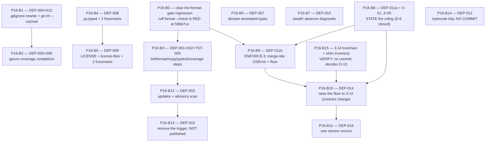

# Plan 16 — Phase 11 Audit Fixes: Supply Chain

> **AUDIT UPDATE (2026-10-10).** Re-checked against HEAD `2289f6f`.
> The plan was prepared at `58bb7ce`; 29 additional commits have landed since.
> Several findings have already been resolved by other phases — see §0 below.
> The plan is **not yet executed** as a plan; it is renamed `_fix` and must be
> updated before its remaining blocks run.
>**

**Source catalogue:** `.ai/audit/99-validation/11-supply-chain-validated-findings.md`
**Repository:** `vkdownloader` (`C:\py_exp\mko_vkideo`) · branch `main` · Windows · `uv`
**Prepared at:** HEAD `58bb7ce`, 54 commits after the catalogue's base `a335b2a`
**Re-checked at:** HEAD `2289f6f`
**Blocks:** 15 · one commit each (B14 is the one no-commit block) · all independently revertible

## §0 — Audit update: what has already landed since this plan was prepared

The plan was measured against `58bb7ce`. Between then and the current HEAD (`2289f6f`),
other phases resolved several findings this plan targets. **No P16-B* commit exists** —
the plan itself has not been executed. The resolution happened incidentally, as the
side effect of other work.

### Already resolved (by other commits)

| Block | Finding | Commit | What landed |
|-------|---------|--------|-------------|
| **P16-B0** | format-gate regression | resolved by `e6e6c68` et seq. | `ruff format --check src tests` is **GREEN** at HEAD (was RED at `58bb7ce`). The two `with patch(...)` headers that `b0fb032` had split are now single-line. **B0 is moot — no commit needed.** |
| **P16-B7** | `DEP-010` stealth absence | `c6d0214` + later commits | `browser.py`'s `create_stealth_page` now warns and raises `ExtractionError` when the stealth script is missing and `stealth_enabled` is true. The `exists()` guard is retained. |
| **P16-B8** (X-01, X-02, X-03, X-05) | `DEP-011` statement + doc drift | `e6e6c68`, docs commits | `ffmpeg_not_found` hint rewritten to `_MERGE_HINT` (`"ffmpeg binary not found on PATH; segment merge will fail after download"` — names no `DownloadMethod` member). The `| ffmpeg |` row is gone from `configuration.md`'s method table; `--method ffmpeg` example is gone from `cli-reference-clean.md`; `vkdownloader-overview.md`'s option list already says `(yt-dlp, auto)`. |
| **P16-B9** | `DEP-011` behaviour half | `e6e6c68 TRN-008` | Both `_merge_batch_segments` and `_perform_final_merge` now have `except OSError` arms that log `merge_spawn_failed` with `_MERGE_HINT`. The `check_ffmpeg_available()` return value is consumed at its single call site in `downloader.py` (`if not check_ffmpeg_available(): logger.warning(...)`). The probe itself is silent. |

### Still open

| Block | Finding | Current state |
|-------|---------|---------------|
| P16-B1 | `DEP-004` + `DEP-012` | **NOT done.** Eight `.gitignore` rules still carry `#` on the pattern line. Seven debris files still index-tracked. |
| P16-B2 | `DEP-005` + `DEP-006` | **NOT done.** 19 untracked-and-unexcluded paths still unignored. `.kilo/.gitignore` still untracked. |
| P16-B3 | `DEP-001` + `DEP-002` | **NOT done.** CI job still only runs `pytest tests/test_packaging.py -v`. No lint/format/mypy/coverage steps. |
| P16-B4 | `DEP-008` | **NOT done.** `src/vkdownloader/py.typed` does not exist. |
| P16-B5 | `DEP-009` | **NOT done.** No `LICENSE` file ships. |
| P16-B6 | `DEP-007` | **NOT done.** `annotated-types` not declared in dev group. |
| P16-B8 (docs) | ffmpeg requirement wording | **PARTIALLY done.** X-01/X-02/X-03/X-05 are fixed, but `README.md` and `docs/01-tools/installation.md` still state `Python 3.10+`/`3.12` and an unconditional `ffmpeg` prerequisite. `vkdownloader-overview.md`'s tree block (X-04) still says `~360 lines` and claims `progress parsing`. |
| P16-B10 | `DEP-014` | **NOT done.** `pyproject.toml` still `requires-python = ">=3.12"`, `.python-version` still `3.12`, `target-version = "py312"`, `python_version = "3.12"`. |
| P16-B11 | `DEP-016` | **NOT done.** `__version__` is still a literal `"0.1.0"`. |
| P16-B12 | `DEP-003` | **NOT done.** No `.github/dependabot.yml`, no advisory scan step. |
| P16-B13 | `DEP-015` | **NOT done.** `release: types: [published]` trigger still present. |
| P16-B14 | `DEP-013` | **NOT done.** (no-commit block — census not yet recorded.) |
| P16-B15 | 3.14 toolchain | **NOT done.** (no-commit block — not yet executed.) |
| **D-8** | ffmpeg version floor | **Still open.** `check_ffmpeg_available` has no version preflight; no floor recorded anywhere. |
| **X-04** | module description | **NOT done.** `vkdownloader-overview.md` still says `ffmpeg_utils.py (~360 lines) - FFmpeg commands, progress parsing, process management`; actual line count is 550 at HEAD and no progress parsing remains. |

### Corrected baseline (HEAD `2289f6f`)

| Metric | As planned (58bb7ce) | As measured (2289f6f) |
|--------|----------------------|----------------------|
| `ruff format --check src tests` | **RED** (1 file to reformat) | **GREEN** (all files formatted) — B0's precondition is gone |
| `ruff check src tests` | exit 0 | exit 0 |
| `mypy src` | 31 files, 0 issues | 31 files, 0 issues |
| `test_packaging.py` | 14 passed | 14 passed |
| `uv lock --check` | 41 packages | 41 packages |
| `pytest -q -rs` | 752 passed, 3 skipped | ~1030+ passed, 3 skipped (grown by other phases' test additions) |
| `EXPECTED_SDIST_ENTRIES` | 73 | 74 (`tests/test_import_graph.py` added by `e04659c`) |
| `EXPECTED_WHEEL_ENTRIES` | 32 | 32 |
| `EXPECTED_DIST_INFO_ENTRIES` | 4 | 4 |
| `ffmpeg_utils.py` lines | 493 | 550 |
| `LICENSE` | absent | absent |
| `py.typed` | absent | absent |
| `release:` trigger | present | present |
| `annotated-types` in dev | absent | absent |

> **The `docs/` folder at `C:\py_dev\mko_bazuna\docs` does not exist** in this
> environment. Documentation problems are scoped to `C:\py_exp\mko_vkideo\docs/`
> (the `vkdownloader` repository). No problem report is filed for a path that
> does not exist; the doc issues that *are* in scope are captured in the table
> above.

### Adjusted dependency graph

```
B0 is MOOT (format gate already green; no commit needed)
B1 → B2
B3 → B12 → B13    (.github/workflows/packaging-check.yml, 3 writers)
B4 → B5           (test_packaging.py frozensets, 2 writers)
B8 → B10          (README.md requirements block, shared with B10)
B6                (pyproject.toml + uv.lock, independent)
B7 is DONE        (stealth diagnostic already in place)
B8 (X-01..X-05) is DONE; B8 (docs wording + X-04) remains
B9 is DONE        (OSError arms, consumed return value, corrected hint)
B15 → B10         (3.14 verification, no-commit)
B11               (version source, independent)
B14               (bytecode tidy, no-commit, parallel-safe)
```

**Key changes to ordering:** B0 is removed (no longer a gate). B9 is removed (already done). B7 is removed (already done). The remaining critical path is B1 → B2, B3 → B12 → B13, B4 → B5, B15 → B10 → B11, with B6, B8 (remaining docs), and B14 parallel-safe. B10 no longer depends on B9 (B9 is done). D-8 remains open and B9's version-floor line in `installation.md` must be filled by measurement before B10 can complete."

> **PRODUCT OWNER DECISIONS A, B AND C — BINDING ON THIS PLAN.** *ffmpeg (below), the
> supported Python range, the publishing model and the licence are all decided. Where a
> decision contradicts an earlier part of this plan, the decision wins and the plan has
> been corrected to match.*

> **1. ffmpeg.** *yt-dlp is the loader. ffmpeg is not a download or loader transport.
> Segment download stays; ffmpeg stays as the segment merge engine.*
> - **Permanently deleted:** `DownloadMethod.FFMPEG`, `HLSDownloader`,
>   `download_with_ffmpeg`, `_temp_argfile`, `_format_argfile`, `FfmpegProgress`,
>   `ProgressParser`, `read_progress`, `_PROGRESS_KEY_HANDLERS`, and every ffmpeg-as-loader
>   code path, help string and doc claim. The retirement committed as `d572d96` is
>   **correct and permanent**. **No block restores any of it, and no block plans a
>   user-visible removal again — it is done.**
> - **Permanently kept as product surface:** `_merge_batch_segments`,
>   `_perform_final_merge`, `_merge_segments_batched`, `_build_ffmpeg_concat_command`,
>   `_required_merge_bytes`, `_check_merge_space`, `_await_ffmpeg_with_timeout`,
>   `_MERGE_SPACE_MARGIN_BYTES`, and **`check_ffmpeg_available`**. **No block may plan any
>   of these for deletion, and `services/ffmpeg_utils.py` can never be deleted whole** —
>   it is permanent product code, not a retirement remnant.
>
> **2. Supported Python range — the floor is `3.14`.** This is a **change to the
> distribution contract**, not a documentation correction. `requires-python` becomes
> `>=3.14`, `.python-version` becomes `3.14`, `[tool.ruff] target-version` and
> `[tool.mypy] python_version` follow, the version classifier changes, and the two
> user-facing claims change. **Users on 3.12 and 3.13 lose support** — stated as a
> rollout note, not as an objection. `P16-B15` verifies the declared toolchain against
> 3.14 and inventories compatibility shims; `P16-B10` implements.
>
> **3. Publishing model — NOT PUBLISHED. Delete the misleading release trigger.** The
> `release: types: [published]` trigger is **removed, not repaired**. With no published
> artifact there is nothing for a provenance or supply-chain guarantee to attach to, so
> **the absence of signing, attestations, SBOM generation and upload verification is
> correct, not a gap.** No block plans any of them.
>
> **4. Licence — MIT is correct and a `LICENSE` file must ship.** `DEP-009` is a decision
> to implement, not a question. MIT and the metadata classifier will agree.
>
> **Decisions closed:** `D-6`, `D-7`, `D-9` (ffmpeg) · `D-4` (closed in the negative by
> `D-9`) · `D-10` (**closed by decision 3 — not published**) · `DEP-009`, `DEP-014`,
> `DEP-015` (implemented, not decided).
> **Still open:** `D-8`, `D-11`, `D-12`, `D-1`, `D-2`, `D-3`, `D-5`, and **`D-13`** (new —
> the declared dev-tool floors against a 3.14 target).

> **This plan implements; it does not redefine.** Every recommendation is subordinate
> to `.kilo/rules/project.md` and to the measured state of the repository as of
> HEAD `58bb7ce`. Where the catalogue's evidence is stale, its consequence no longer
> reproduces, or its `## Report contract` is false, this plan records the correction
> and the measurement rather than restating the catalogue.

---

## §1 Scope

### §1.1 How the scope was derived

Four inputs, in this precedence order:

1. **The validated catalogue's 16 findings** — the authoritative record of what phase
   11 validated, including its de-duplication ruling and its four rollout constraints.
2. **Direct measurement of the repository at HEAD `435ba0b`** — every gate re-run by
   the Planner (§2), every semantic anchor re-located. **The catalogue was validated
   against `a335b2a`, 52 commits back.** Seven catalogue claims were measured rather
   than trusted; **four did not survive** (§1.1.3).
3. **The corpus de-duplication rulings** — `TST-005`/`DEP-002` ratified as one defect,
   `TST-007`/`DEP-001` retained as a complement, `DEP-004`/`DEP-012` retained as a
   complement with one shared edit.
4. **Live drift no store owns** — changes made by `d572d96`/`435ba0b` that no finding
   describes (§1.1.2). Filed as an unnamed obligation here so they are not mistaken
   for scope creep.

#### §1.1.1 Catalogue findings → verdict → IN/OUT → block

| ID | Sev | Type | Class. | Verdict at HEAD `435ba0b` | Disposition | Block |
|---|---|---|---|---|---|---|
| `DEP-001` | HIGH | SPEC-DEVIATION | mandatory | STILL_PRESENT — no `ruff`/`mypy` invocation exists in either workflow; `git grep -E "ruff\|mypy" -- .github` returns no matches | **IN** (with `DEP-002`) | **P16-B3** |
| `DEP-002` | HIGH | SPEC-DEVIATION | mandatory | STILL_PRESENT — arithmetic re-measured: **755 collected, 14 run, 741 never executed** | **IN** — **absorbs `TST-005`**, one commit | **P16-B3** |
| `DEP-003` | MEDIUM | BEST-PRACTICE | advisory | STILL_PRESENT — no `dependabot`/`renovate`/`CODEOWNERS`/pre-commit config; 16-tool name grep returns files=0 | **IN** | **P16-B12** |
| `DEP-004` | HIGH | SPEC-DEVIATION | mandatory | STILL_PRESENT — reproduced: positive control `.gitignore:46:urls.txt` matches; all 8 rules at `.gitignore` tail return NOT-IGNORED; 7 files index-tracked | **IN** (one shared edit with `DEP-012`) | **P16-B1** |
| `DEP-005` | MEDIUM | SPEC-DEVIATION | mandatory | **CLASS STANDS, CONSEQUENCE NO LONGER REPRODUCES** — `ruff check .` and `ruff format --check .` now both exit **0**; untracked-and-unexcluded set is **19 paths** (`tmp/*`, `tmp_old_sec.md`, `tmp_old_sec2.md`, `.ai/plans/05–14`) | **IN, reduced** to the coverage defect | **P16-B2** |
| `DEP-006` | MEDIUM | BEST-PRACTICE | advisory | STILL_PRESENT — `.kilo/.gitignore` exists, is 8 lines, and is **untracked** (`git ls-files --error-unmatch` fails); it carries `.gitignore` and `agent-manager.json` | **IN** | **P16-B2** |
| `DEP-007` | MEDIUM | SPEC-DEVIATION | mandatory | STILL_PRESENT — `tests/test_config.py` imports `annotated_types`; no mechanism names it. **New:** `python-dotenv>=1.2.2` is now a declared **9th** runtime dependency | **IN** | **P16-B6** |
| `DEP-008` | MEDIUM | SPEC-DEVIATION | advisory | STILL_PRESENT — no `py.typed` in tree, index, or build; `[tool.hatch.build.targets.wheel]` cannot create one | **IN** | **P16-B4** |
| `DEP-009` | MEDIUM | SPEC-DEVIATION | advisory | **DECIDED (decision 4)** — MIT is correct and a `LICENSE` must ship. **Corrected measurement:** hatchling **force-includes** licence files into the sdist independently of the `include` allow-list, so the frozenset pair is **`EXPECTED_SDIST_ENTRIES` + `EXPECTED_DIST_INFO_ENTRIES`**, *not* the wheel set (§1.1.3i) | **IN — implement** | **P16-B5** |
| `DEP-010` | MEDIUM | BEST-PRACTICE | mandatory | STILL_PRESENT — the stealth load guard has no `else`; the only log line is on the taken branch | **IN** | **P16-B7** |
| `DEP-011` | MEDIUM | BEST-PRACTICE | advisory | STILL_PRESENT **and materially worse post-ruling** — see §2.7. `shutil.which("ffmpeg")` is presence-only discovery; the binary is now a **settled requirement** of the segment path with **no version floor anywhere**, and a missing binary yields an uncaught `FileNotFoundError` at merge time | **IN, split** — statement half **decided**, behaviour half **load-bearing** | **P16-B8** + **P16-B9** |
| `DEP-012` | LOW | BEST-PRACTICE | advisory | STILL_PRESENT — 7 index-tracked root debris files, all 13 root index entries confirmed | **IN** (one shared edit with `DEP-004`) | **P16-B1** |
| `DEP-013` | LOW | BEST-PRACTICE | advisory | STILL_PRESENT — orphan set now **6** names under `src/`+`tests/` plus 3 at the repository root; **two** cache generations (`-pytest-9.0.3`, `-pytest-9.1.1`) coexist | **IN** | **P16-B14** |
| `DEP-014` | MEDIUM | DOC-UPDATE | mandatory | **RE-SCOPED BY DECISION 2 — this is no longer a documentation fix.** It is a change to the distribution contract: `requires-python` `>=3.12` → `>=3.14`, `.python-version` `3.12` → `3.14`, `[tool.ruff] target-version = "py312"` → `py314`, `[tool.mypy] python_version = "3.12"` → `3.14`, the only version classifier `3.12` → `3.14`, and both user-facing claims. All four declared dev tools **do** support 3.14 at their locked versions (§1.1.3k) | **IN — contract change**, gated on verification | **P16-B15** (verify) → **P16-B10** (implement) |
| `DEP-015` | MEDIUM | BEST-PRACTICE | advisory | **DECIDED (decision 3) — NOT PUBLISHED.** The `release: types: [published]` trigger is **removed, not repaired**, under `permissions: contents: read`. Measured: **nothing in the repository implies publication** — no `[project.urls]`, no badges, no index-naming install line (§1.1.3l) | **IN — remove** | **P16-B13** |
| `DEP-016` | LOW | SPEC-DEVIATION | advisory | STILL_PRESENT — `version` in the manifest and `__version__` in `__init__.py`, both `0.1.0`, compared by nothing | **IN** | **P16-B11** |

**Actionable set: 16 of 16.** `DEP-002` absorbs `TST-005`; `DEP-004` and `DEP-012`
share one edit; `DEP-011` splits by whether the work is a *statement* or a *behaviour*.

#### §1.1.2 Live drift no store owns — filed here so it is not lost

Created by `d572d96` (`TRN-001: Remove FFMPEG download transport`), the ffmpeg
retirement is committed, and four documentation sites still describe it as present.
A test proves `--method ffmpeg` exits 2. `--method` is a **closed `StrEnum` of
`{YTDLP = "yt-dlp", AUTO = "auto"}`**; any document naming `ffmpeg` in that enum is
wrong by construction.

| # | Site | Claim | Owner |
|---|---|---|---|
| **X-01** | `docs/11-guides/configuration.md`, download-method table | a `| ffmpeg |` row | **P16-B8** |
| **X-02** | `docs/99-reference/cli-reference-clean.md`, `download` example | `--method ffmpeg` | **P16-B8** |
| **X-03** | `docs/01-tools/vkdownloader-overview.md`, option list | `Download method (yt-dlp, ffmpeg, auto)` | **P16-B8** |
| **X-04** | `docs/01-tools/vkdownloader-overview.md`, tree block | `ffmpeg_utils.py (~360 lines) - FFmpeg commands, progress parsing, process management` — the module is **493** lines at `58bb7ce` and no longer does progress parsing | **P16-B8** |
| **X-05** | `ffmpeg_utils.py`, the `ffmpeg_not_found` log call's `hint` | `"ffmpeg binary not found on PATH; downloads using ffmpeg or segment merge will fail"` — the first clause names a `DownloadMethod` member that **no longer exists**. Under the Product Owner ruling this is worse than a stale string: it describes a **required** capability as merely absent, and offers no action | **P16-B8** (string only; the logic is `P16-B9`) |

`X-04` sits next to `docs/STRUCT.md`, which is **owned solely by plan 12 `B12`** and
is **not re-filed here**. `vkdownloader-overview.md` is a different file from
`STRUCT.md`; if plan 12 claims it, defer `X-04` and land `X-01`–`X-03`. Recorded so
the overlap is a decision, not a collision.

**Migration-note boundary.** Any text telling users that ffmpeg is *no longer used*
would now be false, and is out of this plan's scope. **Plan 13 `B17` owns the
user-facing removal note**, and its content must say the opposite of a naive retirement
note: the **loader** is gone; the **segment merge engine is not**. This plan does not
duplicate that note and does not draft its wording — it only records the boundary so
nobody else writes a contradicting one.

**Group ownership, settled by the ruling.** `check_ffmpeg_available` is **no longer a
three-way conflict**: it is resolved in favour of **plan 10**, whose `B10` preserves
it. Plan 12's `§2.4.5` files it as retiring and is **wrong**; plan 11 places it in group
C and is **right** on this symbol. Separately, **plan 11's group split is wrong on the
other two symbols** — it files `_merge_batch_segments` and `_perform_final_merge` as
dying, and under the ruling both are permanent. **This plan is the authority the other
plans are reconciled against on the symbol set**, so both corrections are carried here
and in §4.3.

#### §1.1.3 Measured corrections to the catalogue

Seven claims were checked rather than restated. **Four did not survive.**

**(a) The consequence of `DEP-005` no longer reproduces — and the class is real.**
The catalogue reports `ruff check .` → 2 × `I001` in `tmp/`, exit 1. Re-run at
`58bb7ce`: `ruff check .` → **All checks passed!**, exit **0**. The reason is visible
and mechanical: the two offending scratch files are gone. The *class* — paths that no
repository-carried rule names — **stands and has grown**: the untracked-and-unexcluded
set is now **19 paths** (`tmp/code_context_phase05.md`, `tmp/oracle_a.ps1`,
`tmp/oracle_b.ps1`, `tmp/oracle_c.ps1`, `tmp/plan_updates/*`, `tmp/quality-selection.patch`,
`tmp_old_sec.md`, `tmp_old_sec2.md`, and 9 untracked `.ai/plans/*`). **`DEP-005` is
therefore IN, reduced to its coverage half, and its red-build argument is withdrawn.**
Consequence for ordering: rollout constraint 2 (which makes `DEP-005` a blocker on a
whole-tree `DEP-001`) is **dissolved by measurement**, and the whole-tree form of
`DEP-001` is no longer risky.

**The `DEP-005` argument is withdrawn, but a *different* red gate replaced it** — and
this one is the one `DEP-001` would newly enforce. `ruff check .` is green, yet
`ruff format --check src tests` is **red**, because `b0fb032` introduced a formatting
regression that `ruff check` cannot see (`E501` is ignored, so a line-length-neutral
re-wrap passes the linter and fails the formatter). That is `DEP-005`'s consequence
substituted, not resurrected: see **(h)** below and `P16-B0`.

**(b) The packaging gate is a two-way lock, not a one-way agreement.** The briefing
carried the premise that the gate "asserts agreement with the manifest, not
completeness of the manifest", so a frozenset-only edit would ship nothing and stay
green. **Measured, that premise is false.** `_entry_set_difference` returns both
`unexpected = actual - expected` and `missing = expected - actual`, its docstring
reads *"Describe how `actual` differs from `expected`"*, and
`test_sdist_entry_count_matches_the_manifest` independently asserts
`len(actual) == len(EXPECTED_SDIST_ENTRIES) + len(BUILDER_ADDED_SDIST_ENTRIES)`.
A frozenset edit without the manifest edit fails on the `missing` arm; a manifest
edit without the frozenset edit fails on the `unexpected` arm **and** on the count.
**Consequence: every packaging change must edit the frozensets and
`pyproject.toml` together, and the gate is the authoritative proof — the Validator's
cheapest check.** This strengthens `DEP-008`/`DEP-009` rather than weakening them.

**(c) The skip floor is 3, and the pass floor moved twice during this session.** At the
catalogue's base it was 4; at `435ba0b` it was 3; at `58bb7ce` it is **3 skipped /
752 passed**. All three skips are Windows `chmod` oracles. The pass count moved **747 →
752** inside this planning session, because `58bb7ce` and `b0fb032` landed while it ran.
**The current number is 752 passed / 3 skipped**, and it is the one every block's
acceptance criteria assert against. §2.8 records the sequence.

**(h) NEW at `58bb7ce` — the format gate is red on arrival, and that breaks `DEP-001`'s
premise as filed.** `uv run ruff format --check src tests` → **1 file would be
reformatted, 53 files already formatted**, exit 1. The file is `tests/test_hls_downloader.py`,
and the offending hunks are two `with patch("vkdownloader.services.ytdlp_downloader.logger") as mock_logger:`
headers that `b0fb032` split across lines and that now fit on one line. `ruff check`
passes, so this is invisible to the linter and visible only to the formatter.

**This is the same failure shape as `DEP-004`'s red-on-arrival `check-ignore` step, and it
has to be handled the same way: it cannot be gated on.** `DEP-001`'s plan was to add four
steps to a job, three of which are green. Adding the format step as-is makes **every push
red**, including one that touches nothing. `P16-B0` therefore exists and must precede
`P16-B3` (§3). It is a two-hunk reformat of a file this phase does not otherwise own,
which is exactly why it is a separate commit and a separate block rather than a silent
fold into `P16-B3`.

**(d) `python-dotenv` is now declared.** `DEP-007` measured 8 runtime dependencies
and no declaration mechanism for `annotated_types`. Re-measured:
`[project].dependencies` holds **9** names — `playwright`, `aiohttp`, `pydantic`,
`pydantic_settings`, `typer`, `rich`, `structlog`, `yt-dlp`, and
**`python-dotenv>=1.2.2`**, genuinely imported by the configuration module. Phase 06's
`B1` landed. `annotated_types` remains the **only** undeclared top-level third-party
import, and it is in `tests/`, so it is a **dev**-group subject.

**(e) `uv.lock`'s hash-pinning statement holds; its mechanism differs.** `uv.lock` has
**41** `[[package]]` blocks; **exactly one** — `vkdownloader`, `source = { editable = "." }` —
carries no hash. The other **40 of 40** registry-sourced entries are hash-pinned, via
**740** inline `sha256:` tokens across `sdist`/`wheels` entries. `uv lock --check` →
`Resolved 41 packages`, exit 0. `create=True` appears **0** times in `tests/`; the
packaging tests build into `tempfile.mkdtemp()` paths instead.

**(f) Group A of the ffmpeg module is two names, not three — and one is an alias.**
`cancel_ffmpeg_process` is a module-level alias (`cancel_ffmpeg_process = cancel_subprocess`),
not a definition. The actual import surface is: `iter_process_lines` and
`cancel_subprocess`, imported by `ytdlp_downloader`; `check_ffmpeg_available` plus
other names by `downloader` (which re-exports it in `__all__`); `_merge_segments_batched`
by `segment_downloader`. The module is a **leaf**: its only project imports are
`..exceptions` and `..utils.formatting`, and that must stay true.

**(g) The catalogue's own `## Report contract` is false. See §1.5. It is an input
defect to be corrected in the corpus, not a finding to implement.**

The following four were measured while folding in Product Owner decisions 2–4. **Three
of them corrected this plan.**

**(i) CORRECTION — hatchling already handles the licence file; `P16-B5` was over-built
and named the wrong frozensets.** The plan asserted that `[project] license-files` is
"MANDATORY" and that `/LICENSE` must be added to the sdist `include` allow-list. **Both
are false**, read from the pinned builder's own source:

- `hatchling/metadata/core.py` — the `license_files` property **already defaults** to the
  glob set `["LICEN[CS]E*", "COPYING*", "NOTICE*", "AUTHORS*"]` at the project root when
  `license-files` is undeclared. So the key is **optional**, and the default already
  matches a root `LICENSE`.
- `hatchling/builders/sdist.py` — licence files are added to a `force_include` map
  **independently of the `include` allow-list**. So `/LICENSE` does **not** need an entry
  in `[tool.hatch.build.targets.sdist] include`.
- `hatchling/builders/wheel.py` — `add_licenses` writes each licence file through
  `write_metadata("licenses/<name>")`, i.e. **inside `.dist-info`**, not the wheel payload.

**Consequence — the frozenset pair for `LICENSE` is confirmed by measurement, and it is
NOT the same pair as `DEP-008`'s:**

| Set | Moves? | Why |
|---|---|---|
| `EXPECTED_SDIST_ENTRIES` | **73 → 74** (built 75 → 76) | sdist force-includes the licence file regardless of the allow-list |
| `EXPECTED_DIST_INFO_ENTRIES` | **4 → 5** | `.dist-info/licenses/LICENSE` is emitted by the wheel builder |
| `EXPECTED_WHEEL_ENTRIES` | **32, unchanged** | the licence does not enter the `vkdownloader/` payload |

`DEP-008`'s pair is `EXPECTED_WHEEL_ENTRIES` + `EXPECTED_SDIST_ENTRIES`. **`LICENSE`'s is
`EXPECTED_SDIST_ENTRIES` + `EXPECTED_DIST_INFO_ENTRIES`.** The two blocks share exactly one
cell, and C2's two-way lock is what keeps them honest. Declaring `license-files`
explicitly is still **recommended** — it is PEP 639's explicit form and it removes a
glob dependency — but it is **not required**, and the plan must not claim otherwise.

**(j) MEASURED — there are no compatibility shims to remove.** The anticipated finding did
not exist. Scanned `src/` and `tests/` for `sys.version_info`, `platform.python_version`,
`platform.python_implementation`, `sys.version`, `typing_extensions`, `importlib.resources`
legacy paths, `importlib_resources`, `asyncio.coroutine`, `asyncio.get_event_loop`,
`asyncio.Task.all_tasks`, `distutils`, `imp`, `cgi`, `pkg_resources`,
`inspect.getargspec`, `locale.getdefaultlocale`, and `unittest.makeSuite`: **zero
matches in both trees.** `P16-B15` records the empty inventory.

**How the near-misses were told apart**, because the instruction requires it and because a
sweep that confuses them would produce real deletions: `cookies.py` and `downloader.py`
each import `TYPE_CHECKING` and gate imports behind it — that is an **import-cycle guard**
(it keeps a type-only import from creating a runtime cycle between the downloader and its
value types), not a version shim, and `TYPE_CHECKING` is not version-dependent. The ~30
bare `try:` blocks across `browser.py`, `network_monitor.py`, `batch_downloader.py`,
`downloader.py`, `downloader_throttle.py` and `cookies.py` are **runtime error handling**
around subprocess and browser lifecycles; none has a `sys.version_info` guard or an
`ImportError` fallback keyed to a missing symbol. **The test applied: does the construct
exist to tolerate a *Python version*? If removing it would change behaviour on a version
the project still supports, it stays.** Nothing met that test, so nothing is removable.

**(k) MEASURED — the toolchain supports 3.14 at the locked versions; the *declared floors*
are what cannot.** Read from the installed metadata of the locked distributions:

| Tool | Locked | `Requires-Python` | Carries a 3.14 classifier? |
|---|---|---|---|
| `mypy` | 2.1.0 | `>=3.10` | **yes** |
| `pytest` | 9.1.1 | `>=3.10` | **yes** (and 3.15) |
| `pytest-asyncio` | 1.4.0 | `>=3.10` | **yes** |
| `ruff` | 0.15.20 | `>=3.7` | **yes** |
| `pydantic` (runtime) | 2.13.4 | `>=3.9` | **yes** |

**No declared tool is incompatible — so the floor does not make the package uninstallable,
which was the risk to check.** The real defect is that all four are declared **open-ended
`>=`** at floors far below any 3.14-aware release: `ruff>=0.4.0`, `mypy>=1.10.0`,
`pytest>=8.0.0`, `pytest-asyncio>=0.23.0`. A resolver on a fresh 3.14 machine is entitled
to pick versions that predate 3.14 support. That is a supply-chain finding this phase
owns, and it is decision **`D-13`**. Two further pins are set for the *current* interpreter
and would silently keep applying the wrong language rules after the change:
`[tool.ruff] target-version = "py312"` and `[tool.mypy] python_version = "3.12"`.

**(l) MEASURED — nothing in the repository implies publication.** `[project.urls]` is
absent (0 matches). `README.md` carries **no badges at all** — no image syntax, no
`shields.io`, no `pypi.org`. The only install line in the whole tree is `pip install -e .`
in `README.md` and again in `docs/01-tools/installation.md`, both editable local installs
that work and imply no index. **So decision 3 requires removing one trigger and no badge
or install-line correction.** Had a badge pointed at an index it would have been a false
statement to the user; there is none.

#### §1.2 IN — the scope

1. **`DEP-001` + `DEP-002`** (HIGH · SPEC-DEVIATION · mandatory) — one commit in
   `packaging-check.yml`: lint, format, type-check, the behavioural suite, and the
   coverage element `TST-005` uniquely carries.
2. **`DEP-004` + `DEP-012`** (HIGH + LOW) — one shared edit: repair the inert rules
   and remove the seven files they were meant to describe.
3. **`DEP-005` + `DEP-006`** (MEDIUM ×2) — complete the ignore coverage: the
   untracked scratch, and the two paths whose exclusion depends on an untracked file.
4. **`DEP-008`** (MEDIUM · SPEC-DEVIATION) — the PEP 561 marker.
5. **`DEP-009`** (MEDIUM · SPEC-DEVIATION) — the licence text, with the PEP 639 keys.
6. **`DEP-007`** (MEDIUM · SPEC-DEVIATION) — declare `annotated-types`.
7. **`DEP-010`** (MEDIUM · BEST-PRACTICE) — the stealth-script absence diagnostic.
8. **`DEP-011`, statement half** (MEDIUM · BEST-PRACTICE) — **DECIDED:** ffmpeg is a
   **required runtime component of the segment path**. State it as a **conditional**
   prerequisite, plus `X-01`–`X-05`.
9. **`DEP-011`, behaviour half** (MEDIUM) — **load-bearing, not optional hardening.**
   Make the missing-binary path coherent: the discarded return value, an `OSError` arm
   at each merge spawn site, and a version preflight.
10. **`DEP-014`** (MEDIUM) — **the 3.14 floor as a contract change**, not a doc fix:
    `requires-python`, `.python-version`, `[tool.ruff] target-version`,
    `[tool.mypy] python_version`, the version classifier, both user-facing claims, and
    the declared dev-tool floors (`D-13`). Gated on `P16-B15`'s verification.
11. **`DEP-016`** (LOW · SPEC-DEVIATION) — one version source.
12. **`DEP-003`** (MEDIUM · BEST-PRACTICE) — update automation and an advisory scan.
13. **`DEP-015`** (MEDIUM) — **remove** the post-publication trigger; retain the checked
    bytes as CI artifacts. No publish job, no signing, no attestations, no SBOM.
14. **`DEP-013`** (LOW · BEST-PRACTICE) — the one-time bytecode tidy, both generations.
15. **`X-01`–`X-05`** (unnamed doc drift) — the four sites `d572d96` invalidated, plus
    the misleading `ffmpeg_not_found` hint it left behind.
16. **The format-gate regression** introduced by `b0fb032` — the precondition for
    `DEP-001` landing at all.
17. **The 3.14 toolchain verification and shim inventory** (`P16-B15`) — the gate on
    decision 2, and the source of `D-13`.

### §1.3 OUT

| Subject | Why it is out | Who owns it |
|---|---|---|
| **Signing, attestations, SBOM generation, upload verification, provenance** | **Correctly absent.** With **no published artifact** there is nothing for a provenance or supply-chain guarantee to attach to. Decision 3 closes this whole class: their absence is **correct, not a gap.** | **Nobody. Closed.** |
| **A publish job, `[project.urls]`, trusted publishing, `twine`/`uv publish`** | The project is **not published**. None of these may be added, and none is implied anywhere in the tree (§1.1.3l). | **Nobody. Closed.** |
| **A README badge or index-naming install line** | **Measured: none exists.** `README.md` has no badges and the only install line is `pip install -e .`. Had one pointed at an index it would have belonged to `P16-B13`; there is none. | **Nobody. Nothing to do** |
| **Restoring any deleted ffmpeg-as-loader symbol** | `DownloadMethod.FFMPEG`, `HLSDownloader`, `download_with_ffmpeg`, `_temp_argfile`, `_format_argfile`, `FfmpegProgress`, `ProgressParser`, `read_progress`, `_PROGRESS_KEY_HANDLERS` are **permanently deleted**. `d572d96` is correct and permanent; no block restores one. | **Nobody. Closed.** |
| **Deleting any segment-merge symbol** | `_merge_batch_segments`, `_perform_final_merge`, `_merge_segments_batched`, `_build_ffmpeg_concat_command`, `_required_merge_bytes`, `_check_merge_space`, `_await_ffmpeg_with_timeout`, `_MERGE_SPACE_MARGIN_BYTES` and `check_ffmpeg_available` are **permanently kept**. `services/ffmpeg_utils.py` can never be deleted whole. | **Nobody. Closed.** |
| **A user-visible removal note / migration note** | Owned by **plan 13 `B17`**. Its content must say the *loader* is gone, not that ffmpeg is unused — the latter is now false. | **Plan 13** |
|---|---|---|
| `TST-005` as a separate step | Absorbed by `DEP-002` per the ratified ruling; `VAL-125` states *"Do not land both fixes independently."* **One commit, one step.** | **This plan, in `P16-B3`** |
| A separate `TST-007` step | A retained **complement**, not a duplicate: different gate steps. It is landed **in the same commit** as `DEP-001` because the insertion point collides. | This plan, in `P16-B3` |
| `DEP-005`'s "red build" argument | `ruff check .` exits 0 at `435ba0b`. Not reproducible; the coverage half is IN. | — |
| `docs/STRUCT.md` module description | Owned solely by plan 12 `B12`. **Not re-filed.** | **Plan 12** |
| `TRN-001`'s argfile runtime behaviour | Phase 05's observation. This phase files the *pinning-policy* consequence only. | Phase 05 |
| `QLT-009` (`yt_dlp` unmarked for mypy) | Phase 09's mypy profile. Cited, not re-filed. | Phase 09 |
| `TST-013`, `ART-007` (permission oracles) | Phase 10 / phase 07. The three skips are recorded as measured skips, never as a filing. | Phase 07 / 10 |
| `SEC-005`, `SEC-007` (credential leak) | Phase 06. This phase checked only whether the declared dependency set covers what is imported. | Phase 06 |
| `agent-manager.json`'s **contents** | Out of bounds. `DEP-006` files **coverage**, never content. | — |
| Licence *posture* (which licence, whether MIT is right) | `DEP-009` files only that an assertion ships with nothing behind it. | — |
| A vulnerability count | The advisory-database check is a documented skip and no count is asserted anywhere. | — |

### §1.4 Deferred, and the open decisions this plan carries

**Deferred** — each with a default, so an unexecuted deferral still leaves the tree correct:

| # | Deferred | Why | Default | Owner |
|---|---|---|---|---|
| **D-1** | Folding `tests/` into the type-check step. | `mypy src tests` is **86 errors in 8 files** (54 checked). Type-checking `tests/` in the same commit would fail every PR. | Gate `mypy src` only. Record the 86 as a delta, never a pass/fail. | Phase 14 (code quality) |
| **D-2** | A coverage **threshold**, as opposed to a coverage **measurement**. | `TST-005`'s element is "no coverage tool or threshold is declared anywhere". A threshold is a policy the project has never set. | Measure and publish; **no threshold**. Escalate the threshold question with the report. | Tech Lead |
| **D-3** | `CODEOWNERS` and pre-commit. | `DEP-003` itself calls the CI gate the higher-leverage half. Both need a team, not a config file. | Not created. | Tech Lead |
| **D-4** | Hard-failing on a missing or old ffmpeg binary at startup. **NOW CLOSED BY THE RULING, in the negative.** `D-9` decides the gate belongs at the merge call site, so refusal at startup is not a deferred option — it was ruled out because ffmpeg is required only for the segment path and a startup refusal would break users who never reach one. Warn, never refuse, is the **settled** answer, not a default. | Closed by `D-9` | **Closed** |
| **D-5** | Any `ffprobe` subject. | Zero occurrences in `src/` and `tests/`. There is no subject. | Not filed. | — |

**Decisions closed by the Product Owner ruling.** Recorded as decisions, not as defaults.
The criterion each was decided against is **retained** — it is the test the ruling was
made against, and it is what makes the decision auditable rather than arbitrary.

| # | Closed decision | Ruling | Criterion it was decided against | Blocks |
|---|---|---|---|---|
| **D-6** | **Is ffmpeg a mandatory runtime prerequisite or an optional capability?** | **A required runtime component of the segment path.** yt-dlp is the loader; ffmpeg is the segment merge engine. It is **conditional**: required for the segment path, irrelevant to every other download path. | Whether the product can produce **any** HLS output without it. **Measured answer: it cannot** — both surviving `DownloadMethod` members converge on the yt-dlp path whose segment-fallback branch reaches `_merge_segments_batched`, and `yt-dlp` itself shells out to ffmpeg when a stream carries separate video and audio. The ruling confirms the code, rather than overriding it. | `P16-B8` (state it) · `P16-B9` (enforce it) |
| **D-7** | **Where is the prerequisite stated?** | **Both the install guide and the README**, worded as a **conditional** prerequisite — required for the segment path, not for every download. | Whether the README's requirements block ships in the wheel metadata. It does: `readme = "README.md"` makes it the long description, so a claim there reaches every index listing and `pip show`. | `P16-B8` |
| **D-9** | **Does a missing binary warn (today) or refuse?** | **Warn at discovery; gate at the merge call site; never refuse at startup.** Decided **by consequence, not by preference**: ffmpeg is not needed by every download, only by the segment path, so a startup refusal would break users who never reach a merge. | `D-6`'s answer, applied to consequence. The requirement is real but **conditional**, so its enforcement point is the narrowest site that can enforce it — the merge call site. | `P16-B9` |

**Consequence of the three rulings, stated because it changes what `P16-B9` is.**

The `OSError` arms on `_merge_batch_segments` and `_perform_final_merge` are **no longer
optional hardening**. They are the **load-bearing enforcement point for a decision the
Product Owner has made**: they are where a required-but-missing component becomes a named,
actionable failure instead of an uncaught `FileNotFoundError`. `P16-B8` states the
requirement; **`P16-B9` enforces it**, and its acceptance criteria are written as
enforcement rather than as an optional improvement.

**"Warns early, crashes late" is now a named defect, not a neutral observation.**
`check_ffmpeg_available` learns the binary is absent, **acts on nothing** — its return
value is discarded at its only call site — and the run fails later with an opaque
`FileNotFoundError` at merge time. Under the ruling that is the wrong shape: the tool
knows, does not act, and fails late. **`P16-B9` owns the closure** (the consumed return
value and the two `OSError` arms). `P16-B8` owns the *wording* — the `ffmpeg_not_found`
hint, `X-05`, which currently describes a required capability as merely absent.

**Still open.** Each states what evidence settles it and what happens if nobody decides.

| # | Open decision | Block | Criterion | Default if undecided |
|---|---|---|---|---|
| **D-8** | **Which ffmpeg version floor, if any** — **SEVERITY RAISED.** `DEP-011` was filed on *an optional capability is unpinned*. The ruling converts it to **a required capability is unpinned**: the binary is now settled product surface with **no version constraint recorded anywhere**, discovered by presence alone. The value is still a measurement, not a decision. | **P16-B9** | The minimum build that passes the concat/argfile path, derived from `TRN-001`'s recorded behaviour. **Must not be invented here.** | Record the floor as *"the build the project is verified against"* with the measured value; **if no floor can be derived from the code, say so rather than guessing a number.** A plausible number is worse than an absent one, because it will be trusted. |
| ~~**D-10**~~ **CLOSED by decision 3 — NOT PUBLISHED.** | Which of the two release models the project is in. **Decided: neither — the package is not published.** The `release: types: [published]` trigger is **removed, not repaired.** With no published artifact there is nothing for provenance or a supply-chain guarantee to attach to, so the absence of signing, attestations, SBOM generation and upload verification is **correct, not a gap** — a whole class of implied work is closed off. | **P16-B13** | Was: whether a `[project.urls]` entry and an index account exist. **Measured: neither, and nothing in the tree implies publication** (§1.1.3l). | **Closed.** Remove the trigger; retain the checked bytes as CI artifacts. **Do not add signing, attestations, SBOM or upload steps.** |
| **D-13** | **NEW — do the declared dev-tool floors get raised for the 3.14 target?** All four declared tools **support** 3.14 at their locked versions, so the floor does not make the package uninstallable. But every floor is open-ended and far below any 3.14-aware release (`ruff>=0.4.0`, `mypy>=1.10.0`, `pytest>=8.0.0`, `pytest-asyncio>=0.23.0`), so a fresh resolver may pick a version predating 3.14. | **P16-B15** decides · **P16-B10** implements | The first release of each tool carrying a `Programming Language :: Python :: 3.14` classifier. A declared floor below that is a claim the tool set cannot keep. | **Raise each floor to the first 3.14-aware release.** Leaving a floor that permits a non-3.14 tool is `DEP-011`'s unpinned-binary defect, one layer down. |
| **D-11** | Whether `annotated-types` is declared, or the test is rewritten off `annotated_types`. | **P16-B6** | Whether `pydantic` re-exports the operator types the test needs (`Ge`, `Le`) on the pinned version. | Declare it in the **dev** group. It is a test-only import and the manifest should say so. |
| **D-12** | Single version source vs a comparing assertion. | **P16-B11** | Whether `importlib.metadata.version` is acceptable to an editable install with no metadata. | Derive from `importlib.metadata`, with a fallback. The documented verification step keeps working. |

### §1.5 Input defect in the catalogue — to be corrected in the corpus, **not implemented**

**The artefact's `## Report contract` section is false. Nothing in this plan is built
from it, and no block may implement it.** It is recorded here because the corpus must
be corrected, and because the failure mode it describes — a mandatory defect filed
against a document the run itself placed out of scope — is worth not repeating.

Three claims, each measured against the corpus at HEAD `435ba0b`:

| Claim in the artefact | Measured | Verdict |
|---|---|---|
| *"the report format … has **no slot** for a validation decision"*, *"its finding block runs from the heading straight into a nine-field table"*, *"**the format must gain the slot**"* | `.ai/audit/templates/audit-findings.md` **has** the `**Decision:**` slot, written directly below the finding-block heading. It was added by commit `feb0a40` — *"docs(audit): give the finding block a slot for the validation decision"* — and **`git merge-base --is-ancestor feb0a40 a335b2a` exits 1**: `feb0a40` is **not** an ancestor of the audit's base. The obligation was **discharged after the observation window**, before the fix was needed. | **FALSE** |
| *"defines **nine mandatory fields**"* | The per-finding field table has **6** rows today (`ID`, `Severity`, `Type`, `Affected Modules`, `Classification`, `Verification`) and had **5** at the base. **There was never a nine-field table.** The range the artefact points at sits inside the *Template Field Reference*, which lists **12** fields — a different table, with a different purpose. | **FALSE** |
| *"**A section every phase must delete is a defect of the format**"* — its `## Summary` / `## Mandatory Fixes` / `## Advisory Recommendations` / `## Doc Updates Needed` were removed and the burden is "filed against the format" | False **in substance**: those are zeroed tables and `{List all findings…}` placeholders, and their removal is a **convention the validate handbook imposes**, not a format defect. The artefact's **own** second-pass re-entry index then states that blocks **(g)** and **(h)** — *the audit pipeline's own documents* — *"were NOT executed by this run"*. **It filed a mandatory defect about a document it had placed out of scope.** | **FALSE** |

**What the corpus should do with this.** The `## Report contract` section of
`11-supply-chain-validated-findings.md` should be corrected or withdrawn, and the
`DEP-` finding count should not carry a "format defect" obligation that does not exist.
**This plan does not edit that file** — it is an audit artefact, and §2.1 rule 4 forbids
staging anything under `.ai/audit/`. The correction belongs to the validator of the
corpus, not to a supply-chain fix plan.

**Consequence for this plan: there is no block for it.** Sixteen findings, sixteen
blocks, and none of them is "add a slot that is already there."

---

## §2 Baseline

**Re-measured by the Planner at HEAD `58bb7ce`.** The catalogue's own gate figures are
from `a335b2a`, **54 commits back**, and several are stale. **The pass count also moved
during this planning session** (747 at `435ba0b`, 752 at `58bb7ce`) — §2.8 records the
sequence and §2.1 names the current floor.

| Command | Result | Exit |
|---|---|---|
| `uv run pytest -q -rs` | **752 collected · 752 passed · 3 SKIPPED · 1 warning** · 38.37 s | **0** |
| `uv run ruff check src tests` | All checks passed! | **0** |
| `uv run ruff check .` | All checks passed! | **0** |
| `uv run ruff format --check src tests` | **1 file would be reformatted, 53 files already formatted** — `tests/test_hls_downloader.py`, two `with patch(...)` headers split by `b0fb032` that now fit on one line | **1** |
| `uv run mypy src` | **Success: no issues found in 31 source files** | **0** |
| `uv run mypy src tests` | **Found 86 errors in 8 files (checked 54 source files)** — *delta gate only* | 1 |
| `uv run pytest tests/test_packaging.py -q` | **14 passed** | **0** |
| `uv lock --check` | **Resolved 41 packages** | **0** |

**One gate is red, and it is not a pre-existing-errors situation like `mypy src tests`.**
`ruff format --check src tests` is a gate `P16-B3` would newly *enforce*, and it fails
today on a change this phase did not make. `P16-B0` exists to clear it and is the
**precondition of `P16-B3`** — the same handling `DEP-004`'s red-on-arrival
`git check-ignore` step receives (§1.1.3h).

`mypy` is `strict = true` with **exactly one** override (`module = "vkdownloader.cli"`,
`disallow_untyped_decorators = false`) and `ignore_missing_imports = true` — so an
undeclared import is invisible to mypy. **Bare `uv run mypy` has no default target**;
every invocation in this plan names `src` or `src tests` explicitly.

### §2.1 Binding baseline rules

1. **The floor is `752 passed, 3 skipped`.** No block may reduce the passed count. Every
   product block adds tests, so the count rises monotonically; a drop has exactly three
   causes — deletion, weakening, or a new skip — and all three are review-blocking.
   **This number moved from 747 to 752 during this session**; if a block's report states
   a lower floor, the report is stale, not the tree.
2. **`ruff format --check src tests` is RED at HEAD.** It is the fourth documented
   command, and `P16-B3` would newly enforce it. **`P16-B0` must land first.** Any plan
   or block that gates on it before `P16-B0` turns every push red.
3. **`mypy src tests` is a delta gate, never a pass/fail gate.** The **86** errors are
   pre-existing, all in `tests/`, and clearing them is **D-1**, not this plan's. A block
   that folds `tests/` into the type-check step has over-fitted.
4. **`uv run ruff check .` is now green and may be used** — it was red for the whole life
   of the catalogue. B2's acceptance criterion depends on this (§1.1.3a).
5. **Commit hygiene.** Stage by explicit path or by hunk, never by directory. Never
   `git add -A`, `git add .`, `git add -u`, `git reset`, `git checkout`, `git restore`,
   `git stash`, `--amend`, or `--force`. The working tree carries unrelated churn:
   **6 tracked deletions** under `.ai/plans/`, `M .ai/problems/PROBLEM.md`,
   `M .kilo/commands/implement/implement-plan-multiagent.md`, and 9 untracked
   `.ai/plans/*` files. **The working tree under `src/`, `tests/`, `pyproject.toml`,
   `uv.lock`, `.github/`, `.gitignore` and `README.md` is clean at `58bb7ce`** — the
   drift recorded in §2.8 has been committed and resolved. **No block may stage anything
   under `.ai/audit/`.**
6. **Commit message format:** `{type}({scope}): {description}`.
7. **`ruff format` will rewrite any code adapted from this plan's snippets** (`line-length
   = 100`; `E501` is ignored, so a long line passes `check` but fails `format --check`).
   `P16-B0` is the worked example: a change that passes `check` and fails `format`.

### §2.2 Constraints every block must respect

| # | Constraint |
|---|---|
| **C1** | **`tests/test_packaging.py` pins four artifact frozensets, and all four co-edit.** `EXPECTED_SDIST_ENTRIES` (73, → **75** built members with `BUILDER_ADDED_SDIST_ENTRIES`' 2), `EXPECTED_WHEEL_ENTRIES` (**32**), `BUILDER_ADDED_SDIST_ENTRIES` (2), `EXPECTED_DIST_INFO_ENTRIES` (4). The first two are **not** the only two — `FORBIDDEN_SDIST_ENTRIES` and `FORBIDDEN_SDIST_PREFIXES` also pin names, and any new root or `src/` file that must be *absent* from the sdist is a candidate. |
| **C2** | **The gate is a two-way lock** — `_entry_set_difference` reports both directions and `test_sdist_entry_count_matches_the_manifest` asserts the count independently (§1.1.3b). A frozenset edit and the matching `pyproject.toml` edit are **one change**; the test proves both halves or neither. |
| **C3** | **`DEP-008` moves `EXPECTED_WHEEL_ENTRIES` 32 → 33** and `DEP-009` moves the sdist **73 → 74** (`EXPECTED_SDIST_ENTRIES`) / **75 → 76** built. Both also touch the wheel's `.dist-info` count if `license-files` changes what the builder emits — **measured per block, not assumed** (§3 B4/B5). |
| **C4** | **`ffmpeg_utils.py` must stay a leaf, and it is permanent.** Its only project imports are `..exceptions` (`DownloadError`) and `..utils.formatting` (`format_bytes`). No block may add an import of a sibling service. It is **493** lines at `58bb7ce`, and by the Product Owner ruling **it can never be deleted whole** — it is product code, not a retirement remnant (§2.7). |
| **C11** | **Neither direction of ffmpeg change is plannable.** No block may plan the deletion of `_merge_batch_segments`, `_perform_final_merge`, `_merge_segments_batched`, `_build_ffmpeg_concat_command`, `_required_merge_bytes`, `_check_merge_space`, `_await_ffmpeg_with_timeout`, `_MERGE_SPACE_MARGIN_BYTES` or `check_ffmpeg_available`. No block may plan the restoration of `DownloadMethod.FFMPEG`, `HLSDownloader`, `download_with_ffmpeg`, `_temp_argfile`, `_format_argfile`, `FfmpegProgress`, `ProgressParser`, `read_progress` or `_PROGRESS_KEY_HANDLERS`. Both lists are closed by the ruling; proposing either is a review-blocking event, not a suggestion. |
| **C12** | **No block may draft removal-communication text.** A migration note stating that ffmpeg is *no longer used* would be false. Plan 13 `B17` owns the user-facing note and must say the *loader* is gone, not that ffmpeg is unused. |
| **C13** | **`P16-B3` is gated on `P16-B0`.** The format step must not be added to the workflow while `ruff format --check src tests` exits 1. Same rule as `DEP-004`'s `git check-ignore` step: a gate that is red on arrival fails the build for the thing it verifies. |
| **C14** | **No signing, attestation, SBOM, provenance or upload-verification work.** The project is **not published**, so there is no published artifact for any of those to attach to. Their absence is **correct** (§1.3). Any block proposing one is implementing an implication the decision removed. |
| **C15** | **`P16-B15` verifies, `P16-B10` implements — never both in one commit.** The 3.14 change touches four declarations across three files plus two documents; the verification behind it spans five tools and an interpreter the project does not currently use. Bundling them would make one commit unreviewable in both directions. |
| **C16** | **`P16-B0` stays formatting-only.** Decision 2's toolchain verification is **deliberately not** placed inside `P16-B0`, even though both are "make a gate green" work. `B0`'s defining property is that it is **revertible on its own without consequence** — it touches one file, changes no assertion, and adds no test. A toolchain verification with its own agent roster and its own decision (`D-13`) would destroy that property. `B0` is a reformat; `B15` is an investigation. They are filed as two blocks on purpose. |
| **C5** | **`--method` is a closed `StrEnum` of `{YTDLP = "yt-dlp", AUTO = "auto"}`.** Any document carrying `ffmpeg` in that enum is wrong. Do not add a third member to "restore" a document. |
| **C6** | **`packaging-check.yml` is 53 lines and has exactly one `run:` line.** `DEP-001`, `DEP-002`⊃`TST-005`, and `DEP-003`'s scan step all insert into that one step list. One writer at a time (§4.3). |
| **C7** | **House rules 11, 12 and 13 have no subject or are wrong here.** Rule 13 (migrations) — **no database, no ORM, no migrations** in this repository. Rule 11 (Polars) — no Polars dependency, no subject. Rule 12 (`logging.getLogger`) — the codebase uses **structlog** uniformly; rule 12 is simply wrong for this project and **structlog is binding**. |
| **C8** | **`AGENTS.md` does not exist.** `.kilo/rules/project.md` is binding. English only. No `print()`. No `Any`. Pydantic v2. |
| **C9** | **Production code is king.** If a test conflicts with architecture or business logic, the test is wrong. No block edits a test assertion to accommodate a change it should have made. |
| **C10** | **Namespace: mint in `DEP-`, never in `VAL-`.** This phase minted **zero** `VAL-` findings. `VAL-` is a flat validation-store-only namespace: **1 199 occurrences across 53 distinct identifiers**, with `VAL-001` alone at **107**, `VAL-003` at **71** (three mutually exclusive definitions), `VAL-502` at 56. **Block IDs are prefixed `P16-B<n>`** because plans 05–14 all mint bare `B1…Bn` and `B3` means something different in every plan; plan 12 adopted the prefixed form and this plan follows it. |

### §2.3 The dependency graph, three ways

The phase's real subject is the gap between three different graphs. `DEP-007` is the
first face of it; the ffmpeg binary is the second.

| Graph | Contents | Count | Closed? |
|---|---|---|---|
| **As declared** (`[project].dependencies` + `[dependency-groups].dev`) | 9 runtime + 4 dev, **12 of 12 open-ended `>=`, zero ceilings** | 13 | No scanner inspects it (`DEP-003`) |
| **As locked** (`uv.lock`) | **41** `[[package]]` blocks; 40 registry-sourced, **40 of 40 hash-pinned**; 1 editable local | 41 | `uv lock --check` exits 0 |
| **As imported** (AST scan of `src/` + `tests/`) | every declared name reachable; **exactly one undeclared top-level third-party import**: `annotated_types`, in `tests/test_config.py` | — | `ignore_missing_imports = true` hides it from mypy |
| **As discovered on `PATH`** | **`ffmpeg`** — `shutil.which("ffmpeg") is not None`, presence never version | 1 | **No manifest can express it. Nothing records a floor. §2.7.** |
| **Not referenced at all** | **`ffprobe`** — zero occurrences in `src/` and `tests/` | 0 | Nothing to fix |

### §2.4 The four pinned frozensets

| Set | Members | What a packaging change does to it |
|---|---|---|
| `EXPECTED_SDIST_ENTRIES` | **73** | +1 per new file in the sdist allow-list; `BUILDER_ADDED_SDIST_ENTRIES` (2: `PKG-INFO` and the builder's own entry) takes it to **75** built |
| `EXPECTED_WHEEL_ENTRIES` | **32** | +1 for `vkdownloader/py.typed` (`DEP-008`) |
| `BUILDER_ADDED_SDIST_ENTRIES` | **2** | unchanged by this plan unless the builder emits a new sdist member |
| `EXPECTED_DIST_INFO_ENTRIES` | **4** | `METADATA`, `WHEEL`, `entry_points.txt`, `RECORD`. **`DEP-009` may change this count** if `license-files` makes the builder emit a `licenses/` entry — measured, not assumed (C3) |

The sdist `include` list is an explicit **allow-list** (7 entries, with
`/README.md` present and **no `/LICENSE`**). A root `LICENSE` therefore requires an
`include` entry as well as a frozenset entry, and C2's two-way lock makes the gate
prove both halves.

### §2.5 CI surface

`git ls-files .github` returns **exactly two** files; a recursive walk outside
`.venv/`, `.kilo/`, `.ai/`, `.temp/` returns the same two.

| File | Lines | What it does | What it does not do |
|---|---|---|---|
| `.github/workflows/packaging-check.yml` | **53** | triggers on `push`/`pull_request` over 8 paths + `release: [published]`; `permissions: contents: read`; one job: checkout → setup-uv → setup-python → `uv sync --locked` → `uv run pytest tests/test_packaging.py -v` | run lint, format, type-check, the behavioural suite, a scanner, or **any upload**. The path filter admits `src/**` and `tests/**`, so a test-tree change *looks* gated while running **14 of 750** |
| `.github/workflows/doc-lint.yml` | 26 | one `grep` | anything else — read in full by the catalogue |

Absent everywhere: `.pre-commit-config.yaml`, `.github/dependabot.yml`,
`.github/renovate.json`, `renovate.json`, `.github/CODEOWNERS`,
`.github/workflows/dependency-review.yml`, `.github/workflows/codeql.yml`,
`.github/workflows/security.yml`, `tox.ini`, `noxfile.py`, `Makefile`,
`package.json`, `.husky/`, `Taskfile.yml`, `justfile`. A 16-tool name grep over
tracked files returns **files = 0 for every tool**. `git ls-files .github` and the
filesystem walk **agree**, and every line anchor the catalogue cites reproduces
exactly at `435ba0b` — which is the operative test, since neither path is modified
in the working tree.

### §2.6 Ignore surface

`.gitignore` is **66 lines**. Its rules come in three shapes, and the third is broken:

| Shape | Example | Works? |
|---|---|---|
| Plain pattern | `urls.txt` (`:46`), `.temp/` (`:40`), `.kilo/worktrees/` (`:49`) | **Yes** — `git check-ignore -v -- urls.txt` → `.gitignore:46:urls.txt` |
| Negation | `!/.env.example` (`:34`) | **Yes** — the file's one re-admission |
| **`#` on the pattern line** | the **8** rules at the tail: `%PYFILE%`, `Continue`, `Continue=SilentlyContinue`, `ErrorPreference=SilentlyContinue`, `cli_ruff_output.txt`, `temp_tests_output.txt`, `stage_and_commit.bat`, `Shows/` | **No — 8 literal patterns.** `git check-ignore -q` returns non-zero for all 8, with the positive control passing in the same run |

Git starts a comment only when `#` is the **first** character of a line, so each of
those 8 lines is one pattern whose text includes its own comment. The intent prose sits
**three lines above** them and says the files "cannot come back once they are
untracked" — the configuration performs none of the work it is on the page to perform.

- **13** root index entries: **6** project, **7** debris.
- **19** untracked-and-unexcluded paths (`.gitignore` names none of them).
- `.kilo/.gitignore` exists, is **8 lines**, and is **untracked** — it carries
  `.gitignore` and `agent-manager.json`, so a clean checkout has no such file and
  those two paths become ordinary untracked files. The root file's own comment
  already reasons about this seam for two neighbouring paths; two entries were missed.

**Consequence for ordering: the `git check-ignore` verification step `DEP-004`
recommends is RED ON ARRIVAL** and must not land before the rewrite. In one commit is
correct; in two commits, order them.

### §2.7 The ffmpeg runtime component — the central finding, now **decided**

**The product requires the `ffmpeg` binary at runtime to produce any output from an HLS
stream, and nothing states that.** This is no longer an open question. The Product Owner
has ruled that **ffmpeg is a required runtime component of the segment path** — yt-dlp is
the loader, ffmpeg is the segment merge engine, and segment download stays. `D-6` is
**closed**; `D-7` and `D-9` are closed with it. What remains open is the **version
floor** (`D-8`), not the requirement.

`DownloadMethod` is now `{YTDLP, AUTO}`. **Both** converge on the yt-dlp path whose
segment-fallback branch reaches `_merge_segments_batched` → `_merge_batch_segments` /
`_perform_final_merge` → `ffmpeg`. **The number of paths reaching the dependency went
from one to two, and the direct transport that used to make it visible is gone.**

`ffmpeg_utils.py` (493 lines at `58bb7ce`) is **permanent product code**. It cannot be
deleted whole, and by the ruling **no block may plan it for deletion at all** (C4, C11).
The three groups below are now a **permanent partition**, not a retirement assessment:

| Group | Symbols | Status | Evidence |
|---|---|---|---|
| **A — survives, permanent** | `iter_process_lines`, `cancel_subprocess` (with `cancel_ffmpeg_process` as a module-level **alias**) | imported **directly** by `ytdlp_downloader` | `ytdlp_downloader`'s import from `..services.ffmpeg_utils`; four use sites |
| **B — survives, permanent, and now load-bearing** | `check_ffmpeg_available` | **its return value is discarded at its only call site** | a bare call, no binding, no branch |
| **C — survives, permanent, and spawns ffmpeg** | `_build_ffmpeg_concat_command`, `_merge_batch_segments`, `_perform_final_merge`, `_required_merge_bytes`, `_check_merge_space`, `_merge_segments_batched`, `_await_ffmpeg_with_timeout`, `_MERGE_SPACE_MARGIN_BYTES` | **two live `asyncio.create_subprocess_exec` sites** | the merge engine, reached from `segment_downloader`'s import of `_merge_segments_batched` |

**Group B's role changed with the ruling.** `check_ffmpeg_available` was a discarded
diagnostic before it; under a decided requirement it is the **only signal the product has**
that a required component is missing, and it is being ignored. That makes the discarded
return value a defect rather than a design choice, and it makes the merge-site `OSError`
arms the enforcement point of the ruling.

**"Warns early, crashes late" is a NAMED DEFECT under this ruling, not a neutral
observation.** `check_ffmpeg_available` learns the binary is absent, **acts on nothing** —
its return value is discarded at its only call site — and the run fails later with an
uncaught `FileNotFoundError` from `_merge_batch_segments` or `_perform_final_merge`, whose
only `except` clauses are `TimeoutError` (plus `CancelledError` on the process-wait
paths). The tool **knows, does not act, and fails late with an opaque error.** With the
requirement now settled, that is the wrong shape on its own terms, and `P16-B9` closes
it: the return value is consumed, and each spawn site gains an `OSError` arm that re-raises
as `DownloadError` (already imported from `..exceptions`) naming the binary. `_check_merge_space`
is the one place with an `OSError` arm, and it guards space, not the binary. `shutil` must
survive — it is the only discovery mechanism.

Two further consequences measured, neither in any store:

- A live user-facing warning still reads **`"ffmpeg binary not found on PATH; downloads
  using ffmpeg or segment merge will fail"`** — the first clause names a
  `DownloadMethod` member that **no longer exists** and can never exist again. Under the
  ruling the hint is worse than stale: it describes a **required** capability as merely
  absent, and it names a transport the user cannot select instead of the merge that will
  actually fail. This is `X-05`, owned by `P16-B8` (string only).
- **`yt-dlp` also shells out to ffmpeg** whenever a stream has separate video and
  audio. That is an external runtime requirement of a *declared* dependency, recorded
  in no manifest, no document and no test. It is **part of the same settled requirement**,
  and `P16-B8`'s statement must cover it or it documents half the requirement.

**`D-8` is what remains open, and its severity is raised by the ruling.** `DEP-011` was
filed on *an optional capability is unpinned*: `shutil.which("ffmpeg")` is presence-only
discovery, and no version floor is recorded in `pyproject.toml`, in `docs/`, in
`README.md`, in CI, or in a test. With the requirement settled, that is no longer an
optional capability that happens to be unpinned — it is **a required runtime component
with no recorded version constraint anywhere.** The floor's **value** is still a
measurement (`P16-B9`, measured against the concat/argfile path from `TRN-001`'s recorded
behaviour), and the rule is unchanged: **a measured value, or an explicit "none could be
derived" — never a guess.** A plausible number in a document is trusted forever and is
worse than an absent one.

### §2.8 The tree moved during planning — resolved sequence, not an open hazard

This section previously recorded an **open** hazard: two production files carrying a
concurrent agent's uncommitted edits. **That hazard is resolved.** The sequence, so a
later reader can see the plan was measured against a moving tree and knows which numbers
are current:

| Point in this session | HEAD | State | Pass count | `ffmpeg_utils.py` |
|---|---|---|---|---|
| First measurement | `435ba0b` | clean | **747** passed / 3 skipped | 489 lines |
| Mid-session | `435ba0b` | **peer's edits appeared uncommitted** in `ffmpeg_utils.py` (docstring on `cancel_subprocess`) and `ytdlp_downloader.py` (two `and process.returncode is None` conjuncts) | 747 / 3 — unchanged by the edits | **493** in the tree, 489 at HEAD |
| Final measurement | **`58bb7ce`** | **clean** — the peer committed as **`b0fb032`** | **752** passed / 3 skipped | **493** lines, committed |

**Current and binding: HEAD `58bb7ce`, 752 passed / 3 skipped, 86 `mypy src tests`
errors, `ffmpeg_utils.py` 493 lines, working tree clean under `src`/`tests`/config.**

**Three consequences, none of them optional bookkeeping:**

1. **The 747 figures quoted earlier in the source catalogue are stale; every floor in
   this plan is 752.** §1.1.3c, §2.1 rule 1, §5.3 G-1, §7.1 and §7.2 all carry 752.
2. **`b0fb032` left one consequence behind: the format gate is red** (§1.1.3h). That is
   why `P16-B0` exists. The commit passed `ruff check` and the suite and missed
   `ruff format --check` — which is precisely the gap `DEP-001` files, demonstrated by
   the project's own most recent commit.
3. **`P16-B0` and `P16-B9` both write `tests/test_hls_downloader.py`.** B0 is a pure
   reformat of two `with` headers; B9 extends the merge-engine class. **B0 must land
   first** — not for ordering preference but because B9's added code must be
   format-clean, and reformatting a file another block is editing invites a conflict
   over hunks neither block owns.

`ffmpeg_utils.py`'s symbol inventory is **unchanged by `b0fb032`**: same group A/B/C
partition, same two `create_subprocess_exec` sites, same absent `OSError` arms, same
discarded return value, same `shutil` dependency. The ruling in §2.7 fixes that
partition permanently, not provisionally.

**Re-confirmed, not re-derived.** `HEAD` is still `58bb7ce` and the tree under `src/` and
`tests/` is still clean, so **every figure in §2's gate table stands as measured**:
**752 passed / 3 skipped / 1 warning**, `ruff check src tests` clean, `ruff check .` clean,
`ruff format --check src tests` **1 file to reformat / 53 formatted / exit 1** (hence
`P16-B0`), `mypy src` clean in 31 files, `mypy src tests` **86 errors in 8 files
(54 checked)**, `test_packaging.py` 14 passed, `uv lock --check` 41 packages with 40 of 40
registry entries hash-pinned. No gate was re-run for this revision because nothing about
the tree moved.

### §2.9 The 3.14 target — measured compatibility surface

Decision 2 raises the floor to **3.14**. Four declarations currently encode **3.12** and
would all be wrong, and one of them is invisible:

| Declaration | Current value | Becomes | Why it matters |
|---|---|---|---|
| `[project] requires-python` | `>=3.12` | **`>=3.14`** | The distribution contract. Stamped into both artifacts' metadata; a user on 3.13 is rejected at resolution. |
| `.python-version` | `3.12` | **`3.14`** | What `uv` provisions by default. Left at 3.12, every developer keeps building on 3.12 while the package claims 3.14. |
| `[tool.ruff] target-version` | `py312` | **`py314`** | **Silent.** Selects which language rules ruff applies. Left at `py312`, ruff enforces the wrong rule set with no error. |
| `[tool.mypy] python_version` | `3.12` | **`3.14`** | **Silent.** Type-checks against the wrong version's stdlib and syntax. Left at 3.12, `mypy src` passing proves less than it appears to. |
| `[project] classifiers` | `Programming Language :: Python :: 3.12` (the **only** version classifier) | **`3.14`** | The wheel's own metadata corroborates the floor independently of `requires-python`. |

**The toolchain supports 3.14** — measured from the installed metadata of the locked
distributions, and tabulated in §1.1.3k: `mypy` 2.1.0, `pytest` 9.1.1,
`pytest-asyncio` 1.4.0, `ruff` 0.15.20 and the runtime `pydantic` 2.13.4 **all carry a
`3.14` classifier**. So the floor does **not** make the package uninstallable, which was
the specific risk to rule out. The defect is the **declared floors** (`D-13`).

**A 3.14 interpreter is available on this host** (`cpython-3.14.7`, reported by
`uv python list`), while the project venv runs `3.12.1`. **That makes the verification
executable rather than paper** — `P16-B15` can and should run the four gates and the suite
against a real 3.14 interpreter instead of reasoning from classifier metadata alone. This
is the strongest form the verification can take and it is available.

**There are no compatibility shims.** Full inventory in §1.1.3j, with the near-misses
(`TYPE_CHECKING` import-cycle guards, runtime `try:` blocks) and the test used to exclude
them. `P16-B15` records the empty result; **nothing is removed, and the plan claims
nothing is removable.**

---

## §3 Blocks

**Thirteen remaining blocks (B7, B9, and the format-gate B0 are already resolved — §0).**
Every block is one commit and independently revertible — except **P16-B14**, a one-time
local tidy with **no committed content**, and **P16-B15**, a verification gate whose output
is a block report and a decision rather than a diff. Both are stated as such rather than
hidden.

Block IDs are prefixed `P16-B<n>` because bare `B3` means something different in every
plan from 05 to 14 (C10). `P16-B1`…`P16-B15` keep the IDs already published to the board;
the numbering has a one-gap (B0) because it was numbered out of sequence in the original
plan and the original IDs are preserved for traceability with reviewers who saw them.

```
                                     ┌─► P16-B1  DEP-004+DEP-012 ──► P16-B2 DEP-005+006   ┐
                                     │   (index mutation)              (.gitignore rules)   │
                                     │                                                     │
                                     ├─► P16-B3  DEP-001+DEP-002(+TST-005)                 │
                                     │   (ONE commit, ONE step list)                      ├──► P16-B14 tidy (terminal, no commit)
                                     │                                                    │
B0 ALREADY DONE — format gate GREEN at 2289f6f  │                                               │
                                     │                                                    │
                                     ├─► P16-B4  DEP-008 py.typed ──► P16-B5 DEP-009 LIC    │   (DIFFERENT frozenset pairs)
                                     │                                                     │
                                     ├─► P16-B6  DEP-007 annotated-types                    │   (independent)
                                     │                                                     │
B7 ALREADY DONE — stealth diagnostic in browser.py        │                               │
                                     │                                                    │
B8 X-01..X-05 ALREADY DONE — B8 (docs wording + X-04) remains ──► B10 (shared README.md)     │
                                     │                                                    │
B9 ALREADY DONE — OSError arms, consumed return value, TRN-008      │                        │
                                     │                                                    │
                                     ├─► P16-B15 3.14 toolchain + shim inventory ──► P16-B10 DEP-014
                                     │   (VERIFY, no commit; decides D-13)    (IMPLEMENT the contract change)
                                     │                                                    │
                                     ├─► P16-B11 DEP-016                          │
                                     │                                                    │
                                     └─► P16-B12 DEP-003 ──► P16-B13 DEP-015        │   (shared .github/**; NOT published)
```

**B0, B7, and B9 are RESOLVED** (see §0). B8 is split: X-01, X-02, X-03, and X-05 are
done; only the docs-wording half of B8 (conditional ffmpeg requirement in README.md and
installation.md) plus X-04 remain. B9's version-floor line in `installation.md` is the
line B8 leaves for B9 to fill — but B9 is already done, so the line is waiting on **D-8**
being measured, not on B9 being implemented.

### P16-B15 — Verify the declared toolchain against a 3.14 target, and inventory the shims

**Findings covered:** `DEP-014`'s **verification half** (MEDIUM). Not a separate finding —
the verification is a distinct, independently executable concern from the change, and
decision 2 makes it mandatory.

**Goal.** Raise the floor to 3.14 and the package becomes uninstallable for anyone on
3.12 or 3.13, and possibly for the developers themselves. Before the change lands,
establish that **every declared tool supports the new target**, that the two silent
version pins are updated with it, and that no shim is stranded by it. **This block
answers the three checks decision 2 requires and commits no product change** (C15).

**Answered by measurement already, recorded here so the block is verification and not
re-derivation:**

| Check | Result |
|---|---|
| Do the declared tools support 3.14? | **Yes** — `mypy` 2.1.0, `pytest` 9.1.1, `pytest-asyncio` 1.4.0, `ruff` 0.15.20 and runtime `pydantic` 2.13.4 all carry a `3.14` classifier (§1.1.3k) |
| Is the floor declared consistently? | **No** — `requires-python`, `.python-version`, `[tool.ruff] target-version` and `[tool.mypy] python_version` all say 3.12, and only `3.12` appears as a version classifier (§2.9) |
| Are the declared tool **floors** compatible? | **No** — all four are open-ended and far below any 3.14-aware release. This is `D-13`. |
| Are there compatibility shims 3.14 makes unnecessary? | **None.** Zero matches across `src/` and `tests/` for `sys.version_info`, `typing_extensions`, `importlib.resources` legacy paths, `asyncio.coroutine`, `asyncio.get_event_loop`, `distutils`, `imp`, `cgi`, `pkg_resources`, `inspect.getargspec`, `locale.getdefaultlocale`, `unittest.makeSuite` (§1.1.3j) |
| Can the verification actually be executed? | **Yes** — `uv python list` reports `cpython-3.14.7` on this host, against a `3.12.1` project venv |

**Files to be touched: none.** No product, test, manifest or document file is edited.
The output is the block report and the resolution of `D-13`, which `P16-B10` consumes.

**What the block must actually do, beyond recording the above**

1. **Run the four gates and the suite against the real 3.14 interpreter**, not against
   classifier metadata. `uv run --python 3.14 …` against a synced 3.14 environment. This is
   available and it is the strongest form the check can take; skipping it because the
   metadata looked acceptable would be a downgrade for no reason.
2. **Establish which source behaviours differ under 3.14** — anything the suite exercises
   that touches the changed standard library. Report, do not fix.
3. **Resolve `D-13`**: for each of the four tools, the first release carrying a `3.14`
   classifier, and a recommendation to raise the declared floor to it.
4. **Record the shim inventory as an explicit empty result**, with the near-misses named
   and the exclusion test stated (§1.1.3j). An empty result must be *demonstrated*, not
   assumed — and the `TYPE_CHECKING` guards and runtime `try:` blocks must be named as
   deliberately kept, so a later reader does not re-run the sweep and "find" them.
5. **Record the support-window cost** for the rollout note: users on 3.12 and 3.13 lose
   support. That is a consequence of decision 2, not an objection to it.

**Dependencies:** `depends_on: []`. It precedes `P16-B10`, which implements its output.

**Required agents**

| Agent | Status | Justification |
|---|---|---|
| Auditor | **REQUIRED** | The shim inventory is an **absence claim**, and an absence claim is only as good as the sweep behind it. The Auditor owns the pattern set and the exclusion test, so "no shims exist" is auditable rather than asserted — the same standard the catalogue applied to its own negative findings. |
| Researcher | **REQUIRED** | **Question:** *which release of each declared tool first carries a `3.14` classifier, and does anything in the 3.12→3.14 stdlib delta touch a path the suite exercises?* Both are external facts that decide `D-13` and would otherwise be guessed. |
| Planner | **REQUIRED** | **Question:** *which of the four version declarations must move together, and is any of them independently reversible?* `requires-python` and `[tool.mypy] python_version` moving apart would produce a package claiming 3.14 while being type-checked as 3.12 — a silent split, and the reason this is a planning question rather than a find-and-replace. |
| Validator | **REQUIRED** | Answers: *"Did the 3.14 run actually happen, are all four declarations in agreement afterwards, and is the shim inventory demonstrably complete for the pattern set that was run?"* The middle question is the one that matters: **four declarations that disagree produce a build that passes and means less than it appears to.** |

**Acceptance criteria**

1. The four gates and the suite were **executed** against a 3.14 interpreter, and the
   results are recorded per command. A metadata-only argument fails the block.
2. `requires-python`, `.python-version`, `[tool.ruff] target-version` and
   `[tool.mypy] python_version` are all recorded as **belonging to the same change**, and
   `P16-B10` is confirmed to edit all four in one commit.
3. `D-13` is resolved per tool, with the first 3.14-aware release named for each, and the
   recommendation recorded.
4. The shim inventory is recorded as **empty**, with the pattern set, the near-misses
   named (`TYPE_CHECKING` import-cycle guards; runtime `try:` blocks), and the exclusion
   test stated.
5. **No product, test, manifest or document file is modified.** Asserted negatively.
6. The support-window cost is recorded as a rollout note: **users on 3.12 and 3.13 lose
   support.**
7. **No file is added and no frozenset moves.** Asserted negatively — this block commits
   nothing, so `test_packaging.py` reports **14 passed** unchanged.

---

### P16-B0 — Clear the format-gate regression so `DEP-001` can land at all

**Findings covered:** none. **Unfiled, and created by `b0fb032` after the catalogue was
validated** — the same class as `X-01`…`X-05` (§1.1.2), filed here so it is not mistaken
for scope creep.

**Goal.** `DEP-001` files that the project's documented verification bar is invoked by no
automation, and its remedy is to add four steps to one job. **One of the four is red
today.** `uv run ruff format --check src tests` → *1 file would be reformatted, 53 files
already formatted*, exit 1. The file is `tests/test_hls_downloader.py`, and the two
offending hunks are `with patch("vkdownloader.services.ytdlp_downloader.logger") as
mock_logger:` headers that `b0fb032` split across lines and that now fit on one at
`line-length = 100`.

`ruff check src tests` passes on the same file, because `E501` is ignored — so the
regression is invisible to the linter and visible only to the formatter. **This is the gap
`DEP-001` exists to close, demonstrated by the project's own most recent commit.**

**Files to be touched**

| File | Semantic unit | Change |
|---|---|---|
| `tests/test_hls_downloader.py` | two `with patch(...)` headers in the cancellation test class | Reformat so `ruff format --check src tests` exits 0. **Formatting only — no behavioural change, no assertion change.** |

**Why this is a block and not a line inside `P16-B3`.** Three reasons, all of them
planning ones: it is a defect in a file **this phase does not otherwise own** until `B9`;
folding a foreign file's reformat into `DEP-001`'s commit would make that commit
unreviewable and unrevertible as a unit; and `B9` also writes
`tests/test_hls_downloader.py`, so a reformat landing *after* `B9`'s edit invites a hunk
conflict over lines neither block owns. **`B0` must precede both `B3` and `B9`.**

**Evidence (locator only)**
`uv run ruff format --check --diff src tests` — the diff, which is authoritative about
what changes · `b0fb032`'s hunks in `tests/test_hls_downloader.py` ·
`[tool.ruff] line-length = 100` and `[tool.ruff.lint] ignore` of `E501`.

**Dependencies:** `depends_on: []`, and **`P16-B3` and `P16-B9` depend on it** (C13).

**Required agents**

| Agent | Status | Justification |
|---|---|---|
| Auditor | **NOT REQUIRED** | `ruff format --check --diff` states the change exactly. |
| Researcher | **NOT REQUIRED** | No external fact. |
| Planner | **NOT REQUIRED** | One command's output, applied. |
| Validator | **REQUIRED** | Answers: *"Does `ruff format --check src tests` exit 0 now, and is the diff formatting-only — no assertion, no signature, no import moved?"* The second clause is the whole risk: a formatter run that silently restructures a test is a silent test change, and this phase has no business making one. |

**Acceptance criteria**

1. `uv run ruff format --check src tests` exits **0**; all 54 files formatted.
2. The change is **formatting-only**: no assertion text, no test signature, no import and
   no fixture moved. Assert against the `--diff` output before staging.
3. `uv run ruff check src tests` still exits **0**.
4. Full suite: **0 failed**, exactly **3 skipped**, and the passed count is **752** — a
   reformat must change the count by **zero** in both directions.
5. `tests/test_packaging.py` is unchanged and reports **14 passed** — a reformat adds no
   file and moves no frozenset.

---

### P16-B1 — Repair the inert ignore rules and remove the debris they describe

**Findings covered:** `DEP-004` (HIGH · SPEC-DEVIATION · mandatory) **+** `DEP-012`
(LOW · BEST-PRACTICE · advisory) — **one shared edit, one commit.**

**Goal.** Eight rules in `.gitignore` carry a `#` comment on the pattern line, so git
parses each as a single literal pattern whose text includes the comment. They exclude
nothing that exists; the intent prose three lines above them claims they stop seven
files from coming back once untracked. That prose is six lines from a configuration
that performs none of its work, and the seven files are **index-tracked right now** —
so the failure is live, not hypothetical. This block rewrites the rules so they mean
what the prose says, and removes the seven files the rules were written to describe.

**Files to be touched**

| File | Semantic unit | Change |
|---|---|---|
| `.gitignore` | the `Root debris from earlier tool runs` comment block | Move each `#` comment onto **its own line above** its pattern. Keep the prose block; it is correct and becomes true. Keep the anchored-directory spelling (`Shows/`) exactly as written — the catalogue's `Show/` is a citation error, not the rule. |
| `%PYFILE%`, `Continue`, `Continue=SilentlyContinue`, `ErrorPreference=SilentlyContinue`, `cli_ruff_output.txt`, `temp_tests_output.txt`, `stage_and_commit.bat` | index + working tree | **After** the rules are rewritten, `git rm --cached` each and delete it from the working tree. |

**Ordering inside the block is load-bearing.** Rewrite the rules **first**. If the
files are `git rm --cached` while the rules are still inert, they land in
untracked-**and**-unexcluded territory for an instant — the exact state the prose
forbids — and `stage_and_commit.bat`'s own `git add -A` is one keystroke away from
re-adding all seven. After the rewrite they are ignored, so `git rm --cached` leaves
them invisible.

**Evidence (locator only)**
`.gitignore` — the 8 rules whose pattern line carries a trailing `#`, and the intent
prose above them · `git check-ignore -v -- urls.txt` → the positive control, which must
keep matching after the rewrite · `git check-ignore -q -- <name>` for each of the
seven · `git ls-files` filtered to root → **13** entries (6 project, 7 debris) ·
`stage_and_commit.bat`'s `git add -A` line · `tests/test_packaging.py`'s
`FORBIDDEN_SDIST_ENTRIES`, which already pins all seven names.

**Dependencies:** `depends_on: []` — first block on the critical path, and the
**precondition** for the `git check-ignore` verification step `DEP-004` recommends
adding (catalogue rollout constraint 3: that step is **red on arrival**).

**Implementation paths**

| Path | What it does | Verdict |
|---|---|---|
| **A — rewrite rules, then `git rm --cached` + local delete (CHOSEN)** | The rules become true; the files leave the index and stay out. Behaviour-free: no tool reads any of the seven, and none reaches either artifact. | **Chosen.** Matches the prose the file already carries. |
| **B — rewrite rules only, leave the files tracked** | The inert-rule defect closes; the files stay index-tracked. `git rm --cached` on them would then work correctly, but the HIGH finding's live exposure persists. | **Rejected** — leaves `DEP-012` half-landed and creates two commits for one defect. |
| **C — `git rm --cached` first, rewrite rules in a follow-up commit** | Two commits, and the intermediate state is exactly the forbidden one. | **Rejected** — a rollout hazard for a one-commit fix. |

**Required agents**

| Agent | Status | Justification |
|---|---|---|
| Auditor | **NOT REQUIRED** | The mechanism is reproduced by direct command with a passing positive control (§2.6), and there is no architectural question. An audit pass would re-derive what `git check-ignore -v` already proves. |
| Researcher | **NOT REQUIRED** | No external-system uncertainty. Git's comment rule is the whole subject and it was measured here, not assumed. |
| Planner | **NOT REQUIRED** | One file, one index operation, one commit; the internal ordering is fixed by the reason above, not by choice. |
| Validator | **REQUIRED** | Answers: *"After the rewrite, does `git check-ignore -q` return 0 for each of the seven, does the positive control still match, and does the packaging gate still hold?"* The defect is silent by nature — an inert rule and a working rule differ only in a command nobody was running. |

**Acceptance criteria**

1. `git check-ignore -q -- <name>` returns **0** for each of the seven files.
2. `git check-ignore -v -- urls.txt` still reports `.gitignore` as the source rule —
   the rewrite did not disturb a working rule.
3. `git ls-files` filtered to root returns **6** entries, the 6 project files.
4. `git status --porcelain` shows **no `??`** path for any of the seven: after
   `git rm --cached` they are ignored, not merely untracked.
5. Each rule line carries **no** trailing `#`; each explanatory comment is its own line.
6. `tests/test_packaging.py`'s `FORBIDDEN_SDIST_ENTRIES` and `FORBIDDEN_SDIST_PREFIXES`
   are **unchanged** — they already pin the seven names, and this block removes the
   files rather than unpinning them.
7. `uv run pytest tests/test_packaging.py -q` reports **14 passed**.
8. `uv run pytest -q -rs` reports **0 failed**, **exactly 3 skipped**, and a passed
   count **not below 752**.
9. `uv run ruff check src tests`, `uv run ruff format --check src tests`,
   `uv run mypy src` all exit **0**.

---

### P16-B2 — Complete the ignore coverage for the paths nothing names

**Findings covered:** `DEP-005` (MEDIUM · SPEC-DEVIATION · mandatory, **reduced** —
§1.1.3a) **+** `DEP-006` (MEDIUM · BEST-PRACTICE · advisory).

**Goal.** `.gitignore` names the neighbourhood correctly and omits two gaps. The
**19 untracked-and-unexcluded paths** include scratch nothing names, and two agent-tooling
paths whose exclusion depends on `.kilo/.gitignore` — a file that is **untracked**, so a
clean checkout has no such file and those two paths become ordinary untracked files
there. The build backend reads the **root** file, not the nested one; the root file's own
comment already says so and carries two of the four names.

**Files to be touched**

| File | Semantic unit | Change |
|---|---|---|
| `.gitignore` | the `Temp backup files` / `.temp/` neighbourhood | Add `/tmp/` and `/tmp_old_sec.md`, `/tmp_old_sec2.md`, anchored at the root so a nested `tmp/` elsewhere is unaffected. |
| `.kilo/.gitignore` | — | **Unchanged.** It is correct for what it does; the catalogue explicitly keeps it. |
| `.kilo/agent-manager.json`, `.kilo/.gitignore` | root `.gitignore`, the existing agent block | Add both names to the block that already carries `.kilo/worktrees/` and `.kilo/node_modules/` **for exactly this reason**. |

**Deliberately NOT ignored: `.ai/plans/*`.** Nine untracked plan files are in the
untracked-and-unexcluded set, and they are **work product meant to be committed**. A
rule that hid them would be a new defect. The block's acceptance criterion 4 is what
keeps this honest: the post-condition is *"the scratch is covered"*, not *"nothing is
untracked"*.

**Evidence (locator only)**
`.gitignore` — the `.temp/` rule, the `urls.txt` rule, and the agent block whose prose
states the build backend reads the root file · `.kilo/.gitignore` — **8 lines**,
untracked, carrying `.gitignore` and `agent-manager.json` ·
`git ls-files --others --exclude-standard` → the unexcluded set · `git status --porcelain`
— neither path is modified, so the omission is in the repository, not on this machine.

**Dependencies:** `depends_on: [P16-B1]` — same file, one writer at a time. **Order
matter is low** (different rule blocks, no shared line) but the file is a shared lock.

**Implementation paths**

| Path | What it does | Verdict |
|---|---|---|
| **A — add the rules, delete nothing (CHOSEN)** | Coverage closes; the working tree keeps whatever scratch it has. | **Chosen.** `tmp/` now holds another plan's `plan_updates/` drafts; deleting them is another agent's decision, not this block's. |
| **B — add the rules, then delete the scratch** | Matches the catalogue's recommendation literally. | **Rejected as a default** — it would destroy untracked work belonging to other plans. Offer it to the Implementor only if the Tech Lead names the paths as disposable, and **never** for `.ai/plans/*`. |
| **C — add `.kilo/` wholesale instead of two names** | One rule. | **Rejected** — would hide `.kilo/skills/**`, which is **tracked** and part of the agent tooling the repository deliberately carries. |

**Required agents**

| Agent | Status | Justification |
|---|---|---|
| Auditor | **NOT REQUIRED** | Both halves reproduced by direct command. |
| Researcher | **NOT REQUIRED** | Git's per-directory ignore precedence is the only external fact and it was measured here. |
| Planner | **NOT REQUIRED** | Two rule additions in one file, routes resolved. |
| Validator | **REQUIRED** | Answers: *"Does every path that was untracked-and-unexcluded for a scratch reason now match a rule, does `.kilo/agent-manager.json` resolve to the **root** file rather than the untracked nested one, and has anything that must stay visible been hidden?"* The second half of that question is the one that catches an over-broad rule. |

**Acceptance criteria**

1. `git check-ignore -q` returns **0** for `tmp/code_context_phase05.md`,
   `tmp/quality-selection.patch`, `tmp/plan_updates/b4.md`, `tmp_old_sec.md` and
   `tmp_old_sec2.md`.
2. `git check-ignore -v -- .kilo/agent-manager.json` and
   `git check-ignore -v -- .kilo/.gitignore` both report a source rule in the **root**
   `.gitignore`.
3. The nested `.kilo/.gitignore` is **unmodified**.
4. `git ls-files --others --exclude-standard` returns **no** path under `tmp/` and
   **no** root-level `tmp_*` path. The nine `.ai/plans/*` files **remain** in that
   listing — asserted, so an over-broad rule fails the block.
5. `git ls-files .kilo/skills` is unchanged: no `.kilo/` rule broadened.
6. `uv run ruff check .` and `uv run ruff format --check .` still exit **0** (§2.1 —
   they were green before this block and must stay green).
7. Full suite: **0 failed**, exactly **3 skipped**, passed **not below 752**.

---

### P16-B3 — One commit: the lint, format, type, suite and coverage steps in the CI job

**Findings covered:** `DEP-001` (HIGH · SPEC-DEVIATION · mandatory) **+** `DEP-002`
(HIGH · SPEC-DEVIATION · mandatory) **which absorbs `TST-005`** (phase 10) — **one
commit, one step list, by ruling.**

**GATED ON `P16-B0` (C13).** One of the four steps added here is `ruff format --check`,
and that command **exits 1 at HEAD `58bb7ce`**. Adding it before `P16-B0` lands makes
every push red, including pushes that touch nothing — the same red-on-arrival shape as
`DEP-004`'s `git check-ignore` step, handled the same way: **order them.**

**Goal.** The project states four verification commands as its own bar in
`.ai/context/commands.md` and `docs/01-tools/installation.md`. **No automation runs any
of them.** The one job that exists runs `pytest` against a single module — **14 of 750
tests** — while its path filter admits `src/**` and `tests/**`, so a change to the test
tree looks gated while 736 tests never execute. This block adds the missing steps to
that job. It does not add a new job, a new workflow, or a new tool: all four commands
are already declared, already configured, and three of the four already pass.

**Files to be touched**

| File | Semantic unit | Change |
|---|---|---|
| `.github/workflows/packaging-check.yml` | the single job's `steps:` list | Add the verification steps. **No trigger change** — the path filter already admits everything these steps read. **No `permissions` change.** |
| `.github/workflows/packaging-check.yml` | the existing `Build artefacts and assert they match the manifest` step | Kept. See the route table. |
| `pyproject.toml` | `[dependency-groups].dev` | **Only if the coverage route is taken** (D-2). `coverage` is the smaller addition than `pytest-cov`. No frozenset edit: `pyproject.toml` and `uv.lock` are both already `EXPECTED_SDIST_ENTRIES` members. |
| `uv.lock` | — | Committed alongside `pyproject.toml` if the coverage route is taken. |

**Steps to add, in this order**

1. `uv run ruff check src tests`
2. `uv run ruff format --check src tests`
3. `uv run mypy src` — **`src` only** (`D-1`: `mypy src tests` is 86 errors in 8 files)
4. `uv run pytest tests/ -rs` — the behavioural suite, with `-rs` so a
   runner-dependent skip is visible in the log rather than silent.

**Route 1 — the existing packaging step**

| Path | What it does | Verdict |
|---|---|---|
| **A — keep it (CHOSEN)** | The full suite already runs `test_packaging.py`, so this duplicates a ~3 s build. In exchange the job keeps a **named** artifact gate, and the workflow's own header comment ties the whole job to artifact composition. | **Chosen.** Three seconds against a named, reviewable gate. |
| **B — delete it, rely on the full suite** | No duplication, one step fewer. | **Rejected** — the artifact gate stops being *visible* in the job it exists to gate, which is precisely the `DEP-015` failure mode (a check that cannot be seen running). Recorded as an alternative for the Tech Lead. |

**Route 2 — the coverage element `TST-005` uniquely carries**

`TST-005` records that **no coverage tool or threshold is declared anywhere**. That
element belongs inside `DEP-002` and must not be lost in the absorption.

| Path | What it does | Verdict |
|---|---|---|
| **A — measure and publish, set no threshold (CHOSEN, `D-2`)** | Add `coverage` to the dev group; run `uv run coverage run -m pytest tests/` then `uv run coverage report`; no `--fail-under`. The absence of a threshold becomes a **visible report**, which is what the element actually asks for. | **Chosen.** A threshold is a policy the project has never set; inventing one would be answering a question that is not this plan's. |
| **B — declare nothing; record the gap** | Zero new dependencies. | **Rejected** — leaves `TST-005`'s unique element unimplemented, which is what the ruling forbids. |
| **C — set a threshold now** | Would fail immediately at whatever the real coverage is. | **Rejected** — needs the measurement first, and the number is a Tech Lead decision (`D-2`). |

**Evidence (locator only)**
`.github/workflows/packaging-check.yml` — the single `run:` line, the `on:` path
filter, the `permissions` block, the `release:` trigger (`DEP-015`'s subject, **not
touched here**) · `.ai/context/commands.md` and `docs/01-tools/installation.md` — the
four commands this job is being brought into line with · `pyproject.toml` `[tool.mypy]`
— `strict = true`, the single override, `ignore_missing_imports` ·
`[dependency-groups].dev` — the four current names.

**Dependencies:** `depends_on: [P16-B0]`. It inserts into a file no earlier block writes,
but it is **gated on `P16-B0`** because the format step it adds is currently red (§3
`P16-B0`, C13). Its **successor** constraint is real: `P16-B12` also inserts a step into
the same job, so B3 must land first (§4.3).

**Required agents**

| Agent | Status | Justification |
|---|---|---|
| Auditor | **NOT REQUIRED** | Both findings reproduced by direct command; the arithmetic re-measured (750/14/736). |
| Researcher | **REQUIRED** | **Question:** *does adding `coverage` to the dev group change the built sdist, and does `uv lock --check` still exit 0 afterwards?* **Answer owed:** the new `[[package]]` blocks' presence in `uv.lock`, and confirmation that no packaging test asserts `uv.lock`'s *contents* rather than its membership. A gate this plan believes is a two-way lock (C2) must not be surprised by a lockfile edit. |
| Planner | **NOT REQUIRED** | Four steps in one list; both routes resolved with criteria. |
| Validator | **REQUIRED** | Answers: *"Does the finished job, read top to bottom, run every command the project documents as its bar, does it fail on a non-zero exit of any of them, and does the behavioural suite step actually collect the whole tree?"* **And the one question that decides `D-1`:** the YAML must not have folded `tests/` into the type-check step. |

**Acceptance criteria**

1. The job runs `ruff check`, `ruff format --check`, `mypy` and `pytest` on `tests/`,
   each as its own named step, each failing the build on a non-zero exit.
2. The type-check step names **`src`** only. A `tests` target in it fails the block.
3. **No trigger, `permissions` or path-filter change.** `src/**` and `tests/**` were
   already admitted.
4. The existing artifact step is **present and unmodified**.
5. The behavioural step carries `-rs`.
6. The coverage element is present: `coverage` is declared in `[dependency-groups].dev`,
   `uv.lock` is committed with it, and **no `--fail-under`** appears anywhere (D-2).
7. `uv lock --check` exits **0**; `uv run pytest tests/test_packaging.py -q` reports
   **14 passed**.
8. Full suite unchanged: **0 failed**, exactly **3 skipped**, passed **not below 752**.
9. The block report records the CI skip expectation: the runner is `ubuntu-latest`, so
   the **3 Windows `chmod` skips will not fire there** and the CI skip count is **0**.
   A reviewer must not read that as a regression against the local floor.

---

### P16-B4 — Give the wheel its PEP 561 marker

**Findings covered:** `DEP-008` (MEDIUM · SPEC-DEVIATION · advisory).

**Goal.** The project pays the full cost of static typing — every module annotated,
`strict = true`, `mypy src` clean across 31 files — and ships none of it. PEP 561
requires an empty marker file **inside the package directory**; neither
`[tool.hatch.build.targets.wheel] packages` nor `artifacts` is a mechanism that could
create one. Without it, a consumer's mypy treats every `vkdownloader` import as untyped
and skips it.

**Files to be touched**

| File | Semantic unit | Change |
|---|---|---|
| `src/vkdownloader/py.typed` | new, **empty** | Create it. Zero bytes. |
| `tests/test_packaging.py` | `EXPECTED_WHEEL_ENTRIES` | Add `"vkdownloader/py.typed"`. |
| `tests/test_packaging.py` | `EXPECTED_SDIST_ENTRIES` | **Add `"src/vkdownloader/py.typed"`.** |
| `pyproject.toml` | — | **No edit.** `packages = ["src/vkdownloader"]` and the sdist's `/src/vkdownloader` directory entry both admit it automatically. |

**Measured correction to the catalogue, and it changes the block's file set.** The
catalogue says the change is "two lines across the manifest and the test" and names
only `EXPECTED_WHEEL_ENTRIES`. **The sdist admits it too**: the sdist `include` list
contains the **directory** `/src/vkdownloader`, so a new file inside the package ships
in the sdist as well. `EXPECTED_SDIST_ENTRIES` therefore moves **73 → 74** (built
**75 → 76**) and `EXPECTED_WHEEL_ENTRIES` moves **32 → 33**.
`EXPECTED_DIST_INFO_ENTRIES` is **unchanged** at 4 — a package payload file does not
touch `.dist-info`. C2's two-way lock makes the gate prove all three numbers.

**Evidence (locator only)**
`tests/test_packaging.py` — `EXPECTED_WHEEL_ENTRIES`, `EXPECTED_SDIST_ENTRIES` ·
`pyproject.toml` — `[tool.hatch.build.targets.wheel] packages` and
`[tool.hatch.build.targets.sdist] include` · `src/vkdownloader/` — no marker file in
the tree, and `git ls-files` has no `py.typed`.

**Dependencies:** `depends_on: []` — but it must precede `P16-B5`, which edits the same
two frozensets (§4.3).

**Required agents**

| Agent | Status | Justification |
|---|---|---|
| Auditor | **NOT REQUIRED** | Absence confirmed in all three places it could exist (tree, index, build). |
| Researcher | **NOT REQUIRED** | PEP 561's requirement — a marker file inside the package — is the whole subject and was verified against the build, not inferred. |
| Planner | **NOT REQUIRED** | One empty file and three frozenset edits; no route exists. |
| Validator | **REQUIRED** | Answers: *"Do the three frozenset numbers match a real build exactly, and does the built wheel actually contain the marker?"* This is the cheapest block in the plan and the one where an off-by-one is silent until a consumer's build. |

**Acceptance criteria**

1. `src/vkdownloader/py.typed` exists and is **empty**.
2. `EXPECTED_WHEEL_ENTRIES` holds **33** members; `EXPECTED_SDIST_ENTRIES` holds **74**;
   `EXPECTED_DIST_INFO_ENTRIES` holds **4**.
3. `uv run pytest tests/test_packaging.py -q` reports **14 passed** against a **real
   build** — that is the proof the marker is in both artifacts and that no fourth
   number moved.
4. The built wheel contains `vkdownloader/py.typed`; the built sdist contains
   `src/vkdownloader/py.typed`.
5. `pyproject.toml` is **unchanged** by this block.
6. Full suite: **0 failed**, exactly **3 skipped**, passed **not below 752**.

---

### P16-B5 — Ship the licence text the metadata already asserts

**Findings covered:** `DEP-009` (MEDIUM · SPEC-DEVIATION · advisory).

**Goal.** Both artifacts carry `License-Expression: MIT` and the trove classifier
`License :: OSI Approved :: MIT License`, and **neither carries any licence text.** PEP 639
separates the SPDX expression (what the metadata asserts) from the licence file (what a
redistributor needs in order to comply), and the builder emits `License-File` only when it
can find a file to point at — which, until now, it cannot. **Decision 4 settles the two
open questions: MIT is correct, and the file must ship.** This block implements that;
it decides nothing. Which licence, and whether MIT is right, is explicitly **not** an open
subject (§1.3) — the subject is the assertion-without-text, and it is now closed.

**Files to be touched**

| File | Semantic unit | Change |
|---|---|---|
| `LICENSE` | new, at the repository root | The MIT text. **MIT is correct — decision 4.** |
| `pyproject.toml` | `[project] classifiers` | **Delete** the `License :: OSI Approved :: MIT License` trove classifier. PEP 639 treats it as a deprecated duplicate of `License-Expression`, and after this block **MIT and the metadata agree** — which is the inconsistency `DEP-009` files. |
| `pyproject.toml` | `[project]` — add PEP 639 `license-files` | **RECOMMENDED, NOT REQUIRED — corrected.** This plan previously called it mandatory. Read from the pinned builder, `hatchling`'s `license_files` property **already defaults** to the glob `["LICEN[CS]E*", "COPYING*", "NOTICE*", "AUTHORS*"]`, so a root `LICENSE` is picked up with no manifest change. Declare it explicitly anyway: it is PEP 639's explicit form and it removes a glob dependency from the build. **The frozenset movement below does not depend on this key.** |
| `tests/test_packaging.py` | `EXPECTED_SDIST_ENTRIES` | Add `"LICENSE"` — **73 → 74** (built **75 → 76**). |
| `tests/test_packaging.py` | `EXPECTED_DIST_INFO_ENTRIES` | **4 → 5.** The wheel builder writes each licence file through `write_metadata("licenses/<name>")`, i.e. **inside `.dist-info`**. |
| `[tool.hatch.build.targets.sdist] include` | — | **NO EDIT — corrected.** This plan previously required a `"/LICENSE"` entry. The builder adds licence files to a `force_include` map **independently of the `include` allow-list**, so the sdist picks it up without one. |

**Measured confirmation of the frozenset pair — and it is NOT `DEP-008`'s pair**

`DEP-008` (`py.typed`) moves `EXPECTED_WHEEL_ENTRIES` + `EXPECTED_SDIST_ENTRIES`, because
the file is inside the package directory. **`LICENSE` is a different shape**, and the plan
was wrong to assume the same pair:

| Set | Moves? | Mechanism, read from the pinned `hatchling` |
|---|---|---|
| `EXPECTED_SDIST_ENTRIES` | **73 → 74** | `builders/sdist.py` force-includes every entry from `metadata.core.license_files`, regardless of `include` |
| `EXPECTED_DIST_INFO_ENTRIES` | **4 → 5** | `builders/wheel.py` `add_licenses` writes `licenses/LICENSE` inside `.dist-info` |
| `EXPECTED_WHEEL_ENTRIES` | **32, unchanged** | the licence does not enter the `vkdownloader/` payload |

The two blocks share exactly one cell — `EXPECTED_SDIST_ENTRIES` — which is why they are
serialised (C1's contention note) and why C2's two-way lock matters: a frozenset edit
whose mechanism assumption is wrong is **red**, not green.

**Implementation paths**

| Path | What it does | Verdict |
|---|---|---|
| **A — add the file, drop the trove classifier, declare `license-files` explicitly (CHOSEN)** | Both artifacts carry the text; the metadata carries `License-File`; MIT and the classifier agree. | **Chosen.** Explicit over glob-dependent, and the classifier removal is required for the two to agree. |
| **B — add the file and change nothing else** | Also works — the builder's default glob already ships it. | **Rejected as a default**: the deprecated trove classifier would remain beside `License-Expression`, which is the second half of the finding and the reason it is filed. |
| **C — `license = { file = "LICENSE" }` (the pre-PEP 639 spelling)** | Legacy. Interacts badly with `License-Expression` on a modern hatchling. | **Rejected** — deprecated path. |

**Evidence (locator only)**
`pyproject.toml` — `[project] license`, `[project] classifiers`, the two build targets ·
`tests/test_packaging.py` — the two co-edited frozensets and the dist-info set ·
`git ls-files` filtered on licence names → only three third-party `LICENSE` files under
`.kilo/skills/`, all in a `FORBIDDEN_SDIST_PREFIXES` subtree, so none can serve.

**Dependencies:** `depends_on: [P16-B4]` — same two frozensets, one writer at a time.
The order is arbitrary in substance (C1's note: co-location is not a dependency) and
fixed only to keep one writer.

**Required agents**

| Agent | Status | Justification |
|---|---|---|
| Auditor | **NOT REQUIRED** | Confirmed against a real build, not against the manifest alone. |
| Researcher | **REQUIRED → ANSWERED** | **Question:** *what does the pinned hatchling emit into `.dist-info` when `license-files` is declared — does `EXPECTED_DIST_INFO_ENTRIES` move?* **Answer: measure it by building.** This is the one number in the block that cannot be derived from the manifest, and C3 forbids assuming it. |
| Planner | **NOT REQUIRED** | The route is decided by decision 4 and the frozenset numbers are measured from the pinned builder — not design questions. |
| Validator | **REQUIRED** | Answers: *"Does the built wheel's `METADATA` now carry a `License-File` entry, does the sdist contain `LICENSE`, is the deprecated trove classifier gone, and do the two frozensets the builder moves match the build exactly — with `EXPECTED_WHEEL_ENTRIES` unmoved?"* The artifact contents and the frozenset numbers are two independent proofs, and the **negative** one — the wheel set does *not* move — is what catches the assumption this plan previously got wrong. |

**Acceptance criteria**

1. A root `LICENSE` file exists and carries the MIT text.
2. `pyproject.toml` declares `license-files` **explicitly** — recommended, not required,
   since the builder's default glob already covers `LICEN[CS]E*`. And the sdist
   `include` list is **unchanged**: the builder force-includes licence files
   independently of the allow-list, so no `"/LICENSE"` entry is added.
3. The MIT trove classifier is **absent** from `classifiers`, so MIT and the metadata
   agree.
4. The built wheel's `METADATA` carries a `License-File` entry naming the file.
5. `EXPECTED_SDIST_ENTRIES` holds **74** and `EXPECTED_DIST_INFO_ENTRIES` holds **5**.
   **`EXPECTED_WHEEL_ENTRIES` still holds 32** — the licence goes inside `.dist-info`,
   not the payload. This pair is **not** `DEP-008`'s; asserting the negative is what
   distinguishes them.
6. `uv run pytest tests/test_packaging.py -q` reports **14 passed**.
7. Full suite: **0 failed**, exactly **3 skipped**, passed **not below 752**.
8. The block report records the measured dist-info entry name and count so a later
   build-tool bump has a baseline.
   build-tool bump has a baseline.

---

### P16-B6 — Name the test tree's real dependency in the manifest

**Findings covered:** `DEP-007` (MEDIUM · SPEC-DEVIATION · mandatory).

**Goal.** `tests/test_config.py` does `from annotated_types import Ge, Le` to read the
declared constraints off `Settings.model_fields`. **No declaration mechanism names it.**
It resolves today only because `pydantic` declares it transitively — so if pydantic ever
drops, renames or vendors that dependency without a major bump, the suite fails at
import with a `ModuleNotFoundError` whose cause is invisible in this repository's
manifest. `ignore_missing_imports = true` guarantees mypy will not catch it. This is the
**only** undeclared top-level third-party import in either tree.

**Files to be touched**

| File | Semantic unit | Change |
|---|---|---|
| `pyproject.toml` | `[dependency-groups].dev` | Add the name, via `uv add --dev`. It is a **test-only** import — the dev group is the correct home and `D-11` records why. |
| `uv.lock` | — | Committed alongside. The distribution is already in the lock as a transitive entry, so this promotes an existing pin rather than introducing one. |

**No frozenset edit:** `pyproject.toml` and `uv.lock` are both already
`EXPECTED_SDIST_ENTRIES` members, and neither is a wheel payload entry.

**Implementation paths**

| Path | What it does | Verdict |
|---|---|---|
| **A — `uv add --dev annotated-types` (CHOSEN, `D-11`)** | The test tree's real dependency set becomes visible in the manifest. One line. | **Chosen.** The test needs the operator types; declaring where they come from is the finding. |
| **B — rewrite the test to read the operators off `pydantic`** | Zero new declarations; keeps the dev group minimal. | **Rejected as a default** — it depends on a re-export that is not part of pydantic's public surface, so it trades a visible gap for an invisible one. **Offered** in `D-11`; the criterion is whether the pinned pydantic re-exports `Ge`/`Le` **and** the project intends to keep relying on that. |
| **C — add it to `[project].dependencies`** | Would ship a test-only dependency to every installer. | **Rejected.** |

**Evidence (locator only)**
`tests/test_config.py` — the `from annotated_types import Ge, Le` inside
`test_max_retries_bounds_derived_from_field_metadata` · `pyproject.toml` —
`[project].dependencies` (now **9** names, §1.1.3d) and `[dependency-groups].dev`
(4 names) · `[project.optional-dependencies]` — **absent**, so there is no second
declaration mechanism and no extras duplicate.

**Dependencies:** `depends_on: []`.

**Required agents**

| Agent | Status | Justification |
|---|---|---|
| Auditor | **NOT REQUIRED** | An independent AST scan agrees with the finding on every reachability row. |
| Researcher | **REQUIRED → ANSWERED** | **Question:** *does the pinned `pydantic` publicly re-export `Ge`/`Le`, which is the whole of route B?* **Answer owed by the Implementor before editing:** one import check. If it does, route B is genuinely available and `D-11` should be escalated rather than defaulted. |
| Planner | **NOT REQUIRED** | One declaration. |
| Validator | **NOT REQUIRED** | A declared dependency whose import already resolves is verified by `uv lock --check` and by the suite. There is no behavioural change and no regression surface — the Validator's budget is better spent on `P16-B1`, `B3`, `B8` and `B9`. |

**Acceptance criteria**

1. The name appears in `[dependency-groups].dev`.
2. `uv run mypy src tests` error count does **not increase** (the undeclared import was
   already invisible; after the declaration it is merely named).
3. `uv lock --check` exits **0**.
4. Full suite: **0 failed**, exactly **3 skipped**, passed **not below 752**.
5. No `[project].dependencies` entry is added, and no `[project.optional-dependencies]`
   table is created.

---

### P16-B7 — Report the stealth script's absence at a level a human sees

**Findings covered:** `DEP-010` (MEDIUM · BEST-PRACTICE · mandatory).

**Goal.** `browser.py`'s `create_stealth_page` derives a path from the module's own
location and guards the load with `if self._stealth_path.exists():` — **with no `else`**.
The only log line naming the script fires on the **taken** branch. When the file is
absent the product proceeds to launch a page with no anti-automation masking, at the
default log level, with **nothing written at any level**. The consequence is specific:
the download proceeds, the CDN's automation detection starts rejecting the request, and
the operator sees a generic extraction failure with no line anywhere saying the masking
script did not load.

**The declaration half of this finding is satisfied and is deliberately not touched.**
The script is named in both build targets and both artifacts carry it. Only the
**observability** half is in scope.

**Files to be touched**

| File | Semantic unit | Change |
|---|---|---|
| `src/vkdownloader/infrastructure/browser.py` | `create_stealth_page`, the `if self._stealth_path.exists():` guard | Add the `else`, logging at `warning`. |
| `tests/test_browser_infrastructure.py` | the class covering `create_stealth_page` | Extend **in place**; do not create a parallel class. |

**Log level and library:** `structlog` (C7). The precedent is real and should be copied:
`check_ffmpeg_available` logs `ffmpeg_not_found` at `warning` for exactly this shape of
event — an external capability silently absent. Same event-name-plus-hint shape, same
level, same module.

**The `exists()` guard stays.** Making the file optional at runtime is a reasonable
design choice. The finding's point is that it should be a **stated** choice rather than
an invisible one.

**Dependencies:** `depends_on: []`.

**Required agents**

| Agent | Status | Justification |
|---|---|---|
| Auditor | **NOT REQUIRED** | The missing `else` was read at the load site; the claim that it is the only `__file__`-derived runtime read is confirmed. |
| Researcher | **NOT REQUIRED** | No external behaviour is involved. |
| Planner | **NOT REQUIRED** | One branch. |
| Validator | **REQUIRED** | Answers: *"With the script absent, does a `warning`-level record reach the log, and does the existing covered code path still apply the script and still log at `debug`?"* The second half is the regression: a new `else` must not change the taken branch, and the absence is only reachable by removing a file that both build targets require. |

**Acceptance criteria**

1. With the script absent, `create_stealth_page` emits exactly one `warning`-level record
   naming the path it looked for.
2. With the script present, the `debug` record is unchanged and **no** warning is emitted.
3. The `if` guard is **retained**; the change is additive.
4. `browser.py` imports nothing new (C4 discipline — no module growth for a log line).
5. Full suite: **0 failed**, exactly **3 skipped**, passed **not below 752**;
   `uv run mypy src` exits **0** (structlog's typed kwargs are checked).

---

### P16-B8 — State the ffmpeg requirement as the Product Owner ruled it, and make every document say it

**Findings covered:** `DEP-011`, **statement half** (MEDIUM · BEST-PRACTICE ·
advisory) **+** `X-01`, `X-02`, `X-03`, `X-04`, `X-05` — the four documentation sites
`d572d96` invalidated, the hint string it left behind, and none of which any store owns.

**`D-6` and `D-7` are CLOSED. This block no longer decides anything; it states a decision
that has been made.** The Product Owner has ruled that **yt-dlp is the loader, ffmpeg is
the segment merge engine, and segment download stays** — so ffmpeg is a **required
runtime component of the segment path**, stated as a **conditional** prerequisite:
required for the segment path, irrelevant to every other download. The criterion the
ruling was made against is retained in §1.4 so the decision stays auditable.

**What the product requires at runtime to produce any output from an HLS stream, and — as
of this ruling — that the product is required to have ffmpeg.** Both surviving
`DownloadMethod` members converge on the yt-dlp path whose segment-fallback branch
reaches the merge engine, and `yt-dlp` itself shells out to ffmpeg whenever a stream has
separate video and audio.

**Goal.** Make every document state the ruled requirement **identically**, and repair the
surfaces `d572d96` invalidated. **No block may plan a restoration of any deleted
ffmpeg-as-loader symbol, and none may draft removal-communication text** — plan 13 `B17`
owns the user-facing note, and its content must say the *loader* is gone, not that ffmpeg
is unused (C12).

**Files to be touched**

| File | Semantic unit | Change |
|---|---|---|
| `docs/01-tools/installation.md` | the ffmpeg prerequisite section | State the ruled requirement: **ffmpeg is required for the segment path**, optional for everything else, and a missing binary fails at merge time with a named error. **Conditional, not blanket.** Write the version-floor line so that `P16-B9` can replace it with the measured value in one edit. |
| `README.md` | the `## Requirements` list | Add ffmpeg with the same conditional wording. **This file is `readme = "README.md"`, so it is the wheel's long description** — a claim there reaches every index listing and `pip show`. That is `D-7`'s criterion, and it decided the answer: both places. |
| `README.md` | the requirements list | Correct the Playwright row if `P16-B10` has not already (§4.3). |
| `src/vkdownloader/services/ffmpeg_utils.py` | the `ffmpeg_not_found` log call's `hint` (**`X-05`**) | The live text reads *"downloads using ffmpeg or segment merge will fail"* — its first clause names a `DownloadMethod` member that no longer exists **and can never exist again**. Under the ruling the hint is worse than stale: it describes a **required** capability as merely absent and offers no action. Rewrite it to say the required component is missing and that the segment merge will fail. **String only — no logic change in this block.** |
| `docs/11-guides/configuration.md` | the download-method table (**`X-01`**) | Remove the `| ffmpeg |` row. **Do not** add a replacement row: no such method exists and none may be restored (C5, C11). |
| `docs/99-reference/cli-reference-clean.md` | the `download` example (**`X-02`**) | The `--method ffmpeg` example must go. Use a surviving member or drop the flag from the example. |
| `docs/01-tools/vkdownloader-overview.md` | the option list (**`X-03`**) | `Download method (yt-dlp, ffmpeg, auto)` → the two surviving values. |
| `docs/01-tools/vkdownloader-overview.md` | the tree block (**`X-04`**) | `ffmpeg_utils.py (~360 lines) - FFmpeg commands, progress parsing, process management` → **493** lines, and **progress parsing is gone**. Group A of §2.7 survives and is described by neither claim. |

**`docs/STRUCT.md` is NOT touched.** Its module description is **owned solely by plan
12 `B12`**. `vkdownloader-overview.md` is a different file; if plan 12 claims it, defer
`X-04` and land `X-01`–`X-03`, `X-05` (recorded in §4.3 so the overlap is a decision,
not a collision).

**No packaging impact:** every file edited here already exists and is already an
`EXPECTED_SDIST_ENTRIES` member or is inside an already-counted tree (`/README.md`,
`/docs`). **No frozenset edit.**

**Evidence (locator only)**
`src/vkdownloader/models/enums.py` — `DownloadMethod`, closed, two members ·
`src/vkdownloader/services/ffmpeg_utils.py` — `check_ffmpeg_available`, the two
`asyncio.create_subprocess_exec` sites in `_merge_batch_segments` and
`_perform_final_merge`, and the absence of an `OSError` arm in either ·
`src/vkdownloader/services/segment_downloader.py` — the import of
`_merge_segments_batched`, which is how the merge engine is reached ·
`docs/01-tools/installation.md` — the ffmpeg install and verification lines.

**Dependencies:** `depends_on: []`. It precedes `P16-B9` — **not** because `D-6` is
undecided, but because `B8` writes the floor line `B9` fills and the statement `B9`
enforces, and both must exist before the enforcement is meaningful. It precedes
`P16-B10` (**shared `README.md`** requirements block).

**The decision this block states — `D-6`, CLOSED**

> **Ruling: ffmpeg is a required runtime component of the segment path.** yt-dlp is the
> loader; ffmpeg is the segment merge engine; segment download stays. It is
> **conditional** — required for the segment path, irrelevant to every other download.
> No Python manifest can express this, because ffmpeg is not a distribution, so the
> repository's declaration mechanisms have nothing to say and the documents must.

| Was | Now | Effect on this block |
|---|---|---|
| Route A *(default)* — mandatory, stated as a prerequisite, never refused at startup | **RULED** | The wording is now **conditional**, not blanket: the install guide and README must say *required for the segment path*, not *required*. A user whose downloads never segment must not read this as a startup blocker, because it is not one. |
| Route B — optional capability, degrade cleanly | **Rejected** | Retained only as the *shape* of the merge-time failure: a named, actionable error is what "degrade cleanly" actually requires, and `P16-B9` delivers it. |
| — | **`D-9` follows by consequence** | ffmpeg is not needed by every download, so a **startup refusal would break users who never touch it**. The gate belongs **at the merge call site**. That is why `P16-B9`'s `OSError` arms are load-bearing and not optional hardening. |

**Criterion (retained, and the test the ruling was made against):** whether the product
can produce **any** HLS output without the binary. **Measured: it cannot.** The ruling
confirms the code rather than overriding it, which is why this plan carries no
disagreement.

**Required agents**

| Agent | Status | Justification |
|---|---|---|
| Auditor | **REQUIRED** | **Still required, for a different reason than before.** The requirement is now decided, so no architecture decision is open — but the block must establish, against the code at HEAD, that **both** `DownloadMethod` members reach the merge engine, so the *stated* requirement matches what the product actually does. An audit pass is what stops the plan from documenting a requirement it has not traced. |
| Researcher | **REQUIRED** | **Question:** *what does `yt-dlp` do when a stream carries separate video and audio, and does that path reach ffmpeg independently of our own subprocess call?* **Answer owed:** the second external requirement, recorded in no manifest and no test (§2.7). Under the ruling it is **part of the same requirement**, so without it `B8` documents half of it. |
| Planner | **REQUIRED** | **Question:** *what exactly must each of the six sites say, so the set is consistent, **conditional** rather than blanket, and none of them states a version floor that has not been measured?* The wording is the deliverable here, and the ruling makes conditionality a hard requirement rather than a nuance. |
| Validator | **REQUIRED** | Answers: *"Does any of the six sites still name `ffmpeg` as a `--method` value, does any of them state a version floor, do all of them agree on the requirement, and — the new clause — is each one **conditional** rather than claiming ffmpeg is needed by every download?"* Also **`X-04`'s line count is 493** — measured, not estimated. |

**Acceptance criteria**

1. `grep -rn -- "--method ffmpeg"` and every method-table row naming `ffmpeg` return
   **nothing** across `docs/` and `README.md`. A test already proves `--method ffmpeg`
   exits 2; no document may disagree with it, and **no block may restore the member** (C11).
2. The `ffmpeg_not_found` hint (`X-05`) names **no** `DownloadMethod` member, and
   describes the missing binary as a **required** component that will fail the segment
   merge — not as an absent optional capability.
3. The install guide and the README state the requirement **identically**, **conditionally**
   (required for the segment path, not for every download), and name the recorded version
   floor **only if** `D-8` has a measured value. **An invented floor fails the block.**
4. `vkdownloader-overview.md`'s module line says **493** lines and no longer claims
   progress parsing.
5. `docs/STRUCT.md` is **unmodified** — assert it, so plan 12's ownership is protected.
6. **No removal-communication text is added anywhere in this block** (C12). The
   user-facing note belongs to plan 13 `B17`, and its content must say the *loader* is
   gone, not that ffmpeg is unused. Asserted negatively on purpose.
7. **No packaging frozenset edit** — a frozenset change in this block is a review-
   blocking event (no file is added or removed here).
8. `uv run pytest -q -rs` reports **0 failed**, exactly **3 skipped**, passed **752**.
9. The block report records the **ruling's author and date**, and whether `yt-dlp`'s
   independent ffmpeg use was confirmed.

---

### P16-B9 — Make the missing-binary path coherent, and record a version floor

**Findings covered:** `DEP-011`, **behaviour half** (MEDIUM).

**Goal.** **This block is the load-bearing enforcement point for a decision the Product
Owner has made.** The Product Owner has ruled ffmpeg a **required runtime component of
the segment path**; `D-9` decides **by consequence** that the gate belongs **at the merge
call site, not at startup**, because ffmpeg is not needed by every download and a startup
refusal would break users who never reach a merge. **The `OSError` arms this block adds
are therefore not optional hardening — they are where the ruling is enforced.** Without
them the product knows a required component is missing, acts on nothing, and fails late
with an opaque error.

Concretely: `check_ffmpeg_available`'s **return value is discarded at its only call
site**, so a missing binary warns and nothing acts on it; `_merge_batch_segments` and
`_perform_final_merge` have **no `OSError` arm**, so the real behaviour is an **uncaught
`FileNotFoundError` at merge time** — *warns early, crashes late*, with no actionable
text. This block makes the late half a named, actionable failure and records the version
floor for a component the ruling now makes required.

**Gated on `P16-B8`** for sequencing only — `B8` writes the requirement and the floor
line `B9` fills. **The decision is not pending**; `D-6`, `D-7` and `D-9` are closed
(§1.4). **Enforcement point, fixed by `D-9`: the merge call site.** Warn at discovery,
never refuse at startup, and convert the merge crash into a named `DownloadError`. An
older distro build gets a clear message, not a locked-out CLI.

**Files to be touched**

| File | Semantic unit | Change |
|---|---|---|
| `src/vkdownloader/services/ffmpeg_utils.py` | `check_ffmpeg_available` | Keep the caching and the `warning`. Add a **version preflight** next to it: discover the build once alongside the presence probe and compare against the recorded floor. **Warn, never raise** — this is `D-9`'s settled answer, not `D-4`'s deferred one. |
| `src/vkdownloader/services/ffmpeg_utils.py` | `_merge_batch_segments`, `_perform_final_merge` | Add an `OSError` arm at each `asyncio.create_subprocess_exec` site. Re-raise as `DownloadError` (already imported from `..exceptions`) with text that names the missing binary and the path it was looked for. **This is the substance of the block.** |
| `src/vkdownloader/services/downloader.py` | the preflight call to `check_ffmpeg_available` | The return value is currently **discarded**. Route below. |
| `tests/test_hls_downloader.py` | the class covering the merge engine | Extend in place. |
| `tests/test_ffmpeg_utils.py` | the class covering `check_ffmpeg_available` | Extend in place; add the version-preflight and `OSError` coverage. |
| `docs/01-tools/installation.md` | the ffmpeg verification line | **Only if** B8 did not already complete it (shared file, §4.3). |

**Route for the discarded return value — `D-9` is closed; the gate is the merge site**

| Path | What it does | Verdict |
|---|---|---|
| **A — leave the call bare; the warning plus the merge-site `OSError` arm is the whole contract (CHOSEN, and it is the ruling)** | Discovery warns; the merge site raises `DownloadError`. Startup is untouched, so a user whose downloads never segment is unaffected. | **Chosen — and now the only shape consistent with `D-9`.** A startup refusal is not an available alternative; it was ruled out by consequence. |
| **B — branch on the return value in `downloader`** | Turns the preflight into a startup gate. | **Rejected, and closed.** `D-9` decides against it: ffmpeg is conditional, so refusing at startup would break users who never touch the segment path. **Do not revisit this in this block** — it would implement a rule the Product Owner has already reversed. |

**`D-8` is the only open item here, and its severity is raised.** The requirement is
settled; the floor is not. A **measured** value, or the explicit sentence *"no floor is
recorded because none could be derived"* — **never a guess.** A plausible number in a
document is trusted forever, and is worse than an absent one.

**The version floor is measured, never invented.** `D-8`'s criterion is the minimum
build that passes the concat/argfile path, derived from `TRN-001`'s recorded behaviour.
**If no floor can be derived from the code, the correct output is the sentence "no floor
is recorded because none could be derived", not a plausible number.** A guessed version
is worse than an absent one, because it will be trusted.

**Constraint honoured:** `ffmpeg_utils.py` stays a **leaf** (C4). Version discovery
uses `asyncio.create_subprocess_exec` and stdlib `re` — **already imported or
stdlib**. No sibling-service import is added. `shutil` survives; it is the only
discovery mechanism.

**Dependencies:** `depends_on: [P16-B8]` — `D-6` and `D-8` must be answered first.

**Required agents** — **all four. This is the plan's highest-risk code block.**

| Agent | Status | Justification |
|---|---|---|
| Auditor | **REQUIRED** | **Question:** *is there a path to HLS output that avoids `asyncio.create_subprocess_exec` and therefore avoids the new `OSError` arm?* If one exists, this block fixes two of three sites and the finding's own severity framing changes. |
| Researcher | **REQUIRED** | **Question:** *what is the minimum ffmpeg build the concat and argfile paths actually need, and how is it derived rather than assumed?* **Answer owed:** `D-8`'s value or an explicit "cannot be derived". A second question: do the existing tests patch `_merge_batch_segments` / `_perform_final_merge` by string path, so a new `except` arm is not shadowed by a mock? |
| Planner | **REQUIRED** | **Question:** *does the `OSError` arm belong at each of the two sites, or once at the shared caller `_merge_segments_batched`?* Two arms catch more; one arm catches less and reads better. The choice changes the blast radius of a failure and is not derivable from the finding. |
| Validator | **REQUIRED** | Answers: *"With `shutil.which` returning `None`, does a merge attempt now raise `DownloadError` with actionable text instead of `FileNotFoundError` — at **both** spawn sites — and does an old-but-present binary produce a warning and still merge?"* The second half is the `D-9` guarantee: warn, never refuse, because the gate is at the merge site and the startup path is untouched. |

**Acceptance criteria**

1. With the binary absent, a merge attempt raises `DownloadError` — **not**
   `FileNotFoundError` — at **both** `create_subprocess_exec` sites, with text naming
   the binary.
2. `FileNotFoundError` does not escape `ffmpeg_utils` on any merge path.
3. With the binary absent, discovery still logs `ffmpeg_not_found` at `warning` and
   **does not raise**. **`downloader`'s preflight call is NOT converted into a refusal** —
   `D-9` fixes the gate at the merge site, and this criterion asserts the startup path is
   untouched.
4. With an **old but present** binary, the version preflight logs a `warning` naming the
   recorded floor and the discovered build, and **the merge proceeds**. This is the `D-9`
   guarantee, asserted.
5. The caching contract of `check_ffmpeg_available` is preserved: repeated calls probe
   once. `tests/test_ffmpeg_utils.py` has an existing test for it — **it must pass
   unmodified**.
6. `ffmpeg_utils.py` imports no new **project** module; its only project imports remain
   `..exceptions` and `..utils.formatting` (C4).
7. No test assertion is weakened to accommodate the change (C9). If an existing test
   asserts the `FileNotFoundError` behaviour, **the test is wrong** and its assertion is
   replaced — and the block report names it.
8. `uv run mypy src` exits **0** — the new `except` arm is type-checked under `strict`.
9. Full suite: **0 failed**, exactly **3 skipped**, passed **not below 752**.
10. The block report records `D-8`'s outcome: the measured floor, or an explicit
    statement that none could be derived.

---

### P16-B10 — Raise the supported Python floor to 3.14 (a distribution-contract change)

**Findings covered:** `DEP-014` (MEDIUM) — **re-scoped by decision 2.** It is no longer
"docs promise 3.10+, metadata says 3.12, fix the docs." It is a **change to the
distribution contract**, and it is planned as one.

**GATED ON `P16-B15`** (C15). The verification half runs first and decides `D-13`;
this block implements the change. `P16-B15`'s central finding is that **all four declared
tools already support 3.14** at their locked versions, so the floor does not make the
package uninstallable — but two of the declarations are **silent pins** that would keep
applying the wrong language rules if they were not moved with it.

**Files to be touched — four declarations in three files, plus two documents, one commit**

| File | Semantic unit | Change |
|---|---|---|
| `pyproject.toml` | `[project] requires-python` | `>=3.12` → **`>=3.14`**. The contract itself, stamped into both artifacts' metadata. |
| `pyproject.toml` | `[project] classifiers` | The only version classifier, `Programming Language :: Python :: 3.12` → **`3.14`**. The wheel's metadata corroborates the floor independently of `requires-python`; leaving it at 3.12 makes the two disagree. |
| `pyproject.toml` | `[tool.ruff] target-version` | `py312` → **`py314`**. **Silent if missed** — it selects the rule set, so a stale value produces no error and simply enforces the wrong rules. |
| `pyproject.toml` | `[tool.mypy] python_version` | `"3.12"` → **`"3.14"`**. **Silent if missed** — type-checking against the wrong version's stdlib makes a green `mypy src` prove less than it appears to. |
| `pyproject.toml` | `[dependency-groups].dev` | The four floors per `D-13` as resolved by `P16-B15`, committed with the resulting `uv.lock`. |
| `.python-version` | whole file | `3.12` → **`3.14`**. Left stale, every developer keeps building on 3.12 while the package claims 3.14. |
| `README.md` | the `## Requirements` list, Python row | `Python 3.10+` → `Python 3.14+`, **and the wording must reflect that the floor is a deliberate support statement**, not an accident. **If `P16-B8` has rewritten this list, edit the list B8 left behind — do not revert its ffmpeg row.** |
| `docs/01-tools/installation.md` | `## Prerequisites`, Python row | `Python 3.10 or higher` → `Python 3.14 or higher`, with the same deliberate-support wording, and the install step's failure mode stated for 3.12/3.13 users. |
| `README.md` | the requirements list, Playwright row | `Playwright browsers (auto-installed)` is false: a repository-wide search for `playwright install` returns exactly one hit, the **manual** step in the install guide. Adopt the guide's wording. |

**The two silent pins are why this is one block and not a find-and-replace.** Four
declarations that disagree produce a build that passes and means less than it appears to
— and nothing in the suite can catch it. `P16-B15`'s acceptance criterion 2 makes the
four-way agreement an explicit check.

**The Playwright claim is corrected in the same pass.** `playwright>=1.45.0` has no
ceiling, and the locked resolution picks the browser build on the day of the sync — which
is `DEP-011`'s shape applied to a distribution the project *does* declare. It is filed
here rather than separately because the same requirements list is being edited.

**Direction is not chosen here.** Relaxing the floor remains available as a code decision;
**decision 2 selects 3.14**, so this block does not offer it.

**No packaging frozenset edit:** no file is added or removed — `README.md`,
`.python-version` and `pyproject.toml` are all already `EXPECTED_SDIST_ENTRIES` members,
and a *content* change moves no entry. Note the **README is embedded in the wheel
metadata**, so the claim reaches every index listing and `pip show` — which is the point.

**Dependencies:** `depends_on: [P16-B9, P16-B15]` — `B15` for the verification, `B9`
because `B9` writes the measured ffmpeg floor into the install guide this block edits.

**Required agents**

| Agent | Status | Justification |
|---|---|---|
| Auditor | **REQUIRED** | The floor is a claim about the whole tree. Before moving it, confirm the source uses no construct newer than 3.12 (which would make 3.14 safe) and none removed in 3.14 (which would not). `P16-B15` supplies the run; the Auditor owns the claim. |
| Researcher | **REQUIRED** | **Question:** *does anything in the 3.12→3.14 stdlib delta change the behaviour of a path the suite exercises?* **Answer owed** by `P16-B15` and consumed here. It is the reason this block is gated rather than merely ordered. |
| Planner | **REQUIRED** | **Question:** *is `requires-python` and `[tool.mypy] python_version` independently reversible, and does splitting them leave a coherent state at any intermediate commit?* A floor that says 3.14 while the type-checker still runs as 3.12 is a valid-looking commit with a different meaning, so the atomicity of the four declarations is a planning decision. |
| Validator | **REQUIRED** | Answers: *"Do all four declarations agree on 3.14, does the built metadata carry `Requires-Python: >=3.14` and 3.14 as its only version classifier, and does the install guide's prerequisite check no longer admit a version the install step rejects?"* The last clause is the finding's original consequence, now aimed at 3.12/3.13 instead of 3.10/3.11. |

**Acceptance criteria**

1. `requires-python`, `.python-version`, `[tool.ruff] target-version` and
   `[tool.mypy] python_version` **all** state 3.14. A block that moves three of the four
   fails.
2. `Programming Language :: Python :: 3.14` is the **only** version classifier, and the
   built wheel's `METADATA` carries `Requires-Python: >=3.14`.
3. No file in the repository states a floor below 3.14 other than as an explicitly
   historical reference.
4. Both documents state 3.14 **and** present it as a deliberate support statement, not an
   artifact of the manifest.
5. The install guide states what happens for a 3.12 or 3.13 user — resolution failure —
   so the narrowing is not silent to the person it affects.
6. No document claims Playwright browsers are auto-installed; the guide's manual step is
   the single source.
7. The `README.md` requirements list still carries `P16-B8`'s ffmpeg row, if B8 landed.
8. The four dev-tool floors match `P16-B15`'s `D-13` resolution, `uv.lock` is committed
   with them, and `uv lock --check` exits **0**.
9. **No packaging frozenset edit** — `test_packaging.py` reports **14 passed** unchanged.
10. Full suite: **0 failed**, exactly **3 skipped**, passed **not below 752** — measured
    under the **new** floor by `P16-B15` before this block lands.

---

### P16-B11 — One version source, or an assertion between the two

**Findings covered:** `DEP-016` (LOW · SPEC-DEVIATION · advisory).

**Goal.** The distribution version has two sources of truth — the manifest's `version`
and the package attribute `__version__` — and nothing keeps them equal. Both read `0.1.0`
today. **The finding's own framing is precise and this plan preserves it: the two copies
agree now; the defect is that there is no *guarantee* they will.** And the shipped
`## Verification` section instructs the user to read the duplicate, which is what makes
the label `SPEC-DEVIATION` rather than merely "duplicated constant".

**Implementation paths (`D-12`)**

| Path | What it does | Verdict |
|---|---|---|
| **A — derive from `importlib.metadata`, with a fallback (CHOSEN, `D-12` default)** | `__version__ = importlib.metadata.version("vkdownloader")`. The manifest becomes the single source and the documented verification step keeps working. One import. | **Chosen.** Turns a silent drift into a single source. The fallback matters: this project is developed as an **editable** install, so the Implementor must confirm `importlib.metadata.version` resolves in the dev environment and that the fallback is not silently masking a missing distribution. |
| **B — keep the literal, add a one-line assertion to `tests/test_packaging.py`** | Two sources stay; the gate turns drift red. | **Rejected as default, recorded as the alternative.** It preserves the current shape, so a release-day mistake is still possible — just visible afterwards. Choose it if the maintainer prefers a dependency-free attribute. |
| **C — delete `__version__` and change the documented verification step** | One source, but the document that instructed the user must be rewritten to use `importlib.metadata.version`. | **Rejected** — it breaks a documented user workflow to fix an internal duplication. |

**Files to be touched**

| File | Semantic unit | Change |
|---|---|---|
| `src/vkdownloader/__init__.py` | `__version__` | Route A. Keep the module's one-line docstring. |
| `docs/01-tools/installation.md` | the `## Verification` section's first check | **Only if** route A changes what the user should read. Route A keeps the snippet working unchanged, so this is usually a no-op — recorded so it is not forgotten. |

**A trap this block must avoid:** `importlib.metadata` is `stdlib`, so C4 and the leaf
rule are unaffected, but `src/vkdownloader/__init__.py` gains an import. **If the
fallback path is taken, it must be an honest fallback that names the condition**, not a
silent `"0.0.0"` that would recreate a second, wrong source of truth.

**Dependencies:** `depends_on: [P16-B10]` — shared `docs/01-tools/installation.md`.

**Required agents**

| Agent | Status | Justification |
|---|---|---|
| Auditor | **NOT REQUIRED** | Both declarations re-read and compared against a real build. |
| Researcher | **REQUIRED → ANSWERED** | **Question:** *does `importlib.metadata.version("vkdownloader")` resolve in this editable development environment, and what happens when it does not?* The answer determines whether the fallback is a real path or dead code. |
| Planner | **NOT REQUIRED** | The route is chosen; the fallback shape is the Implementor's call. |
| Validator | **REQUIRED** | Answers: *"After the change, does `importlib.metadata.version` and the package attribute report the same value in a **real build** as well as in the editable tree, and does the documented verification snippet still run?"* The first clause is the whole finding; the second is the compatibility guarantee. |

**Acceptance criteria**

1. `vkdownloader.__version__` and `importlib.metadata.version("vkdownloader")` report
   the **same** value in the editable tree and against a built wheel.
2. The documented `## Verification` snippet runs unchanged.
3. `src/vkdownloader/__init__.py` gains **no** third-party import.
4. `tests/test_packaging.py`'s four frozensets are **unchanged** by this block.
5. Full suite: **0 failed**, exactly **3 skipped**, passed **not below 752**.

---

### P16-B12 — Add update automation and one advisory scan

**Findings covered:** `DEP-003` (MEDIUM · BEST-PRACTICE · advisory).

**Goal.** No dependency scanner, no secret scanner, no update automation, no
pre-commit control and no ownership file is configured anywhere — verified by
path-check on eight recognised configurations (all absent) and by a 16-tool name grep
over tracked files (**files = 0 for every tool**). Twelve declared requirements are
**all** open-ended `>=` with no ceiling, resolving to 41 locked packages, none of which
any control inspects and none of which any automation proposes an update for.

**The clean counterpart was verified and is the reason this is correctly rated
advisory:** a high-precision committed-secret sweep over the project's own tracked files
across nine patterns returns **0 hits on every pattern**. There is nothing for a secret
scanner to find today. The finding is filed against the **absence of the control**,
never against the absence of material — and this block keeps it that way.

**Files to be touched**

| File | Semantic unit | Change |
|---|---|---|
| `.github/dependabot.yml` | new | Update automation for the `uv` ecosystem. **A new file under `.github/`** — which the sdist `include` allow-list does not name, so it **cannot** ship in either artifact and **no frozenset edit** is possible or needed. |
| `.github/workflows/packaging-check.yml` | the single job's `steps:` list | Add one advisory-scan step over `uv.lock`, so a known-vulnerable resolution fails the same build that already asserts artifact composition. |
| `pyproject.toml`, `uv.lock` | `[dependency-groups].dev` | Only if the scanner is a Python package. No frozenset edit (both files already listed). |

**Implementation paths**

| Path | What it does | Verdict |
|---|---|---|
| **A — update automation + one advisory step (CHOSEN)** | The two additions the finding names as carrying most of the value. Neither is an enterprise pattern. | **Chosen.** |
| **B — add all five classes (scanner, secret scan, updates, pre-commit, CODEOWNERS)** | Complete coverage. | **Rejected.** `CODEOWNERS` and pre-commit need a team, not a file (**D-3**), and a secret scanner with no material to find is a second green check that proves nothing today. |
| **C — the CI gate only** | Highest leverage per unit of effort. | **Rejected as the whole fix** — it leaves the *silent drift* half, which is the finding's substance, unaddressed. |

**Researcher obligations — two facts this plan will not assert from memory**

1. **The exact ecosystem string.** `package-ecosystem` must be the value GitHub accepts
   for `uv`; a wrong string makes the file inert and the finding unfixed.
2. **Whether the scanner runs against `uv.lock` offline.** If the chosen tool requires a
   live advisory database — the very check phase 11 **documented as skipped** — then CI
   turns a network outage into a red build. The default is a scanner that degrades to a
   warning on database unreachability, **not** one that fails the build on a network
   error. This mirrors the documented-skip discipline already in the corpus.

**Evidence (locator only)**
`pyproject.toml` — `[project].dependencies` and `[dependency-groups].dev`, 12 open-ended
bounds · `uv.lock` — 41 blocks, 40 of 40 hash-pinned · `git ls-files` filtered on the
16 tool names → no matches.

**Dependencies:** `depends_on: [P16-B3]` — both insert a step into the same job's step
list (C6). **P16-B3 must land first**, or the two collide at the same lines.

**Required agents**

| Agent | Status | Justification |
|---|---|---|
| Auditor | **NOT REQUIRED** | Both halves re-run rather than accepted; the enumeration is complete. |
| Researcher | **REQUIRED** | **Questions:** (a) the exact `package-ecosystem` value for `uv`; (b) which scanner reads `uv.lock` and whether it fails or warns on advisory-database unreachability. Both are external facts that would make the block inert or flaky if guessed. |
| Planner | **NOT REQUIRED** | Two additions, routes resolved. |
| Validator | **REQUIRED** | Answers: *"Is the update file actually accepted (not inert on a wrong ecosystem string), and does the scan step fail the build on a real advisory while surviving a database outage?"* A config file that parses is not a config file that works. |

**Acceptance criteria**

1. `.github/dependabot.yml` uses the ecosystem identifier the Researcher's brief
   confirmed, recorded in the block report.
2. The advisory step runs against `uv.lock` and fails the build on a **real** advisory.
3. The advisory step **does not** fail the build on advisory-database unreachability —
   asserted with the mechanism the Researcher's brief identified.
4. `git ls-files -- .github` returns **three** files.
5. **No frozenset edit** — `.github/**` is not in the sdist allow-list, so a new file
   there is invisible to the packaging gate. Assert `EXPECTED_SDIST_ENTRIES` is unchanged
   and `test_packaging.py` still reports **14 passed**.
6. No `[project.optional-dependencies]` table is created, and no pre-commit or
   `CODEOWNERS` file is added (**D-3**).
7. Full suite: **0 failed**, exactly **3 skipped**, passed **not below 752**.

---

### P16-B13 — Remove the post-publication trigger; the project is not published

**Findings covered:** `DEP-015` (MEDIUM · BEST-PRACTICE · advisory) — **`D-10` is CLOSED
by decision 3.**

**Goal.** A `release: types: [published]` trigger fires **after** a human has already
published a GitHub Release, under `permissions: contents: read` which confirms the job is
deliberately unable to publish. It re-derives the answer from the released ref on a
different machine at a different moment and asserts only that the entry sets match. **The
green check attests to a rebuild, never an upload** — false assurance, which is worse
than no check.

**Decision 3 answers the question `D-10` posed: the package is NOT published. The trigger
is therefore removed, not repaired.** With no published artifact there is nothing for a
provenance or supply-chain guarantee to attach to, so **the absence of signing,
attestations, SBOM generation and upload verification is correct, not a gap.** This block
plans **none** of them, and C14 forbids any block from adding them.

**Implementation paths — reduced to one by the decision**

| Path | What it is | Verdict |
|---|---|---|
| **A — not published; remove the trigger (CHOSEN, and it is the ruling)** | Delete `release: types: [published]`. Add an explicit `uv build --out-dir` step and retain both artifacts as CI artifacts, so the exact bytes that were checked are recoverable. | **Chosen.** Two trigger lines plus an upload step. |
| ~~B — published to an index~~ | A `build` job on tags recording `sha256sum` into the job summary and publishing with trusted publishing. | **NOT AVAILABLE.** Closed by decision 3. A package that is not published has no index, no trusted publishing, and no upload to hash. |

**A fact the catalogue missed, and it changes the file list.** Retaining the checked bytes
requires artifacts **to exist as files**. Today the only build happens **inside
`tests/test_packaging.py`**, into a `tempfile.mkdtemp()` path outside the repository, so
there is nothing on disk for an upload step to reach. An **explicit `uv build --out-dir`**
step is therefore required before the upload, and is in scope here.

**Publication-implies scan — measured, and it is clean (C14).** `[project.urls]`: **absent**
(0 matches). `README.md`: **no badges at all** — no image syntax, no `shields.io`, no
`pypi.org`. The **only** install line in the entire tree is `pip install -e .` in
`README.md` and again in `docs/01-tools/installation.md`, both editable local installs
that work and imply no index. **So this block removes one trigger and corrects no badge or
install line, because there are none to correct.** Had a badge pointed at an index it would
have been a false statement to the user and would have belonged here; the scan is recorded
so a later reader does not re-run it wondering whether one was missed.

**Files to be touched**

| File | Semantic unit | Change |
|---|---|---|
| `.github/workflows/packaging-check.yml` | the `on:` block's `release:` key | **Remove it.** It fires after the fact, can act on nothing, and its green check is the false assurance the finding names. |
| `.github/workflows/packaging-check.yml` | the single job's `steps:` list | Add an explicit build step producing both artifacts into a job-local directory, plus an artifact-upload step. |
| `.github/workflows/packaging-check.yml` | `permissions:` | **Unchanged** — `contents: read` is correct for a job that uploads only CI artifacts. |

**Why the duplicated build is acceptable here.** The existing `test_packaging.py` step
asserts composition against a real build inside a temp directory; the new build step
produces *retained bytes*. They are different jobs — one is a gate, one is an archive —
and the second exists only to be retained. The block report states the duplication so it is
a decision, not an oversight.

**Dependencies:** `depends_on: [P16-B12]` — the third and last writer of
`packaging-check.yml`'s step list (C6).

**Required agents**

| Agent | Status | Justification |
|---|---|---|
| Auditor | **REQUIRED** | The trigger must be **gone**, and "gone" is a negative claim — the same failure shape as the shim inventory in `P16-B15`. The Auditor owns the sweep, so "no trigger remains and nothing implies publication" is auditable rather than asserted. |
| Researcher | **NOT REQUIRED** | The decision has removed the external question. There is no index account, no publisher, and no ecosystem to research — **measured absent**, and the absence is now correct rather than a gap. |
| Planner | **REQUIRED** | **Question:** *does route A's artifact-upload step need the artifact digests recorded as well as the files, and where does that go?* SHA recording was route B's feature; whether retaining bytes without publishing still wants a recorded digest changes the step's shape, and that is not derivable from the decision alone. |
| Validator | **REQUIRED** | Answers: *"Does any trigger in the file fire after a human action it cannot influence, is the trigger **gone** rather than merely renamed, is there an artifact a reader can download that is byte-identical to what the job checked, and — the negative assertions C14 requires — is there no publish action, no `[project.urls]`, no signing or attestation step, and no badge or index-naming install line?"* All four are negative claims; a block that passes three of them has not closed the class. |

**Acceptance criteria**

1. `packaging-check.yml` contains **no** `release:` trigger. A rename fails this.
2. The job produces both artifacts on disk and uploads them as CI artifacts.
3. The uploaded bytes are the bytes the artifact step asserted — same job run, no rebuild.
4. `permissions:` is unchanged (`contents: read`).
5. **No publish action, no `[project.urls]`, no trusted-publishing configuration, no
   `twine`/`uv publish` step, no signing, no attestation, no SBOM generation, no upload
   verification.** Asserted negatively — C14.
6. **No badge and no index-naming install line anywhere in `README.md` or `docs/`**;
   `pip install -e .` remains the only install instruction, and it works. Asserted
   negatively, per the measured scan.
7. **No frozenset edit**: the job-local build directory is never committed.
   `test_packaging.py` reports **14 passed**.
8. Full suite: **0 failed**, exactly **3 skipped**, passed **not below 752**.
9. The block report states in one sentence that the project is **not published**, so the
   absence of a distribution channel is written down rather than inferred.

---

### P16-B14 — Clear the orphan bytecode in both cache generations (no commit)

**Findings covered:** `DEP-013` (LOW · BEST-PRACTICE · advisory).

**Goal.** The orphan set is now **6** names under `src/` + `tests/` — the five the
catalogue names plus `test_probe_tmp`, left by the deletion of the scratch probe — and
**two cache generations coexist**: `cpython-312-pytest-9.0.3` and `cpython-312-pytest-9.1.1`,
because the plugin version changed between runs and neither generation was cleared. **A
cleanup that clears one leaves the other and the class survives.** The repository-root
`__pycache__` is a third location.

**This block produces no commit, and that is stated rather than hidden.** Every file it
touches is already ignored — `__pycache__/` and `*.py[oc]` are both declared, and the
packaging gate confirms neither artifact ever contained any of them (the sdist's
`include` list admits directories, and hatchling excludes `__pycache__` by default —
verified by enumeration, not assumed). The subject is a **working-tree tidy**, so the
deliverable is a recorded census, not a diff.

**Do not add a rule.** The finding's own operational judgement is right and this plan
holds it: *"worth doing once and not worth a rule — the ignore coverage is already
correct, so this is a one-time tidy, not a gate that should be added."* Adding a rule
would be a new defect in a block whose whole subject is that no rule is needed. If the
two-generation split recurs regularly the cause is a pytest upgrade in the environment,
not the repository.

**Procedure** — run outside `.venv/`, in this order, because the census must be taken
**before** the deletion or the finding is unprovable:

1. Enumerate every `__pycache__` directory under `src/`, `tests/` and the repository
   root; record the orphan-name set (a cache basename with no `.py` beside it) and the
   **distinct cache generations** present.
2. Delete the `__pycache__` directories that hold **both** generations, the
   `9.0.3`-only directories, and the repository-root directory.
3. Re-run the census. **The orphan set must be empty and the 9.0.3 generation must be
   gone.**
4. Run the full suite and the three quality gates; the count must be unchanged.

**Dependencies:** `depends_on: []`. It is the **terminal** block — nothing follows it,
and it may run in parallel with every other block because it writes no tracked file.

**Required agents**

| Agent | Status | Justification |
|---|---|---|
| Auditor | **NOT REQUIRED** | The census is mechanical. |
| Researcher | **NOT REQUIRED** | The root cause is already attributed to an environment-level pytest upgrade. |
| Planner | **NOT REQUIRED** | A four-step procedure. |
| Validator | **REQUIRED** | Answers: *"Is the post-deletion orphan set empty, are **both** generations gone rather than one, and is the suite count unchanged?"* The second clause is the finding's whole claim — a cleanup that clears one generation reports success and leaves the class intact. |

**Acceptance criteria**

1. The pre-deletion census is **recorded** in the block report: orphan names and the
   distinct cache generations.
2. The post-deletion orphan set is **empty**, under `src/`, `tests/` and the repository
   root.
3. **Both** `cpython-312-pytest-9.0.3` and `cpython-312-pytest-9.1.1` are gone.
4. `uv run pytest -q -rs` reports **0 failed**, exactly **3 skipped**, and a passed count
   **identical to** the count at the start of the block — a tidy must not change it.
5. `git status --porcelain` shows **no** new path: everything touched was already ignored.
6. `uv run ruff check src tests`, `uv run ruff format --check src tests`,
   `uv run mypy src` all exit **0**.
7. **No new ignore rule is added**, and no new file is created. This is asserted
   negatively on purpose.

---

## §4 Dependency graph and execution order

### §4.1 Graph



Linearised, with one writer at a time per file:

```
P16-B0                          the format gate must be green before it is enforced
P16-B15                         3.14 verification; no committed content
P16-B3  ──► P16-B12 ──► P16-B13     .github/workflows/packaging-check.yml   (3 writers)
P16-B1  ──► P16-B2                  .gitignore                                (2 writers)
P16-B4  ──► P16-B5                  tests/test_packaging.py frozensets       (2 writers)
P16-B8  ──► P16-B9 ──► P16-B10 ──► P16-B11
                                state the ruling → enforce → raise the floor → version
P16-B6                          pyproject.toml + uv.lock                    (1 writer)
P16-B7                          infrastructure/browser.py                  (1 writer)
P16-B14                         no tracked file — parallel with everything
```

**`pyproject.toml` now has three writers** — `B5` (`classifiers` + `license-files`),
`B6` (`[dependency-groups].dev`) and `B10` (`requires-python`, the version classifier,
`[tool.ruff] target-version`, `[tool.mypy] python_version`, and the dev floors), plus
`B3`/`B12` if either adds a dev dependency. They are serialised **B5 → B6 → B10**, and
**`B10` is last** because it is the largest and because `B15` must resolve `D-13` before it
can edit the floors.

### §4.2 Why this order

**`P16-B0` before `P16-B3` and before `P16-B9` — the gate must be green before it is
enforced.** `ruff format --check src tests` exits 1 at `58bb7ce`. Adding it as a CI step
before it passes makes **every** push red, including pushes that change nothing — the
identical red-on-arrival shape to `DEP-004`'s `git check-ignore` step, and the identical
remedy: order them. `B0` also precedes `B9` because `B9` writes
`tests/test_hls_downloader.py`, and its added code must land format-clean rather than
half-reformatted (§2.8 consequence 3, I-16).

**P16-B3 before P16-B12 before P16-B13 — three writers, one 53-line file.**
`DEP-001`, `DEP-002`⊃`TST-005`, `DEP-003`'s scan step and `DEP-015`'s trigger change
all touch `packaging-check.yml`. The catalogue's rollout constraint 1 says the first
two "sequence them in one commit", which this plan does. Constraints do not dissolve
for the other two: the scan step and the trigger change are **different findings** and
keep separate commits, so they must be serialised behind the first. **B3 first** because
it is the HIGH work and because its steps are what every later step is appended to.
**B13 last of the three** because its `release:` trigger removal is the only change that
alters *when the job fires* — doing it before the steps exist would leave a job that
runs less often and does less.

**P16-B1 before P16-B2 — one file, and B1's rules are B2's neighbours.** Both add rules
to `.gitignore`. B1 **rewrites** eight existing rules; B2 **adds** four. Rewriting first
means B2's additions are written into a file whose comment discipline is already fixed,
so B2 cannot reintroduce the `#`-on-the-pattern-line defect in its own lines. B1 also
goes first because its `git rm --cached` leaves the tree in a state where an inert-rule
regression would immediately be visible.

**P16-B4 before P16-B5 — two co-edited frozensets.** Both move
`EXPECTED_SDIST_ENTRIES`. Neither is a *semantic* dependency — the catalogue's own
constraint 4 says so, and it is right — but two writers on one frozenset in one
workspace is a lost-update risk, not a merge conflict. `EXPECTED_SDIST_ENTRIES` is the
contended cell, so whichever lands first must leave the count consistent. B4 first
because it is the smaller edit (one empty file, three numbers, no manifest change) and
therefore the safer base for the block that also changes manifest semantics.

**P16-B8 before P16-B9 — the ruling is stated before it is enforced.** This is no longer
an uncertainty gate; `D-6`, `D-7` and `D-9` are **closed**. The ordering is now a
*completeness* dependency rather than a decision dependency: `B9` is **load-bearing
enforcement** for a decided requirement, so the requirement must be written down first, or
the enforcement has nothing to point at. `B8` also leaves the version-floor line that
`B9` fills with the measured value. Landing `B9` first would reproduce, in a different
order, exactly how the current code ended up knowing and not acting — the tool knows the
binary is absent and does nothing.

**P16-B8 → P16-B10 — one requirements list, two owners.** Both edit `README.md`'s
requirements block: B8 adds the ffmpeg row, B10 corrects the Python and Playwright rows.
One block owning both would couple two independently revertible findings to one file
list. Serialised, each lands with its own finding, and B10's acceptance criterion 4
asserts B8's row survives — which is the cheapest possible check that the serialisation
did not lose a line.

**P16-B9 before P16-B10 — the version floor lands in a document.** B9 measures the floor
(`D-8`); the install guide's verification line must then compare against it. Running B10
first would leave a "compare against the floor" instruction with no floor to compare
against, which is the false-assurance shape `DEP-015` is about.

**P16-B15 before P16-B10 — verification precedes the contract change, and the placement is
deliberate.** The instruction offered `B0` as the alternative home; **`B0` is the wrong
place and C16 records why.** `B0`'s defining property is that it is **revertible on its
own without consequence** — one file, formatting only, no assertion moved, no test added,
no decision produced. A 3.14 toolchain verification spans five tools, an interpreter the
project does not currently use, a negative shim claim, and a decision (`D-13`) with its
own agent roster. Bundled into `B0`, that block would stop being trivially revertible and
would acquire a second concern, and **the commit count would lie** — a `git log` line
would carry both a reformat and a toolchain decision. They are filed as two blocks: `B0` is
a reformat, `B15` is an investigation. **`B15` also gates `B10` directly**, because `D-13`'s
answer is what `B10` writes into `[dependency-groups].dev`.

**P16-B9 before P16-B10 — the ffmpeg floor lands in the install guide this block edits.**
`B9` measures the floor (`D-8`); `B10` rewrites that same guide's prerequisites section.
Running `B10` first would leave a "compare against the floor" instruction with no floor to
compare against, which is the false-assurance shape `DEP-015` is about — now doubly so,
since decision 3 removes the distribution channel that would have carried the correction.

**P16-B10 before P16-B11 — one verification section.** `B10` rewrites
`## Prerequisites`; `B11` rewrites `## Verification`. Different sections, so no content
conflict, but one file is one lock, and `B11`'s snippet must be written knowing the floor
is 3.14.

**P16-B5 before P16-B6 before P16-B10 — three `pyproject.toml` writers, one table each.**
Serialised for lost-update safety, not for semantic reasons. **`B10` last**: it is the
largest edit, it depends on `B15`, and it must be the commit where the declared floors,
the interpreter pin and the two silent tool pins move **together**.

**P16-B6, P16-B7 and P16-B14 run anywhere.** `B6` writes `pyproject.toml` + `uv.lock`
(serialised before `B10`); `B7` writes one file in the browser layer; `B14` writes **no
tracked file at all**. `B15` also writes none.

**P16-B6, P16-B7 and P16-B14 run anywhere.** B6 writes `pyproject.toml` + `uv.lock`,
which no other block writes (B3 and B12 write `pyproject.toml` **only** if the coverage
route is taken — see the conflict note below). B7 writes one file in the browser layer.
B14 writes **no tracked file at all**. B14 is genuinely parallel-safe and is the
natural block to hand out last, as a tidy with nothing to collide with.

### §4.3 Conflict matrix

| File | Blocks that write it | Resolution |
|---|---|---|
| `.github/workflows/packaging-check.yml` | **B3, B12, B13** | **Serialised: B3 → B12 → B13.** One writer at a time. Each edits a different semantic unit (`steps:` list vs `on:` block), so there is no content conflict — but a shared file is a shared lock, and the catalogue's constraint 1 makes the collision explicit. |
| `.gitignore` | **B1, B2** | **Serialised: B1 → B2.** B1 rewrites 8 rules; B2 adds 4 in other blocks. |
| `tests/test_packaging.py` | **B4, B5** | **Serialised: B4 → B5.** Both edit `EXPECTED_SDIST_ENTRIES` (the contended cell) and the dist-info set. **Both also edit the sdist set, which the catalogue only told B4 about** — see C3. |
| `pyproject.toml` | **B5, B6, B10**, and **B3** or **B12** if a dev dependency is added | **Serialised: B5 → B6 → B10**, with the coverage/scanner dev-group edits folded into **B3** and **B12** rather than made separately. **`B10` is last** and is the only block touching `requires-python`, the version classifier, `[tool.ruff] target-version` and `[tool.mypy] python_version` — **four declarations that must move together, because two of them are silent if they do not** (§2.9). No frozenset edit for any of them: `pyproject.toml` and `uv.lock` are already `EXPECTED_SDIST_ENTRIES` members. |
| `uv.lock` | **B3** or **B12**, **B6**, **B10** | Serialised behind the same blocks. **B10's lock delta follows `D-13`'s resolution** and is the only one that changes what a 3.14 user resolves. |
| `docs/01-tools/installation.md` | **B8, B9, B10, B11** | **Serialised: B8 → B9 → B10 → B11.** Four writers, one file. B8 owns the ffmpeg section; B9 writes the measured floor into the line B8 leaves; **B10 owns `## Prerequisites` and the Python floor**; B11 owns `## Verification`. |
| `README.md` | **B8, B10** | **Serialised: B8 → B10.** Both edit `## Requirements`. **B10's criterion 7 asserts B8's ffmpeg row survives** — the cheapest possible check that the serialisation did not lose a line. |
| `src/vkdownloader/services/ffmpeg_utils.py` | **B8, B9** | **Serialised: B8 → B9.** B8 is a **string literal only** (`X-05`'s hint); B9 adds logic. Deliberate separation: the **wording** of a required-but-missing component is corrected independently of the **behaviour** that enforces its absence, so neither commit is unreviewable. `B9` must not absorb `B8`'s string change, and `B8` must not touch logic. |
| `src/vkdownloader/services/ffmpeg_utils.py` (leaf rule, C4 / C11) | **B9** | B9 may add **stdlib** imports. It may **not** add a sibling-service import, and it may **not** plan any symbol in the module for deletion — the whole module is permanent product code. Asserted negatively in B9's criteria. |
| `docs/01-tools/vkdownloader-overview.md` | **B8** (`X-03`, `X-04`) | **Overlap with plan 12 is possible and is a decision, not a collision.** `docs/STRUCT.md` is plan 12 `B12`'s **solely** and is not touched. `vkdownloader-overview.md` is a different file; if plan 12 claims it, defer `X-04` and land `X-01`–`X-03`. |
| `tests/test_hls_downloader.py` | **B0, B9** | **Serialised: B0 → B9.** B0 reformats two `with` headers that `b0fb032` split; B9 extends the merge-engine class. **B0 first**, or B9's added code lands beside a stale re-wrap and the two fight over hunks neither owns (I-16). |
| `docs/STRUCT.md` | **nobody in this plan** | **Assert unchanged in B8's criteria.** Plan 12 `B12` owns it. |
| **`check_ffmpeg_available` — RESOLVED** | plan 10, plan 11, plan 12 | **No longer a three-way conflict. Resolved in favour of plan 10**, whose `B10` preserves the symbol. **Plan 12's `§2.4.5` files it as retiring and is wrong.** **Plan 11 is right on this symbol** (group C). This plan agrees with plan 10 and is the authority it is reconciled against. |
| **`_merge_batch_segments`, `_perform_final_merge` — CORRECTION** | plan 11 | **Plan 11's group split is wrong on these two**: it files them as dying. Under the Product Owner ruling they are **permanent** and are the merge engine the ruling keeps. `P16-B9` adds `OSError` arms to both. Plan 11 should be reconciled against this plan. |
| **Every other `ffmpeg_utils.py` symbol** | plan 11, plan 12 | **Permanently kept, all of them** (C11). No plan may plan their deletion, and `ffmpeg_utils.py` can never be deleted whole. |
| **Deleted ffmpeg-as-loader symbols** | plan 10, plan 13 | **Permanently deleted.** No block restores one. `d572d96` is correct and permanent; a user-visible removal is not planned again. |
| **User-facing removal / migration note** | plan 13 `B17` | **Not this plan's.** It must say the *loader* is gone, **not** that ffmpeg is unused — the latter is now false (C12, DR-9). Asserted negatively in B8's criterion 6. |
| `src/vkdownloader/` (module surface) | **B4** (`py.typed`) | The only new file under `src/` in the plan. Its two frozenset edits are in B4. |
| `.github/dependabot.yml` | **B12** | New file. Invisible to the packaging gate — the sdist allow-list does not name `.github/`. **No frozenset edit is possible**, and B12 asserts that. |
| **`.ai/audit/**`** | **nobody** | **No block may stage anything under this path.** §1.5's correction belongs to the corpus owner. |
| **`.kilo/`, `.ai/problems/`** | **nobody** | Unrelated working-tree churn (§2.1 rule 5). Never staged. |
| **`.python-version`** | **B10** | Sole writer. Must move to `3.14` with `requires-python` in one commit — a package claiming 3.14 while `uv` provisions 3.12 is a silent split. |
| **`[tool.ruff] target-version`, `[tool.mypy] python_version`** | **B10** | Sole writers. **The two silent pins**: either one left at `3.12` produces no error and simply makes ruff and mypy apply 3.12 rules to 3.14 code. |
| **`LICENSE`** | **B5** | New root file. **No `pyproject.toml` `include` edit is needed** — the builder force-includes it (§1.1.3i). Asserted negatively. |
| **Any index or publication surface** | **nobody** | **Nothing implies publication** (§1.1.3l), and decision 3 forbids creating an implication. C14. |

---

## §5 Risks and mitigations

### §5.1 Implementation risks

| # | Risk | Block | Mitigation |
|---|---|---|---|
| **I-1** | **`git rm --cached` lands before the rules are rewritten**, putting seven files into untracked-and-unexcluded state for an instant — the exact state the file's own prose forbids, with a tracked `git add -A` script one keystroke away. | B1 | Ordering is stated as load-bearing **inside** the block, and criterion 4 asserts no `??` path for any of the seven. |
| **I-2** | A `#` comment is reintroduced on a pattern line while rewriting eight of them. | B1, B2 | B1 criterion 5 asserts no trailing `#` on a rule line; B2's acceptance criteria run `git check-ignore -q` on five named scratch paths, which is the same mechanism B1 uses. |
| **I-3** | **An over-broad ignore rule hides real work.** `.ai/plans/` holds nine untracked plan files that are meant to be committed; a `plans/` or a bare `tmp`-adjacent rule could swallow them. | B2 | Criterion 4 asserts the nine `.ai/plans/*` paths **remain** in `git ls-files --others --exclude-standard`. The block's post-condition is *"the scratch is covered"*, never *"nothing is untracked"*. |
| **I-4** | **The CI job is green and does nothing.** A step that reports success while running nothing is worse than a missing step, and it is exactly `DEP-015`'s failure mode reproduced. | B3, B12 | Each step is a **named** step with its own `run:` and its own non-zero-exit failure. B3's criterion 1 fails the block if the behavioural step does not collect the whole tree. B12's criterion 3 requires the advisory step to survive a database outage **and** fail on a real advisory — a scanner that always passes fails criterion 2. |
| **I-5** | **`D-1` over-fits**: the type-check step gets `tests/` and every PR goes red on 84 pre-existing errors. | B3 | Criterion 2 names it as a block failure. The count is recorded as a **delta** and never as a gate. |
| **I-6** | **The frozensets move by the wrong amount.** `DEP-008` is filed as "two lines" and actually moves **two** frozensets (the sdist admits any file inside the package directory); `DEP-009` may move a **third** (`EXPECTED_DIST_INFO_ENTRIES`) depending on what the builder emits. | B4, B5 | C2's two-way lock plus `test_sdist_entry_count_matches_the_manifest`'s independent count assertion make a wrong number **red**, not silent. B5's Researcher brief is specifically "measure the dist-info count, do not assume it". |
| **I-7** | A packaging change updates the frozensets but not the manifest (or the reverse) and the gate stays green. | B4, B5 | **Measured impossible** (§1.1.3b): `_entry_set_difference` reports both directions and the count is asserted separately. Recorded so a reviewer does not spend effort defending against a risk this gate cannot have. |
| **I-8** | **The new `OSError` arm is shadowed by a mock**, or an existing test asserts the old `FileNotFoundError` behaviour and is quietly edited. | B9 | Researcher's second question is exactly this (do tests patch the merge functions by string path). Criterion 7 makes a weakened assertion a review-blocking event under C9. |
| **I-9** | **An `importlib.metadata` fallback silently reports a wrong version** — recreating the second source of truth the block exists to remove. | B11 | Criterion 3 forbids a third-party import; the block spec forbids a silent `"0.0.0"`-style fallback and requires one that names the condition. Criterion 1 compares the attribute against `importlib.metadata` in **both** the editable tree and a real build. |
| **I-10** | **`shutil` is removed** as "dead" once the transport is gone, breaking binary discovery outright. | B9 | C4 states `shutil` must survive; B9's criteria do not touch the presence probe's mechanism, only add to it. |
| **I-11** | A dependency-scan step turns a **network outage** into a red build — reproducing, in CI, the very advisory-database access phase 11 documented as skipped. | B12 | Criterion 3 requires degradation, not failure, on unreachability. |
| **I-12** | **A wrong `package-ecosystem` string** makes the update file inert while parsing cleanly. | B12 | Researcher's first question; criterion 1 requires the Researcher's confirmed value, recorded in the report. |
| **I-13** | `uv build --out-dir` in a new CI step produces build output that leaks into the working tree of a later block. | B13 | The output directory is job-local; criterion 5 asserts no frozenset edit and 14 passed. |
| **I-14** | **The bytecode tidy clears one generation and reports success.** | B14 | Criterion 3 names **both** generations explicitly — the finding's entire claim. |
| **I-15** | **`P16-B3` adds a format step that is red on arrival**, making every push red including ones that touch nothing. This is the project's own most recent commit failing the gate it had not yet adopted. | **B0 → B3** | `P16-B0` exists solely to clear it and **must precede `B3`** (C13, R-3). `B0`'s criterion 2 requires the change be formatting-only, checked against `ruff format --check --diff` before staging — a formatter run that restructures a test is a silent test change, and this phase has no business making one. |
| **I-16** | **`P16-B0` and `P16-B9` both write `tests/test_hls_downloader.py`** and a reformat landing after `B9`'s edit invites a hunk conflict over lines neither block owns. | B0, B9 | **`B0` must precede `B9`** (§2.8 consequence 3), so the reformat is already in place when `B9` adds code, and `B9`'s added code lands format-clean. |
| **I-17** | **The `LICENSE` frozenset pair is derived from the catalogue's shape rather than from the builder**, moving `EXPECTED_WHEEL_ENTRIES` instead of `EXPECTED_DIST_INFO_ENTRIES` — or, as the plan previously had it, requiring a `pyproject.toml` edit that is not needed and would leave the numbers wrong either way. | B5 | **Read from the pinned builder** (`metadata/core.py`, `builders/sdist.py`, `builders/wheel.py`), tabulated in §1.1.3i, and asserted by `B5`'s criteria. C2's two-way lock makes a wrong number red. The plan's earlier claim that `license-files` is mandatory is **withdrawn** in the block. |
| **I-18** | **A 3.14 shim sweep reports false positives**, and a block removes `TYPE_CHECKING` guards or runtime `try:` blocks believing them to be version shims. | **B15** | The exclusion test is stated in §1.1.3j: *does the construct exist to tolerate a Python version?* `B15`'s acceptance criterion 4 requires the near-misses be **named as deliberately kept**, so a later reader does not "find" them. Nothing was removable, so nothing is removed. |
| **I-19** | **The floor is raised without re-running the suite**, so `752` was measured under 3.12 and asserted under 3.14. | **B15 → B10** | `B15`'s criterion 1 runs the suite against the real 3.14 interpreter; `B10`'s criterion 10 requires the floor to be the one **measured under the new floor**. The 3.14 interpreter is available, so this costs one command. |

### §5.2 Rollout risks

| # | Risk | Block | Mitigation |
|---|---|---|---|
| **R-1** | **`TST-005` gets landed a second time.** Phase 10's `VAL-125` says *"Do not land both fixes independently"*, and phase 10 may execute its own block from its own worktree. Two identical steps, or a conflict at the same lines. | B3 | B3 is **one commit carrying both**. The block report names `TST-005` as absorbed so a second author sees the ruling before writing. Phase 10 must be told; this plan cannot edit phase 10's artefacts. |
| **R-2** | **Seven files leave the index and one is gone for good.** `stage_and_commit.bat` was never a maintained tool — no tool reads any of the seven, and none reaches either artifact — but a person may have relied on one of them. | B1 | Criteria 6 and 7 prove the sdist gate still forbids their names, so nothing about artifact composition changes. The block report lists the seven by name **before** deletion, so a restore is one `git checkout HEAD~1 -- <name>`. |
| **R-3** | **The CI gate turns a developer's first push red** for reasons that have nothing to do with their change. | B3 | The three quality commands exit 0 on this tree **after `P16-B0` lands** (§2), and the suite is green at **752/3**. **Before `P16-B0`, the format step is red — that is `R-3`'s live form and it is why `B3` is gated.** The only other new red risk is the advisory step's behaviour on an advisory — which is the point — and on unreachability, which criterion 3 defuses. Stated so the first red CI run is not a surprise. |
| **R-4** | **CI skip count is 0, local floor is 3.** A reviewer diffing the two reads a regression. | B3 | Criterion 9 requires the block report to state that the runner is `ubuntu-latest` and the 3 Windows `chmod` skips cannot fire there. |
| **R-5** | **A dev-group dependency is added in the same commit as CI steps**, so a failing dependency resolution and a failing gate are indistinguishable. | B3, B12, B6 | Each block's own lock delta is committed with its own manifest edit and named in its report. No block adds a dependency and changes behaviour in one commit. |
| **R-6** | ~~**`P16-B9` ships a behaviour change whose justification is a decision the Tech Lead never made.**~~ **RESOLVED — the decision is made.** The Product Owner has ruled ffmpeg a required runtime component of the segment path and fixed the gate at the merge call site. | B8, B9 | The hazard is closed, and the residual is the opposite one: **`B9` now ships load-bearing enforcement, so an unimplemented `OSError` arm means a decided requirement is unenforced.** `B8`'s report records the ruling's author and date; `B9`'s criteria 1–3 assert the enforcement exists. Neither block decides anything itself. |
| **R-7** | **The 3.14 floor drops users silently.** Anyone on 3.12 or 3.13 is now rejected at **resolution**, after following an install guide that used to admit them. This is the finding's original mechanism, retargeted — and it is a **consequence of decision 2, not an objection to it.** | **B10** | Recorded as a **rollout note, not an objection**, in three places: `B15`'s acceptance criterion 6, `B10`'s goal statement, and the install guide's own text. `B10`'s criterion 5 requires the guide to **state what happens for a 3.12 or 3.13 user**, so the narrowing is not silent to the person it affects. The alternative — a silent floor change — is the failure mode; this makes it announced. |
| **R-8** | **Three of the four version declarations move and one is missed.** Two are **silent** (`target-version`, `python_version`): no tool errors, they just enforce the wrong rules. The result is a green build that means less than it appears to, and no test can catch it. | **B10** | `B10`'s criterion 1 fails the block if three of four move. `B15`'s criterion 2 makes four-way agreement an explicit check *before* the change, and `B15`'s Planner question asks whether any split is independently reversible — it is not. |
| **R-9** | **The floor is raised and the toolchain turns out not to support it** — making the package uninstallable for the people it claims to serve. | **B15 → B10** | **Measured: it does not happen.** All four declared tools plus runtime `pydantic` carry a `3.14` classifier at their locked versions (§1.1.3k), and a **real 3.14 interpreter is available on this host**, so `B15` runs the gates and the suite rather than trusting metadata. `B15`'s criterion 1 fails the block if the run is skipped. |
| **R-10** | **The version floor becomes the project's only reproducibility control for the toolchain**, and `D-13` is left unresolved — so a fresh resolver on a 3.14 machine may install a `mypy` or `pytest` that predates 3.14 support. This is `DEP-011`'s unpinned-binary defect one layer down. | **B15, B10** | `D-13`'s criterion is the first release of each tool carrying a `3.14` classifier; its default is to raise each declared floor to that release. `B10`'s criterion 8 requires the floors and the lock to match `B15`'s resolution. |
| **R-11** | **The decision to not publish is read as a gap**, and a later block adds signing, attestations, an SBOM or a `pip install vkdownloader` line to "close" it. | B13, all | C14 forbids it, `B13`'s criteria 5 and 6 are **negative assertions**, and §1.1.3l records the measured scan showing no badge or index line exists to fix. The report states the absence is **correct**. |
| **R-12** | **`P16-B0` is expanded to carry the 3.14 verification**, destroying its "revertible on its own without consequence" property and making a `git log` line carry two unrelated concerns. | B0, B15 | C16 states the separation and the reason. `B15` is a separate block with its own roster, its own decision, and **no committed content** — so the commit count stays honest at 15 commits for 16 blocks (`B14` and `B15` contribute none). |

### §5.3 Regression risks

| # | Risk | Block | Mitigation |
|---|---|---|---|
| **G-1** | **The suite floor drops** — a test deleted, weakened or newly skipped. | all | Floor: **752 passed, 3 skipped** (§2.1). Every product block adds tests, so the count rises monotonically. A drop has exactly three causes, all review-blocking. **B0 and B14 are the exceptions and are asserted differently**: each must leave the count **identical**, because a reformat and a tidy must change nothing. |
| **G-2** | **The cache contract of `check_ffmpeg_available` breaks.** | B9 | `tests/test_hls_downloader.py` has an existing test that the check **caches its result across calls**. Criterion 5 requires it to pass **unmodified** — it is the regression guard for the version preflight being added next to it. |
| **G-3** | **The merge engine's existing tests patch the merge functions by string path**, and a new `except` arm changes what a mocked failure produces. | B9 | Named in B9's Researcher's second question and in I-8; criterion 7 forbids accommodating a test by weakening it. |
| **G-4** | **`create_stealth_page`'s covered path changes.** A new `else` must not touch the taken branch. | B7 | Criterion 2: with the script present, the `debug` record is unchanged and **no warning** is emitted. |
| **G-5** | **The browser suite's fixtures construct a real page**, so removing the script file is not reachable in-test and the new branch is never exercised. | B7 | The test drives the guard with the path absent — the existing suite already covers this shape for `check_ffmpeg_available`. Criterion 1 requires a `warning` reaching the log. |
| **G-6** | **The packaging gate fails because a file was added.** | B4, B5, B12, B13 | `tests/test_packaging.py` is in the mandatory per-block suite (§7.1). B14 is the one block that deletes directories and must show **no** `git status` change. |
| **G-7** | **Adding `annotated-types` to the dev group changes `mypy src tests`' count** — the delta gate, which has 84 pre-existing errors. | B6 | Criterion 2 requires the count **not to increase**, which is the correct use of a delta gate. |
| **G-8** | **The documentation edits break a build.** `README.md` is the wheel's long description and `docs/` ships in the sdist. | B8, B10, B11 | `test_packaging.py` runs in every block's suite and the **sdist entry counts do not move** — a doc edit is not a file addition. Asserted by the 14-passed criterion. |

### §5.4 Compatibility risks

| # | Risk | Block | Mitigation |
|---|---|---|---|
| **X-1** | **The ffmpeg merge path's error type changes** from `FileNotFoundError` to `DownloadError`. Any caller catching `OSError` still works (`DownloadError` is the project's own error type — the Implementor confirms its base class in B9's Auditor brief); any caller catching `FileNotFoundError` **breaks**. | B9 | No caller outside `ffmpeg_utils` spawns ffmpeg — `segment_downloader` imports `_merge_segments_batched` and does not catch its exceptions for this. B9's Auditor question is scoped to exactly this: which paths reach the spawn sites. |
| **X-2** | **A version preflight adds a subprocess at discovery**, changing startup timing and its failure modes. | B9 | Criterion 6 requires the caching contract to hold (one probe, not one per call), and the preflight **warns and continues** (`D-9`'s settled answer; criterion 4 asserts the merge still proceeds). |
| **X-3** | **`__version__` stops being a literal**, so anything reading it at import time in an environment with no installed distribution changes behaviour. | B11 | Criterion 1 compares both sources in the editable tree **and** a real build; the Researcher's question establishes whether the fallback is a real path or dead code. |
| **X-4** | **Dropping the `release:` trigger removes a check the maintainer relied on.** | B13 | The check was a rebuild, not an upload, and it fired after a human action it could not influence (the finding's own framing). Route A replaces it with a build step and retained artifacts — **more** than it removes. Criterion 8 records the outcome so the release model is written down, not inferred. |
| **X-5** | **Adding `.github/dependabot.yml` starts proposing updates** against 12 open-ended bounds, including `playwright`, whose browser build is itself unpinned. | B12 | Updates arrive as **reviewed pull requests**, never as automatic merges — which is the mechanism, not a setting this plan adds. `D-11`-style restraint applies: no update is merged by any block. |
| **X-6** | **`.gitignore` changes alter what a contributor sees in `git status`**, including paths they expected to be visible. | B1, B2 | Criterion 4 of B2 asserts the one class that **must** stay visible (`.ai/plans/*`) is still visible. |
| **X-7** | **Python 3.12 → 3.14 floor.** No runtime consequence for the code itself — the source is measured against 3.14 and uses nothing newer than 3.12 — but **every user on 3.12 or 3.13 is rejected at resolution.** | **B10** | This is the decision's intended effect, not an accident. `B10`'s criteria 1–2 assert all four declarations and the built metadata agree, and criterion 5 requires the install guide to state the consequence. Announced, not silent — see R-7. |
| **X-8** | **The wheel's `License-File` metadata changes**, and some index validator or consumer reads metadata it did not expect. | B5 | This is the finding's remedy: the metadata is currently asserting a licence with nothing behind it. Criterion 4 requires the new entry and criterion 3 requires the deprecated classifier to go with it, so the two agree. **With no publication there is no index to validate against**, so the blast radius is smaller than the finding implies. |

### §5.5 Documentation risks

| # | Risk | Block | Mitigation |
|---|---|---|---|
| **DR-1** | ~~**The ffmpeg requirement is documented and still wrong** because `D-6` is answered by assumption.~~ **RESOLVED — `D-6` is decided, not assumed.** The residual risk is now the opposite: the requirement is **conditional**, and a document that states it *unconditionally* is wrong in a way that would make users think ffmpeg is needed by every download. | B8 | B8's criterion 3 requires the wording to be **conditional** — required for the segment path, not for every download — and identical across the install guide and the README. The ruling's author and date are recorded (criterion 9). |
| **DR-2** | **A version floor is invented.** A plausible number in a document is trusted forever and is worse than an absent one. **Severity raised by the ruling**: the binary is now a *required* runtime component, so an unpinned required component is worse than an unpinned optional one. | B8, B9 | B8's criterion 3: *"An invented floor fails the block."* B9's criterion 10: the report records the measured floor **or an explicit statement that none could be derived**. |
| **DR-8** | **A document states the ffmpeg requirement as blanket, contradicting `D-9`.** The ruling makes the requirement conditional; a document that says "ffmpeg is required" without the condition implies a startup requirement, which is exactly what `D-9` refused. | B8 | Cross-checked against the same criterion as `DR-1`: conditionality is asserted in both documents and the wording is compared, not spot-checked. |
| **DR-9** | **Removal-communication text says ffmpeg is no longer used.** That is now false. | —, plan 13 | **No block drafts it** (C12). Plan 13 `B17` owns the user-facing note and must say the *loader* is gone while the merge engine stays. Recorded in §1.1.2 and §4.3 so nobody else writes a contradicting note. |
| **DR-3** | **A corrected sentence still describes a mechanism the code does not have** — the exact defect `DEP-005`, `DEP-010` and `DEP-015` exist to remove, recreated one clause over. | B8, B10, B11 | Each documentation block's criteria are written as **cross-document agreement**, not as "the sentence changed": B8 asserts all four sites agree and none names a `--method` value; B10 asserts the three sources of the Python floor agree; B11 asserts the attribute and the metadata agree. |
| **DR-4** | **`X-04` collides with plan 12's structural description.** | B8 | Named in §4.3 as a decision with a default (defer `X-04`, land `X-01`–`X-03`), and B8's criterion 5 asserts `docs/STRUCT.md` is unmodified. |
| **DR-5** | **A document carries a `DownloadMethod` value that does not exist**, in a place this plan did not enumerate. | B8 | C5 states the closed enum. B8's criterion 1 is a **search**, not a spot-check: no `--method ffmpeg` and no method-table row naming `ffmpeg`, anywhere in `docs/` or `README.md`. |
| **DR-6** | **The catalogue's false `## Report contract` gets implemented by a later reader**, who takes "the format must gain the slot" at face value. | — | §1.5 records the three measurements, the falsifying commit `feb0a40` and the ancestry check that shows it post-dates the audit's base. **No block implements it.** |
| **DR-7** | **Documentation is edited for changes the maintenance rules exclude** (cosmetic changes, code comments, bug fixes). | B4, B6, B7, B9, B11 | Only B8, B10 and B11 are documentation blocks, and each edits a **claim that is currently false** — a requirement nothing states, a version floor that contradicts the artifact, and a verification step pointing at an unguarded duplicate. B9's doc touch is a floor value into a line B8 wrote. No other block touches a document. |

---

## §6 Task specifications

One task per block, in the house template's shape. **Semantic units only — no line
numbers**; the tree moved 52 commits since the catalogue was validated and every
positional anchor in it has drifted. Evidence locators live in §3.

### P16-B0

```yaml
id: plan16-b0-clear-format-gate-regression
title: Clear the format-gate regression so DEP-001 can land at all
priority: high
depends_on: []

source_reference: .ai/plans/16-supply-chain-audit-fixes.md
source_section: "§3 — P16-B0 — Clear the format-gate regression so `DEP-001` can land at all"
source_file: n/a  # unfiled; created by b0fb032 after the catalogue was validated
source_blocks:
  - "P16-B0 — format-gate regression, no finding ID"

description: >
  DEP-001's remedy is to add four verification steps to the one CI job, and one of the
  four is red at HEAD. `ruff format --check src tests` exits 1: `tests/test_hls_downloader.py`
  has two `with patch(...)` headers that b0fb032 split across lines and that now fit on one
  at line-length 100. `ruff check` passes on the same file because E501 is ignored, so the
  regression is invisible to the linter and visible only to the formatter - which is the
  gap DEP-001 files, demonstrated by the project's own most recent commit. Clear it before
  anything gates on it, exactly as DEP-004's git check-ignore step must follow the rule
  rewrite.

goals:
  - make `ruff format --check src tests` exit 0 so the step P16-B3 adds is not red on arrival
  - prove the change is formatting-only, so no test assertion is silently restructured
  - land before P16-B3 (gates on it) and before P16-B9 (writes the same file)

files:
  - path: tests/test_hls_downloader.py
    targets:
      - type: class
        name: TestYtDlpSubprocessShutdown
    semantic_anchors:
      insert_after:
        type: patch_call
        value: ytdlp_downloader_logger_patch

changes:
  - action: reformat
    description: >
      Reformat so `ruff format --check src tests` exits 0. FORMATTING ONLY - no assertion
      text, no test signature, no import, no fixture. Check `ruff format --check --diff src tests`
      BEFORE staging and confirm the diff contains nothing but line re-wrapping; a formatter
      run that restructures a test is a silent test change and this phase has no business
      making one.

  - action: do_not_touch
    description: >
      Do not fix anything else in this file. There is no finding here, no behaviour change,
      and no test added - this block exists so P16-B3 can land, and it is expected to be
      revertible on its own without consequence.

architectural_constraints:
  - "Formatting only. Any non-whitespace change fails the block."
  - "House rule 2: production code is king - but this block changes NO production code, only
     the formatting of a test file. Do not 'improve' the test while you are in it."
  - "Stage by explicit path or by hunk. Never `git add -A` or `git add .`."
  - "No frozenset edit: a reformat adds no file and moves none of the four pinned sets."

acceptance_criteria:
  - "uv run ruff format --check src tests exits 0; all 54 files formatted"
  - the diff is formatting-only - no assertion, signature, import or fixture moved
  - uv run ruff check src tests still exits 0
  - "full suite: 0 failed, exactly 3 skipped, and the passed count is 752 - a reformat
     changes the count by zero in both directions"
  - "tests/test_packaging.py is unchanged and reports 14 passed"

tests_to_run:
  - uv run ruff format --check src tests
  - uv run ruff check src tests
  - uv run pytest tests/test_packaging.py -q
  - uv run pytest -q -rs
  - uv run mypy src
```

### P16-B1

```yaml
id: plan16-b1-gitignore-inert-rules
title: Repair the inert ignore rules and remove the debris they describe
priority: high
depends_on: []

source_reference: .ai/plans/16-supply-chain-audit-fixes.md
source_section: "§3 — P16-B1 — Repair the inert ignore rules and remove the debris they describe"
source_file: .ai/audit/99-validation/11-supply-chain-validated-findings.md
source_blocks:
  - "P16-B1 — DEP-004 (HIGH) + DEP-012 (LOW), one shared edit"

description: >
  Eight rules in the root ignore file carry a comment on the pattern line, so git parses
  each as one literal pattern that excludes nothing. Move every comment onto its own line
  above its pattern, then remove the seven index-tracked root files the rules were
  written to describe. The rules must land before the index removal, or the files pass
  through the exact untracked-and-unexcluded state the file's own prose forbids.

goals:
  - make the eight rules mean what the intent prose above them already claims
  - preserve the one working rule family and the file's single anchored negation
  - remove seven index-tracked files no tool reads and neither artifact ships
  - leave the packaging gate's forbidden-entry pins untouched

files:
  - path: .gitignore
    targets:
      - type: module
        name: root_debris_rule_block
    semantic_anchors:
      insert_before:
        type: comment_block
        value: root_debris_from_earlier_tool_runs

changes:
  - action: rewrite
    description: >
      Move each trailing comment onto its own line above its pattern, for all eight
      rules: %PYFILE%, Continue, Continue=SilentlyContinue, ErrorPreference=SilentlyContinue,
      cli_ruff_output.txt, temp_tests_output.txt, stage_and_commit.bat, Shows/. Keep the
      anchored-directory spelling of the last one exactly as written - the catalogue's
      `Show/` is a citation error, not the rule. Keep the intent prose block unchanged; it
      is correct and becomes true. Do not reformat, reorder or renumber any other rule.

  - action: delete_from_index_and_tree
    description: >
      After the rewrite lands, `git rm --cached` each of the seven files and delete it
      from the working tree. Stage by explicit path only - never `git add -A`, and note
      that stage_and_commit.bat is the very script that would stage them all at once.

architectural_constraints:
  - "House rule: production code is king. Removing files changes no behaviour; if any
     tool turns out to read one, the finding is wrong and the block reports it."
  - "Do not edit FORBIDDEN_SDIST_ENTRIES or FORBIDDEN_SDIST_PREFIXES. They already pin
     all seven names; the block removes the files rather than unpinning the guard."
  - "Do not add a new ignore rule for any path not named here. B2 owns additions."
  - "Stage by explicit path. Never git add -A, git add ., git add -u, git reset,
     git checkout, git restore, git stash, --amend or --force."
  - "Never stage anything under .ai/audit/."

acceptance_criteria:
  - git check-ignore -q returns 0 for each of the seven filenames
  - git check-ignore -v -- urls.txt still reports .gitignore as the source rule
  - git ls-files filtered to root returns exactly 6 entries
  - git status --porcelain shows no untracked path for any of the seven
  - no rule line carries a trailing '#'; each comment is its own line
  - tests/test_packaging.py is unchanged and reports 14 passed
  - "full suite: 0 failed, exactly 3 skipped, passed not below 752"

tests_to_run:
  - uv run pytest tests/test_packaging.py -q
  - uv run pytest -q -rs
  - uv run ruff check src tests
  - uv run ruff format --check src tests
  - uv run mypy src
```

### P16-B2

```yaml
id: plan16-b2-ignore-coverage-completion
title: Complete the ignore coverage for the paths nothing names
priority: medium
depends_on: [plan16-b1-gitignore-inert-rules]

source_reference: .ai/plans/16-supply-chain-audit-fixes.md
source_section: "§3 — P16-B2 — Complete the ignore coverage for the paths nothing names"
source_file: .ai/audit/99-validation/11-supply-chain-validated-findings.md
source_blocks:
  - "P16-B2 — DEP-005 (reduced) + DEP-006"

description: >
  Two coverage gaps in the root ignore file: untracked scratch at the repository root
  that no rule names, and two agent-tooling paths whose exclusion depends on a nested
  ignore file the repository does not carry. Add four rules. Delete nothing - the
  scratch includes another plan's drafts.

goals:
  - cover the untracked-and-unexcluded scratch without hiding real work
  - move the two agent-tooling exclusions into the root file the build backend reads
  - keep the nested ignore file, which is correct for what it does

files:
  - path: .gitignore
    targets:
      - type: module
        name: temp_scratch_rules
      - type: module
        name: agent_tooling_rules
    semantic_anchors:
      insert_after:
        type: pattern
        value: "temp_directory_rule"      # the `.temp/` rule

changes:
  - action: add
    description: >
      Add `/tmp/`, `/tmp_old_sec.md` and `/tmp_old_sec2.md`, anchored at the root so a
      nested `tmp/` elsewhere is unaffected. Place them next to the existing scratch
      entries. Each explanatory comment goes on its own line above its pattern - B1 fixed
      that discipline and this block must not reintroduce the defect in its own lines.

  - action: add
    description: >
      Add `.kilo/agent-manager.json` and `.kilo/.gitignore` to the existing agent block,
      which already carries `.kilo/worktrees/` and `.kilo/node_modules/` for exactly the
      documented reason: the build backend reads the root file, not the nested one. Extend
      that block's comment so it names all four rather than two.

  - action: do_not_delete
    description: >
      Do not delete any scratch path. The catalogue's recommendation also deletes them;
      that is rejected as a default because tmp/plan_updates/ holds another plan's
      drafts. If the Tech Lead names specific paths as disposable, delete only those and
      never anything under .ai/plans/.

architectural_constraints:
  - "Do not add a `.kilo/` rule. `.kilo/skills/**` is tracked and deliberate; a broad
     rule would hide it."
  - "Do not add a rule covering `.ai/plans/**`. Those nine files are work product meant to
     be committed, and a rule that hid them would be a new defect."
  - ".kilo/.gitignore itself is NOT modified. Its contents are not this phase's subject;
     only the coverage of the two paths it names is."
  - "Do not touch .kilo/agent-manager.json. Its contents were not read by the validator
     and are not read here."

acceptance_criteria:
  - git check-ignore -q returns 0 for five named scratch paths under tmp/ and at the root
  - git check-ignore -v resolves both agent-tooling paths to a rule in the ROOT file
  - the nested .kilo/.gitignore is unmodified
  - the nine .ai/plans/* paths REMAIN in git ls-files --others --exclude-standard
  - "git ls-files .kilo/skills is unchanged - no rule broadened"
  - "uv run ruff check . and uv run ruff format --check . both exit 0 (green since 435ba0b)"
  - "full suite: 0 failed, exactly 3 skipped, passed not below 752"

tests_to_run:
  - uv run ruff check .
  - uv run ruff format --check .
  - uv run pytest tests/test_packaging.py -q
  - uv run pytest -q -rs
  - uv run ruff check src tests
  - uv run mypy src
```

### P16-B3

```yaml
id: plan16-b3-ci-verification-gate
title: One commit - lint, format, type, suite and coverage steps in the CI job
priority: high
depends_on: [plan16-b0-clear-format-gate-regression]

source_reference: .ai/plans/16-supply-chain-audit-fixes.md
source_section: "§3 — P16-B3 — One commit: the lint, format, type, suite and coverage steps in the CI job"
source_file: .ai/audit/99-validation/11-supply-chain-validated-findings.md
source_blocks:
  - "P16-B3 — DEP-001 + DEP-002 (absorbing TST-005), one commit by ruling"

description: >
  Add the four verification commands the project documents as its own bar to the single
  existing job, plus the coverage measurement that phase 10's TST-005 uniquely carried.
  One commit, because DEP-001, DEP-002 and TST-005 insert into the same step list of the
  same 53-line file and the de-duplication ruling forbids landing them separately.

  GATED ON P16-B0. One of the four steps is `ruff format --check`, which EXITS 1 at
  HEAD 58bb7ce. Adding it before P16-B0 lands makes every push red, including pushes that
  touch nothing. Order them, exactly as DEP-004's git check-ignore step must follow the
  rule rewrite.

goals:
  - make the documented verification bar actually enforced by automation
  - execute the behavioural suite, not one module of it
  - fold in TST-005's unique element - no coverage tool or threshold is declared anywhere
    - without inventing a threshold the project has never set
  - change no trigger, no permission and no path filter

files:
  - path: .github/workflows/packaging-check.yml
    targets:
      - type: module
        name: packaging_check_job_steps
      - type: module
        name: packaging_check_job_triggers
    semantic_anchors:
      insert_before:
        type: step
        value: build_artefacts_and_assert_they_match_the_manifest

  - path: pyproject.toml
    targets:
      - type: module
        name: project.dependency_groups.dev
    semantic_anchors:
      insert_after:
        type: module
        value: project.dependency_groups.dev

changes:
  - action: add
    description: >
      Add four named steps, in this order: `uv run ruff check src tests`;
      `uv run ruff format --check src tests`; `uv run mypy src`;
      `uv run pytest tests/ -rs`. Each is its own step so a failure names itself. The
      behavioural step carries -rs so a runner-dependent skip is visible in the log.
      Type-check `src` ONLY - `mypy src tests` is 86 errors in 8 files (D-1), and folding
      tests in would fail every PR until those are cleared separately.

  - action: add_coverage_element
    description: >
      Add `coverage` to the dev group via `uv add --dev coverage`, commit the lock, and
      run `uv run coverage run -m pytest tests/` followed by `uv run coverage report`.
      NO `--fail-under` anywhere: a threshold is policy the project has never set (D-2),
      and this block publishes the measurement so the absence becomes visible rather
      than silent. `coverage` is preferred over `pytest-cov` - one dependency, not two.

  - action: do_not_change
    description: >
      Do not touch the `on:` block's push/pull_request path filters, the `permissions:`
      block, or the existing artifact step. The filter already admits src/**, tests/**,
      pyproject.toml and uv.lock - everything the new steps read. The artifact step is
      kept despite duplicating ~3s of the full suite, because a named gate a reviewer can
      see is worth more than the seconds it costs (route B recorded as the alternative).

architectural_constraints:
  - "Do not add a new workflow or a new job. DEP-001's own recommendation is one job or
     one step, and adding a job would create a second insertion point."
  - "Do not add a new tool. All four commands are already declared and configured."
  - "Do not add `--fail-under` (D-2)."
  - "Do not type-check tests/ in this commit (D-1)."
  - "Do not change any trigger, permission or path filter."

acceptance_criteria:
  - four named steps exist, each failing the build on a non-zero exit
  - "the type-check step names `src` only - a `tests` target in it fails the block"
  - "no change to the on: block or to permissions:"
  - the existing artifact step is present and unmodified
  - the behavioural step carries -rs
  - coverage is declared in the dev group, uv.lock is committed, and no --fail-under exists
  - "uv lock --check exits 0; test_packaging.py reports 14 passed"
  - "full suite: 0 failed, exactly 3 skipped, passed not below 752"
  - "the block report records that CI runs on ubuntu-latest where the 3 Windows chmod
     skips cannot fire, so a CI skip count of 0 is expected and is not a regression"

tests_to_run:
  - uv lock --check
  - uv run pytest tests/test_packaging.py -q
  - uv run pytest -q -rs
  - uv run ruff check src tests
  - uv run ruff format --check src tests
  - uv run mypy src
```

### P16-B4

```yaml
id: plan16-b4-pep561-marker
title: Give the wheel its PEP 561 marker
priority: medium
depends_on: []

source_reference: .ai/plans/16-supply-chain-audit-fixes.md
source_section: "§3 — P16-B4 — Give the wheel its PEP 561 marker"
source_file: .ai/audit/99-validation/11-supply-chain-validated-findings.md
source_blocks:
  - "P16-B4 — DEP-008"

description: >
  Create the empty marker file PEP 561 requires inside the package directory, and move
  the two frozensets the build actually changes. The catalogue says two lines and names
  only the wheel set; measured, the sdist admits any file inside the package directory
  too, so the sdist set moves as well.

goals:
  - ship the annotations the project already maintains at full cost
  - move both frozensets the change actually affects, not the one the finding names

files:
  - path: src/vkdownloader/py.typed
    targets:
      - type: file
        name: py_typed_marker
    semantic_anchors:
      insert_after:
        type: file
        value: src/vkdownloader/__init__.py

  - path: tests/test_packaging.py
    targets:
      - type: constant
        name: EXPECTED_WHEEL_ENTRIES
      - type: constant
        name: EXPECTED_SDIST_ENTRIES

changes:
  - action: add
    description: >
      Create `src/vkdownloader/py.typed`, zero bytes. PEP 561 requires the marker as a
      file inside the package directory; neither the wheel target's `packages` nor its
      `artifacts` is a mechanism that could create one, which is why no manifest edit
      appears below.

  - action: edit_test_manifest
    description: >
      Add `vkdownloader/py.typed` to EXPECTED_WHEEL_ENTRIES (32 -> 33) and
      `src/vkdownloader/py.typed` to EXPECTED_SDIST_ENTRIES (73 -> 74; built 75 -> 76).
      EXPECTED_DIST_INFO_ENTRIES stays at 4 - a package payload file does not touch
      .dist-info. All three numbers are proven by the real-build gate in the same run.

architectural_constraints:
  - "The marker file must be EMPTY. PEP 561 specifies an empty marker; content is ignored
     by consumers and misleading to maintainers."
  - "pyproject.toml is NOT edited. `packages = [\"src/vkdownloader\"]` and the sdist's
     `/src/vkdownloader` directory entry both admit the file automatically."
  - "Edit exactly two frozensets. EXPECTED_DIST_INFO_ENTRIES must not move in this block."

acceptance_criteria:
  - src/vkdownloader/py.typed exists and is zero bytes
  - "EXPECTED_WHEEL_ENTRIES holds 33, EXPECTED_SDIST_ENTRIES holds 74, EXPECTED_DIST_INFO_ENTRIES holds 4"
  - "uv run pytest tests/test_packaging.py -q reports 14 passed against a real build"
  - the built wheel contains vkdownloader/py.typed
  - the built sdist contains src/vkdownloader/py.typed
  - pyproject.toml is unchanged by this block
  - "full suite: 0 failed, exactly 3 skipped, passed not below 752"

tests_to_run:
  - uv run pytest tests/test_packaging.py -q
  - uv run pytest -q -rs
  - uv run ruff check src tests
  - uv run mypy src
```

### P16-B15

```yaml
id: plan16-b15-verify-314-toolchain-and-shims
title: Verify the declared toolchain against a 3.14 target, and inventory the shims
priority: high
depends_on: []

source_reference: .ai/plans/16-supply-chain-audit-fixes.md
source_section: "§3 — P16-B15 — Verify the declared toolchain against a 3.14 target, and inventory the shims"
source_file: .ai/audit/99-validation/11-supply-chain-validated-findings.md
source_blocks:
  - "P16-B15 — DEP-014 verification half (decision 2 makes it mandatory)"

description: >
  Decision 2 raises the floor to Python 3.14. Before that lands, establish that every
  declared tool supports the new target, that the two SILENT version pins move with it,
  and that no shim is stranded. This block answers those checks and COMMITS NO PRODUCT
  CHANGE - its output is a block report and the resolution of D-13, which P16-B10 consumes.

  Already measured, so the block is verification rather than re-derivation: all four
  declared dev tools plus runtime pydantic carry a 3.14 classifier at their locked
  versions, so the floor does NOT make the package uninstallable; four declarations encode
  3.12 and two of them are silent pins; the declared tool FLOORS are the real defect
  (D-13); there are ZERO compatibility shims; and a real cpython-3.14.7 interpreter is
  available on this host, so the verification is executable rather than paper.

  PLACEMENT IS DELIBERATE. Decision 2 offered P16-B0 as the home for this work. B0 is the
  wrong place: its defining property is being revertible on its own without consequence -
  one file, formatting only, no decision produced. A five-tool verification with its own
  roster and its own decision would destroy that, and the commit count would lie. B0 is a
  reformat; B15 is an investigation (C16).

goals:
  - execute the four gates and the suite against a real 3.14 interpreter
  - "resolve D-13: the first 3.14-aware release of each declared tool"
  - record the shim inventory as a demonstrated EMPTY result, with near-misses named
  - record the support-window cost (3.12 and 3.13 users lose support) as a rollout note
  - change no product, test, manifest or document file

files: []
changes:
  - action: verify_by_execution
    description: >
      Run `ruff check src tests`, `ruff format --check src tests`, `mypy src` and the full
      suite against cpython-3.14.7, which `uv python list` reports as available on this
      host, in a synced 3.14 environment. This is the strongest form the check can take and
      it is available; a metadata-only argument is a downgrade for no reason and fails the
      block.

  - action: resolve_decision
    description: >
      For each of ruff, mypy, pytest and pytest-asyncio, identify the first release
      carrying a `Programming Language :: Python :: 3.14` classifier and record a
      recommendation to raise the declared floor to it. Criterion: a declared floor below
      that release is a claim the tool set cannot keep.

  - action: record_empty_inventory
    description: >
      Record the shim sweep as EMPTY, with the pattern set that was run and the exclusion
      test applied: does the construct exist to tolerate a PYTHON VERSION? Name the
      near-misses as deliberately KEPT so a later reader does not re-run the sweep and
      "find" them - the TYPE_CHECKING import-cycle guards in cookies.py and
      downloader.py, and the runtime try/ blocks across browser.py, network_monitor.py,
      batch_downloader.py, downloader.py, downloader_throttle.py and cookies.py.

  - action: do_not_modify
    description: >
      Do NOT edit any file. No manifest change, no document change, no test change, no
      pin change - P16-B10 does all of that. Do NOT relax the floor: decision 2 selects
      3.14 and this block does not offer the alternative.

architectural_constraints:
  - "Verification before implementation. P16-B10 consumes this block's D-13 resolution;
     editing the floors here would pre-empt the check (C15)."
  - "Do NOT touch P16-B0's file beyond reading it. B0 stays formatting-only (C16)."
  - "Do NOT stage anything. This block commits no content, like P16-B14."
  - "No packaging frozenset edit, and no file added: test_packaging.py reports 14 passed
     unchanged."

acceptance_criteria:
  - "the four gates and the suite were EXECUTED against a 3.14 interpreter, with per-command
     results recorded - a metadata-only argument fails the block"
  - "requires-python, .python-version, [tool.ruff] target-version and [tool.mypy]
     python_version are recorded as belonging to ONE change, and P16-B10 is confirmed to
     edit all four in one commit"
  - "D-13 is resolved per tool, the first 3.14-aware release named for each, and the
     recommendation recorded"
  - "the shim inventory is recorded as EMPTY, with the pattern set, the near-misses named
     (TYPE_CHECKING import-cycle guards; runtime try/ blocks) and the exclusion test stated"
  - "the support-window cost is recorded as a rollout note: users on 3.12 and 3.13 lose
     support"
  - "no product, test, manifest or document file is modified - asserted negatively"
  - "no file is added and no frozenset moves; test_packaging.py reports 14 passed"

tests_to_run:
  - uv run --python 3.14 ruff check src tests
  - uv run --python 3.14 ruff format --check src tests
  - uv run --python 3.14 mypy src
  - uv run --python 3.14 pytest -q -rs
```

### P16-B5

```yaml
id: plan16-b5-licence-text
title: Ship the licence text the metadata already asserts
priority: medium
depends_on: [plan16-b4-pep561-marker]

source_reference: .ai/plans/16-supply-chain-audit-fixes.md
source_section: "§3 — P16-B5 — Ship the licence text the metadata already asserts"
source_file: .ai/audit/99-validation/11-supply-chain-validated-findings.md
source_blocks:
  - "P16-B5 — DEP-009"

description: >
  DECIDED (Product Owner decision 4): MIT is correct and a LICENSE file MUST ship. This
  block implements that decision; it decides nothing. Both artifacts currently carry
  License-Expression: MIT and the trove classifier License :: OSI Approved :: MIT License
  and NEITHER carries any licence text, so the metadata asserts a licence with nothing
  behind it.

  MEASURED FROM THE PINNED BUILDER, and it corrects this plan's earlier claims: hatchling's
  license_files property ALREADY DEFAULTS to the glob ["LICEN[CS]E*", "COPYING*",
  "NOTICE*", "AUTHORS*"], and builders/sdist.py force-includes licence files independently
  of the sdist include allow-list. So neither the `license-files` key nor an include entry
  is REQUIRED. The frozenset pair is EXPECTED_SDIST_ENTRIES + EXPECTED_DIST_INFO_ENTRIES -
  NOT the wheel pair that DEP-008 moves.

goals:
  - ship the MIT text in both artifacts, so the assertion has something behind it
  - remove the deprecated trove classifier so MIT and the metadata agree
  - declare license-files explicitly rather than relying on the builder's default glob
  - move the two frozensets the builder actually moves - and not the wheel set

files:
  - path: LICENSE
    targets:
      - type: file
        name: mit_licence_text
    semantic_anchors:
      insert_after:
        type: file
        value: README.md

  - path: pyproject.toml
    targets:
      - type: module
        name: project
      - type: module
        name: tool.hatch.build.targets.sdist

  - path: tests/test_packaging.py
    targets:
      - type: constant
        name: EXPECTED_SDIST_ENTRIES
      - type: constant
        name: EXPECTED_DIST_INFO_ENTRIES

changes:
  - action: add
    description: >
      Create a root `LICENSE` carrying the MIT text. Decision 4 settles the licence choice;
      house rule 14 keeps documentation current, and a licence file is the document the
      metadata already promises.

  - action: add_key_recommended_not_required
    description: >
      Declare the PEP 639 `license-files` key in `[project]`, pointing at the file.
      RECOMMENDED, NOT REQUIRED - corrected from this plan's earlier claim. The pinned
      builder already defaults to the glob ["LICEN[CS]E*", "COPYING*", "NOTICE*",
      "AUTHORS*"], so the key changes nothing about the built artifacts. Declare it
      explicitly for PEP 639 explicitness and to remove a glob dependency from the build.
      The frozenset movement below does NOT depend on this key.

  - action: do_not_edit_include
    description: >
      Do NOT add an entry to [tool.hatch.build.targets.sdist] include. Corrected from this
      plan's earlier claim: builders/sdist.py adds licence files to a force_include map
      independently of the allow-list, so /LICENSE ships without one.

  - action: remove
    description: >
      Delete the `License :: OSI Approved :: MIT License` trove classifier. PEP 639 tooling
      treats it as a deprecated duplicate of License-Expression, and after this block MIT
      and the metadata agree - which is the second half of the finding.

  - action: edit_test_manifest
    description: >
      Add "LICENSE" to EXPECTED_SDIST_ENTRIES (73 -> 74; built 75 -> 76) and add the
      licenses/LICENSE entry to EXPECTED_DIST_INFO_ENTRIES (4 -> 5).
      EXPECTED_WHEEL_ENTRIES stays at 32 - the licence does not enter the vkdownloader/
      payload, it goes inside .dist-info. This pair is NOT DEP-008's pair; the two blocks
      share exactly one cell.

architectural_constraints:
  - "Do not change which licence is claimed. Decision 4 settles it: MIT. This block
     implements; it does not re-open the choice."
  - "Do not use the pre-PEP 639 `license = { file = ... }` spelling. It is deprecated and
     interacts badly with License-Expression on a modern hatchling."
  - "Do NOT add an sdist include entry. The builder force-includes the licence file, and an
     unnecessary allow-list entry is a maintenance liability."
  - "The frozenset edits and the LICENSE file are one change. The gate is a TWO-WAY lock:
     a frozenset edit whose mechanism assumption is wrong is red, not green."

acceptance_criteria:
  - a root LICENSE exists and carries the MIT text
  - the MIT trove classifier is absent from classifiers, so MIT and the metadata agree
  - the built wheel's METADATA carries a License-File entry naming the file
  - "EXPECTED_SDIST_ENTRIES holds 74 and EXPECTED_DIST_INFO_ENTRIES holds 5; EXPECTED_WHEEL_ENTRIES
     still holds 32 - the pair is not DEP-008's pair"
  - "no sdist include entry was added - the builder force-includes the licence file, and
     asserting its absence keeps the allow-list honest"
  - "uv run pytest tests/test_packaging.py -q reports 14 passed"
  - "full suite: 0 failed, exactly 3 skipped, passed not below 752"

tests_to_run:
  - uv run pytest tests/test_packaging.py -q
  - uv run pytest -q -rs
  - uv run ruff check src tests
  - uv run ruff format --check src tests
  - uv run mypy src
```

### P16-B6

```yaml
id: plan16-b6-declare-annotated-types
title: Name the test tree's real dependency in the manifest
priority: medium
depends_on: []

source_reference: .ai/plans/16-supply-chain-audit-fixes.md
source_section: "§3 — P16-B6 — Name the test tree's real dependency in the manifest"
source_file: .ai/audit/99-validation/11-supply-chain-validated-findings.md
source_blocks:
  - "P16-B6 — DEP-007"

description: >
  The test tree imports annotated_types, which no declaration mechanism names. It
  resolves today only because pydantic declares it transitively, and mypy's
  ignore_missing_imports guarantees the gap stays invisible. Declare it in the dev group
  in the same commit as its lock delta.

goals:
  - make the test tree's real dependency set visible in the manifest
  - keep it a dev concern - nothing in src/ imports it
  - add no frozenset entry, because neither pyproject.toml nor uv.lock is a wheel entry

files:
  - path: pyproject.toml
    targets:
      - type: module
        name: project.dependency_groups.dev
  - path: uv.lock
    targets:
      - type: module
        name: annotated_types_package_block

changes:
  - action: add_dependency
    description: >
      Run `uv add --dev annotated-types` and commit the resulting uv.lock alongside
      pyproject.toml. The distribution is already in the lock as a transitive entry of
      pydantic, so this promotes an existing pin rather than introducing a new one, and
      the declaration carries the same open-ended `>=` convention as every other entry.

  - action: do_not_rewrite_test
    description: >
      Do NOT rewrite the test to read the operator types off pydantic as the default.
      Route B is recorded in D-11 and depends on a re-export that is not part of
      pydantic's public surface - it would trade a visible gap for an invisible one. The
      Researcher's answer to "does the pinned pydantic re-export Ge/Le" is owed before the
      edit; if it does, escalate D-11 rather than defaulting.

architectural_constraints:
  - "Dev group only. Nothing under src/ imports it; adding it to [project].dependencies
     would ship a test-only package to every installer."
  - "Do NOT create [project.optional-dependencies]. It is absent today and there is no
     second mechanism to reconcile against."
  - "No packaging-manifest edit: pyproject.toml and uv.lock are already
     EXPECTED_SDIST_ENTRIES members and neither is a wheel payload entry."

acceptance_criteria:
  - the name appears in [dependency-groups].dev
  - "uv run mypy src tests error count does not increase"
  - uv lock --check exits 0
  - no [project].dependencies entry is added and no optional-dependencies table is created
  - "full suite: 0 failed, exactly 3 skipped, passed not below 752"

tests_to_run:
  - uv lock --check
  - uv run mypy src
  - uv run pytest -q -rs
  - uv run ruff check src tests
```

### P16-B7

```yaml
id: plan16-b7-stealth-absence-diagnostic
title: Report the stealth script's absence at a level a human sees
priority: medium
depends_on: []

source_reference: .ai/plans/16-supply-chain-audit-fixes.md
source_section: "§3 — P16-B7 — Report the stealth script's absence at a level a human sees"
source_file: .ai/audit/99-validation/11-supply-chain-validated-findings.md
source_blocks:
  - "P16-B7 — DEP-010"

description: >
  The browser layer guards the anti-automation script load with an `if ... exists()`
  that has no else. The only log line naming the script fires on the taken branch, so a
  missing file degrades the product silently at every log level. Add the missing branch.
  The declaration half of the finding is satisfied and is deliberately not touched.

goals:
  - make a silent capability downgrade visible in the same log stream as the rest of the run
  - leave the covered path byte-identical in behaviour
  - keep the exists() guard - optional-at-runtime is a reasonable design, an invisible
    one is not

files:
  - path: src/vkdownloader/infrastructure/browser.py
    targets:
      - type: function
        name: create_stealth_page
        anchor: stealth_path_exists_guard
      - type: attribute
        name: _stealth_path
    semantic_anchors:
      insert_after:
        type: function
        value: create_stealth_page

  - path: tests/test_browser_infrastructure.py
    targets:
      - type: class
        name: test_class_covering_create_stealth_page

changes:
  - action: add_branch
    description: >
      Add the `else` arm to the `if self._stealth_path.exists():` guard inside
      create_stealth_page. Log at `warning` using the structlog event-name-plus-hint
      shape the codebase already uses for exactly this event - an external capability
      silently absent. check_ffmpeg_available is the precedent to copy: same level, same
      shape, same reason.

  - action: add_tests
    description: >
      Extend the existing class in place - do not create a parallel one. Two assertions:
      with the script absent, exactly one warning-level record names the path looked for;
      with the script present, the debug record is unchanged and no warning is emitted.

architectural_constraints:
  - "structlog, not stdlib logging. House rule 12 prescribes logging.getLogger; it is
     wrong for this project and the codebase uses structlog uniformly (C7)."
  - "The exists() guard is RETAINED. Do not make the script a hard requirement."
  - "browser.py gains no import. A log line does not need one."
  - "Do not touch the manifest. Both build targets already name the script and both
     artifacts carry it - the declaration half is clean and is not this block's subject."

acceptance_criteria:
  - with the script absent, exactly one warning-level record names the path looked for
  - "with the script present, the debug record is unchanged and no warning is emitted"
  - the exists() guard is retained; the change is additive
  - browser.py imports nothing new
  - "uv run mypy src exits 0 - structlog's typed kwargs are checked under strict"
  - "full suite: 0 failed, exactly 3 skipped, passed not below 752"

tests_to_run:
  - uv run pytest tests/test_browser_infrastructure.py -q -rs
  - uv run pytest -q -rs
  - uv run ruff check src tests
  - uv run ruff format --check src tests
  - uv run mypy src
```

### P16-B8

```yaml
id: plan16-b8-ffmpeg-requirement-stated
title: State the ruled ffmpeg requirement and make every document say it
priority: high
depends_on: []

source_reference: .ai/plans/16-supply-chain-audit-fixes.md
source_section: "§3 — P16-B8 — State the ffmpeg requirement as the Product Owner ruled it, and make every document say it"
source_file: .ai/audit/99-validation/11-supply-chain-validated-findings.md
source_blocks:
  - "P16-B8 — DEP-011 (statement half) + X-01, X-02, X-03, X-04, X-05"

description: >
  D-6 and D-7 are CLOSED by the Product Owner: yt-dlp is the loader, ffmpeg is the segment
  merge engine, segment download stays. ffmpeg is therefore a REQUIRED runtime component of
  the segment path - stated as a CONDITIONAL prerequisite, required for the segment path
  and irrelevant to every other download. This block decides nothing; it states a decision
  that has been made and repairs the surfaces d572d96 invalidated.

  The ffmpeg_not_found hint (X-05) is in scope HERE and is string-only: it currently names
  a DownloadMethod member that no longer exists and can never exist again, and it describes
  a required capability as merely absent.

goals:
  - put D-6 in front of the Tech Lead with the traced code evidence, not a summary
  - state the requirement identically in the install guide and the README
  - remove every mention of ffmpeg as a --method value, because no such member exists
  - correct the module description created stale by the same commit
  - leave docs/STRUCT.md untouched - it is plan 12 B12's sole subject

files:
  - path: docs/01-tools/installation.md
    targets:
      - type: module
        name: ffmpeg_prerequisite_section
    semantic_anchors:
      insert_after:
        type: section
        value: prerequisites

  - path: README.md
    targets:
      - type: module
        name: requirements_list
    semantic_anchors:
      insert_after:
        type: section
        value: requirements

  - path: src/vkdownloader/services/ffmpeg_utils.py
    targets:
      - type: function
        name: check_ffmpeg_available
        anchor: ffmpeg_not_found_log_call

  - path: docs/11-guides/configuration.md
    targets:
      - type: module
        name: download_method_table
  - path: docs/99-reference/cli-reference-clean.md
    targets:
      - type: module
        name: download_command_examples
  - path: docs/01-tools/vkdownloader-overview.md
    targets:
      - type: module
        name: option_list
      - type: module
        name: module_tree_block

changes:
  - action: surface_decision
    description: >
      Record the RULING that closed D-6 - ffmpeg is a required runtime component of the
      segment path, conditional in scope - together with its author and its date. This
      block does not choose between routes; it states the answer. The criterion the ruling
      was made against is retained in the plan's §1.4 so the decision stays auditable, and
      the measured answer supports it: both DownloadMethod members reach the merge engine,
      and yt-dlp itself shells out to ffmpeg whenever a stream has separate video and audio.

  - action: edit
    description: >
      In the install guide's ffmpeg section and in the README's requirements list, state the
      requirement identically and CONDITIONALLY: required for the segment path, not required
      by every download. A blanket "ffmpeg is required" would imply a startup requirement,
      which D-9 explicitly refused. The README is `readme = "README.md"`, so it is the
      wheel's long description: a claim there reaches every index listing and `pip show`.
      That is D-7's criterion and it decided the answer: both places. Write the version-floor
      line so that B9 can replace it with the measured value in one edit.

  - action: edit_string_only
    description: >
      Rewrite the `hint` on the ffmpeg_not_found log call (X-05). It currently reads
      "downloads using ffmpeg or segment merge will fail" - its first clause names a
      DownloadMethod member that no longer exists and can never be restored, and it tells
      the user about a transport they cannot select. Replace it with what is now true: a
      REQUIRED component is missing and the segment merge will fail. STRING ONLY in this
      block - no logic changes here; the enforcement is B9's.

  - action: remove
    description: >
      Remove the `| ffmpeg |` row from configuration.md's download-method table and the
      `--method ffmpeg` example from cli-reference-clean.md. Do NOT substitute a
      replacement naming ffmpeg: DownloadMethod is a closed StrEnum of {YTDLP, AUTO}, and
      the member is permanently deleted (C11).

  - action: edit
    description: >
      In vkdownloader-overview.md: `Download method (yt-dlp, ffmpeg, auto)` becomes the
      two surviving values; and `ffmpeg_utils.py (~360 lines) - FFmpeg commands, progress
      parsing, process management` becomes 493 lines with progress parsing removed, since
      the module no longer parses progress. Group A of the module - the process-line and
      cancellation helpers imported directly by the yt-dlp downloader - is described by
      neither claim. If plan 12 claims this file, defer THIS half only and land the other
      sites plus X-05.

  - action: do_not_write_removal_text
    description: >
      Do NOT draft removal-communication or migration text. A note saying ffmpeg is no
      longer used would now be false. Plan 13 B17 owns the user-facing note and must say
      the LOADER is gone, not that ffmpeg is unused (C12).

architectural_constraints:
  - "Do NOT add a third DownloadMethod member to make a document true (C5). A test
     already proves `--method ffmpeg` exits 2, and the member is PERMANENTLY DELETED (C11)."
  - "Do NOT plan or perform the restoration of any ffmpeg-as-loader symbol. The retirement
     committed as d572d96 is correct and permanent."
  - "State the requirement CONDITIONALLY. A blanket 'ffmpeg is required' implies a startup
     requirement, which D-9 explicitly refused."
  - "docs/STRUCT.md is NOT touched. Plan 12 B12 owns it solely. Assert it unchanged."
  - "Do NOT draft removal-communication text (C12). Plan 13 B17 owns the user-facing note."
  - "Do NOT state a version floor that has not been measured. An invented floor fails the
     block (DR-2). B9 writes the measured value; D-8 stays open until then."
  - "No packaging frozenset edit. Every file edited here already exists and is already an
     EXPECTED_SDIST_ENTRIES member or inside an already-counted tree. A frozenset change
     in this block is review-blocking."
  - "No logic change to ffmpeg_utils.py in this block - the hint is a string literal - and
     the module must stay a leaf (C4)."

acceptance_criteria:
  - no --method ffmpeg and no method-table row naming ffmpeg anywhere in docs/ or README.md
  - "the ffmpeg_not_found hint names no DownloadMethod member, and describes the missing
     binary as a REQUIRED component whose absence fails the segment merge"
  - "the install guide and the README state the requirement identically and CONDITIONALLY
     (required for the segment path, not for every download), and name a version floor
     only if D-8 has a measured value"
  - vkdownloader-overview.md says 493 lines and no longer claims progress parsing
  - docs/STRUCT.md is unmodified
  - "no removal-communication text is added anywhere in this block (C12)"
  - "no restored ffmpeg-as-loader symbol appears, in code or in any document"
  - no packaging frozenset edit; test_packaging.py still reports 14 passed
  - "the block report records the RULING's author and date, and whether yt-dlp's
     independent ffmpeg use was confirmed"
  - "full suite: 0 failed, exactly 3 skipped, passed not below 752"

tests_to_run:
  - uv run pytest tests/test_packaging.py -q
  - uv run pytest tests/test_hls_downloader.py -q -rs
  - uv run pytest -q -rs
  - uv run ruff check src tests
  - uv run mypy src
```

### P16-B9

```yaml
id: plan16-b9-ffmpeg-preflight-coherence
title: Enforce the ruled ffmpeg requirement at the merge call site, and record a version floor
priority: high
depends_on: [plan16-b0-clear-format-gate-regression, plan16-b8-ffmpeg-requirement-stated]

source_reference: .ai/plans/16-supply-chain-audit-fixes.md
source_section: "§3 — P16-B9 — Make the missing-binary path coherent, and record a version floor"
source_file: .ai/audit/99-validation/11-supply-chain-validated-findings.md
source_blocks:
  - "P16-B9 — DEP-011 (behaviour half)"

description: >
  THIS IS THE LOAD-BEARING ENFORCEMENT POINT FOR A DECIDED REQUIREMENT. The Product Owner
  has ruled ffmpeg a required runtime component of the segment path, and D-9 has decided by
  consequence that the gate belongs AT THE MERGE CALL SITE and NOT AT STARTUP - because
  ffmpeg is not needed by every download, so a startup refusal would break users who never
  reach a merge. The OSError arms below are therefore not optional hardening; they are where
  the ruling is enforced.

  Today the tool knows and does not act: check_ffmpeg_available's return value is discarded
  at its only call site, so a missing binary warns and nothing acts on it, while
  _merge_batch_segments and _perform_final_merge have no OSError arm and fail late with an
  uncaught FileNotFoundError and no actionable text. D-8 - the version floor - is the only
  item here still open, and its severity is raised: a required component is unpinned.

goals:
  - convert a merge-time FileNotFoundError into a named, actionable DownloadError
  - record a measured version floor, or state explicitly that none could be derived
  - warn and never refuse, so an older distro build is not locked out
  - keep the presence probe's caching contract and the module's leaf status

files:
  - path: src/vkdownloader/services/ffmpeg_utils.py
    targets:
      - type: function
        name: check_ffmpeg_available
      - type: function
        name: _merge_batch_segments
      - type: function
        name: _perform_final_merge
      - type: constant
        name: _ffmpeg_available
    semantic_anchors:
      insert_before:
        type: function
        value: _build_ffmpeg_concat_command

  - path: tests/test_ffmpeg_utils.py
    targets:
      - type: class
        name: TestMergeBatchSegments
      - type: class
        name: TestPerformFinalMerge
  - path: tests/test_hls_downloader.py
    targets:
      - type: class
        name: TestMergeSegmentsBatchedRealExecution
      - type: class
        name: TestFfmpegAvailabilityCheck

changes:
  - action: add_branch
    description: >
      Add an `OSError` arm at EACH of the two asyncio.create_subprocess_exec sites, in
      _merge_batch_segments and _perform_final_merge. Re-raise as DownloadError - already
      imported from ..exceptions - with text naming the binary and the path it was looked
      for. Two arms rather than one at the shared caller: the caller's own comment already
      wraps this in `except (ExtractionError, OSError)`, so one arm at the shared level
      would be swallowed there. THIS IS THE SUBSTANCE OF THE BLOCK.

  - action: add_preflight
    description: >
      Next to the presence probe in check_ffmpeg_available, discover the build once
      alongside it and compare against the recorded floor. WARN AND CONTINUE on an old or
      unparseable build (D-9) - never raise, never refuse at startup. Use
      asyncio.create_subprocess_exec and stdlib re; both are already imported or stdlib.
      Preserve the existing caching contract: repeated calls probe once, and the existing
      test asserting that must pass unmodified.

  - action: measure
    description: >
      Derive the minimum build the concat and argfile paths actually need, from TRN-001's
      recorded behaviour. If no floor can be derived from the code, the output is the
      sentence "no floor is recorded because none could be derived" - NOT a plausible
      number. A guessed version is worse than an absent one, because it will be trusted.
      Write the measured value into the line P16-B8 left for it in installation.md.

  - action: do_not_gate_startup
    description: >
      Leave downloader's call to check_ffmpeg_available bare. D-9 has CLOSED this: the
      gate belongs at the merge call site, because ffmpeg is required only for the
      segment path and a startup refusal would break users who never reach a merge. This
      is no longer a default awaiting escalation - it is the ruled shape. A caller that
      must branch can read the return value; downloader choosing not to is the design.

architectural_constraints:
  - "ffmpeg_utils.py must stay a LEAF. Its only project imports are ..exceptions and
     ..utils.formatting. No sibling-service import is added (C4)."
  - "shutil must survive. It is the only discovery mechanism; removing it as dead code
     after the transport retirement would break binary discovery outright."
  - "NO SYMBOL IN THIS MODULE MAY BE PLANNED FOR DELETION (C11). The whole module is
     permanent product code, not a retirement remnant."
  - "DO NOT RESTORE ANY DELETED ffmpeg-as-loader SYMBOL (C11). An OSError arm added for
     enforcement is not an invitation to bring DownloadMethod.FFMPEG back."
  - "Project rule 2: production code is king. If an existing test asserts the
     FileNotFoundError behaviour, THE TEST IS WRONG - replace the assertion and name it
     in the block report."
  - "Do not refuse at startup. Warn, then fail named at the merge site. This is D-9."
  - "Keep the module's existing log events and levels. This block adds a version warning;
     it does not demote the existing ffmpeg_not_found warning."

acceptance_criteria:
  - "with the binary absent, a merge attempt raises DownloadError - not FileNotFoundError
     - at BOTH spawn sites, with text naming the binary"
  - FileNotFoundError does not escape ffmpeg_utils on any merge path
  - "with the binary absent, discovery still logs ffmpeg_not_found at warning and does not
     raise"
  - "with an old but present binary, the preflight warns naming floor and discovered
     build, and the merge PROCEEDS (the D-9 guarantee - warn, never refuse)"
  - "the caching test in test_ffmpeg_utils.py passes unmodified"
  - "ffmpeg_utils.py imports no new PROJECT module; its only project imports remain
     ..exceptions and ..utils.formatting"
  - "uv run mypy src exits 0 - the new except arm is type-checked under strict"
  - "full suite: 0 failed, exactly 3 skipped, passed not below 752"
  - "the block report records D-8's outcome: the measured floor, or an explicit
     statement that none could be derived"

tests_to_run:
  - uv run pytest tests/test_ffmpeg_utils.py -q -rs
  - uv run pytest tests/test_hls_downloader.py -q -rs
  - uv run pytest tests/test_segment_downloader.py -q -rs
  - uv run pytest -q -rs
  - uv run ruff check src tests
  - uv run ruff format --check src tests
  - uv run mypy src
```

### P16-B10

```yaml
id: plan16-b10-raise-python-floor-to-314
title: Raise the supported Python floor to 3.14 (a distribution-contract change)
priority: high
depends_on: [plan16-b9-ffmpeg-preflight-coherence, plan16-b15-verify-314-toolchain-and-shims]

source_reference: .ai/plans/16-supply-chain-audit-fixes.md
source_section: "§3 — P16-B10 — Raise the supported Python floor to 3.14 (a distribution-contract change)"
source_file: .ai/audit/99-validation/11-supply-chain-validated-findings.md
source_blocks:
  - "P16-B10 — DEP-014, re-scoped by decision 2"

description: >
  RE-SCOPED. This is no longer "docs promise 3.10+, metadata says 3.12, fix the docs". The
  Product Owner has chosen Python 3.14+, so this is a CHANGE TO THE DISTRIBUTION CONTRACT
  and is planned as one: requires-python, the version classifier, .python-version,
  [tool.ruff] target-version and [tool.mypy] python_version, the declared dev-tool floors
  per D-13, and both user-facing claims.

  TWO OF THE FIVE ARE SILENT PINS. [tool.ruff] target-version and [tool.mypy]
  python_version select which language rules and which stdlib a tool reasons about. Left at
  py312/3.12 they produce NO ERROR - they simply enforce the wrong rules, and no test can
  catch it. Four declarations that disagree yield a build that passes and means less than
  it appears to, which is why they move in one commit.

  GATED ON P16-B15, which verifies the declared toolchain against a real 3.14 interpreter
  and resolves D-13. Measured already: all four declared tools support 3.14 at their locked
  versions, so the floor does not make the package uninstallable; the declared FLOORS are
  the defect.

  ROLLOUT NOTE, not an objection: users on 3.12 and 3.13 lose support, and are rejected at
  resolution after following an install guide that used to admit them.

goals:
  - make all four version declarations and the version classifier state 3.14, together
  - present the floor in both documents as a deliberate support statement, not an accident
  - state the consequence for a 3.12 or 3.13 user so the narrowing is announced
  - raise the declared dev-tool floors to the first 3.14-aware releases (D-13)
  - correct the false Playwright auto-install claim in the same requirements list

goals:
  - make the documented floor agree with the artifact the documents ship inside
  - remove the false auto-install claim and point at the guide's manual step
  - change no manifest field

files:
  - path: pyproject.toml
    targets:
      - type: module
        value: project
        name: requires_python_and_classifiers
      - type: module
        name: tool.ruff
      - type: module
        name: tool.mypy
      - type: module
        name: project.dependency_groups.dev
    semantic_anchors:
      insert_after:
        type: constant
        value: requires_python

  - path: .python-version
    targets:
      - type: file
        name: python_version_pin

  - path: README.md
    targets:
      - type: module
        name: requirements_list

  - path: docs/01-tools/installation.md
    targets:
      - type: section
        value: prerequisites

changes:
  - action: raise_floor
    description: >
      `requires-python = ">=3.12"` becomes `>=3.14`. This is the distribution contract and
      the single most consequential edit in the plan: it is stamped into both artifacts'
      metadata and it is what rejects a 3.12 or 3.13 user.

  - action: move_classifier
    description: >
      The only version classifier, `Programming Language :: Python :: 3.12`, becomes
      `3.14`. The wheel's own metadata corroborates the floor independently of
      requires-python, so leaving it at 3.12 makes the two disagree about the same fact.

  - action: move_silent_pins
    description: >
      `[tool.ruff] target-version` becomes `py314` and `[tool.mypy] python_version` becomes
      `"3.14"`. BOTH ARE SILENT IF MISSED: no tool errors, they simply enforce 3.12 rules
      and reason about the 3.12 stdlib. Treat these two as the load-bearing part of the
      block and re-read all four declarations together before committing.

  - action: raise_declared_floors
    description: >
      Raise the four `[dependency-groups].dev` floors to the first 3.14-aware releases per
      D-13 as resolved by P16-B15, and commit the resulting uv.lock. All four are currently
      open-ended and far below any 3.14-aware release - ruff>=0.4.0, mypy>=1.10.0,
      pytest>=8.0.0, pytest-asyncio>=0.23.0 - so a fresh resolver on a 3.14 machine may
      install a tool that predates 3.14 support. This is DEP-011's unpinned-binary defect
      one layer down.

  - action: move_interpreter_pin
    description: >
      `.python-version` becomes `3.14`. Left at 3.12, every developer keeps building on
      3.12 while the package claims 3.14 - so the floor is declared and unenforced in
      practice.

  - action: edit_documents
    description: >
      In README.md's `## Requirements` and installation.md's `## Prerequisites`, change
      3.10 to 3.14 AND present it as a deliberate support statement rather than an
      artifact of the manifest. State what a 3.12 or 3.13 user now gets: a resolution
      failure. The guide's own prerequisite check currently admits versions its install
      step rejects - that ordering is the finding's mechanism, and it must be corrected,
      not merely renumbered. If P16-B8 has already rewritten the README list, edit the
      list B8 left behind and do not revert its ffmpeg row.

  - action: do_not_relax_the_floor
    description: >
      Do NOT relax requires-python, do NOT offer 3.12 as an alternative, and do NOT add a
      second supported-range note. Decision 2 selects 3.14; this block implements it.

architectural_constraints:
  - "ALL FOUR declarations and the classifier move in ONE commit. Three of four fails the
     block (R-8): two of them are silent, so nothing else would catch the split."
  - "Do not touch P16-B15's report or P16-B0's file. B15 verifies, B0 reformats, this
     block implements (C15, C16)."
  - "No packaging frozenset edit: no file is added or removed. README.md, .python-version
     and pyproject.toml are all already EXPECTED_SDIST_ENTRIES members, and a CONTENT
     change moves no entry."
  - "House rule 2: production code is king. No source edit is required here - if
     verification against 3.14 finds a genuine incompatibility, report it rather than
     rewriting production code to fit the new floor."
  - "The support-window narrowing is a rollout note, not an objection, and must be visible
     in the install guide."

acceptance_criteria:
  - "requires-python, .python-version, [tool.ruff] target-version and [tool.mypy]
     python_version ALL state 3.14 - a block that moves three of the four fails"
  - "Programming Language :: Python :: 3.14 is the only version classifier, and the built
     wheel's METADATA carries Requires-Python: >=3.14"
  - "no file in the repository states a floor below 3.14 other than as an explicitly
     historical reference"
  - "both documents state 3.14 AND present it as a deliberate support statement, not an
     artifact of the manifest"
  - "the install guide states what happens for a 3.12 or 3.13 user - a resolution failure -
     so the narrowing is not silent to the person it affects"
  - no document claims Playwright browsers are auto-installed; the guide's manual step is
    the single source
  - the README requirements list still carries P16-B8's ffmpeg row, if B8 landed
  - "the four dev-tool floors match P16-B15's D-13 resolution, uv.lock is committed with
     them, and uv lock --check exits 0"
  - "no packaging frozenset edit; test_packaging.py reports 14 passed unchanged"
  - "full suite: 0 failed, exactly 3 skipped, passed not below 752 - the floor measured
     under the NEW interpreter by P16-B15, not under 3.12"

tests_to_run:
  - uv run pytest tests/test_packaging.py -q
  - uv run pytest -q -rs
  - uv run ruff check src tests
  - uv run mypy src
```

### P16-B11

```yaml
id: plan16-b11-single-version-source
title: One distribution version source, or an assertion between the two
priority: low
depends_on: [plan16-b10-raise-python-floor-to-314]

source_reference: .ai/plans/16-supply-chain-audit-fixes.md
source_section: "§3 — P16-B11 — One version source, or an assertion between the two"
source_file: .ai/audit/99-validation/11-supply-chain-validated-findings.md
source_blocks:
  - "P16-B11 — DEP-016"

description: >
  The DISTRIBUTION version is declared twice - in the manifest and in the package
  attribute - with nothing keeping them equal, and the shipped verification section
  instructs the user to read the duplicate. Turn the silent drift into a single source.
  The two copies agree today; the defect is that there is no guarantee they will.

  Distinct from P16-B10, which moves the PYTHON floor. Both are "versions" and neither
  should be confused with the other: B10 changes which interpreters are supported, B11
  changes which release of the package is reported.

  MEASURED, and clean: [project.urls] is absent; README.md carries NO badges; the only
  install line in the entire tree is `pip install -e .` (twice), an editable local install
  that works and implies no index. So this block removes one trigger and corrects no badge
  or install line - because there are none to correct.

goals:
  - make the manifest the single source of the distribution version
  - keep the documented verification snippet working unchanged
  - avoid recreating a second, wrong source of truth in the fallback path

files:
  - path: src/vkdownloader/__init__.py
    targets:
      - type: constant
        name: __version__
    semantic_anchors:
      insert_after:
        type: module_docstring
        value: vkdownloader_package_docstring

  - path: docs/01-tools/installation.md
    targets:
      - type: section
        value: verification

changes:
  - action: replace_implementation
    description: >
      Route A (D-12 default): derive the attribute from
      `importlib.metadata.version("vkdownloader")`. The manifest stays the single source
      and the documented verification step keeps working - one import, and a class of
      release-day error removed. The module's one-line docstring is unchanged.

  - action: add_fallback
    description: >
      Because this project is developed as an EDITABLE install, confirm the metadata call
      resolves in the development environment. If a fallback is required it must name the
      condition it fires under. A silent `0.0.0`-style fallback would recreate a second
      source of truth that disagrees with the manifest - the exact defect the block
      removes.

  - action: do_not_delete_the_attribute
    description: >
      Route C (delete __version__ and rewrite the documented verification step) is
      rejected: it breaks a documented user workflow to fix an internal duplication.
      Route B (keep the literal, add a one-line comparison to test_packaging.py) is
      recorded as the alternative if the maintainer prefers a dependency-free attribute -
      it turns drift red instead of impossible, and the two sources stay.

architectural_constraints:
  - "__init__.py gains a STDLIB import only. No third-party import."
  - "tests/test_packaging.py's four frozensets are unchanged by this block."
  - "Do not change the manifest's version field in any commit that does not also change
     the attribute's source. That is the whole finding."
  - "House rule 14: the Verification section is updated only if route A changes what the
     user should read. It normally does not."

acceptance_criteria:
  - "vkdownloader.__version__ and importlib.metadata.version(\"vkdownloader\") report the
     SAME value in the editable tree AND against a built wheel"
  - the documented Verification snippet runs unchanged
  - src/vkdownloader/__init__.py gains no third-party import
  - "tests/test_packaging.py's four frozensets are unchanged; test_packaging.py reports
     14 passed"
  - "any fallback names the condition it fires under - a silent placeholder fails the block"
  - "full suite: 0 failed, exactly 3 skipped, passed not below 752"

tests_to_run:
  - uv run pytest tests/test_packaging.py -q
  - uv run pytest -q -rs
  - uv run ruff check src tests
  - uv run ruff format --check src tests
  - uv run mypy src
```

### P16-B12

```yaml
id: plan16-b12-update-automation-and-advisory-scan
title: Add update automation and one advisory scan
priority: medium
depends_on: [plan16-b3-ci-verification-gate]

source_reference: .ai/plans/16-supply-chain-audit-fixes.md
source_section: "§3 — P16-B12 — Add update automation and one advisory scan"
source_file: .ai/audit/99-validation/11-supply-chain-validated-findings.md
source_blocks:
  - "P16-B12 — DEP-003"

description: >
  No dependency scanner, secret scanner, update automation, pre-commit control or
  ownership file is configured anywhere - verified by path-check on eight recognised
  configurations and by a 16-tool name grep returning files=0 for every tool. Add the two
  additions the finding names as carrying most of the value, and neither of them makes
  the CI build depend on a network.

goals:
  - turn 12 open-ended dependency bounds into reviewed update proposals
  - make a known-vulnerable resolution fail the build that already asserts composition
  - keep the committed-secret position honest - zero hits today is a measurement, not a
    reason to add a scanner that proves nothing

files:
  - path: .github/dependabot.yml
    targets:
      - type: module
        name: dependabot_config
    semantic_anchors:
      insert_after:
        type: module
        value: packaging_check_workflow

  - path: .github/workflows/packaging-check.yml
    targets:
      - type: module
        name: packaging_check_job_steps
    semantic_anchors:
      insert_before:
        type: step
        value: build_artefacts_and_assert_they_match_the_manifest

  - path: pyproject.toml
    targets:
      - type: module
        name: project.dependency_groups.dev

changes:
  - action: add
    description: >
      Create `.github/dependabot.yml` with the package-ecosystem value the Researcher's
      brief CONFIRMED for uv - a guessed ecosystem string makes the file inert while
      parsing cleanly, which is worse than no file because it looks like coverage. Record
      the confirmed value in the block report. Keep the schedule reasonable; updates
      arrive as reviewed pull requests and NO block merges one.

  - action: add
    description: >
      Add one advisory-scan step over uv.lock to the existing packaging job, so a
      known-vulnerable resolution fails the same build that already asserts artifact
      composition. The scanner must DEGRADE TO A WARNING when the advisory database is
      unreachable - turning a network outage into a red build would reproduce, in CI, the
      very advisory-database access phase 11 recorded as a documented skip (I-11).

  - action: do_not_add
    description: >
      Do NOT add a secret scanner, CODEOWNERS, or a pre-commit config (D-3). A secret
      scanner has no material to find today - a nine-pattern sweep of the tracked tree
      returns zero hits on every pattern - and CODEOWNERS and pre-commit need a team,
      not a file. The finding is filed against the absence of the control, never against
      the absence of material, and this block keeps that distinction.

architectural_constraints:
  - "Do NOT create [project.optional-dependencies]. No new dependency table."
  - "No packaging frozenset edit. `.github/**` is not named by the sdist allow-list, so
     a new file there is invisible to the packaging gate - assert that, do not assume it."
  - "Do not add a job. The step goes into the job P16-B3 already extended."
  - "Do not merge, auto-merge, or configure any dependency update."
  - "No network-dependent failure mode may reach the build's exit status."

acceptance_criteria:
  - ".github/dependabot.yml uses the Researcher's CONFIRMED ecosystem identifier,
     recorded in the block report"
  - the advisory step fails the build on a real advisory
  - the advisory step does NOT fail the build on advisory-database unreachability,
     asserted with the mechanism the Researcher's brief identified
  - git ls-files -- .github returns exactly three files
  - "no frozenset edit - test_packaging.py still reports 14 passed"
  - no optional-dependencies table, no pre-commit config, no CODEOWNERS file
  - "full suite: 0 failed, exactly 3 skipped, passed not below 752"

tests_to_run:
  - uv lock --check
  - uv run pytest tests/test_packaging.py -q
  - uv run pytest -q -rs
  - uv run ruff check src tests
  - uv run mypy src
```

### P16-B13

```yaml
id: plan16-b13-remove-release-trigger
title: Remove the post-publication trigger; the project is not published
priority: medium
depends_on: [plan16-b12-update-automation-and-advisory-scan]

source_reference: .ai/plans/16-supply-chain-audit-fixes.md
source_section: "§3 — P16-B13 — Remove the post-publication trigger; the project is not published"
source_file: .ai/audit/99-validation/11-supply-chain-validated-findings.md
source_blocks:
  - "P16-B13 — DEP-015 (D-10 closed by decision 3)"

description: >
  DECIDED (Product Owner decision 3): the package is NOT PUBLISHED. The
  `release: types: [published]` trigger fires after a human has already published, under
  `permissions: contents: read` which confirm the job cannot publish. Its green check
  attests to a REBUILD, never an UPLOAD - false assurance, worse than no check. The trigger
  is REMOVED, not repaired.

  A WHOLE CLASS OF IMPLIED WORK IS CLOSED. With no published artifact there is nothing for
  a provenance or supply-chain guarantee to attach to, so the absence of signing,
  attestations, SBOM generation and upload verification is CORRECT, not a gap. This block
  plans none of them and C14 forbids any block from adding them.

  MEASURED, and clean: `[project.urls]` is absent (0 matches); README.md carries NO
  badges at all - no image syntax, no shields.io, no pypi.org; the only install line in
  the entire tree is `pip install -e .` in README.md and again in
  docs/01-tools/installation.md, both editable local installs that work and imply no index.
  So this block removes one trigger and corrects no badge or install line, because there
  are none to correct.

  A fact the catalogue missed: retaining the checked bytes requires artifacts to exist as
  files, and today the only build happens inside tests/test_packaging.py into a
  tempfile.mkdtemp() path outside the repository. An explicit `uv build --out-dir` step is
  required before the upload, and is in scope here.

goals:
  - remove a check that fires after the fact and can act on nothing
  - retain the exact bytes that were checked, so an installer can be traced to them
  - leave the release-model decision to the Tech Lead and record it

files:
  - path: .github/workflows/packaging-check.yml
    targets:
      - type: module
        name: packaging_check_job_triggers
      - type: module
        name: packaging_check_job_steps
      - type: module
        name: workflow_permissions
    semantic_anchors:
      remove:
        type: trigger
        value: release

changes:
  - action: remove
    description: >
      Remove the `release: types: [published]` trigger. It fires after a human action it
      cannot influence and under permissions that confirm it cannot publish, so its green
      check attests to a rebuild and never to an upload. This is the finding's negative
      half: the trigger must be GONE, not merely renamed (criterion 1).

  - action: add
    description: >
      Add an explicit `uv build --out-dir` step producing both artifacts into a job-local
      directory, plus an artifact-upload step retaining them as CI artifacts. The explicit
      build step is REQUIRED and the catalogue missed it: today the only build happens
      INSIDE tests/test_packaging.py into a tempfile.mkdtemp() path outside the repository,
      so there is no file on disk for an upload step to reach. The build step and the
      artifact step are different jobs from the composition gate - one asserts, one
      archives - and the block report states the duplication so it is a decision.

  - action: do_not_add_publication
    description: >
      Do NOT add a publish job, a `[project.urls]` table, trusted publishing, a
      `twine`/`uv publish` step, signing, attestations, an SBOM step, or any upload
      verification. Decision 3 closes that class and C14 forbids it. Route B is NOT
      AVAILABLE - a package that is not published has no index, no publisher and no upload
      to hash.

  - action: do_not_add_a_badge
    description: >
      Do NOT add a build/publish badge to README.md. Nothing implies publication today -
      README.md has no badges and the only install line is `pip install -e .` - and adding
      one would create the false statement the scan found none of. Do NOT change
      `pip install -e .`: it works and it correctly implies no index.

architectural_constraints:
  - "Do NOT change permissions. `contents: read` is correct for a job that uploads only
     CI artifacts and publishes nothing."
  - "Do NOT add [project.urls], a publish table, or any publish tooling (C14, decision 3)."
  - "Do NOT add signing, attestation, SBOM generation, provenance or upload verification.
     Their absence is CORRECT (C14)."
  - "Do NOT commit build output. The out-dir is job-local and nothing it produces is
     staged; the block changes no frozenset entry."
  - "Do not add a job. Both the build and the upload go into the job P16-B3 and P16-B12
     already extended."

acceptance_criteria:
  - "the workflow contains no `release:` trigger - a rename fails this"
  - the job produces both artifacts on disk and uploads them as CI artifacts
  - the uploaded bytes are the bytes the artifact step asserted - same job run, no rebuild
  - "permissions is unchanged (contents: read)"
  - "no publish action, no [project.urls], no trusted-publishing configuration, no
     twine/uv publish step, no signing, no attestation, no SBOM generation, no upload
     verification - asserted negatively (C14)"
  - "no badge and no index-naming install line anywhere in README.md or docs/;
     `pip install -e .` remains the only install instruction and it works - asserted
     negatively, per the measured scan"
  - "no frozenset edit; test_packaging.py reports 14 passed"
  - "full suite: 0 failed, exactly 3 skipped, passed not below 752"
  - "the block report states in one sentence that the project is NOT published, so the
     absence of a distribution channel is written down rather than inferred"

tests_to_run:
  - uv run pytest tests/test_packaging.py -q
  - uv run pytest -q -rs
  - uv run ruff check src tests
  - uv run mypy src
```

### P16-B14

```yaml
id: plan16-b14-orphan-bytecode-tidy
title: Clear the orphan bytecode in both cache generations (no commit)
priority: low
depends_on: []

source_reference: .ai/plans/16-supply-chain-audit-fixes.md
source_section: "§3 — P16-B14 — Clear the orphan bytecode in both cache generations (no commit)"
source_file: .ai/audit/99-validation/11-supply-chain-validated-findings.md
source_blocks:
  - "P16-B14 — DEP-013"

description: >
  Orphan bytecode for deleted module names survives in the source and test trees, in two
  coexisting cache generations, plus a third location at the repository root. A cleanup
  that clears one generation leaves the other and the class survives the fix. This block
  produces no commit: every path it touches is already ignored, so the deliverable is a
  recorded census, not a diff.

goals:
  - clear the orphan-name set to empty
  - clear BOTH cache generations, not one
  - add no ignore rule - the ignore coverage is already correct and a new rule would be
    a new defect
  - change no test count

files: []
changes:
  - action: census
    description: >
      BEFORE deleting anything: enumerate every __pycache__ directory under src/, tests/
      and the repository root; record the orphan-name set (a cache basename with no .py
      beside it) and the DISTINCT cache generations present. Two generations are known to
      coexist - cpython-312-pytest-9.0.3 and cpython-312-pytest-9.1.1 - because the
      plugin version changed between runs and neither was cleared. Record the census, or
      the finding is unprovable after the fact.

  - action: delete
    description: >
      Delete the __pycache__ directories holding BOTH generations, the 9.0.3-only
      directories, and the repository-root directory. Run outside .venv/. Nothing tracked
      is touched: __pycache__/ and *.py[oc] are both declared, and neither artifact ever
      contained any of it - the sdist's include list admits directories but hatchling
      excludes __pycache__ by default, which was verified by enumeration rather than
      assumed.

  - action: do_not_add_a_rule
    description: >
      Add NO ignore rule and create NO file. The finding's own operational judgement is
      right and this block holds it: worth doing once, not worth a rule, because the
      ignore coverage is already correct. If the two-generation split recurs regularly
      the cause is a pytest upgrade in the environment, not the repository.

architectural_constraints:
  - "No commit. This block's entire subject is ignored working-tree content."
  - "Do not delete anything under .venv/ or node_modules/."
  - "Do not touch .kilo/worktrees/ - each holds a complete second copy of the source tree."
  - "Do not add a CI step or a pre-commit rule for this class. It is a one-time tidy."

acceptance_criteria:
  - the pre-deletion census is recorded in the block report - orphan names and distinct
    cache generations
  - the post-deletion orphan set is EMPTY under src/, tests/ and the repository root
  - "BOTH cpython-312-pytest-9.0.3 and cpython-312-pytest-9.1.1 are gone"
  - "full suite: 0 failed, exactly 3 skipped, and the passed count is IDENTICAL to the
     count at the start of the block - a tidy must not change it"
  - git status --porcelain shows no new path; everything touched was already ignored
  - no new ignore rule is added and no new file is created

tests_to_run:
  - uv run pytest -q -rs
  - uv run ruff check src tests
  - uv run ruff format --check src tests
  - uv run mypy src
```

---

## §7 Verification strategy

### §7.1 Per-block gate — every block runs all four

```bash
uv run pytest -q -rs
uv run ruff check src tests
uv run ruff format --check src tests
uv run mypy src
```

**Pass criteria, every block:** all four exit `0`; `uv run pytest -q -rs` reports
**0 failed**, **exactly 3 skipped**, and a passed count **greater than or equal to 752**.

**Two standing notes, plus one gate that is currently red.**

- **`ruff format --check src tests` is RED at HEAD `58bb7ce`** and it is one of the four
  commands above. **`P16-B0` must land first** (§1.1.3h, C13), and every block after it
  re-runs this gate. **`P16-B0` is the single exception**: it is *making* the gate green,
  so its pass criterion is the transition — the command exits 0 — not the status quo.
- **`uv run mypy src tests` is a delta gate, never a pass/fail gate.** Its 86 errors in
  8 files are pre-existing and all in `tests/`; clearing them is `D-1`, not this plan's.
  A block that reports it as a failure has reported the wrong thing. `uv run mypy src`
  is the gate and it is green.
- **`uv run ruff check .` is green at HEAD `58bb7ce` and may be used.** It was red for
  the whole life of the catalogue (§1.1.3a). It is not a gate — the documented bar is the
  `src tests` form — but B2's criteria depend on it staying green, so B2 runs it.

**Per-block additions on top of the four**

| Block | Also runs |
|---|---|
| **P16-B0** | `uv run ruff format --check src tests` (must go **1 → 0**) · `uv run ruff format --check --diff src tests` (before staging — prove formatting-only) · `tests/test_packaging.py` |
| **P16-B15** | **The four gates and the suite under `uv run --python 3.14`** — against a real 3.14 interpreter, per command. A metadata-only argument fails the block. `tests/test_packaging.py` (to confirm nothing moved). |
| P16-B1 | `uv run pytest tests/test_packaging.py -q` · `git check-ignore` battery (§7.4) |
| P16-B2 | `uv run pytest tests/test_packaging.py -q` · `uv run ruff check .` · `uv run ruff format --check .` · `git ls-files --others --exclude-standard` |
| P16-B3, P16-B12 | `uv lock --check` · `uv run pytest tests/test_packaging.py -q` |
| P16-B4, P16-B5, P16-B11, P16-B13 | `uv run pytest tests/test_packaging.py -q` |
| P16-B6 | `uv lock --check` · `uv run mypy src tests` (count must not increase) |
| P16-B7 | `uv run pytest tests/test_browser_infrastructure.py -q -rs` |
| P16-B8 | `uv run pytest tests/test_packaging.py -q` · `uv run pytest tests/test_hls_downloader.py -q -rs` |
| P16-B9 | `uv run pytest tests/test_ffmpeg_utils.py -q -rs` · `tests/test_hls_downloader.py -q -rs` · `tests/test_segment_downloader.py -q -rs` |
| P16-B14 | the census procedure (§7.6) |

### §7.2 End-of-plan gate — after P16-B14

```bash
uv run pytest -q -rs
uv run ruff check src tests
uv run ruff check .
uv run ruff format --check src tests
uv run mypy src
uv lock --check
uv run pytest tests/test_packaging.py -q
git status --porcelain -- src tests docs pyproject.toml uv.lock README.md .github .gitignore .python-version LICENSE
git log --oneline -14
```

`git status --porcelain` over those paths must be **empty**. `git log --oneline -14` is
the block-count check: **fourteen commits, sixteen blocks** — `P16-B14` (a tidy) and
`P16-B15` (a verification) produce none by design, and `P16-B0` is the first. Each commit
is independently revertible with a single `git revert`; reverting P16-B1 restores the seven
files, reverting P16-B4 restores the two frozenset numbers, reverting P16-B0 puts the format
gate back to red (which is why it is first, not last), reverting P16-B10 restores the 3.12
support window (so **it is the most disruptive revert in the plan** and the only one with a
user-visible effect), and reverting the P16-B8→P16-B9 pair leaves the stated requirement
without its enforcement.

**After `P16-B10` lands, add one more check to this gate**, because the project now claims a
floor it must actually hold:

```bash
uv run --python 3.14 pytest -q -rs
uv run --python 3.14 ruff check src tests
uv run --python 3.14 mypy src
```

The `752` floor was measured under 3.12. `P16-B15` establishes the 3.14 figure before the
change, and the end-of-plan gate must confirm the project still meets its own bar at the
floor it now advertises.

### §7.3 How "four frozensets co-edit, and the gate proves both halves" is enforced

Three independent mechanisms, in increasing order of authority:

1. **A property of the plan, asserted up front.** Only two blocks add a file that can
   reach an artifact: **P16-B4** adds one file inside the package directory, and
   **P16-B5** adds one root file. Every other block edits existing files in place or
   touches paths the sdist allow-list does not name (`.github/**`). The plan therefore
   needs exactly **two** frozenset co-edits, and both are named in §2.4 and C3.
2. **A mechanical check, per block, before staging.**
   `git status --porcelain -- src tests docs pyproject.toml` must show no `??` path
   under `src/`, `tests/` or `docs/` in a block that did not declare one. An untracked
   path there means a new file was created and the frozensets are now wrong.
3. **The authoritative check: the test itself, against a real build.**
   `tests/test_packaging.py` is in the mandatory per-block suite (§7.1) and it is a
   **two-way lock** — `_entry_set_difference` reports both `unexpected` and `missing`,
   and `test_sdist_entry_count_matches_the_manifest` asserts the count independently.
   **Measured** (§1.1.3b): a frozenset edit without the matching manifest edit fails on
   the `missing` arm, and a manifest edit without the frozenset edit fails on the
   `unexpected` arm *and* on the count. Neither half can ship alone and stay green.

The one number no mechanism can predict is `EXPECTED_DIST_INFO_ENTRIES` after
P16-B5's `license-files` key, because it depends on what the builder emits. That is
P16-B5's Researcher's brief (measure it) and its acceptance criterion (record it).

### §7.4 How the ignore rewrite is proven, and why it must land first

`DEP-004`'s recommended verifying step is **red on arrival**. The catalogue's rollout
constraint 3 is not advisory: `git check-ignore -q -- cli_ruff_output.txt` returns
non-zero while the rules are inert, so a CI step carrying it would fail the build for
the very thing it verifies. **P16-B1 therefore lands the rewrite and the `git rm --cached`
in one commit, and only then is any `git check-ignore` step added as CI** — which no
block in this plan adds, so the constraint is discharged by ordering rather than by a
follow-up.

**The battery, run inside P16-B1 after the rewrite:**

```bash
# positive control first — proves the tool works, so a later miss is the rule's fault
git check-ignore -v -- urls.txt          # must report .gitignore as the source rule
git check-ignore -v -- .env.example      # must report NO match — the one anchored negation
# then each of the seven, which must all now match
git check-ignore -q -- "%PYFILE%";                                    echo $?
git check-ignore -q -- "Continue";                                     echo $?
git check-ignore -q -- "Continue=SilentlyContinue";                    echo $?
git check-ignore -q -- "ErrorPreference=SilentlyContinue";             echo $?
git check-ignore -q -- "cli_ruff_output.txt";                          echo $?
git check-ignore -q -- "temp_tests_output.txt";                        echo $?
git check-ignore -q -- "stage_and_commit.bat";                         echo $?
# post-state
git ls-files | Select-String -Pattern "^[^/]+$"     # must be exactly 6 project files
git status --porcelain                              # no ?? for any of the seven
```

**Pass criteria:** every `git check-ignore -q` returns **0**; the positive control still
resolves to `.gitignore`; the negation still produces no match; the root index holds
**6** entries; `git status` shows no `??` for the seven. The validator re-runs the whole
battery — including the positive control, which is what makes the other seven
meaningful.

### §7.5 How the ffmpeg requirement is proven coherent across P16-B8 and P16-B9

The finding is a *system* property: a requirement nothing stated, plus a diagnostic that
warns at one point and crashes at another. **The requirement is now decided** — neither
block proves a decision, and this table proves that what is written and what the code does
agree. Neither block alone can establish it.

| Question | Proven by | How |
|---|---|---|
| Do **both** `DownloadMethod` members actually reach the merge engine? | **B8's Auditor** | A trace from each member through the yt-dlp downloader to the segment-fallback branch to the merge functions. If a path avoids them, the *stated* requirement overstates what the product needs — and that is the failure this catches. |
| Is there a path to HLS output that avoids `create_subprocess_exec`? | **B9's Auditor** | The same trace from the other end. If one exists, B9 fixes 2 of 3 sites and the finding's framing changes. |
| Does `yt-dlp` reach ffmpeg independently of our own call? | **B8's Researcher** | Recorded in B8's report. If confirmed, it is a **second** external requirement of a **declared** dependency, and it belongs in the same statement — or B8 documents half of it. |
| With the binary absent, is the failure named at **both** spawn sites? | **B9's tests** — `TestMergeBatchSegments` and `TestPerformFinalMerge` | Two assertions, one per `asyncio.create_subprocess_exec` site. `FileNotFoundError` must not escape the module. **This is the enforcement of the ruling, so it is not optional.** |
| Is the startup path untouched, as `D-9` requires? | **B9's criterion 3** | `downloader`'s preflight call is **not** converted into a refusal, and discovery still warns without raising. |
| Does an **old but present** binary still merge? | **B9's test** — `TestFfmpegAvailabilityCheck` | The `D-9` guarantee, asserted: warn, proceed, never refuse. |
| Do all six documentation sites state the same thing, **conditionally**? | **B8's Validator** | A **search**, not a spot-check: no `--method ffmpeg`, no method-table row naming `ffmpeg`, the install guide and README agreeing **in wording** — in a file that is the wheel's long description — and each saying *required for the segment path*, not *required*. |
| Does the hint describe a required component correctly? | **B8's criterion 2** (`X-05`) | No `DownloadMethod` member named, and the missing binary described as required-and-failing-the-merge, not merely absent. |
| Is the recorded floor real? | **B9's report** | The measured value, or the explicit sentence "no floor is recorded because none could be derived". A plausible number without a derivation fails B8's criterion 3. |

**What this does not prove, stated plainly:** the plan does not prove ffmpeg's presence
in any real environment, and it does not prove the ruling's business case. No block
executes ffmpeg. A CI job that installs ffmpeg to prove the happy path is **not**
proposed — it would add a toolchain dependency to a build whose entire subject is that
this dependency is undeclared.

### §7.6 How the bytecode tidy is proven (P16-B14)

Two censuses and one invariant:

1. **Before** — orphan names (cache basenames with no `.py` beside them) and the
   **distinct cache generations**, under `src/`, `tests/` and the repository root.
   Recorded in the block report. Without this the finding is unprovable afterwards.
2. **After** — the orphan set must be **empty**, and **both**
   `cpython-312-pytest-9.0.3` and `cpython-312-pytest-9.1.1` must be gone.
   **Clearing one and reporting success is the finding's whole failure mode** and is
   criterion 3's reason for existing.
3. **The invariant** — the full-suite count is **identical** before and after. A tidy
   that changes the test count has deleted or restored something it was not authorised
   to touch, and that is a review-blocking event regardless of the count's direction.

### §7.7 Per-finding verification trace

| Finding | How the fix is proven to work |
|---|---|
| `DEP-001` | The finished job, read top to bottom, runs each of the four documented commands as its own named step, each failing the build on a non-zero exit. **`P16-B0` is proven first**: `ruff format --check src tests` must exit 0 before this step is added, or the step is red on arrival (C13). Criterion 2 fails the block if the type-check step names `tests/` (D-1). |
| `DEP-002` | The behavioural step carries `tests/` and `-rs`, and B3's report records the CI skip expectation (0, because the 3 Windows `chmod` skips cannot fire on `ubuntu-latest`). **`TST-005`'s unique element** — no coverage tool declared anywhere — is proven by criterion 6: `coverage` in the dev group, `uv.lock` committed, **no `--fail-under` anywhere**. |
| `DEP-003` | A confirmed ecosystem identifier (Researcher's brief, recorded) rather than a guessed one, plus a scan step asserted twice: fails on a real advisory, survives a database outage. |
| `DEP-004` | The §7.4 battery, positive control first, all seven names. The control is what makes the other seven meaningful. |
| `DEP-005` | Five named scratch paths match a rule after B2; and — the measured correction — `ruff check .` and `ruff format --check .` **exit 0**, so the class is proven by coverage, not by a red build. |
| `DEP-006` | `git check-ignore -v` resolves both agent-tooling paths to the **root** file, and the nested file is byte-unchanged. |
| `DEP-007` | The name is in the dev group; `uv lock --check` exits 0; `mypy src tests`' error count does **not** increase. |
| `DEP-008` | `test_packaging.py` against a **real build** at 14 passed, with `EXPECTED_WHEEL_ENTRIES` 33 and `EXPECTED_SDIST_ENTRIES` 74 — the second of which the catalogue did not predict and which is the reason the sdist frozenset moves too. |
| `DEP-009` | The built wheel's `METADATA` carries a `License-File` entry (the finding's exact complaint, closed), the sdist contains `LICENSE`, **the deprecated trove classifier is gone so MIT and the metadata agree**, and the two frozensets the builder actually moves are correct: `EXPECTED_SDIST_ENTRIES` 74 and `EXPECTED_DIST_INFO_ENTRIES` 5, with `EXPECTED_WHEEL_ENTRIES` **unchanged at 32**. The absence of an sdist `include` entry is also asserted — the builder force-includes the licence file. |
| `DEP-010` | With the script absent, exactly one `warning` reaches the log; with it present, the `debug` record is unchanged and **no** warning fires. |
| `DEP-011` | §7.5, across both blocks. Neither half alone is sufficient: B8 proves the requirement is stated **conditionally** and every document agrees; B9 proves the failure is **named at the merge site** and the old-build path still works. **B9's arms are the enforcement of the ruling**, so their absence fails the plan's central finding rather than leaving it optional. |
| `DEP-012` | `git ls-files` at the root returns **6**; `git status` shows no `??` for the seven; `FORBIDDEN_SDIST_ENTRIES` still pins every name they had. |
| `DEP-013` | §7.6 — empty orphan set, **both** generations gone, count identical. |
| `DEP-014` | **All four declarations and the classifier agree on 3.14** — `requires-python`, `.python-version`, `[tool.ruff] target-version`, `[tool.mypy] python_version` — verified individually, because **two of the four are silent if missed**. The built metadata carries `Requires-Python: >=3.14` and `3.14` as its only version classifier; the documents present the floor as deliberate and state the consequence for a 3.12/3.13 user; and the whole set was executed under a real 3.14 interpreter by `P16-B15` before it was declared. |
| `DEP-015` | The trigger is **gone** (a negative assertion, which a rename would fail), an artifact a reviewer can download is byte-identical to what the job checked, **and the publication class is closed**: no publish action, no `[project.urls]`, no signing, attestation, SBOM or upload verification, and no badge or index-naming install line anywhere. |
| `DEP-016` | The attribute and `importlib.metadata` report the same value in **both** the editable tree and a real build, and the documented verification snippet still runs. |
| `X-01`–`X-03` | One **search** across `docs/` and `README.md`: no `--method ffmpeg`, no method-table row naming `ffmpeg`. A test already proves the value exits 2, and the member is permanently deleted. |
| `X-04` | The line says **493** and no longer claims progress parsing — both measured, not estimated. |
| `X-05` | The hint names no `DownloadMethod` member and describes the missing binary as a **required** component whose absence fails the segment merge. |
| **(unfiled) format gate** | `uv run ruff format --check src tests` exits **0**, and the diff that produced the transition is formatting-only. |
| **(unfiled) 3.14 verification** | The four gates and the suite were **executed** under a real 3.14 interpreter; the shim inventory is a demonstrated **empty** result with near-misses named; `D-13` is resolved per tool. |
| **(not a finding — negative)** | No block restores a deleted ffmpeg-as-loader symbol, plans one of the permanent symbols for deletion, drafts removal-communication text, adds a publication surface (publish action, `[project.urls]`, badge, index install line), or adds signing / attestation / SBOM / upload-verification work (C14). Asserted negatively in B8, B13 and C11/C12/C14. |

### §7.8 What no block verifies, recorded so the gaps are visible

| Gap | Why no block closes it | Owner |
|---|---|---|
| Whether ffmpeg exists in any real user environment, and whether a real ffmpeg merges an HLS stream correctly | No block executes ffmpeg; `TRN-001`'s argfile behaviour is phase 05's observation and is not re-derived here | Phase 05 |
| **Whether the ruled posture is the right business call** | `D-6`/`D-7`/`D-9` are **decided by the Product Owner**, and this plan implements them. It does not re-argue them and does not present the alternative as live. | **Closed — Product Owner** |
| Whether a consumer of a published release has already adopted a removed ffmpeg-as-loader surface | The retirement is permanent and this plan plans no user-visible removal; the boundary for the one note that *is* user-facing is plan 13 `B17`. | Plan 13 |
| Whether a **threshold** should exist on the coverage measurement now published | A policy the project has never set; the measurement is published so the decision can be made on evidence (D-2) | Tech Lead |
| **Whether 3.14 is the right floor, and whether losing 3.12/3.13 is acceptable** | **Decided by the Product Owner.** This plan implements it and records the cost; it does not re-argue it. The blast radius the plan does *not* know — how many real users sit on 3.12/3.13 — is not measurable from the repository. | **Closed — Product Owner** |
| **Whether the declared dev-tool floors get raised** | `D-13`, open. The criterion is the first release of each tool carrying a `3.14` classifier; the default is to raise each floor to it. | **Open — `P16-B15` decides, `P16-B10` implements** |
| **Whether there is a distribution channel at all** | **Decided: no.** Decision 3 states it. The plan records the absence rather than closing it, because "not published" is a posture that can change and the record should say so. | **Closed — Product Owner** |
| Which release model the project wants | Two coherent configurations exist; route A matches the measured state and route B is a publishing decision (D-10) | Tech Lead |
| Whether a committed secret ever exists | Today's sweep returns **zero hits on every pattern** — a measurement, not a guarantee, and not the finding's subject | Phase 06 (`SEC-005`, `SEC-007`) |
| Whether the 84 `mypy src tests` errors matter | D-1, explicitly out of scope; they are recorded as a delta, never as a gate | Phase 14 |
| Whether `docs/STRUCT.md` describes the module accurately | Owned solely by plan 12 `B12`; asserted unchanged here | Plan 12 |
| Whether `ffprobe` is needed | Zero occurrences in `src/` and `tests/`; there is no subject to file (D-5) | — |
| Whether the audit pipeline's own documents are correct | The catalogue's `## Report contract` on that subject is **false** and the artefact's own index says blocks (g) and (h) were not executed | The corpus owner — see §1.5 |