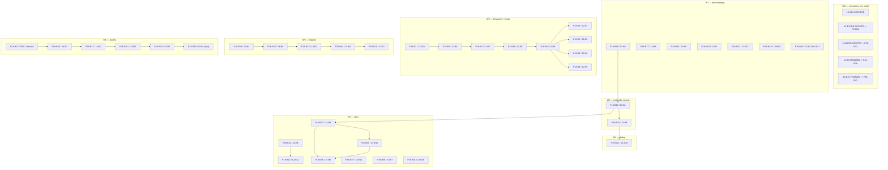

# 18 — Consolidated Audit Fixes: Execution Order and Block Register

Three plans (12, 13, 14) were written against `09f1b10`. Thirty-five commits have landed since;
the live baseline is `cdf0697`. This file is **not** a fourth plan. It is the register that says
*which* blocks survive, *in what order*, *under which gates*, and *with which agents*.

**Read discipline (binding).** Every block in §3 defers to its cited source block for detailed
scope, acceptance criteria, alternatives and oracles. An Implementor MUST open the source block
before starting. Where a §3 cell reads `→ source plan`, this plan deliberately does not restate the
scope — restating it from memory would introduce drift, which is the exact failure this
consolidation exists to prevent.

**Binding Tech Lead decisions, baked in, not re-opened:**

| ID | Decision |
|---|---|
| `DEC-X` | Exit code `130` is **retained**. The contract table is **six rows**: `0` success · `1` download failure only · `2` usage error · `3` configuration error · `130` interrupted/cancelled · `4`–`129` and `131`+ unallocated. Plan 13 `B1`'s acceptance criterion as written would delete the `130` row and is superseded. |
| `DEC-Y` | `P12-B11` is **re-scoped, not dropped**. Its original criterion is withdrawn as false on arrival. A replacement criterion must be written. |
| `DEC-Z` | New block **`P18-B14`** owns `services/downloader.py` + `tests/test_hls_downloader.py`: the 28 `does not explicitly export attribute` errors. No existing plan owns it at the right size. The remedy is the owning module's `__all__` or the test's import site — never weakened type checking. |
| `DEC-W` | `DEF-6` resolved as a **no-regression reading**, not a Product Owner ruling. Minimal scope. No speculative redesign. No new facade or abstraction layer. Plan-14 `B4`'s `downloader_throttle.py` split stays, **last**. |
| `DEC-V` | Risk tiering and the agent-assignment rule in §3 (introduced by this consolidation; not a Tech Lead decision, recorded so it is not mistaken for one). |

---

## §1 Scope

### 1.1 IN — surviving blocks

Severity is **inherited** from the source plan's finding and is not re-derived here.
Risk tiers (`DEC-V`):

- **T1** — shared contract: public/exit/log/packaging surface, shared config, the
  `services/downloader.py` facade, or a `tests/test_packaging.py` frozenset. **Single-writer, serialised.**
- **T2** — multi-module behaviour: two or more modules, or one cross-module call path.
- **T3** — isolated: one module, one call path, no shared fixture.

| `P18-B<n>` | Source block | Finding ref | Semantic scope (by symbol) | Files | Sev / Tier |
|---|---|---|---|---|---|
| `P18-B1` | `12-B11` **RE-SCOPED** (`DEC-Y`) | plan 12 | `ytdlp_downloader._sweep_stale_cookie_dirs`, `config.create_parent_directory`, `cli._render_preamble_failure`: three mode-less `mkdir` sites; log file / log parent / working tree / output dir creation posture; rely on `tempfile.mkdtemp` granting the cookie artefact dir `0o700` on POSIX | `services/ytdlp_downloader.py`, `config.py`, `cli.py` | S2 / T2 |
| `P18-B2` | `12-B6` | plan 12 `D-4` | Head of the filesystem→merge precondition chain; establishes the precondition the chain builds on → source plan `B6` | → source plan `B6` | S2 / T2 |
| `P18-B3` | `12-B7` | plan 12 | Second link in the merge precondition chain → source plan `B7` | → source plan `B7` | S2 / T2 |
| `P18-B4` | `12-B9` | plan 12 `D-5` | `.part` probe / `--no-part` / probe both — unchosen → source plan `B9` | → source plan `B9` | S2 / T2 |
| `P18-B5` | `12-B8` | plan 12 | Download-stage demand figure **and** multiplier — unchosen → source plan `B8` | → source plan `B8` | S2 / T2 |
| `P18-B6` | `12-B1` | plan 12 | No open decision recorded in the source plan → source plan `B1` | → source plan `B1` | S2 / T2 |
| `P18-B7` | `12-B2` | plan 12 | Warn at all three sites vs keep suppression — unchosen → source plan `B2` | → source plan `B2` | S3 / T2 |
| `P18-B8` | `12-B4` | plan 12 | No open decision recorded → source plan `B4` | → source plan `B4` | S3 / T2 |
| `P18-B9` | `12-B5` | plan 12 `D-3` | `D-3` — unchosen → source plan `B5` | → source plan `B5` | S3 / T2 |
| `P18-B10` | `12-B3` | plan 12 | No open decision recorded → source plan `B3` | → source plan `B3` | S3 / T2 |
| `P18-B11` | `12-B10` | plan 12, `DEF-6` | Tier 1 exact-URL dedup before any network call; tier 2 resolved-filename dedup after a **single** metadata extraction, reusing `perform_download`'s pre-extracted `video_data` / `selected_stream` contract. `DEC-W` fixes the **rule**, not the **site** | `services/downloader.py::perform_download`, `services/batch_downloader.py` | S1 / T1 |
| `P18-B12` | `12-B12` | plan 12 | No open decision recorded → source plan `B12` | → source plan `B12` | S4 / T3 |
| `P18-B13` | `13-B1` | plan 13 | Six-row exit-code contract per `DEC-X`; `cli.py` produces `0`/`1`/`2`/`3`/`130`; both `cli-reference*.md` carry the six-row table; supersedes the source plan's four-row acceptance criterion | `cli.py`, `docs/99-reference/cli-reference.md`, `docs/99-reference/cli-reference-clean.md`, `tests/test_cli.py` | S2 / T1 |
| `P18-B14` | **NEW** (`DEC-Z`) | mypy delta | `services/downloader.py::__all__` currently names 20 symbols; 28 further names are imported from the facade by `tests/test_hls_downloader.py` (39 errors) and omitted, so mypy rejects them. Fix = extend the owning module's `__all__`, or move the test's import site. **Never** relax type checking | `services/downloader.py`, `tests/test_hls_downloader.py` | S2 / T1 |
| `P18-B15` | `13-B9` | plan 13 | Give `models/enums.py::ProgressStatus.SKIPPED` a producer; prerequisite for `P18-B11`'s dedup reporting → source plan `B9` | `services/batch_downloader.py`, `models/enums.py` | S2 / T2 |
| `P18-B16` | `13-B5` | plan 13 | No open decision recorded → source plan `B5` | → source plan `B5` | S3 / T2 |
| `P18-B17` | `13-B8` | plan 13 | Unchosen → source plan `B8` | → source plan `B8` | S3 / T2 |
| `P18-B18` | `13-B10` | plan 13 | Unchosen → source plan `B10` | → source plan `B10` | S3 / T2 |
| `P18-B19` | `13-B11` **+** `13-B12` | plan 13 | Two source blocks merged into **one commit** — same concern, one writer → plan 13 `B11` + `B12` | → source plan `B11`, `B12` | S3 / T2 |
| `P18-B20` | `13-B17` | plan 13 | Unchosen → source plan `B17` | → source plan `B17` | S3 / T2 |
| `P18-B21` | `13-B3` | plan 13 | Unchosen; first block to touch the `setup_logging` processor chain → source plan `B3` | `config.py::setup_logging` | S2 / T2 |
| `P18-B22` | `13-B6` | plan 13 | Unchosen → source plan `B6` | → source plan `B6` | S3 / T2 |
| `P18-B23` | `13-B7` | plan 13 | No open decision recorded → source plan `B7` | → source plan `B7` | S3 / T2 |
| `P18-B24` | `13-B4` | plan 13 | Unchosen; sequenced after `P18-B21`/`B22`/`B23` by the wave → source plan `B4` | → source plan `B4` | S3 / T2 |
| `P18-B25` | `13-B2` | plan 13 | Unchosen → source plan `B2` | → source plan `B2` | S3 / T2 |
| `P18-B26` | `14-B1` | plan 14 | Unchosen → source plan `B1` | → source plan `B1` | S3 / T2 |
| `P18-B27` | `14-B2` | plan 14 | Unchosen → source plan `B2` | → source plan `B2` | S3 / T2 |
| `P18-B28` | `14-B4` | plan 14 `D7`/`D8` | Eight external gates. Includes the `downloader_throttle.py` split, which per `DEC-W` stays **last** of the W6 group | `services/downloader_throttle.py` + the 8 gate files | S3 / T2 |
| `P18-B29` | `14-B12` | plan 14 | No open decision recorded → source plan `B12` | → source plan `B12` | S4 / T3 |
| `P18-B30` | `14-B3` | plan 14 `D5` | Python pin alignment (`requires-python`, ruff `py312`, mypy `3.12`). All three currently read `3.12` and agree; Ruling B (`>=3.14`) has **not** landed, so this block is currently a **no-op** | `pyproject.toml` | S4 / T1 |
| `P18-B31` | `14-B5` | plan 14 | No open decision recorded → source plan `B5` | → source plan `B5` | S3 / T2 |
| `P18-B32` | `14-B6` **RE-SCOPED** | plan 14 | Four wrong `docs/STRUCT.md` rows (`models/enums.py` — "Quality, Method" names nothing that exists; `models/video.py`; `models/dtos.py`; `ffmpeg_utils.py` — "FFmpeg discovery and stream concatenation"). Plus the `Layering` disclosure of the `models → exceptions` upward import. Its `P12-B12` start-gate is **dropped as pointless** | `docs/STRUCT.md` | S3 / T1 |
| `P18-B33` | `14-B9` | plan 14 | Delete `docs/99-reference/cli-reference-clean.md`; update `EXPECTED_SDIST_ENTRIES` 73 → 72. **`tests/test_cli.py` must be added to its file list** — `tests/test_cli.py::_REFERENCE_DOC_NAMES` currently names the deleted doc | `docs/99-reference/cli-reference-clean.md`, `tests/test_cli.py`, `tests/test_packaging.py`, `docs/99-reference/cli-reference.md` | S2 / T1 |
| `P18-B34` | `14-B13` | plan 14 | No open decision recorded → source plan `B13` | → source plan `B13` | S4 / T3 |
| `P18-B35` | `14-B10` | plan 14 | `EXPECTED_SDIST_ENTRIES` 72 → 71 after `P18-B33`. Shares the `tests/test_packaging.py` frozenset with `P18-B33` — **must** be serialised after it | `tests/test_packaging.py`, `docs/99-reference/cli-reference.md` | S2 / T1 |
| `P18-B36` | `14-B8` **TRIMMED** | plan 14 | Remainder only: the universal-export claim in the `cli-reference*.md` export section, four incorrect per-file line-count claims, one table row with no name in its first column. The `--method ffmpeg` row is **already fixed** and is out of scope | `docs/99-reference/cli-reference.md`, `docs/99-reference/cli-reference-clean.md` | S3 / T1 |
| `P18-B37` | `14-B11` | plan 14 | Unchosen → source plan `B11` | → source plan `B11` | S3 / T2 |
| `P18-B38` | `14-B7` | plan 14 | Unchosen → source plan `B7` | → source plan `B7` | S3 / T2 |
| `P18-B39` | `13-B14` | plan 13 | Unchosen; independent, placeable in any wave → source plan `B14` | → source plan `B14` | S3 / T2 |
| `P18-B40` | `13-B15` | plan 13 | Unchosen; independent, placeable in any wave → source plan `B15` | → source plan `B15` | S3 / T2 |
| `P18-B41` | `13-B16` **TRIMMED** | plan 13 | Remainder only: a single stale "ffmpeg path" comment in `services/progress_display.py`. The `batch_downloader.py` docstrings were fixed by `7eda45a` and are out of scope | `services/progress_display.py` | S4 / T3 |

**Count.** 41 `P18` blocks covering **42** source blocks (`13-B11` and `13-B12` are merged into `P18-B19`),
drawn from 38 outstanding + 2 re-scoped + 1 new, less 1 dropped.

### 1.2 OUT / ceded

| Item | Owner | Reason |
|---|---|---|
| `13-B13` token-refresh `OSError` arm | **dropped** | `e6e6c68` already narrowed the handler; no `OSError` arm remains |
| `13-B16` `batch_downloader.py` docstrings | ceded | fixed by `7eda45a` |
| `14-B8` `--method ffmpeg` row | ceded | already fixed in the live docs |
| `P12-B11` original criterion | **withdrawn** | false on arrival (`DEC-Y`) |
| `P12-B11` skip-budget clause | **void** | `3778e13` made the three `0o600` oracles executable |
| `P12-B11` `gettempdir` / `iterdir` / `rmtree` zero-`grep` criterion | **withdrawn** | `ytdlp_downloader._sweep_stale_cookie_dirs` legitimately uses all three, plus an age grace |
| `13-B1` four-row exit table acceptance criterion | **superseded** | would delete the `130` row; `DEC-X` supersedes |
| `P12-C4`, `P12-I4`, `P12` §7.3 end-of-plan assertion | **void** | `services/ffmpeg_utils.py` imported `utils.url_sanitizer` in `486bfd9`; the leaf property is broken, so a leaf-purity assertion cannot pass |
| plan-14 §2.3 / §2.9 "`check_ffmpeg_available` return value discarded" | **void** | `e6e6c68` consumes it via `logger.warning("ffmpeg_missing_for_merge", …)` |
| `14-B3` python-pin work | **currently a no-op** | `pyproject.toml` pins agree at `3.12`; Ruling B (`>=3.14`) has not landed |
| D-11 "skip budget" clause | **void** | `3778e13` made the permission oracles executable |
| All plan-12 `utils/security.py` scope | **ceded, zero drift** | `utils/security.py` is byte-identical to `e59523c`; every anchor holds |
| Plan-12 drift review of `tests/test_security.py`, `tests/test_segment_downloader.py` | **ceded, zero drift** | never touched since `09f1b10` |
| `--log-level` / `--log-file` CLI flag introduction | **not planned here** | both flags do not exist; adding them is a Product Owner scope decision, not an audit fix. See §5 residual R4. |

### 1.3 DROPPED / TRIMMED / RE-SCOPED

| Source block | Disposition | Reason | Where it lands |
|---|---|---|---|
| `13-B13` | **DROPPED** | `e6e6c68` already narrowed the token-refresh handler; no `OSError` arm remains | — |
| `13-B16` | **TRIMMED** | `batch_downloader.py` docstrings fixed by `7eda45a`; only one stale "ffmpeg path" comment in `progress_display.py` remains | `P18-B41` |
| `14-B8` | **TRIMMED** | the `--method ffmpeg` row is already fixed; remaining: the universal-export claim, four wrong line counts, one unnamed row | `P18-B36` |
| `14-B6` | **RE-SCOPED** | drop its `P12-B12` start-gate (now pointless); scope to the four wrong rows plus the `Layering` disclosure of the `models → exceptions` upward import | `P18-B32` |
| `P12-B11` | **RE-SCOPED** | `DEC-Y`. Original criterion false on arrival; skip-budget clause void. Remaining substance: three mode-less `mkdir` sites, the log-file / log-parent / working-tree / output-dir posture, and the `tempfile.mkdtemp` `0o700` compensating control. **A new criterion must be written.** | `P18-B1` |

---

## §2 Baseline and constraints

### 2.1 Gate table — re-measured at `cdf0697`

| Gate | Result | Floor |
|---|---|---|
| `uv run pytest -q -rs` | **891 passed, 3 skipped, 1 warning**, exit 0 | ≥ 891 passed; exit 0 |
| `uv run ruff check src tests` | clean, exit 0 | clean, exit 0 |
| `uv run ruff format --check src tests` | **GREEN — 54 files already formatted**, exit 0 | clean, **54 files** |
| `uv run mypy src` | clean, 31 files, exit 0 | clean, 31 files |
| `uv run mypy src tests` | **93 errors in 8 files**, 0 in `src/` | must not grow; `src/` stays 0 |
| `uv run mypy --disallow-any-explicit src` | **12 errors in 8 files** | must not grow |
| `git status --porcelain -- src tests docs pyproject.toml` | empty | empty at every block boundary |
| `tests/test_packaging.py` | `EXPECTED_SDIST_ENTRIES` 73 · `EXPECTED_WHEEL_ENTRIES` 32 · `BUILDER_ADDED_SDIST_ENTRIES` 2 · `EXPECTED_DIST_INFO_ENTRIES` 4 | tracked through `P18-B33` → `P18-B35` |

### 2.2 The three corrected rules

**Rule 1 — the skip composition rule.** The 3 live skips are **not** the D-11 permission oracles.
`3778e13` made those executable. The 3 live skips are POSIX-killpg oracles:
`tests/test_ffmpeg_utils.py` ×2 (marked `skipif(sys.platform == "win32")`, reason "POSIX-only: killpg path")
and `tests/test_hls_downloader.py::TestProcessBoundaryDescendant` ×1 (marked `skipif(sys.platform == "win32")`,
reason "POSIX-only: killpg reaches descendants"). A fourth `skipif` exists in `tests/test_hls_downloader.py`
but is `sys.platform != "win32"` ("Windows-only"), so it executes here and contributes 0 skips.
**These three are untouchable. A change in count _or_ composition is review-blocking.**

**Rule 2 — the format rule.** The red format gate plan 12 planned around **does not exist**. The gate is
green at entry and must stay green. 54 files are asserted. Formatting is never an outcome of any block.

**Rule 3 — the mypy-delta rule.** The delta grew 86/89 → **93**. The entire growth is one defect:
`1b8c339` added `__all__` to `services/downloader.py`, and mypy now rejects 28 names imported from that
facade but omitted. Distribution: `test_hls_downloader.py` 39 · `test_config.py` 31 · `test_extractor.py` 10 ·
`test_batch_downloader.py` 5 · `test_segment_downloader.py` 4 · `test_progress_display.py` 2 ·
`test_quality_spec.py` 1 · `test_downloader.py` 1. Owned by `P18-B14` (`DEC-Z`).

### 2.3 Constraints `C1`–`C12`

- **`C1` — Symbols only.** Cite modules, classes, functions, fields, enum members, table rows, config
  keys. **Zero `file:line` anywhere** — not in briefs, not in acceptance criteria, not in commit
  messages. Anchors must survive unrelated code movement.
- **`C2` — `structlog.get_logger`, not stdlib `logging`.** New call sites use `structlog.get_logger(__name__)`.
  Live context, not a licence to "fix": `config.py::setup_logging` deliberately bridges stdlib logging
  (`logging.FileHandler`, `structlog.stdlib.add_log_level`) and `merge_contextvars`. That bridge is
  existing plumbing — do not remove it as a drive-by.
- **`C3` — All enums live in `models/enums.py`.** Currently: `QualityKind`, `QualityLabel`,
  `StreamFormat`, `LogLevel`, `DownloadMethod`, `CookieSource`, `ErrorCode`, `ProgressStatus`.
  A new fixed value set is a new `StrEnum` there, not a dict or list literal.
- **`C4` — `services/downloader.py` re-exports are plumbing, never the remedy.** When a symbol is
  "missing" downstream, fix the owning module or the import site. Widening the facade to paper over a
  missing implementation is forbidden.
- **`C5` — Packaging-frozenset single-writer lock.** `EXPECTED_SDIST_ENTRIES`, `EXPECTED_WHEEL_ENTRIES`,
  `BUILDER_ADDED_SDIST_ENTRIES`, `EXPECTED_DIST_INFO_ENTRIES` in `tests/test_packaging.py` have exactly
  one writer at a time. Any block that needs them declares it in §3 **before** starting.
- **`C6` — `create=True` appears 0 times in `tests/`.** Keep it 0. Tests write into the tmp filesystem
  through the project's own fixtures; they do not pre-create directories behind production's back.
- **`C7` — `asyncio_mode` is strict.** `pyproject.toml` sets no `asyncio_mode`, so pytest-asyncio default
  strict applies. **Every `async def` test needs `@pytest.mark.asyncio`.** An unmarked async test is
  silently collected and never awaited.
- **`C8` — Explicit-path staging only.** `git add <explicit paths>`. Never `git add -A`, `git add .`,
  `git add -u`. No mutating git command beyond staging and committing the block's own paths.
- **`C9` — `.ai/audit/**` is read-only.** Evidence is read, never edited, and never cited as a work item.
- **`C10` — `AGENTS.md` does not exist.** `.kilo/rules/project.md` binds. Do not create or reference an
  `AGENTS.md`; do not assert a rule that lives nowhere.
- **`C11` — `mypy src` is the type gate; `mypy src tests` is a delta gate only.** `mypy src` must be clean.
  The test-side delta is reported, never fixed by relaxing checking — no `ignore_errors`, no `# type: ignore`
  blanket, no config widening.
- **`C12` — The format gate is green at entry and stays green.** `ruff format --check src tests` must
  report 54 files formatted at every block boundary. No block may end with formatting as its output.

---

## §3 Block register

**Agent rule (`DEC-V`).** Every block requires **Implementor** (not listed — it is the executing role).
Advisors are added only with a one-clause reason:

- **Auditor** — the block changes a shared contract, shared config, packaging, or a source-plan baseline
  assertion is void and must be re-read before code moves.
- **Researcher** — live behaviour since `09f1b10` must be characterised first, or an unknown consumer
  must be enumerated.
- **Planner** — **only** where the block's own shape changed (re-scoped, trimmed, or new). A Planner is
  never assigned to mechanical work, and never to a block that is already fully specified in its source plan.
- **Validator** — the block's acceptance is externally observable (CLI surface, exit codes, log shape,
  filesystem artefacts, packaging manifest) or is a negative invariant (no new skips, no new mypy errors).

`AD` Auditor · `RS` Researcher · `PL` Planner · `VA` Validator

| `P18-B<n>` | Source block | Source plan + section | Semantic scope | Files | `AD` | `RS` | `PL` | `VA` | Open decision |
|---|---|---|---|---|:-:|:-:|:-:|:-:|---|
| `P18-B1` | `12-B11` | 12 · `B11` | `DEC-Y` re-scope: three mode-less `mkdir` sites; log file / log parent / working tree / output dir posture; `tempfile.mkdtemp` gives the cookie artefact dir `0o700` on POSIX | `services/ytdlp_downloader.py`, `config.py`, `cli.py` | ✔ artefact-creation posture is a security surface | ✔ `_sweep_stale_cookie_dirs` and `create_parent_directory` drifted since `09f1b10` | ✔ **re-scope: the replacement criterion must be written** | ✔ artefact modes are filesystem-observable | `DEC-Y` replacement criterion (Planner authors it; Tech Lead ratifies) |
| `P18-B2` | `12-B6` | 12 · `B6` | → `12-B6` | → `12-B6` | ✔ heads the merge precondition chain | ✔ chain must be re-measured at `cdf0697` | — | ✔ filesystem-observable | `D-4` — **unchosen** |
| `P18-B3` | `12-B7` | 12 · `B7` | → `12-B7` | → `12-B7` | ✔ merge precondition is a correctness surface | ✔ | — | ✔ | none recorded |
| `P18-B4` | `12-B9` | 12 · `B9` | → `12-B9` | → `12-B9` | ✔ | ✔ `.part` / `--no-part` interaction unmeasured | — | ✔ | `D-5`: `.part` probe / `--no-part` / probe both — **unchosen** |
| `P18-B5` | `12-B8` | 12 · `B8` | → `12-B8` | → `12-B8` | ✔ | ✔ demand figure needs live evidence | — | ✔ | download-stage demand figure **and** multiplier — **unchosen** |
| `P18-B6` | `12-B1` | 12 · `B1` | → `12-B1` | → `12-B1` | ✔ | ✔ | — | ✔ | none recorded |
| `P18-B7` | `12-B2` | 12 · `B2` | → `12-B2` | → `12-B2` | ✔ | ✔ | — | ✔ | warn at all three sites vs keep suppression — **unchosen** |
| `P18-B8` | `12-B4` | 12 · `B4` | → `12-B4` | → `12-B4` | ✔ | ✔ | — | ✔ | none recorded |
| `P18-B9` | `12-B5` | 12 · `B5` | → `12-B5` | → `12-B5` | ✔ | ✔ | — | ✔ | `D-3` — **unchosen** |
| `P18-B10` | `12-B3` | 12 · `B3` | → `12-B3` | → `12-B3` | ✔ | ✔ | — | ✔ | none recorded |
| `P18-B11` | `12-B10` | 12 · `B10` | `DEF-6` two-tier no-regression reading (see §5 R1) | `services/downloader.py::perform_download`, `services/batch_downloader.py` | ✔ `DEF-6` is a semantic-contract reading, not a settled rule | ✔ must prove a duplicate never launches a second media download | — | ✔ duplicate-suppression is user-observable | placement of tier 2: `(a)` in `download_video` vs `(b)` in `batch_downloader` — **unchosen** |
| `P18-B12` | `12-B12` | 12 · `B12` | → `12-B12` | → `12-B12` | ✔ doc claims a contract | ✔ line counts drift | — | ✔ doc claims are checkable | none recorded |
| `P18-B13` | `13-B1` | 13 · `B1` | six-row exit table per `DEC-X` | `cli.py`, `docs/99-reference/cli-reference.md`, `docs/99-reference/cli-reference-clean.md`, `tests/test_cli.py` | ✔ public exit contract | ✔ `cli.py` has ~19 `typer.Exit` sites incl. a computed `exit_code`; each must be classified | — | ✔ exit codes are the contract | `DEC-X` **settled**; the four-row criterion is superseded |
| `P18-B14` | **NEW** | `DEC-Z` (no source block) | extend `services/downloader.py::__all__` (currently 20 names) or move the test import site, for the 28 omitted names | `services/downloader.py`, `tests/test_hls_downloader.py` | ✔ the facade's public surface is a contract, and no existing plan owns this at the right size | ✔ 28 names across 8 test files must be enumerated and split facade-owned vs test-local | ✔ **new block with no source plan — criterion must be authored** | ✔ the negative invariant (delta must fall) is the acceptance | none — `DEC-Z` settled; the split of the 28 is the Implementor's first step |
| `P18-B15` | `13-B9` | 13 · `B9` | give `ProgressStatus.SKIPPED` a producer | `services/batch_downloader.py`, `models/enums.py` | ✔ | ✔ | — | ✔ | **unchosen** |
| `P18-B16` | `13-B5` | 13 · `B5` | → `13-B5` | → `13-B5` | ✔ | ✔ | — | ✔ | none recorded |
| `P18-B17` | `13-B8` | 13 · `B8` | → `13-B8` | → `13-B8` | ✔ | ✔ | — | ✔ | **unchosen** |
| `P18-B18` | `13-B10` | 13 · `B10` | → `13-B10` | → `13-B10` | ✔ | ✔ | — | ✔ | **unchosen** |
| `P18-B19` | `13-B11` + `13-B12` | 13 · `B11`, `B12` | two source blocks, one commit | → `13-B11`, `13-B12` | ✔ | ✔ the two blocks' scopes must be checked for overlap before merging | — | ✔ | none recorded (both) |
| `P18-B20` | `13-B17` | 13 · `B17` | → `13-B17` | → `13-B17` | ✔ | ✔ | — | ✔ | **unchosen** |
| `P18-B21` | `13-B3` | 13 · `B3` | → `13-B3` | `config.py::setup_logging` | ✔ the processor chain is a shared contract | ✔ chain must be re-read live | — | ✔ log shape is observable | **unchosen**. See §5 R3 — this block is the first to touch the chain and must first confirm the `redact_log_event` placement that plan 11 `B6` landed |
| `P18-B22` | `13-B6` | 13 · `B6` | → `13-B6` | → `13-B6` | ✔ | ✔ | — | ✔ | **unchosen** |
| `P18-B23` | `13-B7` | 13 · `B7` | → `13-B7` | → `13-B7` | ✔ | ✔ | — | ✔ | none recorded |
| `P18-B24` | `13-B4` | 13 · `B4` | → `13-B4` | → `13-B4` | ✔ | ✔ | — | ✔ | **unchosen** |
| `P18-B25` | `13-B2` | 13 · `B2` | → `13-B2` | → `13-B2` | ✔ | ✔ | — | ✔ | **unchosen** |
| `P18-B26` | `14-B1` | 14 · `B1` | → `14-B1` | → `14-B1` | ✔ | ✔ | — | ✔ | **unchosen** |
| `P18-B27` | `14-B2` | 14 · `B2` | → `14-B2` | → `14-B2` | ✔ | ✔ | — | ✔ | **unchosen** |
| `P18-B28` | `14-B4` | 14 · `B4` | includes the `downloader_throttle.py` split — `DEC-W`: **last** | `services/downloader_throttle.py` + the block's 8 external gate files | ✔ eight external gates | ✔ each gate must be re-measured before the split | — | ✔ | `D7` / `D8` — **unchosen**. See §5 R2 — depends on `P18-B14` landing first |
| `P18-B29` | `14-B12` | 14 · `B12` | → `14-B12` | → `14-B12` | ✔ | ✔ | — | ✔ | none recorded |
| `P18-B30` | `14-B3` | 14 · `B3` | `pyproject.toml` python pins — **currently a no-op**; all three agree at `3.12` | `pyproject.toml` | ✔ shared config, read by every tool | ✔ confirm pins have not moved before editing | — | ✔ | `D5` — **unchosen**; if it selects `>=3.14`, the block stops being a no-op |
| `P18-B31` | `14-B5` | 14 · `B5` | → `14-B5` | → `14-B5` | ✔ | ✔ | — | ✔ | none recorded |
| `P18-B32` | `14-B6` | 14 · `B6` | re-scoped: four wrong rows + `Layering` disclosure of `models → exceptions`. `P12-B12` start-gate dropped | `docs/STRUCT.md` | ✔ `STRUCT.md` is the architecture disclosure surface | ✔ 70 lines naming all 31 `.py`; three rows landed, four still wrong | ✔ **re-scope** | ✔ each row is checkable against the module | `P12-B12` gate **dropped**; scope narrowed |
| `P18-B33` | `14-B9` | 14 · `B9` | delete `cli-reference-clean.md`; `EXPECTED_SDIST_ENTRIES` 73 → 72; **`tests/test_cli.py` added** (`_REFERENCE_DOC_NAMES`) | `docs/99-reference/cli-reference-clean.md`, `tests/test_cli.py`, `tests/test_packaging.py`, `docs/99-reference/cli-reference.md` | ✔ deletes a shipped doc and moves a packaging constant | ✔ the deleted doc's sdist entry and its `test_cli.py` reference must both be traced | ✔ **package file list is amended by the trim** | ✔ | **unchosen** |
| `P18-B34` | `14-B13` | 14 · `B13` | → `14-B13` | → `14-B13` | ✔ | ✔ | — | ✔ | none recorded |
| `P18-B35` | `14-B10` | 14 · `B10` | `EXPECTED_SDIST_ENTRIES` 72 → 71 | `tests/test_packaging.py`, `docs/99-reference/cli-reference.md` | ✔ packaging constant, single-writer locked | ✔ | — | ✔ | **unchosen**. **Hard precondition: `P18-B33` must be committed first** |
| `P18-B36` | `14-B8` | 14 · `B8` | trimmed: universal-export claim, four line-count claims, one unnamed row | `docs/99-reference/cli-reference.md`, `docs/99-reference/cli-reference-clean.md` | ✔ | ✔ line counts drift as edits land | ✔ **trim** | ✔ | scope narrowed; `--method ffmpeg` row ceded |
| `P18-B37` | `14-B11` | 14 · `B11` | → `14-B11` | → `14-B11` | ✔ | ✔ | — | ✔ | **unchosen** |
| `P18-B38` | `14-B7` | 14 · `B7` | → `14-B7` | → `14-B7` | ✔ | ✔ | — | ✔ | **unchosen** |
| `P18-B39` | `13-B14` | 13 · `B14` | → `13-B14` | → `13-B14` | ✔ | ✔ | — | ✔ | **unchosen** |
| `P18-B40` | `13-B15` | 13 · `B15` | → `13-B15` | → `13-B15` | ✔ | ✔ | — | ✔ | **unchosen** |
| `P18-B41` | `13-B16` | 13 · `B16` | trimmed to one stale comment | `services/progress_display.py` | — | — | ✔ **trim** | — gate is the `grep` itself | none recorded; scope narrowed |

---

## §4 Ordering

### 4.1 Dependency graph



### 4.2 Linearised order

**W0 — corrections.** No code, no tests, no commits beyond this file. Ruling the register:
`13-B13` dropped; `12-B11` and `14-B6` re-scoped; `14-B8` and `13-B16` trimmed. Reason: every later wave
inherits its file claims from the register, so the register must be correct before any Implementor reads it.

**W1 — free-standing.** `P18-B16` (`13-B5`), `P18-B17` (`13-B8`), `P18-B31` (`14-B5`), `P18-B10` (`12-B3`),
`P18-B20` (`13-B17`), `P18-B18` (`13-B10`), `P18-B19` (`13-B11`+`13-B12`, one commit).
Reason: no recorded predecessor among surviving blocks. Run in any order, one at a time where files collide.
`P18-B16` is placed first inside the wave because `P18-B13` names it as a predecessor. `P18-B19` is a single
block precisely because the two source blocks share a commit boundary and splitting them would create a
non-buildable intermediate state.

**W2 — exit-code contract.** `P18-B13` (`13-B1`) after `P18-B16`; then `P18-B15` (`13-B9`).
Reason: `P18-B13` sets the six-row contract on `cli.py` and both `cli-reference*.md`, which later W7 doc
blocks edit in the same files. `P18-B15` follows because it mutates the same CLI result surface and must not
race with the exit-code edit.

**W3 — filesystem / merge.** `P18-B1` → `P18-B2` → `P18-B3` → `P18-B4` → `P18-B5` → {`P18-B6`, `P18-B7`,
`P18-B8`, `P18-B9`}. Reason for each position:
`P18-B1` first because it establishes the artefact-creation posture (directory modes, log dir, output dir)
that the merge chain reads. `P18-B2` heads the precondition chain as the source plan sequences it.
`P18-B3`, `P18-B4`, `P18-B5` follow the source plan's chain order. `P18-B6`–`B9` are the tail: they are
downstream of the demand decision that `P18-B5` makes, so they cannot precede it.

**W4 — dedup.** `P18-B11` (`12-B10`) after `P18-B15`. Reason: `P18-B15` must have landed, because
`P18-B11`'s dedup reporting depends on `ProgressStatus.SKIPPED` having a producer.

**W5 — logging.** `P18-B21` (`13-B3`), `P18-B22` (`13-B6`), `P18-B23` (`13-B7`), `P18-B24` (`13-B4`),
`P18-B25` (`13-B2`). Reason: the source plan's ordering over the `setup_logging` processor chain, which has
one writer at a time. `P18-B21` is first because it is the first surviving block to touch the chain and must
confirm the `redact_log_event` placement plan 11 `B6` landed before editing anything downstream of it.

**W6 — quality.** `P18-B14` (`DEC-Z` facade) **hoisted to the front of the wave**, then `P18-B26` (`14-B1`),
`P18-B27` (`14-B2`), `P18-B29` (`14-B12`), `P18-B30` (`14-B3`), `P18-B28` (`14-B4`) last.
Reason for the hoist: while 93 test-side mypy errors stand, every subsequent block's delta-gate report is
harder to attribute. Clearing the one defect that caused the entire growth first makes each later block's
delta attributable to that block alone. Reason for `P18-B28` last: `DEC-W` fixes the `downloader_throttle.py`
split as the last item in this wave.

**W7 — docs.** `P18-B32` (`14-B6`) → `P18-B12` (`12-B12`) → `P18-B33` (`14-B9`) → `P18-B35` (`14-B10`) →
`P18-B36` (`14-B8`) → `P18-B37` (`14-B11`) → `P18-B38` (`14-B7`) → `P18-B41` (`13-B16`).
Reason for each position: `P18-B32` owns `docs/STRUCT.md` and lands before any other doc block so the
architecture disclosure is truthful before per-command detail is corrected. `P18-B33` deletes a shipped doc,
which changes the file `P18-B35` and `P18-B36` count lines in and the frozenset `P18-B35` edits, so it
precedes both. `P18-B36` last among the reference-doc blocks because its four line-count claims can only be
correct once `P18-B33` and `P18-B35` have stopped changing the file. `P18-B41` is a source-comment edit with
no shared file; it is placed last in the wave purely as the smallest-risk item.

**Anywhere.** `P18-B39` (`13-B14`) and `P18-B40` (`13-B15`) have no recorded predecessor and no successor.
Slot them into whichever wave has an idle writer.

### 4.3 Writer-file serialisation table

| Shared file | Claiming blocks | Rule |
|---|---|---|
| `tests/test_packaging.py` frozensets | `P18-B33`, `P18-B35` | **Hard serialisation: `B33` → `B35`.** 73 → 72 → 71. Any other block needing the frozensets must declare in §3 first (`C5`). |
| `docs/99-reference/cli-reference.md` + `cli-reference-clean.md` | `P18-B13`, `P18-B33`, `P18-B35`, `P18-B36` | Serialise `B13` → `B33` → `B35` → `B36`. `B36` runs after `B33` and `B35` because its line-count claims depend on their final shape. |
| `tests/test_cli.py` | `P18-B13`, `P18-B33` | Serialise `B13` → `B33`. `B33` **must** edit `tests/test_cli.py::_REFERENCE_DOC_NAMES`, which currently names `cli-reference-clean.md`. |
| `docs/STRUCT.md` | `P18-B32`, `P18-B12` | Serialise `B32` → `B12`. Confirm `P18-B12`'s file claim against the source plan before W7 opens. |
| `tests/test_hls_downloader.py` | `P18-B14`, plus any W1/W3/W5 block the source plans assign there | `P18-B14` is exclusive while it runs. Enumerate the overlap in §3 before W1 opens. |
| `tests/test_segment_downloader.py` (1705 lines) | plan-12 anchors | Never touched since `09f1b10`. Re-confirm the file claim of each W3 block before it starts. |
| `services/downloader.py` | `P18-B11`, `P18-B14`, `P18-B28` | `P18-B14` before `P18-B28` (the split may rewrite the facade's re-export list). `P18-B11` after `P18-B14` so its `perform_download` edit lands against a settled `__all__`. |
| `pyproject.toml` | `P18-B30` | Single writer, T1. Sole owner in this register. |

---

## §5 Risks and residual

### 5.1 Source-plan assumptions now void

| # | Assumption in a source plan | Status at `cdf0697` | Consequence |
|---|---|---|---|
| V1 | The 3 live skips are the D-11 permission oracles | **False.** `3778e13` made them executable; the 3 are POSIX-killpg oracles | The skip-budget clause is void; the composition rule (§2.2 Rule 1) now governs |
| V2 | The format gate is red and plan 12 plans around it | **False.** Green, 54 files | Plan 12's format-related framing does not apply; `C12` governs |
| V3 | The mypy delta is 86 or 89 and needs a per-file sweep | **False.** It is 93, and the entire growth is one defect (`1b8c339`, `__all__` on the facade) | Owned by `P18-B14`; no per-file sweep |
| V4 | `check_ffmpeg_available`'s return value is discarded | **False.** `e6e6c68` consumes it via `logger.warning("ffmpeg_missing_for_merge", …)` | Plan-14 §2.3/§2.9 void |
| V5 | `services/ffmpeg_utils.py` is a leaf module, so `C4`/`I4` and the §7.3 end-of-plan assertion can pass | **False.** `486bfd9` added `from ..utils.url_sanitizer import …` | `P12-C4`, `P12-I4`, §7.3 void |
| V6 | `13-B1` narrows `1` and adds `3`, producing a four-row table | **Superseded.** `cli.py` also produces `130`; `DEC-X` fixes six rows | `DEC-X` governs; the source criterion is superseded |
| V7 | `P12-B11`'s zero-`grep` criterion holds | **False.** `_sweep_stale_cookie_dirs` uses `gettempdir`, `iterdir`, `rmtree`, plus an age grace | `DEC-Y` re-scope |
| V8 | `P12-B11`'s three `0o600` oracles are skipped, consuming a skip budget | **False.** `3778e13` made them executable | Skip-budget clause void |
| V9 | `pyproject.toml` python pins disagree | **False.** `requires-python >=3.12`, ruff `py312`, mypy `3.12` all agree | `P18-B30` is currently a no-op |
| V10 | Plan-11 `B6`'s logging work is outstanding | **False.** It landed: `redact_log_event` is in `setup_logging`'s processor list after `UnicodeDecoder()` | The chain is `merge_contextvars → add_log_level → TimeStamper → format_exc_info → UnicodeDecoder() → redact_log_event → JSONRenderer()/ConsoleRenderer()`. **No exc-info-clearing processor exists.** W5 must start from this shape, not from the pre-`B6` shape |
| V11 | `models/quality.py`, `services/ytdlp_downloader.py`, `utils/__init__.py` are missing from `docs/STRUCT.md` | **False.** Those three rows landed | `P18-B32` has four rows left, not seven |
| V12 | `13-B16`'s `batch_downloader.py` docstrings are stale | **False.** Fixed by `7eda45a` | Trimmed to one comment |
| V13 | `14-B8`'s `--method ffmpeg` row is wrong | **False.** Already fixed | Row ceded out of `P18-B36` |

### 5.2 Cross-plan conflicts live today

| # | Conflict | Resolution |
|---|---|---|
| R1 | `DEF-6` (`12-B10`) and `13-B9` disagree about what "skipping a duplicate" means. Plan 12's dedup key is the resolved output filename, which requires metadata; `13-B9` is the producer of `ProgressStatus.SKIPPED` | **Resolved as a no-regression reading** (`DEC-W`), recorded as a *reading*, **not** a Product Owner ruling. Two tiers: (1) exact-URL dedup **before any network call**; (2) resolved-filename dedup **after a single metadata extraction**, reusing `perform_download`'s existing pre-extracted `video_data` / `selected_stream` contract. A duplicate must never launch a second **media download**; resolving metadata once is permitted. **What would falsify this reading:** a case where the pre-extracted `video_data` / `selected_stream` pair does not uniquely determine the output filename (e.g. a stream whose rendered filename collides with a different video's), or where metadata extraction itself is more expensive than the download it would save — in which case tier 2 must be gated or dropped, and `DEF-6` escalates to the Product Owner. |
| R2 | `14-B4` has 8 external gates; `DEC-Z`'s facade block also rewrites `services/downloader.py` | `P18-B14` lands first (W6 front); `P18-B28` follows and re-measures all 8 gates against the post-`B14` facade. `DEC-W` keeps the `downloader_throttle.py` split last in W6 |
| R3 | Plan 11 `B6` landed `redact_log_event` into the processor chain, but the `SEC-003:` comment still says "Sixteen exception-carrying records", and no exc-info-clearing processor exists | `P18-B21` (`13-B3`) is the first surviving block to touch the chain and **must first** reconcile the comment's claim against the live chain. If the comment is stale, correcting it is in scope for `P18-B21`; if the clearing processor is genuinely missing, that is new work and must be raised, not silently invented. |
| R4 | `cli.py::_render_preamble_failure` still tells the operator to "Check the `--log-file` option or `VKDOWNLOADER_LOG_FILE` environment variable", but **neither `--log-level` nor `--log-file` exists as a CLI flag**. `models/enums.py::LogLevel` exists (5 members) and `config.py` has `log_level` / `log_file` settings fields, but no Typer option surfaces them | **Unassigned.** This is a user-facing inaccuracy, not an audit finding, and adding the flags is a Product Owner scope decision. Assign it explicitly to the plan-13 CLI block that owns `_render_preamble_failure` — most likely `P18-B16` (`13-B5`) or `P18-B20` (`13-B17`) — **before W1 opens**, and record the assignment in §3. Do not add the flags as a drive-by. |
| R5 | `services/ffmpeg_utils.py` is 636 lines and all nine permanent symbols exist, but the module is **no longer a leaf** | **Unowned.** No surviving block repairs it, and `DEC-W` forbids inventing a new block. Path: `P18-B32` must disclose the `url_sanitizer` import truthfully in the `Layering` disclosure of `docs/STRUCT.md`, whatever the repair decision. `P18-B28` must re-measure whether leaf purity still matters after its split. Repairing it — relocating the import, or inlining it — is a separate Tech Lead decision. |
| R6 | Both `docs/99-reference/cli-reference*.md` exit tables contain a mojibake em dash (`—`) in the four existing rows | Not an audit finding, but W7 edits those exact tables. Do not introduce new mojibake, and do not gratuitously re-encode bytes outside the edited table — that turns a two-row fix into a whole-file rewrite. |

### 5.3 Residual risk accepted

- **Attribution drift.** 41 blocks over three plans is a long chain. If a block's gate fails, bisect by
  running the gate at the previous block's commit; do not relax a floor to make a block pass.
- **Unchosen decisions.** 26 blocks carry decisions this plan deliberately does **not** make. An Implementor
  that picks one without a recorded gate has silently re-decided a Product Owner question. Each such block
  must record its choice and its basis in the commit body.
- **`P18-B30` no-op.** If `D5` does not select `>=3.14`, the block produces no diff. That is a valid outcome;
  it must be recorded as "verified already aligned", not as a failed block.

---

## §6 Per-block task briefs

Template: `.ai\tasks\templates\task_template.yaml`. One entry per block, ready to hand to an Implementor.
`tests_to_run` and `gates` reference §7. **Universal gates (`U`) run at every block boundary.**
All briefs inherit `C1`–`C12` from §2.3.

### W0 — corrections (no code)

The W0 dispositions are recorded in §1.3 and are already applied to the register. There is no Implementor
task for W0: it is an amendment pass to this file, and it is complete when this file is read.

### W1 — free-standing

```yaml
id: P18-B16
title: "plan 13 B5 — see .ai/plans/13-cli-observability-audit-fixes.md"
priority: medium
depends_on: []
source_reference: .ai/plans/13-cli-observability-audit-fixes.md
source_section: B5
description: >
  Execute plan 13 block B5 unchanged. No open decision recorded. Re-measure the
  block's premise against cdf0697 before editing; if the premise moved, stop and
  report rather than adapting silently.
goals: [deliver plan 13 B5 scope, hold all universal gates]
files: [{ path: "see source plan B5 file list" }]
acceptance_criteria:
  - source plan B5 criteria met verbatim
  - "U: pytest >= 891 passed / exactly 3 skips (composition per 2.2 Rule 1)"
  - "U: ruff check clean; ruff format --check 54 files; mypy src clean 31 files"
  - "U: mypy src tests <= 93 errors, 0 in src/"
tests_to_run: [U]
```

```yaml
id: P18-B17
title: "plan 13 B8 — unchosen decision"
priority: medium
depends_on: []
source_reference: .ai/plans/13-cli-observability-audit-fixes.md
source_section: B8
description: >
  Execute plan 13 block B8. The source plan deliberately leaves a decision open.
  Gather the evidence the source plan names, record the choice AND its basis in the
  commit body, then implement. Do not pick a default silently.
goals: [resolve the open decision on the record, deliver plan 13 B8 scope, hold all universal gates]
files: [{ path: "see source plan B8 file list" }]
acceptance_criteria:
  - chosen decision and its evidentiary basis recorded in the commit body
  - source plan B8 criteria met
  - "U: all universal gates; skip composition unchanged"
tests_to_run: [U]
```

```yaml
id: P18-B31
title: "plan 14 B5 — no open decision"
priority: medium
depends_on: []
source_reference: .ai/plans/14-code-quality-audit-fixes.md
source_section: B5
description: Execute plan 14 block B5 unchanged. Declare any file claim that collides with §4.3 before starting.
goals: [deliver plan 14 B5 scope, hold all universal gates]
files: [{ path: "see source plan B5 file list" }]
acceptance_criteria: [source plan B5 criteria met, "U: all universal gates"]
tests_to_run: [U]
```

```yaml
id: P18-B10
title: "plan 12 B3 — no open decision"
priority: medium
depends_on: []
source_reference: .ai/plans/12-filesystem-artifacts-audit-fixes.md
source_section: B3
description: >
  Execute plan 12 block B3. Note: plan 12's format-related framing does not apply
  (V2) — the format gate is green at entry and must stay green (C12).
goals: [deliver plan 12 B3 scope, do not introduce or remove formatting drift, hold all universal gates]
files: [{ path: "see source plan B3 file list" }]
acceptance_criteria:
  - source plan B3 criteria met
  - "no formatting work performed; ruff format --check still reports 54 files"
  - "U: all universal gates"
tests_to_run: [U]
```

```yaml
id: P18-B20
title: "plan 13 B17 — unchosen decision; candidate owner for R4"
priority: medium
depends_on: []
source_reference: .ai/plans/13-cli-observability-audit-fixes.md
source_section: B17
description: >
  Execute plan 13 block B17. Before starting, confirm whether this block owns
  cli._render_preamble_failure. If it does, R4 applies: the emitted hint names a
  --log-file option that does not exist. Correct the message to reference only
  surfaces that exist (the VKDOWNLOADER_LOG_FILE environment variable). Do NOT
  add the --log-file or --log-level CLI flags.
goals: [deliver plan 13 B17 scope, resolve R4 in scope or report it unassigned, hold all universal gates]
files: [{ path: "see source plan B17 file list" }, { path: "src/vkdownloader/cli.py", semantic_anchors: [_render_preamble_failure] }]
acceptance_criteria:
  - chosen decision and basis recorded in the commit body
  - "if R4 is in scope: no operator-facing string names a nonexistent CLI flag"
  - "if R4 is out of scope: R4 reported to the coordinator, not silently dropped"
  - "U: all universal gates"
tests_to_run: [U]
```

```yaml
id: P18-B18
title: "plan 13 B10 — unchosen decision"
priority: medium
depends_on: []
source_reference: .ai/plans/13-cli-observability-audit-fixes.md
source_section: B10
description: Execute plan 13 block B10. Record the open decision and its basis in the commit body.
goals: [resolve the open decision on the record, deliver plan 13 B10 scope, hold all universal gates]
files: [{ path: "see source plan B10 file list" }]
acceptance_criteria: [decision and basis recorded, source plan B10 criteria met, "U: all universal gates"]
tests_to_run: [U]
```

```yaml
id: P18-B19
title: "plan 13 B11 + B12 — merged into one commit"
priority: medium
depends_on: []
source_reference: .ai/plans/13-cli-observability-audit-fixes.md
source_section: "B11, B12"
description: >
  Execute plan 13 blocks B11 and B12 as ONE commit. The merge exists because the
  two blocks share a commit boundary; splitting them would create a non-buildable
  intermediate state. Confirm the two scopes do not conflict before starting; if
  they do, stop and report rather than interleaving them.
goals: [deliver both blocks atomically, leave the tree buildable at every commit, hold all universal gates]
files: [{ path: "see source plan B11 + B12 file list" }]
acceptance_criteria:
  - both blocks' criteria met in a single commit
  - exactly one commit produced
  - "U: all universal gates"
tests_to_run: [U]
```

### W2 — exit-code contract

```yaml
id: P18-B13
title: "plan 13 B1 — six-row exit-code contract (DEC-X)"
priority: high
depends_on: [P18-B16]
source_reference: .ai/plans/13-cli-observability-audit-fixes.md
source_section: B1
description: >
  Execute plan 13 block B1 under DEC-X. The source plan's acceptance criterion as
  written would DELETE the 130 row — do not apply it. The contract is SIX rows:
  0 success; 1 download failure only; 2 usage error; 3 configuration error;
  130 interrupted/cancelled; 4-129 and 131+ unallocated. cli.py currently raises
  typer.Exit(code=1) at the bulk of its sites and typer.Exit(code=130) at two,
  plus one computed exit_code; classify every site. Both
  docs/99-reference/cli-reference.md and cli-reference-clean.md carry the table.
  Rewriting 130 semantics is out of scope.
goals:
  - six-row table in both reference docs and in cli.py's actual behaviour
  - "code 1 narrowed to download failure only; code 3 introduced for configuration error"
  - "code 2 stays terminal and separate: nothing attempted, no file created"
files:
  - path: src/vkdownloader/cli.py
    semantic_anchors: [every typer.Exit call site]
  - path: docs/99-reference/cli-reference.md
    semantic_anchors: ["the Exit codes table"]
  - path: docs/99-reference/cli-reference-clean.md
    semantic_anchors: ["the Exit codes table"]
  - path: tests/test_cli.py
acceptance_criteria:
  - "both reference docs carry exactly six exit rows; the 130 row is present and unchanged in meaning"
  - "docs and cli.py behaviour agree row for row"
  - "no table row lost; no mojibake introduced (R6)"
  - "U: all universal gates"
tests_to_run: [U, "exit-code assertions in tests/test_cli.py"]
```

```yaml
id: P18-B15
title: "plan 13 B9 — give ProgressStatus.SKIPPED a producer"
priority: high
depends_on: [P18-B13]
source_reference: .ai/plans/13-cli-observability-audit-fixes.md
source_section: B9
description: >
  Execute plan 13 block B9. models/enums.py::ProgressStatus.SKIPPED currently has
  no producer. This block is the hard prerequisite for P18-B11's dedup reporting.
  Record the open decision and its basis in the commit body.
goals: [SKIPPED becomes reachable from the dedup path, record the open decision, hold all universal gates]
files:
  - path: src/vkdownloader/services/batch_downloader.py
  - path: src/vkdownloader/models/enums.py
    semantic_anchors: [ProgressStatus]
acceptance_criteria:
  - "SKIPPED has a producer reachable from the dedup path, not only from tests"
  - decision and basis recorded in the commit body
  - "U: all universal gates"
tests_to_run: [U]
```

### W3 — filesystem / merge

```yaml
id: P18-B1
title: "plan 12 B11 RE-SCOPED — artefact-creation posture (DEC-Y)"
priority: high
depends_on: []
agents: [Auditor, Researcher, Planner, Validator]
source_reference: .ai/plans/12-filesystem-artifacts-audit-fixes.md
source_section: B11
description: >
  Execute plan 12 block B11 under DEC-Y. WITHDRAWN: the zero-grep criterion for
  gettempdir / iterdir / rmtree — false on arrival, because
  ytdlp_downloader._sweep_stale_cookie_dirs legitimately uses all three plus an age
  grace. WITHDRAWN: the skip-budget clause — 3778e13 made the three 0o600 oracles
  executable. REMAINING SUBSTANCE: (a) the three mode-less mkdir sites;
  (b) the log file / log parent / working tree / output dir creation posture;
  (c) the newly-found compensating control — tempfile.mkdtemp gives the cookie
  artefact directory 0o700 on POSIX, which is correct posture and must be
  preserved, not replaced. A Planner MUST author the replacement criterion before
  any code moves; the Tech Lead ratifies it.
goals:
  - replacement criterion written, replacing the withdrawn one
  - every directory this project creates has an explicit, deliberate mode
  - the mkdtemp 0o700 compensating control is preserved and documented
files:
  - path: src/vkdownloader/services/ytdlp_downloader.py
    semantic_anchors: [_sweep_stale_cookie_dirs]
  - path: src/vkdownloader/config.py
    semantic_anchors: [create_parent_directory, "the log_file validator chain"]
  - path: src/vkdownloader/cli.py
    semantic_anchors: [_render_preamble_failure]
acceptance_criteria:
  - replacement criterion exists, is recorded, and the withdrawn criterion is marked withdrawn in the commit body
  - "no mode-less mkdir remains at the three sites"
  - "the cookie artefact directory is still 0o700 on POSIX; no regression"
  - "no new skip introduced; the 3 skips and their composition are unchanged"
  - "U: all universal gates"
tests_to_run: [U, "the three 0o600 permission oracles made executable by 3778e13"]
```

```yaml
id: P18-B2
title: "plan 12 B6 — head of the merge precondition chain (D-4 open)"
priority: high
depends_on: [P18-B1]
agents: [Auditor, Researcher, Validator]
source_reference: .ai/plans/12-filesystem-artifacts-audit-fixes.md
source_section: B6
description: >
  Execute plan 12 block B6. D-4 is deliberately unchosen — gather the evidence the
  source plan names, record the choice and its basis, then implement.
goals: [resolve D-4 on the record, deliver plan 12 B6 scope, hold all universal gates]
files: [{ path: "see source plan B6 file list" }]
acceptance_criteria:
  - "D-4 chosen; choice and basis recorded in the commit body"
  - source plan B6 criteria met
  - "U: all universal gates"
tests_to_run: [U]
```

```yaml
id: P18-B3
title: "plan 12 B7 — second link in the merge precondition chain"
priority: high
depends_on: [P18-B2]
agents: [Auditor, Researcher, Validator]
source_reference: .ai/plans/12-filesystem-artifacts-audit-fixes.md
source_section: B7
description: Execute plan 12 block B7. No open decision recorded.
goals: [deliver plan 12 B7 scope, hold all universal gates]
files: [{ path: "see source plan B7 file list" }]
acceptance_criteria: [source plan B7 criteria met, "U: all universal gates"]
tests_to_run: [U]
```

```yaml
id: P18-B4
title: "plan 12 B9 — .part probe decision (D-5 open)"
priority: high
depends_on: [P18-B3]
agents: [Auditor, Researcher, Validator]
source_reference: .ai/plans/12-filesystem-artifacts-audit-fixes.md
source_section: B9
description: >
  Execute plan 12 block B9. D-5 is deliberately unchosen between: probe the .part
  file, pass --no-part, or probe both. Record the choice and its basis.
goals: [resolve D-5 on the record, deliver plan 12 B9 scope, hold all universal gates]
files: [{ path: "see source plan B9 file list" }]
acceptance_criteria:
  - "D-5 chosen; choice and basis recorded in the commit body"
  - source plan B9 criteria met
  - "U: all universal gates"
tests_to_run: [U]
```

```yaml
id: P18-B5
title: "plan 12 B8 — download-stage demand figure and multiplier"
priority: high
depends_on: [P18-B4]
agents: [Auditor, Researcher, Validator]
source_reference: .ai/plans/12-filesystem-artifacts-audit-fixes.md
source_section: B8
description: >
  Execute plan 12 block B8. TWO things are unchosen here: the download-stage demand
  figure AND its multiplier. Both must be chosen explicitly and recorded; a figure
  adopted without a basis is not acceptable.
goals:
  - demand figure chosen from live evidence and recorded
  - multiplier chosen, justified, and recorded
  - deliver plan 12 B8 scope
files: [{ path: "see source plan B8 file list" }]
acceptance_criteria:
  - "figure and multiplier each chosen; basis for each recorded in the commit body"
  - source plan B8 criteria met
  - "U: all universal gates"
tests_to_run: [U]
```

```yaml
id: P18-B6
title: "plan 12 B1 — merge chain tail"
priority: high
depends_on: [P18-B5]
agents: [Auditor, Researcher, Validator]
source_reference: .ai/plans/12-filesystem-artifacts-audit-fixes.md
source_section: B1
description: >
  Execute plan 12 block B1. Downstream of the demand decision in P18-B5; it cannot
  precede it. No open decision recorded.
goals: [deliver plan 12 B1 scope, hold all universal gates]
files: [{ path: "see source plan B1 file list" }]
acceptance_criteria: [source plan B1 criteria met, "U: all universal gates"]
tests_to_run: [U]
```

```yaml
id: P18-B7
title: "plan 12 B2 — warn at all three sites vs keep suppression (open)"
priority: medium
depends_on: [P18-B5]
agents: [Auditor, Researcher, Validator]
source_reference: .ai/plans/12-filesystem-artifacts-audit-fixes.md
source_section: B2
description: >
  Execute plan 12 block B2. The open decision is whether to warn at all three sites
  or keep the existing suppression. Record the choice and its basis.
goals: [resolve the warning-suppression decision on the record, deliver plan 12 B2 scope]
files: [{ path: "see source plan B2 file list" }]
acceptance_criteria:
  - "decision chosen and basis recorded in the commit body"
  - source plan B2 criteria met
  - "U: all universal gates"
tests_to_run: [U]
```

```yaml
id: P18-B8
title: "plan 12 B4 — merge chain tail"
priority: medium
depends_on: [P18-B5]
agents: [Auditor, Researcher, Validator]
source_reference: .ai/plans/12-filesystem-artifacts-audit-fixes.md
source_section: B4
description: Execute plan 12 block B4. Downstream of P18-B5. No open decision recorded.
goals: [deliver plan 12 B4 scope, hold all universal gates]
files: [{ path: "see source plan B4 file list" }]
acceptance_criteria: [source plan B4 criteria met, "U: all universal gates"]
tests_to_run: [U]
```

```yaml
id: P18-B9
title: "plan 12 B5 — D-3 open"
priority: medium
depends_on: [P18-B5]
agents: [Auditor, Researcher, Validator]
source_reference: .ai/plans/12-filesystem-artifacts-audit-fixes.md
source_section: B5
description: Execute plan 12 block B5. D-3 is deliberately unchosen. Record the choice and its basis.
goals: [resolve D-3 on the record, deliver plan 12 B5 scope, hold all universal gates]
files: [{ path: "see source plan B5 file list" }]
acceptance_criteria:
  - "D-3 chosen; choice and basis recorded in the commit body"
  - source plan B5 criteria met
  - "U: all universal gates"
tests_to_run: [U]
```

### W4 — dedup

```yaml
id: P18-B11
title: "plan 12 B10 — DEF-6 two-tier dedup (DEC-W no-regression reading)"
priority: high
depends_on: [P18-B15]
agents: [Auditor, Validator]
source_reference: .ai/plans/12-filesystem-artifacts-audit-fixes.md
source_section: B10
description: >
  Execute plan 12 block B10 under DEC-W. TWO TIERS: (1) exact-URL dedup BEFORE any
  network call; (2) resolved-filename dedup AFTER a single metadata extraction,
  reusing perform_download's existing pre-extracted video_data / selected_stream
  contract. A duplicate must never launch a second MEDIA DOWNLOAD; resolving
  metadata once is permitted. The site of tier 2 remains UNCHOSEN: (a) in
  download_video vs (b) in batch_downloader — record the choice and its basis.
  This is a reading, not a Product Owner ruling. Before implementing, check the
  falsifier: if the pre-extracted video_data / selected_stream pair does not
  uniquely determine the output filename, or if metadata extraction costs more
  than the download it saves, STOP and escalate — do not implement tier 2.
goals:
  - tier 1 dedup is network-free
  - tier 2 resolves metadata exactly once and launches no second media download
  - dedup reporting uses the ProgressStatus.SKIPPED producer landed by P18-B15
files:
  - path: src/vkdownloader/services/downloader.py
    semantic_anchors: [perform_download, __all__]
  - path: src/vkdownloader/services/batch_downloader.py
acceptance_criteria:
  - "tier-2 site chosen ((a) or (b)) and basis recorded in the commit body"
  - "falsifier checked and the check recorded; escalated if it fired"
  - "no duplicate path performs a second media download; proven by test, not by inspection"
  - "P18-B14 has landed, so services/downloader.py __all__ is settled (4.3)"
  - "U: all universal gates"
tests_to_run: [U]
```

### W5 — logging

```yaml
id: P18-B21
title: "plan 13 B3 — logging chain; reconcile SEC-003 first (R3)"
priority: high
depends_on: []
agents: [Auditor, Researcher, Validator]
source_reference: .ai/plans/13-cli-observability-audit-fixes.md
source_section: B3
description: >
  Execute plan 13 block B3. FIRST, reconcile R3: the live chain is
  merge_contextvars -> add_log_level -> TimeStamper -> format_exc_info ->
  UnicodeDecoder() -> redact_log_event -> JSONRenderer()/ConsoleRenderer(),
  as landed by plan 11 B6, and NO exc-info-clearing processor exists, while the
  SEC-003: comment still claims "Sixteen exception-carrying records". If the
  comment is stale, correcting it is in scope for this block. If a clearing
  processor is genuinely missing, that is NEW work: raise it, do not invent it.
  Then execute plan 13 B3, recording its open decision and basis.
goals:
  - live chain confirmed and the SEC-003 comment made true, or the gap escalated
  - deliver plan 13 B3 scope
  - open decision recorded with basis
files:
  - path: src/vkdownloader/config.py
    semantic_anchors: [setup_logging, "the processor chain", "the SEC-003 comment"]
acceptance_criteria:
  - "SEC-003 comment matches the live chain, or the discrepancy is escalated in the commit body"
  - "redact_log_event remains positioned after UnicodeDecoder() unless plan 13 B3's criterion says otherwise and says why"
  - "open decision and basis recorded"
  - "U: all universal gates"
tests_to_run: [U]
```

```yaml
id: P18-B22
title: "plan 13 B6 — logging chain, second"
priority: medium
depends_on: [P18-B21]
agents: [Auditor, Researcher, Validator]
source_reference: .ai/plans/13-cli-observability-audit-fixes.md
source_section: B6
description: Execute plan 13 block B6. Record the open decision and its basis.
goals: [resolve the open decision on the record, deliver plan 13 B6 scope]
files: [{ path: "see source plan B6 file list" }]
acceptance_criteria: [decision and basis recorded, source plan B6 criteria met, "U: all universal gates"]
tests_to_run: [U]
```

```yaml
id: P18-B23
title: "plan 13 B7 — logging chain, third"
priority: medium
depends_on: [P18-B22]
agents: [Auditor, Researcher, Validator]
source_reference: .ai/plans/13-cli-observability-audit-fixes.md
source_section: B7
description: Execute plan 13 block B7. No open decision recorded.
goals: [deliver plan 13 B7 scope, hold all universal gates]
files: [{ path: "see source plan B7 file list" }]
acceptance_criteria: [source plan B7 criteria met, "U: all universal gates"]
tests_to_run: [U]
```

```yaml
id: P18-B24
title: "plan 13 B4 — logging chain, fourth"
priority: medium
depends_on: [P18-B23]
agents: [Auditor, Researcher, Validator]
source_reference: .ai/plans/13-cli-observability-audit-fixes.md
source_section: B4
description: Execute plan 13 block B4. Record the open decision and its basis.
goals: [resolve the open decision on the record, deliver plan 13 B4 scope]
files: [{ path: "see source plan B4 file list" }]
acceptance_criteria: [decision and basis recorded, source plan B4 criteria met, "U: all universal gates"]
tests_to_run: [U]
```

```yaml
id: P18-B25
title: "plan 13 B2 — logging chain, fifth"
priority: medium
depends_on: [P18-B24]
agents: [Auditor, Researcher, Validator]
source_reference: .ai/plans/13-cli-observability-audit-fixes.md
source_section: B2
description: Execute plan 13 block B2. Record the open decision and its basis.
goals: [resolve the open decision on the record, deliver plan 13 B2 scope]
files: [{ path: "see source plan B2 file list" }]
acceptance_criteria: [decision and basis recorded, source plan B2 criteria met, "U: all universal gates"]
tests_to_run: [U]
```

### W6 — quality

```yaml
id: P18-B14
title: "DEC-Z facade/mypy — 28 does-not-explicitly-export-attribute errors"
priority: high
depends_on: []
agents: [Auditor, Researcher, Planner, Validator]
source_reference: ".ai/plans/ (no source block — created by DEC-Z)"
source_section: null
description: >
  Fix the 93-error mypy delta at its single root. 1b8c339 added __all__ to
  services/downloader.py naming 20 symbols; 28 further names are imported from
  that facade by tests/test_hls_downloader.py (39 errors) and other test files
  but omitted, so mypy rejects them. Distribution: test_hls_downloader.py 39,
  test_config.py 31, test_extractor.py 10, test_batch_downloader.py 5,
  test_segment_downloader.py 4, test_progress_display.py 2, test_quality_spec.py 1,
  test_downloader.py 1. RULE: the fix is the OWNING MODULE's __all__ or the TEST's
  import site. NEVER weakened type checking — no ignore_errors, no blanket
  type: ignore, no config widening (C11). STEP 1: enumerate the 28 and classify
  each as facade-owned (belongs in __all__) or test-local (the test should import
  from the owning module, or the name is private and the test should not use it).
  Facade re-exports are plumbing, never the remedy (C4): a name added to __all__
  must actually be re-exported from the facade, not merely declared.
  DEC-Z sizes this block because no existing plan owns it correctly — plan 14 B4
  has 8 external gates.
goals:
  - the mypy src tests delta falls from 93 and reaches 0, or every remaining error is individually justified
  - src/ stays at 0 errors
  - no type checking weakened
files:
  - path: src/vkdownloader/services/downloader.py
    semantic_anchors: [__all__]
  - path: tests/test_hls_downloader.py
acceptance_criteria:
  - "each of the 28 names classified facade-owned or test-local, and the classification recorded"
  - "every name added to __all__ is genuinely re-exported by the facade"
  - "mypy src tests reaches 0 errors, or each residual error carries an inline, specific justification"
  - "mypy src stays clean at 31 files"
  - "no ignore_errors, no blanket type: ignore, no config widening — verifiable by reading pyproject.toml and the diff"
  - "U: all universal gates"
tests_to_run: [U, "uv run mypy src tests"]
```

```yaml
id: P18-B26
title: "plan 14 B1 — unchosen decision"
priority: medium
depends_on: [P18-B14]
agents: [Auditor, Researcher, Validator]
source_reference: .ai/plans/14-code-quality-audit-fixes.md
source_section: B1
description: Execute plan 14 block B1 after P18-B14 has settled the facade. Record the open decision and its basis.
goals: [resolve the open decision on the record, deliver plan 14 B1 scope]
files: [{ path: "see source plan B1 file list" }]
acceptance_criteria: [decision and basis recorded, source plan B1 criteria met, "U: all universal gates"]
tests_to_run: [U]
```

```yaml
id: P18-B27
title: "plan 14 B2 — unchosen decision"
priority: medium
depends_on: [P18-B26]
agents: [Auditor, Researcher, Validator]
source_reference: .ai/plans/14-code-quality-audit-fixes.md
source_section: B2
description: Execute plan 14 block B2. Record the open decision and its basis.
goals: [resolve the open decision on the record, deliver plan 14 B2 scope]
files: [{ path: "see source plan B2 file list" }]
acceptance_criteria: [decision and basis recorded, source plan B2 criteria met, "U: all universal gates"]
tests_to_run: [U]
```

```yaml
id: P18-B29
title: "plan 14 B12 — no open decision"
priority: medium
depends_on: [P18-B27]
agents: [Auditor, Researcher, Validator]
source_reference: .ai/plans/14-code-quality-audit-fixes.md
source_section: B12
description: Execute plan 14 block B12. No open decision recorded.
goals: [deliver plan 14 B12 scope, hold all universal gates]
files: [{ path: "see source plan B12 file list" }]
acceptance_criteria: [source plan B12 criteria met, "U: all universal gates"]
tests_to_run: [U]
```

```yaml
id: P18-B30
title: "plan 14 B3 — python pin alignment; currently a NO-OP"
priority: low
depends_on: [P18-B29]
agents: [Auditor, Researcher, Validator]
source_reference: .ai/plans/14-code-quality-audit-fixes.md
source_section: B3
description: >
  Execute plan 14 block B3. FIRST re-measure pyproject.toml: requires-python is
  >=3.12, ruff target-version is py312, and mypy python_version is 3.12 — they all
  AGREE. Ruling B (>=3.14) has not landed, so there is no misalignment to fix and
  this block is currently a NO-OP. D5 is unchosen. If D5 does not select >=3.14,
  produce NO diff and record the outcome as "verified already aligned" — that is a
  successful block, not a failed one. Do not edit pins to create work.
goals: [record whether a pin change is warranted, record D5 and its basis, produce no gratuitous diff]
files:
  - path: pyproject.toml
    semantic_anchors: ["requires-python", "ruff target-version", "mypy python_version"]
acceptance_criteria:
  - "all three pins read and their agreement or disagreement stated in the commit body"
  - "D5 chosen; choice and basis recorded"
  - "either a warranted, single-purpose pin change, or a no-diff result recorded as verified-aligned"
  - "U: all universal gates"
tests_to_run: [U]
```

```yaml
id: P18-B28
title: "plan 14 B4 — module split; LAST of W6 (DEC-W)"
priority: medium
depends_on: [P18-B30, P18-B14]
agents: [Auditor, Researcher, Validator]
source_reference: .ai/plans/14-code-quality-audit-fixes.md
source_section: B4
description: >
  Execute plan 14 block B4, including the downloader_throttle.py split, which DEC-W
  fixes as the LAST item in W6. Re-measure all 8 external gates against the
  post-P18-B14 facade before the split, not against the pre-B14 one. D7 and D8 are
  unchosen: record both choices and their bases. Also carry R5 forward: re-measure
  whether services/ffmpeg_utils.py leaf purity still matters after the split (it
  does NOT hold today — 486bfd9 added a utils.url_sanitizer import). Report R5;
  do not repair it here.
goals:
  - the split lands with all 8 external gates re-measured and green
  - D7 and D8 recorded with basis
  - R5 re-measured and reported, not silently repaired
files:
  - path: src/vkdownloader/services/downloader_throttle.py
  - path: "the 8 external gate files named in source plan B4"
acceptance_criteria:
  - "all 8 external gates re-measured post-P18-B14 and green"
  - "D7 and D8 chosen; choices and bases recorded in the commit body"
  - "R5 status reported; no unrequested repair of the ffmpeg_utils import"
  - "services/downloader.py is the LAST file this block touches (4.3)"
  - "U: all universal gates"
tests_to_run: [U]
```

### W7 — docs

```yaml
id: P18-B32
title: "plan 14 B6 RE-SCOPED — four wrong STRUCT.md rows + Layering disclosure"
priority: medium
depends_on: []
agents: [Auditor, Planner, Validator]
source_reference: .ai/plans/14-code-quality-audit-fixes.md
source_section: B6
description: >
  Execute plan 14 block B6 under its re-scope. DROPPED: the P12-B12 start-gate —
  it is now pointless. SCOPE: (a) the four still-wrong rows in docs/STRUCT.md —
  models/enums.py claims "Quality, Method" and neither exists (the real members
  are QualityKind, QualityLabel, StreamFormat, LogLevel, DownloadMethod,
  CookieSource, ErrorCode, ProgressStatus); models/video.py; models/dtos.py; and
  ffmpeg_utils.py, described as "FFmpeg discovery and stream concatenation".
  (b) The Layering disclosure of the models -> exceptions upward import.
  (c) R5: disclose truthfully that services/ffmpeg_utils.py imports
  utils.url_sanitizer and is therefore no longer a leaf — disclose the truth
  whatever the repair decision turns out to be.
  CONTEXT, not scope: STRUCT.md is 70 lines and names all 31 .py files; the
  models/quality.py, services/ytdlp_downloader.py and utils/__init__.py rows
  already landed.
files:
  - path: docs/STRUCT.md
    semantic_anchors: ["the four named module rows", "the Layering section"]
acceptance_criteria:
  - "all four wrong rows now describe the module as it is"
  - "models/enums.py names members that exist"
  - "the models -> exceptions upward import is disclosed in Layering"
  - "R5 disclosed truthfully in Layering"
  - "the dropped P12-B12 start-gate is not reinstated"
  - "U: all universal gates"
tests_to_run: [U]
```

```yaml
id: P18-B12
title: "plan 12 B12 — documentation"
priority: low
depends_on: [P18-B32]
agents: [Auditor, Researcher, Validator]
source_reference: .ai/plans/12-filesystem-artifacts-audit-fixes.md
source_section: B12
description: >
  Execute plan 12 block B12. Confirm its file claim against source plan B12 before
  starting: if it also touches docs/STRUCT.md it is serialised behind P18-B32 (4.3).
  Its start-gate relationship to 14-B6 was dropped by the B6 re-scope.
goals: [deliver plan 12 B12 scope, hold all universal gates]
files: [{ path: "see source plan B12 file list" }, { path: "docs/STRUCT.md", note: "only if the source plan claims it" }]
acceptance_criteria: [source plan B12 criteria met, "U: all universal gates"]
tests_to_run: [U]
```

```yaml
id: P18-B33
title: "plan 14 B9 — delete cli-reference-clean.md; sdist 73 -> 72"
priority: high
depends_on: [P18-B13]
agents: [Auditor, Planner, Validator]
source_reference: .ai/plans/14-code-quality-audit-fixes.md
source_section: B9
description: >
  Execute plan 14 block B9. Delete docs/99-reference/cli-reference-clean.md and
  update tests/test_packaging.py EXPECTED_SDIST_ENTRIES from 73 to 72. CRITICAL
  FILE-LIST AMENDMENT: tests/test_cli.py MUST be added to this block's files.
  tests/test_cli.py::_REFERENCE_DOC_NAMES = ("cli-reference.md",
  "cli-reference-clean.md") and will fail against the deleted doc. The source plan
  does not list it. Record the open decision and its basis.
  MUST be serialised before P18-B35 (C5, 4.3).
files:
  - path: docs/99-reference/cli-reference-clean.md
    semantic_anchors: ["the whole document — delete it"]
  - path: tests/test_cli.py
    semantic_anchors: [_REFERENCE_DOC_NAMES]
  - path: tests/test_packaging.py
    semantic_anchors: [EXPECTED_SDIST_ENTRIES]
  - path: docs/99-reference/cli-reference.md
acceptance_criteria:
  - "tests/test_cli.py::_REFERENCE_DOC_NAMES no longer names the deleted doc"
  - "EXPECTED_SDIST_ENTRIES is 72 and tests/test_packaging.py passes"
  - "EXPECTED_WHEEL_ENTRIES 32, BUILDER_ADDED_SDIST_ENTRIES 2, EXPECTED_DIST_INFO_ENTRIES 4 unchanged"
  - "the deleted doc's sdist entry is gone; no orphan reference anywhere (grep the repo)"
  - "no table row or anchor lost from cli-reference.md; no mojibake introduced (R6)"
  - "decision and basis recorded in the commit body"
  - "U: all universal gates"
tests_to_run: [U, "tests/test_cli.py", "tests/test_packaging.py"]
```

```yaml
id: P18-B35
title: "plan 14 B10 — sdist 72 -> 71"
priority: high
depends_on: [P18-B33]
agents: [Auditor, Validator]
source_reference: .ai/plans/14-code-quality-audit-fixes.md
source_section: B10
description: >
  Execute plan 14 block B10. HARD PRECONDITION: P18-B33 must be committed first —
  the two blocks claim the same frozenset in tests/test_packaging.py (C5, 4.3).
  EXPECTED_SDIST_ENTRIES goes 72 -> 71. Record the open decision and its basis.
files:
  - path: tests/test_packaging.py
    semantic_anchors: [EXPECTED_SDIST_ENTRIES]
  - path: docs/99-reference/cli-reference.md
acceptance_criteria:
  - "EXPECTED_SDIST_ENTRIES is 71 and tests/test_packaging.py passes"
  - "P18-B33 confirmed committed before this block opened"
  - "EXPECTED_WHEEL_ENTRIES 32, BUILDER_ADDED_SDIST_ENTRIES 2, EXPECTED_DIST_INFO_ENTRIES 4 unchanged"
  - "decision and basis recorded in the commit body"
  - "U: all universal gates"
tests_to_run: [U, "tests/test_packaging.py"]
```

```yaml
id: P18-B36
title: "plan 14 B8 TRIMMED — export claim, line counts, unnamed row"
priority: medium
depends_on: [P18-B35, P18-B33]
agents: [Auditor, Planner, Validator]
source_reference: .ai/plans/14-code-quality-audit-fixes.md
source_section: B8
description: >
  Execute plan 14 block B8 TRIMMED. CEDED, do not touch: the --method ffmpeg row,
  which is already correct in the live docs. REMAINING: (a) the universal-export
  claim in the cli-reference*.md export section; (b) four incorrect per-file
  line-count claims; (c) one table row with no name in its first column.
  MUST run after P18-B33 and P18-B35: its line-count claims can only be correct
  once those blocks have stopped changing the files. Do not introduce mojibake
  and do not re-encode bytes outside the edited tables (R6).
files:
  - path: docs/99-reference/cli-reference.md
  - path: docs/99-reference/cli-reference-clean.md
acceptance_criteria:
  - "all four line-count claims match reality after P18-B33 and P18-B35"
  - "the universal-export claim is true as written, or removed"
  - "the unnamed row has a name in its first column"
  - "the --method ffmpeg row is untouched"
  - "no mojibake introduced; no whole-file re-encoding"
  - "U: all universal gates"
tests_to_run: [U]
```

```yaml
id: P18-B37
title: "plan 14 B11 — unchosen decision"
priority: medium
depends_on: [P18-B36]
agents: [Auditor, Researcher, Validator]
source_reference: .ai/plans/14-code-quality-audit-fixes.md
source_section: B11
description: Execute plan 14 block B11. Record the open decision and its basis.
goals: [resolve the open decision on the record, deliver plan 14 B11 scope]
files: [{ path: "see source plan B11 file list" }]
acceptance_criteria: [decision and basis recorded, source plan B11 criteria met, "U: all universal gates"]
tests_to_run: [U]
```

```yaml
id: P18-B38
title: "plan 14 B7 — unchosen decision"
priority: medium
depends_on: [P18-B36]
agents: [Auditor, Researcher, Validator]
source_reference: .ai/plans/14-code-quality-audit-fixes.md
source_section: B7
description: Execute plan 14 block B7. Record the open decision and its basis.
goals: [resolve the open decision on the record, deliver plan 14 B7 scope]
files: [{ path: "see source plan B7 file list" }]
acceptance_criteria: [decision and basis recorded, source plan B7 criteria met, "U: all universal gates"]
tests_to_run: [U]
```

```yaml
id: P18-B41
title: "plan 13 B16 TRIMMED — one stale comment in progress_display.py"
priority: low
depends_on: [P18-B36]
agents: [Planner]
source_reference: .ai/plans/13-cli-observability-audit-fixes.md
source_section: B16
description: >
  Execute plan 13 block B16 TRIMMED. CEDED, do not touch: the batch_downloader.py
  docstrings, fixed by 7eda45a. REMAINING: a single stale "ffmpeg path" comment in
  services/progress_display.py. Comment-only; the grep in the acceptance criteria
  IS the verification, so no separate Validator is assigned.
files:
  - path: src/vkdownloader/services/progress_display.py
acceptance_criteria:
  - "no stale ffmpeg-path comment remains in progress_display.py"
  - "batch_downloader.py is not modified"
  - "no behavioural change; diff is comment-only"
  - "U: all universal gates"
tests_to_run: [U]
```

### Anywhere

```yaml
id: P18-B39
title: "plan 13 B14 — unchosen decision; placeable in any wave"
priority: medium
depends_on: []
agents: [Auditor, Researcher, Validator]
source_reference: .ai/plans/13-cli-observability-audit-fixes.md
source_section: B14
description: >
  Execute plan 13 block B14. No recorded predecessor or successor. Slot it into
  whichever wave has an idle writer, honouring §4.3 for any shared file it claims.
goals: [resolve the open decision on the record, deliver plan 13 B14 scope]
files: [{ path: "see source plan B14 file list" }]
acceptance_criteria: [decision and basis recorded, source plan B14 criteria met, "U: all universal gates"]
tests_to_run: [U]
```

```yaml
id: P18-B40
title: "plan 13 B15 — unchosen decision; placeable in any wave"
priority: medium
depends_on: []
agents: [Auditor, Researcher, Validator]
source_reference: .ai/plans/13-cli-observability-audit-fixes.md
source_section: B15
description: >
  Execute plan 13 block B15. No recorded predecessor or successor. Slot it into
  whichever wave has an idle writer, honouring §4.3 for any shared file it claims.
goals: [resolve the open decision on the record, deliver plan 13 B15 scope]
files: [{ path: "see source plan B15 file list" }]
acceptance_criteria: [decision and basis recorded, source plan B15 criteria met, "U: all universal gates"]
tests_to_run: [U]
```

---

## §7 Gate table

### 7.1 Universal gates (`U`) — every block, at its boundary

```powershell
uv run pytest -q -rs
uv run ruff check src tests
uv run ruff format --check src tests
uv run mypy src
git status --porcelain -- src tests docs pyproject.toml
```

| Universal gate | Floor | Meaning of a breach |
|---|---|---|
| `uv run pytest -q -rs` | exit 0, **≥ 891 passed**, **exactly 3 skipped** with the composition in §2.2 Rule 1 | Fewer passes = regression. Different skip count **or** composition = **review-blocking** |
| `uv run ruff check src tests` | exit 0, clean | Any finding blocks |
| `uv run ruff format --check src tests` | exit 0, **54 files already formatted** | Any drift blocks. Do not fix by formatting the repo — find who introduced it |
| `uv run mypy src` | exit 0, clean, **31 files** | Any error blocks |
| `git status --porcelain -- src tests docs pyproject.toml` | empty | Unstaged or uncommitted work at a boundary blocks |

**Skip-composition assertion** (run alongside the pytest gate; `C7` — every `async def` test keeps `@pytest.mark.asyncio`):

```powershell
uv run pytest -q -rs 2>&1 | Select-String -Pattern "SKIPPED"
```

Expected exactly three entries, all POSIX-killpg:
`tests/test_ffmpeg_utils.py` ×2 — reason "POSIX-only: killpg path";
`tests/test_hls_downloader.py::TestProcessBoundaryDescendant` ×1 — reason "POSIX-only: killpg reaches descendants".
The `sys.platform != "win32"` skip in `tests/test_hls_downloader.py` ("Windows-only") **executes here and must not appear**.

### 7.2 Delta gates — report, never relax (`C11`)

```powershell
uv run mypy src tests
uv run mypy --disallow-any-explicit src
```

| Delta gate | Entry value | Floor |
|---|---|---|
| `mypy src tests` | **93 errors in 8 files**, 0 in `src/` | Must not grow. `src/` stays 0. Per-file distribution must be reported so a new site's cost is visible |
| `mypy --disallow-any-explicit src` | **12 errors in 8 files** | Must not grow |

**Reducing these deltas is never a block's acceptance criterion, with one exception:** `P18-B14`, whose
whole purpose is the delta (floor: reach 0, or every residual error individually justified). The remedy is
the owning module's `__all__` or the test's import site — **never** weakened type checking.

### 7.3 Per-block gates

| Block | Additional gates | Files |
|---|---|---|
| `P18-B1` | the three `0o600` permission oracles made executable by `3778e13`; POSIX-only mode assertions for the three `mkdir` sites; `U` | `services/ytdlp_downloader.py`, `config.py`, `cli.py` |
| `P18-B2` … `P18-B9` | the source plan's own per-block gates, plus `U` | per §3 |
| `P18-B10` | `U` **plus** explicit confirmation that no formatting work occurred (`ruff format --check` still 54 files) | per §3 |
| `P18-B11` | `U` **plus** a test proving no duplicate path performs a second media download; `ProgressStatus.SKIPPED` asserted reachable from the dedup path, not only from tests | `services/downloader.py`, `services/batch_downloader.py` |
| `P18-B12` | `U` plus the source plan's doc gates | `docs/STRUCT.md` if claimed |
| `P18-B13` | `U` plus: both reference docs carry **exactly six** exit rows; `130` present and semantically unchanged; docs and `cli.py` agree row for row; every `typer.Exit` site in `cli.py` classified into the six-row table | `cli.py`, both reference docs, `tests/test_cli.py` |
| `P18-B14` | `mypy src tests` reaches **0**; `mypy src` still clean; `pyproject.toml` diff empty of type-checking relaxation; every `__all__` addition verified as a real facade re-export | `services/downloader.py`, `tests/test_hls_downloader.py` |
| `P18-B15` | `U` plus `SKIPPED` reachable from the dedup path | `services/batch_downloader.py`, `models/enums.py` |
| `P18-B16` … `P18-B10` | `U` | per §3 |
| `P18-B19` | `U` plus **exactly one commit** produced, tree buildable at it | per §3 |
| `P18-B21` | `U` plus: `SEC-003` comment reconciled against the live chain; `redact_log_event` still after `UnicodeDecoder()` | `config.py::setup_logging` |
| `P18-B22` … `P18-B25` | `U` | per §3 |
| `P18-B26` … `P18-B27`, `P18-B29` | `U` | per §3 |
| `P18-B28` | `U` plus all **8** external gates re-measured **post-`P18-B14`**; R5 reported | `services/downloader_throttle.py` + 8 gate files |
| `P18-B30` | `U` plus all three `pyproject.toml` pins read and their agreement stated; either a warranted single-purpose diff or a recorded no-diff result | `pyproject.toml` |
| `P18-B32` | `U` plus: `docs/STRUCT.md` still names all 31 `.py`; four rows now accurate; `models → exceptions` upward import disclosed; R5 disclosed truthfully | `docs/STRUCT.md` |
| `P18-B33` | `U` plus `tests/test_cli.py` and `tests/test_packaging.py`; `EXPECTED_SDIST_ENTRIES` = 72; repo-wide grep finds no reference to the deleted doc | `cli-reference-clean.md`, `tests/test_cli.py`, `tests/test_packaging.py`, `cli-reference.md` |
| `P18-B35` | `U` plus `tests/test_packaging.py`; `EXPECTED_SDIST_ENTRIES` = 71; `P18-B33` confirmed committed | `tests/test_packaging.py`, `cli-reference.md` |
| `P18-B36` | `U` plus: four line-count claims verified against reality **after** `P18-B33` and `P18-B35`; `--method ffmpeg` row untouched; no whole-file re-encoding | both reference docs |
| `P18-B37`, `P18-B38`, `P18-B39`, `P18-B40` | `U` | per §3 |
| `P18-B41` | `U` plus: grep finds no stale ffmpeg-path comment in `progress_display.py`; `batch_downloader.py` unmodified; diff is comment-only | `services/progress_display.py` |

### 7.4 Packaging constant ledger

| Constant | Entry | After `P18-B33` | After `P18-B35` |
|---|---|---|---|
| `EXPECTED_SDIST_ENTRIES` | 73 | 72 | 71 |
| `EXPECTED_WHEEL_ENTRIES` | 32 | 32 | 32 |
| `BUILDER_ADDED_SDIST_ENTRIES` | 2 | 2 | 2 |
| `EXPECTED_DIST_INFO_ENTRIES` | 4 | 4 | 4 |

Single-writer lock (`C5`). Any value other than the value in this row for the wave's stage is a breach.

---

## Appendix — live facts this register depends on

Verified at `cdf0697`. Any change to these invalidates the blocks that cite them.

| Fact | Value |
|---|---|
| Source layout | `src/vkdownloader/` — 31 `.py` files across `cli.py`, `config.py`, `exceptions.py`, `__init__.py`, `__main__.py`, `infrastructure/` ×3, `models/` ×5, `services/` ×13, `utils/` ×5 |
| `services/downloader.py::__all__` | 20 names; 28 further names imported from the facade and omitted (`DEC-Z`) |
| `services/ffmpeg_utils.py` | 636 lines; nine permanent symbols present; `cancel_ffmpeg_process = cancel_subprocess`; **not a leaf** since `486bfd9` |
| `check_ffmpeg_available` | return value **used** since `e6e6c68` (`logger.warning("ffmpeg_missing_for_merge", …)`) |
| `models/enums.py` | `QualityKind`, `QualityLabel`, `StreamFormat`, `LogLevel` (5 members), `DownloadMethod`, `CookieSource`, `ErrorCode`, `ProgressStatus` |
| `utils/security.py` | byte-identical to `e59523c` — zero drift |
| `tests/test_security.py`, `tests/test_segment_downloader.py` | never touched since `09f1b10` |
| `setup_logging` chain | `merge_contextvars → add_log_level → TimeStamper → format_exc_info → UnicodeDecoder() → redact_log_event → JSONRenderer()/ConsoleRenderer()`; no exc-info-clearing processor |
| `pyproject.toml` pins | `requires-python >=3.12`, ruff `py312`, mypy `3.12` — all agree; no `asyncio_mode` key (strict default) |
| `docs/STRUCT.md` | 70 lines, names all 31 `.py` |
| `docs/99-reference/` | `cli-reference.md`, `cli-reference-clean.md`, `ast-editor.md`, `morfx-tools.md` |
| `tests/test_cli.py::_REFERENCE_DOC_NAMES` | `("cli-reference.md", "cli-reference-clean.md")` |
| `create=True` in `tests/` | 0 occurrences |
| CLI flags | `--log-level` and `--log-file` **do not exist**; `cli._render_preamble_failure` still names `--log-file` (R4) |
