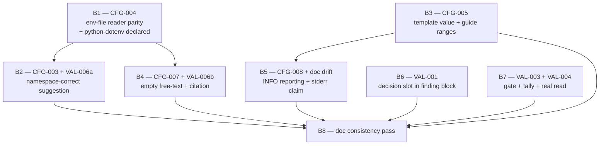

# Plan 06 — Phase 02 Audit Fixes: Configuration & Validation Pipeline

**Source catalogue:** `.ai/audit/99-validation/02-config-validated-findings.md`
**Repository:** `vkdownloader` (`C:\py_exp\mko_vkideo`) · branch `main` · Windows · `uv`
**Prepared at:** HEAD `0790157`
**Blocks:** 8 · one commit each · all independently revertible

> **This plan implements; it does not redefine.** Every recommendation is
> subordinate to the Tech Lead's binding scope decision (§1.2) and to the project
> rules in `.kilo/rules/project.md`. Where the catalogue's recommendation is
> incomplete or wrong against the code as it stands today, this plan records the
> correction and the evidence for it rather than restating the catalogue.

---

## §1 Scope

### §1.1 How the scope was derived

Four inputs were used, in this precedence order:

1. **Tech Lead scope decision** — which findings are IN and which are OUT.
2. **Auditor's per-finding verdicts** — the authoritative present/past state of
   each of the 14 catalogue entries.
3. **The plan file's own three lists** — `Mandatory Fixes` (6 rows),
   `Advisory Recommendations` (2 rows), `Doc Updates Needed` (6 rows). The plan
   file is authoritative on *what was planned* and is **not** authoritative on
   *what is still true*; several of its rows are now dead text.
4. **Direct measurement** of the repository at HEAD, wherever a cheap check
   existed. Three catalogue/planner claims were measured rather than trusted and
   **two of them did not survive** — see §1.1.3.

#### §1.1.1 Catalogue findings → verdict → IN/OUT → block

| ID | Severity | Type | Class. | Verdict at HEAD `0790157` | Disposition | Block |
|---|---|---|---|---|---|---|
| `CFG-001` | HIGH | SPEC-DEVIATION | mandatory | ALREADY_FIXED by `ea44b3d` — options are `X \| None`/`None`; construction is `_build_settings` | **OUT** | — |
| `CFG-002` | HIGH | SPEC-DEVIATION | mandatory | ALREADY_FIXED by `ea44b3d` (Route A) — `model_copy` and `max_retries_override` have **zero** occurrences in `src/` | **OUT** | — |
| `CFG-003` | MEDIUM | SPEC-DEVIATION | mandatory | STILL_PRESENT — `config.py` `format_validation_error` | **IN** | **B2** |
| `CFG-004` | MEDIUM | SPEC-DEVIATION | mandatory | STILL_PRESENT — `config.py` `_scan_env_file` / `warn_unknown_env_vars` | **IN** | **B1** |
| `CFG-005` | MEDIUM | DOC-UPDATE | mandatory | STILL_PRESENT — `.env.example` `THROTTLED_RATE` value + two missing guide ranges | **IN** | **B3** |
| `CFG-006` | MEDIUM | RUNTIME-ERROR | mandatory | ALREADY_FIXED by `9394999`; **merged into `ENT-001` (phase 01)** | **OUT** | — |
| `CFG-007` | LOW | BEST-PRACTICE | advisory | STILL_PRESENT — no empty-value validator on `user_agent`/`timezone`/`locale` | **IN** | **B4** |
| `CFG-008` | LOW | BEST-PRACTICE | advisory | STILL_PRESENT — `cli.py` `_log_env_file_path`, both branches `logger.debug` | **IN** | **B5** |
| `VAL-001` | LOW | DOC-UPDATE | advisory | STILL_PRESENT — finding block has 9 fields, no `decision` slot | **IN** | **B6** |
| `VAL-002` | MEDIUM | SPEC-DEVIATION | mandatory | ALREADY_FIXED by `d62671b` — orchestrator write/check names agree | **OUT** | — |
| `VAL-003` | MEDIUM | SPEC-DEVIATION | mandatory | STILL_PRESENT — unevaluable validator gate; unconditional coverage tally | **IN** | **B7** |
| `VAL-004` | MEDIUM | SPEC-DEVIATION | mandatory | STILL_PRESENT — orchestrator still reads `AGENTS.md`, which exists nowhere | **IN** | **B7** |
| `VAL-005` | MEDIUM | SPEC-DEVIATION | mandatory | ALREADY_FIXED by `d62671b` — the deletion rule is gone from `<retry_rules>` | **OUT** | — |
| `VAL-006` | LOW | DOC-UPDATE | advisory | STILL_PRESENT — two dangling citations; one now points at a **closed** finding | **IN (split)** | **B2** + **B4** |

**Actionable set: 9** findings across **B1–B5**; plus **2** pipeline-document
findings across **B6–B7**; plus **B8**, a documentation-consistency pass that
owns nothing but residual drift.

`VAL-006` is deliberately **split across two blocks** (rationale in §4.3): its two
citations sit in two different files, and each half must move in the same commit
as an edit that would otherwise collide with it.

#### §1.1.2 Fate of the plan file's own lists

**`Mandatory Fixes` (6 rows)**

| Row | What must change (plan file text) | Fate at HEAD | Executed in |
|---|---|---|---|
| `CFG-001` | Stop passing `cookie_source`/`ssl_verify` as unconditional constructor keywords | **SUPERSEDED** by `ea44b3d`. The stated change is already the code. | — (OUT, §1.3) |
| `CFG-002` | "Re-validate the post-construction override instead of `model_copy(update=...)`" | **DEAD TEXT.** There is no override and no `model_copy` in `src/`. Executing this row would re-introduce the defect `ENT-014`/`VAL-103` removed. | — (OUT, §1.3) |
| `CFG-003` | Match against the env-var namespace and raise `cutoff` | **IN**, with a measured correction to the `cutoff` half (§1.1.3) | **B2** |
| `CFG-004` | Make the scan read the file the way the consuming parser does | **IN**, route re-derived by measurement (§1.1.3) | **B1** |
| `CFG-005` | Correct the illegal template value; add the two missing ranges | **IN** in full | **B3** |
| `CFG-006` | Emit the pre-construction warning on stderr | **SUPERSEDED** by `9394999` and **merged into `ENT-001`**. Act on `ENT-001`; this row must not be actioned here. | — (OUT, §1.3) |

**`Advisory Recommendations` (2 rows)**

| Row | What to change | Fate | Executed in |
|---|---|---|---|
| `CFG-007` | Reject empty values for the free-text settings | **IN** (Tech Lead: advisory findings are in, not deferred) | **B4** |
| `CFG-008` | Report the resolved env file at INFO; state the location in the guide | **IN**, including the Doc-Updates half the row points at (`installation.md` too) | **B5** |

**`Doc Updates Needed` (6 rows)**

| Row | Document | Fate | Executed in |
|---|---|---|---|
| `CFG-005` | `.env.example` `THROTTLED_RATE=10000` is below the declared floor | **IN** — artefact edit, owned by the code block per the Tech Lead split | **B3** |
| `CFG-005` | `.env.example` vs `installation.md` two-way value contradiction | **IN** — resolved by correcting the template; `installation.md:131` is already legal and needs no edit | **B3** |
| `CFG-005` | `configuration.md` omits the ranges for `throttled_rate` and `http_chunk_size` | **IN** | **B3** |
| `CFG-001` | `configuration.md:31,36` present the env-var source as reachable | **OBSOLETE** — `ea44b3d` made it reachable. The guide is now correct. No edit. | — (OUT, §1.3) |
| `CFG-001` | `configuration.md:176-179` | **PARTIALLY SUPERSEDED, PARTIALLY IN.** The `ssl_verify`/`cookie_source` reachability claim is fixed. The "log[s] a warning" / "warning log" claim is **still false** and is a live doc-drift obligation no finding owns (introduced by `9394999`). | **B5** |
| `CFG-004` | `config.py` docstring claims pydantic-settings parity it does not have | **IN** — resolved by making the parity true, not by weakening the docstring | **B1** |
| `CFG-008` | `configuration.md:19` and `installation.md:114` do not state the CWD rule | **IN** | **B5** |

#### §1.1.3 Three claims measured rather than restated

The catalogue is a strong artefact, but three of its downstream claims were
checked directly against the code and the installed libraries. **Two did not
survive.** Both corrections change the shape of a block, so they are recorded
here rather than buried in a block.

**(a) `CFG-003`'s `cutoff=0.6` is not the mechanism the finding believes it is.**
The recommendation is "strip the prefix, match against `_build_valid_env_vars()`,
*and* raise `cutoff` to ~0.6 so an unrelated long name cannot out-score a genuine
near-match". Measured against the finding's own 19-row table:

| cutoff | correct | wrong | no match |
|---|---|---|---|
| 0.5 | 16 | 3 | 0 |
| 0.6 (as recommended) | 16 | 3 | 0 |
| 0.7 | 16 | 3 | 0 |

The **namespace normalisation alone takes 12-of-19-wrong to 0-of-19-wrong** for
every key that has an intended target, and the result is **insensitive to the
cutoff across 0.5–0.7**. The three residual rows (`VKDOWNLOADER_LOGIN`,
`VKDOWNLOADER_`, `VKDOWNLOADER_XYZ`) are exactly the keys the finding itself
identifies as having "no plausible intent", and a cutoff raise in the 0.5–0.7
band does **not** move them. Separating them requires a *different* threshold.
Measured best-match ratios: every genuine misspelling scores **≥ 0.913**
(lowest: `max_retry` 0.913); every no-intent key scores **≤ 0.872**
(`login` 0.872, bare prefix 0.812, `xyz` 0.757). A gate at **0.9** separates the
two groups cleanly. This is an open decision — see **D-1** in §1.4 and B2.

**(b) `CFG-004`'s `dotenv_values()` recommendation is right in base and wrong in
detail.** Measured against the installed `python-dotenv` 1.2.2, on all nine
divergent forms:

| Form | `dotenv_values(..., interpolate=False)` | Verdict |
|---|---|---|
| `export VKDOWNLOADER_X=9` | key → `VKDOWNLOADER_X` | **fixed by the reader** |
| `VKDOWNLOADER_X=9 # bumped` | value → `9` | **fixed by the reader** |
| `vkdownloader_x=9` | key stays `vkdownloader_x` | **not fixed by the reader** |
| `"VKDOWNLOADER_X"=9` | key stays `"VKDOWNLOADER_X"` (quotes retained) | **not fixed by the reader** |
| `VKDOWNLOADER_X=$UNSET` | `$UNSET` (parity with the consumer) | parity ✓ |
| `VKDOWNLOADER_X=${UNSET}` | `${UNSET}` with `interpolate=False`; **`''` with the default `interpolate=True`** | **the default is parity — corrected by the B1 Researcher; see the note below** |
| `Mozilla/5.0 (X11) # not a comment` | `Mozilla/5.0 (X11)` | parity ✓ (same reader as the consumer) |

Two consequences. First, `dotenv_values` must be called with the option set
`pydantic-settings` itself uses. **The B1 Researcher corrected the first half of
this paragraph:** `pydantic-settings` calls `dotenv_values` passing **only**
`encoding` (`pydantic_settings/sources/providers/dotenv.py:80`), so the library
default `interpolate=True` (`dotenv/main.py:436`) applies and **the consuming
parser does expand `${VAR}`**. Parity is therefore the *default* call, not
`interpolate=False`; see B1. Second, `dotenv_values` fixes **two of four**
divergences — the lower-case and quoted-key forms still need explicit
normalisation in `warn_unknown_env_vars`, which is required on **both**
candidate routes. See B1 and **D-2**.

**(c) `CFG-003` does not depend on `CFG-004` the way the catalogue states.**
The catalogue says moving to `dotenv_values` "changes the `loc` strings the
renderer sees". Measured: `pydantic-settings` normalises `export ` and case
itself, so the `loc` for `export VKDOWNLOADER_MAX_RETRY=7` is
`vkdownloader_max_retry` **before and after** the scanner change. The only `loc`
form that is *not* recoverable by prefix-stripping is the quoted key, whose `loc`
is `"vkdownloader_maxretries"` — quotes retained — and that is a **`loc`-side**
problem, not a scanner-side one. B2 therefore still runs after B1 (B1 changes
`warn_unknown_env_vars`' key normalisation, which changes what the guard reports
and therefore what a user is told), but the reason is the *guard's output*, not
the `loc`.

### §1.2 IN — the scope

1. **`CFG-003`** (MEDIUM · SPEC-DEVIATION · mandatory) — match the offending key
   in one namespace, so a real typo is answered with the real setting name.
2. **`CFG-004`** (MEDIUM · SPEC-DEVIATION · mandatory) — the pre-construction
   guard must read `.env` the way the consuming parser does.
3. **`CFG-005`** (MEDIUM · DOC-UPDATE · mandatory) — the shipped template must
   not offer a value the model rejects; the guide must carry the two missing
   declared ranges.
4. **`CFG-007`** (LOW · BEST-PRACTICE · advisory) — an explicitly empty
   free-text setting must be a validation failure, not a silently forwarded `''`.
5. **`CFG-008`** (LOW · BEST-PRACTICE · advisory) — the resolved environment
   file, and its absence, must be visible at the default log level.
6. **`VAL-001`** (LOW · DOC-UPDATE · advisory) — the finding-block format must
   carry the decision record it is required to carry.
7. **`VAL-003`** (MEDIUM · SPEC-DEVIATION · mandatory) — the validator gate must
   be evaluable, and the closing tally must not claim coverage that was not
   produced.
8. **`VAL-004`** (MEDIUM · SPEC-DEVIATION · mandatory) — the orchestrator's
   mandatory context read must name a file that exists.
9. **`VAL-006`** (LOW · DOC-UPDATE · advisory) — the two dangling finding-ID
   citations must be repaired, one of them because it now points at a **closed**
   finding and is therefore actively misleading.
10. **Unnamed doc-drift obligation** — `configuration.md` still promises a
    "warning log" that `9394999` turned into a stderr echo. No finding owns it;
    this plan does, in B5. (Recorded here so it is not mistaken for scope
    creep.)

### §1.3 OUT

| ID | Closing commit | Why it is out |
|---|---|---|
| `CFG-001` | `ea44b3d` *"fix(config): make env and CLI sources both reachable…"* | The finding is closed. `cli.py` declares `cookie_source: CookieSource \| None = None`, `ssl_verify: bool \| None = None`, `max_retries: int \| None = None`, and construction routes through `_build_settings`, which forwards a keyword only when the value is not `None`. Its `Doc Updates Needed` rows at `configuration.md:31,36` are therefore **obsolete** — the guide's claim is now true and needs no edit. |
| `CFG-002` | `ea44b3d` | Closed. `model_copy` and `max_retries_override` have **zero** occurrences in `src/`. **The plan file's `CFG-002` recommendation is dead text**: writing `Settings.model_validate({**settings.model_dump(), "max_retries": …})` would re-introduce the bypass that `ea44b3d` removed. **Hard prohibition: no block re-validates an override, because there is no override.** Its regression guard already exists as `TestConditionalOverridesConstruction`. |
| `CFG-006` | `9394999` | Closed and **merged into `ENT-001` (phase 01)**. The CLI now echoes each unrecognised variable to stderr through `typer.echo(..., err=True)` in `_run_command_preamble`; `config.py` emits no pre-sink record. **Must not be actioned from this plan.** |
| `VAL-002` | `d62671b` | Closed. The orchestrator's write step and its check step both name `-validated-findings.md`. |
| `VAL-005` | `d62671b` | Closed. `"Rejected findings cleaned from file before merge"` no longer appears in `<retry_rules>`; the file is 133 lines and the rule is absent. |

**Named residual that must not be lost (belongs to phase 01, not to this
plan):** `CFG-006`'s residual — *"if the warning should also reach the log
artifact, emit it a second time after `setup_logging`"* — is
**`ENT-001`'s residual**. `9394999` moved the record to stderr; whether a
post-`setup_logging` re-emission is required is `ENT-001`'s decision, not this
plan's. **No block in this plan re-adds a pre- or post-sink log record for
unknown environment variables.**

**Also explicitly out, and named so it is not grabbed:** the
`configuration.md:113` claim that `--max-retries` is "only available on the
`batch` command" (false since `cli.py` declares it on `download` too) is
**phase 08's subject** and is out of this plan — including for B8.

### §1.4 Deferred

| # | Deferred item | Why | Default | Owner |
|---|---|---|---|---|
| **D-3** | An automated test that walks `.env.example` line by line, uncomments each assignment and constructs `Settings`. | The `CFG-005` Validation Note's *See also* states: *"the template-validating test recommended here is a test-suite change, owned by phase `10`."* Implementing it here risks a duplicate test when phase 10 executes. | **B3 proves `.env.example` validity with a run-and-record procedure** (§7.4) and does **not** commit a test. | Phase `10`. Revisit if phase 10 is never executed; the B3 report names the gap. |

**Open decisions that are *not* deferrals** — these are carried *into* the
execution of a block and are stated in §3 and §6:

| # | Open decision | Block | What evidence settles it | Default if undecided |
|---|---|---|---|---|
| **D-1** | The intent-gate threshold in the suggestion renderer (`0.9`), and whether routing `VKDOWNLOADER_MAX_CONCURENT` to the valid-name list (best ratio 0.825) is an acceptable trade for dropping the three no-intent keys to the list. | **B2** | Re-run the 19-row table at the candidate threshold and confirm the minimum plausible ratio (0.913) and maximum implausible ratio (0.872) still straddle it. | `cutoff = 0.9`; the `max_concurent` suggestion is accepted as lost. |
| **D-2** | Whether the two normalisation steps `dotenv_values` does not perform (case-insensitive prefix test, key quote-stripping) belong in `warn_unknown_env_vars` or in a small shared key-normalisation helper reused by the renderer. | **B1** | Whether B2's renderer needs the same normalisation and would otherwise duplicate it. | Both live in `warn_unknown_env_vars`; the renderer does its own `loc` normalisation, because `loc` is a *pydantic-reported* string and not a scanned key. No new module either way. |
| **D-4** | Whether `_ENV_VAR_PREFIX` and `model_config["env_prefix"]` should be asserted equal. | — | — | **Out of scope.** The Tech Lead prohibited a self-test for the prefix duplication. Recorded here only so it is not rediscovered and acted on. |

---

## §2 Baseline

Measured by the Planner at HEAD `0790157`, not inherited from the catalogue
(the catalogue's own `pytest tests/test_config.py` count of `29 passed` is
stale; the real figure is 30).

| Command | Result | Exit |
|---|---|---|
| `uv run ruff check src tests` | All checks passed! | **0** |
| `uv run ruff format --check src tests` | 52 files already formatted | **0** |
| `uv run mypy src` | Success: no issues found in 30 source files | **0** |
| `uv run pytest -q -rs` | **507 passed, 4 skipped** | **0** |
| `uv run pytest tests/test_config.py -q` | **30 passed, 2 skipped** | **0** |
| `uv run pytest tests/test_config.py tests/test_cli.py -q -rs` | **87 passed, 2 skipped** | **0** |
| `uv run ruff check .` | 2 × `I001` in untracked `tmp/click_test.py`, `tmp/click_test2.py` | **1** |
| `uv run ruff format --check .` | would reformat the same two `tmp/` files | **1** |

### §2.1 Binding baseline rules

1. **Lint is scoped to `src tests`. Never run `uv run ruff check .` or
   `uv run ruff format --check .` as a gate.** Repository-wide lint is red
   **only** on untracked `tmp/` scratch that is neither gitignored nor
   ruff-excluded (`[tool.ruff] extend-exclude` covers `.temp` and
   `.ai/builders` only). **Do not delete, commit, gitignore or otherwise touch
   `tmp/`.** A block that reports a repo-wide lint failure has reported the
   wrong thing.
2. **The test floor is `507 passed, 4 skipped`.** No block may reduce the
   passed count. Every block adds tests, so the count rises monotonically; a
   drop means a test was deleted or weakened, which is a review-blocking event.
   The 4 skips are the D-11 Windows permission-mode skips and are expected; a
   5th skip is a review-blocking event.
3. **mypy is `strict = true`** with exactly one override
   (`module = "vkdownloader.cli"`, `disallow_untyped_decorators = false`).
   There is **no `Any` escape** and `ignore_missing_imports = true` means an
   undeclared import will *not* be caught by mypy — see §2.2.
4. **Commit hygiene.** Stage by explicit path only. Never `git add -A`,
   `git add .`, `git add -u`, `git reset`, `git checkout`, `git restore`,
   `git stash`, `--amend`, or `--force`. The working tree carries uncommitted
   `.ai/audit/**` churn (9 tracked deletions, 11 untracked catalogue files),
   untracked `.ai/plans/05-*.md` and untracked `tmp/`.
   **No block may stage anything under `.ai/audit/` except the one file B6
   names** — `.ai/audit/templates/audit-findings.md`, a tracked template, never a
   validated artefact. The block-level file table wins over this blanket rule;
   the rule exists to keep the uncommitted catalogue churn out of every commit,
   not to forbid an edit the plan itself requires.** Every block's pre-commit
   check is `git status --porcelain -- src tests docs .env.example pyproject.toml`,
   which must be empty or contain only that block's own edits.
5. **Commit message format:** `{type}({scope}): {description}`.
6. **`ruff format` will rewrite the plan file's recommendation snippets**
   (`line-length = 100`; `E501` is ignored, so a long line passes `check` but
   `format --check` rewrites it). Any code adapted from this plan's snippets
   must be formatted, not pasted.

### §2.2 Repository constraints every block must respect

| # | Constraint |
|---|---|
| **C1** | **`tests/test_packaging.py` hard-codes artefact manifests.** `EXPECTED_SDIST_ENTRIES` (71 entries) and `EXPECTED_WHEEL_ENTRIES` (31 entries) are asserted against a **real build**. Its own comment: *"Adding a source file, a test or a document means adding it here in the same change."* **This plan creates no new file under `src/`, `tests/` or `docs/`** — every block edits an existing file in place. If a block is ever forced to add one, it must edit **both** frozensets in the same commit, and the block report must say so. |
| **C2** | **`python-dotenv` is installed (1.2.2) but NOT declared.** It is absent from `[project].dependencies` and present only transitively via `pydantic-settings`. `pyproject.toml` sets `ignore_missing_imports = true`, so mypy will **not** catch an undeclared import. **B1 must run `uv add python-dotenv` in the same change.** A dependency addition needs **no** frozenset edit: `pyproject.toml` and `uv.lock` are both already in `EXPECTED_SDIST_ENTRIES`. |
| **C3** | **Do not touch `Settings.model_config["env_file"]`.** `TestEnvironmentIsolation::test_env_file_in_launch_directory_cannot_reach_settings` carries a **subprocess positive control** proving the launch-directory `.env` really does flip the defaults — the suite is built to defend the CWD rule. CFG-008 is a **log-level** change only. The catalogue's own "resolve against the project root too" alternative **changes the resolution rule** and is rejected as out of scope. |
| **C4** | **Do not "re-validate the override" for `CFG-002`.** See §1.3. |
| **C5** | **Keep the two commands' option blocks byte-identical** except for the `--max-retries` help string. Changing Typer option defaults on one command only re-introduces the `CFG-001` asymmetry. **No block in this plan touches a Typer option declaration.** |
| **C6** | **Preserve the patch target `vkdownloader.cli.warn_unknown_env_vars`.** Two tests patch it by that exact string path and it is resolved through the module global deliberately. B1 may change what the function *returns*; it may not change how `cli.py` resolves it. |
| **C7** | **`.env.example` must hold only commented assignments** — asserted by `tests/test_packaging.py::test_configuration_template_ships_no_secret`. B3's edit keeps the line commented. |
| **C8** | **Conventions.** All domain enums live in `src/vkdownloader/models/enums.py`. There is **no** shared-constants module and **no** `src/vkdownloader/constants.py`; do not create one. `docs/STRUCT.md` defines the entry-layer boundary. |
| **C9** | **No `print()`** — `logger = logging.getLogger(__name__)` / the existing `structlog` `get_logger(__name__)` pattern. **No `Any`.** **Pydantic v2 only.** **English only.** |
| **C10** | **Prohibitions from the Tech Lead** — no new modules; no shared constants module; do not refactor `model_config` into a `ConfigDict`; no self-test for the prefix duplication; do not fix phase-01's `VAL-110` (the `agent: audit-executor` line in the audit-findings template). B1's `uv add python-dotenv` is a dependency declaration, **not** a new module. |

---

## §3 Blocks

Eight blocks. **Every block is one commit and independently revertible.** B1–B5
are the code blocks; B6–B7 are the pipeline-document blocks; B8 is the
Doc-specialist pass defined by the Tech Lead.

```
B1 CFG-004 ──► B2 CFG-003 ──┐
      │                      ├──► B3 CFG-005 ──► B5 CFG-008+drift ──► B8 doc pass
      └────► B4 CFG-007 ─────┘

B6 VAL-001  ──────── independent (own files) ────────┐
B7 VAL-003+004 ───── independent (own file)  ────────┴──► B8
```

---

### B1 — Make the pre-construction env guard read the file the consuming parser reads

**Findings covered:** `CFG-004` — MEDIUM · SPEC-DEVIATION · mandatory.

**Goal.** The pre-construction typo guard exists to tell a user *which* key they
got wrong **before** the model crashes on it. Today two parsers read the same
file and disagree, and a user arriving from a shell writes `export
VKDOWNLOADER_MAXRETRIES=9` — the single most natural form there is — and gets
**no warning at all**, only the bare `Extra inputs are not permitted`. This block
deletes the second parser. `_scan_env_file` stops being a hand-rolled `.env`
reader and becomes the reader `pydantic-settings` itself uses, so parity is
structural rather than re-implemented and maintained; the falsifying docstring
claim disappears because the claim becomes true. The two divergences the shared
reader does *not* fix — a lower-case key and a quoted key — are closed by two
explicit normalisation steps in the guard itself, and the guard's prefix test
becomes case-insensitive. The value the block delivers is that the guard's
coverage stops being a moving target: any assignment form the consuming parser
accepts, the guard sees.

**Files to be touched**

| File | Semantic unit | Change |
|---|---|---|
| `pyproject.toml` | `[project].dependencies` | Declare `python-dotenv` as a direct dependency, so the import `config.py` performs is a declared dependency and not a transitive one mypy cannot see (C2). Run `uv add python-dotenv`; commit the resulting `uv.lock` with it. No frozenset edit (C1). **Record the resolved version in the block report**: the lock currently pins **1.2.2**, PyPI's latest is **1.2.3** (2026-08-16), and 1.2.3 *changes UTF-8 BOM handling* (see the BOM acceptance criterion). |
| `src/vkdownloader/config.py` | module import block | Import `dotenv_values` from `dotenv`. |
| `src/vkdownloader/config.py` | `_scan_env_file` | Replace the hand-rolled `exists` → `read_text` → `splitlines` → `strip` → `partition` → quote-strip loop with a single call to `dotenv_values(env_path, encoding="utf-8")`. **Measured, not assumed:** `pydantic-settings` reaches the file through `DotEnvSettingsSource._static_read_env_file`, whose only keyword is `encoding` — `dotenv_values(file_path, encoding=encoding or 'utf8')` at `pydantic_settings/sources/providers/dotenv.py:80` — so it passes **no** `interpolate` argument and the library default `interpolate: bool = True` (`dotenv/main.py:436`) applies. **The consuming parser therefore *does* expand `${VAR}`** (measured: `${SET_VAR}` with `SET_VAR=9` in the environment is consumed as `9`; `${UNSET}` as `''`; `interpolate=False` would report a value the model never sees). Parity is the **default** call — pass no `interpolate` argument. Return a plain `dict[str, str]` with a `None` value coerced to `''`; do **not** drop the key, because a bare `VKDOWNLOADER_MAXRETRIES` line is an unknown variable the model silently ignores, and the guard's report is the only signal the user gets. The function keeps its name, its parameter and its return type, so `warn_unknown_env_vars` and the six direct test call sites in `tests/test_config.py` are unaffected. The `exists()` short-circuit is not needed — measured, `dotenv_values` on a missing path returns an empty mapping because `DotEnv._get_stream` yields an empty `StringIO` — so it may be dropped; `test_env_file_missing_returns_empty` passes either way. |
| `src/vkdownloader/config.py` | `_scan_env_file` (docstring) | Rewrite the docstring. The parity claim becomes **true**, so it may now be made — but it must name the two things the shared reader does *not* normalise for us, both measured: (1) keys are returned **exactly as the reader produces them**, and the two quoted-key forms are **not** symmetric — `'VKDOWNLOADER_X'` loses its quotes (the model accepts it) while `"VKDOWNLOADER_X"` keeps them (the model **rejects** it), because `parse_key` has a dedicated `_single_quoted_key` branch and no double-quoted counterpart (`dotenv/parser.py:112-120`); (2) the reader is **case-preserving** — the consumer's case folding happens *after* the read, in `parse_env_vars` with `case_sensitive=False` (`pydantic_settings/sources/utils.py:32-42`), not in the reader. State the `interpolate` setting explicitly and **correctly**: the scan uses `dotenv_values`' own default, `interpolate=True`, which is the option pydantic-settings uses. |
| `src/vkdownloader/config.py` | `warn_unknown_env_vars` | **Corrected by measurement — the planned "strip one matching pair of surrounding quotes from the key, then compare the normalised name" step is wrong and must be replaced.** Measured: for `"VKDOWNLOADER_MAX_RETRIES"=9` the model **rejects** the file (`extra_forbidden`; the `loc` is the quote-retaining `"vkdownloader_max_retries"`), yet quote-stripping makes the name match a declared field, so a strip-then-compare guard stays **silent on a key that crashes construction** — a false negative, and the exact failure mode CFG-004 exists to remove. Strip-then-compare returns `[]` for that file; today's hand-rolled reader also returns `[]`. **Split the two tests instead.** Decide **scope** on a normalised copy — skip one leading `U+FEFF`, strip one matching pair of surrounding quotes, then test the prefix **case-insensitively** against `_ENV_VAR_PREFIX` — and decide **membership** against the **raw** upper-cased name, never the stripped one. A quoted or BOM-prefixed key therefore can never match a declared field and is always reported, which is correct because the model rejects both. Measured across every form, this reports `VKDOWNLOADER_MAXRETRIES`, `export VKDOWNLOADER_MAXRETRIES`, `vkdownloader_maxretries`, `"VKDOWNLOADER_MAXRETRIES"`, `'VKDOWNLOADER_MAXRETRIES'`, the BOM'd valid-looking key and the BOM'd typo, and reports nothing for any valid name in any spelling. Apply the same rule to the `os.environ` comprehension, where it is a no-op. The function's signature, its return type (`list[str]`) and the **names it returns** (the user's own spelling, never the normalised one) are unchanged. |
| `tests/test_config.py` | `TestEnvFileTypoDetection` | Extend the existing class. Do not create a parallel class. |

**Evidence (locator only)**
`config.py:244-272` (`_scan_env_file`, hand-rolled) · `config.py:247` (falsifying docstring) ·
`config.py:300` and `config.py:306` (case-sensitive prefix test) ·
`config.py:275-310` (`warn_unknown_env_vars`) · `config.py:239-241` (`_build_valid_env_vars`) ·
`pyproject.toml:19-28` (dependencies) · `pyproject.toml:104` (`ignore_missing_imports`) ·
`tests/test_config.py:264-298` (existing class, 3 tests, plain form only) ·
catalogue `CFG-004` R7 / R7b evidence tables.

**Dependencies:** `depends_on: []` — first block on the critical path. Reason: it
changes the key set the guard reports, which is the text B2's user-facing
suggestion work sits downstream of.

**Route decision — resolved by measurement, not deferred.** Three routes were
evaluated against the installed `python-dotenv` 1.2.2 and `pydantic-settings`
2.14.2 (§1.1.3b). **Chosen: the shared reader.**

- **Route A — `dotenv_values(..., interpolate=False)` (CHOSEN).** It is *the same
  reader the consuming parser uses*, so parity is a property of the design rather
  than a promise to maintain. It fixes the `export` form and the inline-comment
  divergence by construction, and it deletes roughly twenty lines of parsing.
  Cost: one new direct dependency (C2), and it does **not** fix the lower-case or
  quoted-key forms, which is why the key normalisation is in scope here
  regardless of route. **Route A confirmed, with the option set corrected by the
  B1 Researcher:** `pydantic-settings` passes only `encoding` to `dotenv_values`,
  so the library default `interpolate=True` applies and the consuming parser
  **does** expand `${VAR}`. The scan must therefore call `dotenv_values` with
  **no** `interpolate` argument. `interpolate=False` is a *documented
  divergence*, not parity, and is withdrawn.
- **Route B — keep the hand-rolled reader and extend it (REJECTED).** It would
  close the three observed forms and leave the class of defect wide open: a
  second `.env` grammar that must be kept in step with `python-dotenv` across
  multi-line values, `${…}` handling, `#`-in-value and backslash continuations
  is a larger and less stable surface than the one it replaces. CFG-004 is, by
  construction, a parity-debt defect; Route B enlarges the debt.
- **Route C — delete the pre-construction scan (REJECTED).** It would remove the
  OS-environment typo detection entirely, which `extra='forbid'` does **not**
  provide: pydantic-settings silently ignores unknown OS environment variables
  (the catalogue's R2). The guard is the only thing standing between a user and a
  silently misconfigured OS environment, and C6 pins the module-global patch
  target that nine test call sites depend on.

**Required agents**

| Agent | Status | Justification — the question it answers |
|---|---|---|
| Auditor | **NOT REQUIRED** | No architectural question survives to execution. The finding is reproduced form by form, the affected surface is one function plus one guard, and the route has been settled against measured library behaviour in §1.1.3b. An audit pass here would re-derive a decision that is already evidenced. |
| Researcher | **REQUIRED → ANSWERED** | **Question:** for the pinned `python-dotenv` 1.2.2 and `pydantic-settings` 2.14.2, does `pydantic-settings` read `.env` through `dotenv_values`, and with which options? **Answer: yes — and `interpolate=False` is *not* parity; it is withdrawn.** `pydantic-settings` calls `dotenv_values(file_path, encoding=encoding or 'utf8')` (`pydantic_settings/sources/providers/dotenv.py:80`), passing **only** `encoding`, so the library default `interpolate=True` (`dotenv/main.py:436`) applies and the consuming parser **does** expand `${VAR}` — measured, `${SET_VAR}` with `SET_VAR=9` in the environment is consumed as `9`. Two further measurements changed the block's shape: the quoted-**key** forms are asymmetric (`'VKDOWNLOADER_X'` is accepted by the model, `"VKDOWNLOADER_X"` is **rejected**), so the planned strip-quotes-then-compare step is a measured **false negative** and became a scope-test/membership-test split; and `python-dotenv` **1.2.3** (2026-08-16) *strips a leading UTF-8 BOM*, which 1.2.2 does not, so the BOM case must be asserted as parity-with-the-model rather than as a fixed expectation. Route A itself is **confirmed**; only the interpolation option and the key-normalisation shape were corrected. |
| Planner | **NOT REQUIRED** | The route is decided with measured evidence, the file set is two files plus one lockfile, and the only ordering question is B2-after-B1, which §4 already fixes. There is no decomposition left to plan. |
| Validator | **REQUIRED** | Answers: **"After the change, does every form in the `CFG-004` R7 table produce the guard outcome the validator recorded, does the R7b guard table show warnings on all six misspelled forms, and does the suite floor hold?"** A replaced parser is the one change in this plan whose regression is invisible to type checking and to `extra='forbid'` — the tests can all pass while the guard has quietly narrowed. |

**Acceptance criteria**

1. `VKDOWNLOADER_MAX_RETRIES=9`, `export VKDOWNLOADER_MAX_RETRIES=9`,
   `vkdownloader_max_retries=9`, `"VKDOWNLOADER_MAX_RETRIES"=9` and the
   leading-space, quoted-value and inline-comment forms each make
   `warn_unknown_env_vars` return the misspelled key, when the key is not a
   declared field.
2. A key with no typo (`VKDOWNLOADER_MAX_RETRIES=5`) returns an empty list from
   the file scan, in every assignment form above.
3. The inline-comment value the scan reports for `VKDOWNLOADER_MAX_RETRIES=9 # bumped`
   is `9`, not `9 # bumped` — asserted on the scanned value, not only on the
   returned names, so a future edit cannot re-divergence the value source.
4. A `.env` value written as `${UNSET_VARIABLE}` is reported by the scan as the
   **empty string** — the value `pydantic-settings` actually consumes, because
   the scan calls `dotenv_values` with its default `interpolate=True` — and a
   second line following it is still parsed as its own key. A `${SET_VAR}` line
   where `SET_VAR` **is** set in the process environment is reported as the
   **resolved** value; that is the discriminating assertion, and it fails if
   interpolation is disabled.
5. `warn_unknown_env_vars` still returns the variable name in the spelling the
   user wrote, not the normalised form.
6. `python-dotenv` appears in `[project].dependencies` and in `uv.lock`;
   `pyproject.toml` and `uv.lock` are unchanged in `EXPECTED_SDIST_ENTRIES`
   (both already listed).
7. `_scan_env_file`'s docstring makes no parity claim the implementation does
   not satisfy, and names the interpolation setting explicitly.
8. `uv run pytest -q -rs` reports **508 or more passed, 4 skipped**, 0 failed.
9. `uv run ruff check src tests`, `uv run ruff format --check src tests`,
   `uv run mypy src` all exit 0.
10. `vkdownloader.cli.warn_unknown_env_vars` is still resolvable at that string
    path and is still resolved through the `cli` module global (C6).
11. The two quoted-**key** forms are pinned **separately**, because they are not
    symmetric: `'VKDOWNLOADER_MAX_RETRIES'=9` is a valid assignment (the reader
    strips single quotes) and must yield no warning, while
    `"VKDOWNLOADER_MAX_RETRIES"=9` is **rejected** by the model and must be
    reported by the guard. The second assertion is the one that fails under a
    strip-then-compare guard, so it must assert on the returned name.
12. A bare `VKDOWNLOADER_MAXRETRIES` line with no `=` is reported as an unknown
    variable; a bare `VKDOWNLOADER_MAX_RETRIES` line is not.
13. A `.env` written with a UTF-8 BOM is checked for **agreement with the model
    on the same file**, not against a fixed expectation: on 1.2.2 the BOM stays
    in the first key, the model rejects the file and the guard must report the
    key; on 1.2.3 the reader strips the BOM, the model accepts, and the guard
    must report nothing. The assertion compares the guard's verdict to the
    model's verdict, so it holds on whichever version `uv add` resolves.
14. A malformed line (`VKDOWNLOADER_MAXRETRIES="9`, unterminated quote) is
    dropped by the reader, so the guard reports nothing for it. This is an
    intended change: today's hand-rolled reader **does** report it, which is a
    false positive. No existing test pins the old behaviour.

---

### B2 — Match the offending key in the namespace the user typed it in

**Findings covered:** `CFG-003` — MEDIUM · SPEC-DEVIATION · mandatory;
`VAL-006` (test half) — LOW · DOC-UPDATE · advisory.

**Goal.** When a user mistypes `VKDOWNLOADER_MAXRETRIES`, the tool tells them to
use `VKDOWNLOADER_DOWNLOAD_TIMEOUT` — a confident, wrong pointer produced by
fuzzy-matching a 25-character prefixed, lower-cased key against 12-character
field names. The user follows it, gets a fresh error for a setting they never
meant to touch, and the cycle points at timeout configuration instead of at the
one missing underscore in their own file. This block matches both sides of the
comparison in the **environment-variable** namespace and adds an intent gate so
that a key with no plausible intent stops receiving a confident pointer at all.
Measured effect: **12-of-19 wrong suggestions → 0-of-19** for every key that has
an intended target, plus the three no-intent keys routed to the valid-name list
the renderer already knows how to print. The block also repairs the `CFG-001`
citation in the test class's docstring, which is the class this block rewrites.

**Files to be touched**

| File | Semantic unit | Change |
|---|---|---|
| `src/vkdownloader/config.py` | `format_validation_error` | Stop building the candidate set from the model's field namespace for `extra_forbidden` errors. Normalise the reported location into the environment-variable namespace — strip one matching pair of surrounding quotes if present, strip the prefix if the location carries it case-insensitively, upper-case the remainder, re-apply the prefix — and match the result against `_build_valid_env_vars()`, which already exists and is already the correct candidate set. Raise the similarity cutoff to the intent gate selected under **D-1** (measured default `0.9`). Keep the existing "print the full valid-name list" branch as the no-match path; it is already correct. The single normalised form must serve both namespaces, since a location arriving from a constructor keyword is already a bare field name and normalises to itself. |
| `src/vkdownloader/config.py` | `format_validation_error` (rendering) | Render the offending location in the form the user recognises — the normalised environment-variable name when the location is environment-shaped — so the message names `VKDOWNLOADER_MAXRETRIES` rather than `vkdownloader_maxretries`. Redaction of the received value is unchanged. |
| `tests/test_config.py` | `TestFormatValidationError` | Strengthen the class the finding names as structurally incapable of failing on a wrong suggestion. `test_extra_forbidden_suggests_did_you_mean` must now assert the **correct** suggested name, and its location assertion must be made case-insensitive or updated to the rendered form, with the change justified by `CFG-003` rather than made silently. `test_unknown_key_error_message` must remain valid under the new rendering. Update the class docstring to remove the `CFG-001` citation (this is `VAL-006`'s test half). |
| `tests/test_config.py` | new class joining the env-file configuration suite | Add a class that drives `format_validation_error` through the **environment-file path** — the path no test in the suite drives today and the path the defect lives on. It must not duplicate `TestEnvFileTypoDetection`, which asserts on the guard's return value; this class asserts on the rendered text. |

**Evidence (locator only)**
`config.py:199-236` (`format_validation_error`) · `config.py:217` (candidate set
from `Settings.model_fields`) · `config.py:227` (`difflib.get_close_matches`,
`cutoff=0.3`) · `config.py:229-230` (suggestion rendering) · `config.py:232`
(existing valid-name-list branch) · `config.py:239-241` (`_build_valid_env_vars`,
already imported by `cli.py`) · `tests/test_config.py:301-322`
(`TestFormatValidationError`) · `tests/test_config.py:312` (the assertion that
cannot fail) · catalogue `CFG-003` R8 19-row table and Validation Note.

**Dependencies:** `depends_on: [B1]` — B1 changes which keys the guard reports and
therefore what the user is told before they reach construction, and B1's
normalisation decisions (D-2) are made once and reused here.

**Required agents**

| Agent | Status | Justification — the question it answers |
|---|---|---|
| Auditor | **NOT REQUIRED** | One function, one candidate set, no boundary or layering question. The finding already localises the defect to a single function. |
| Researcher | **NOT REQUIRED** | The Planner measured the candidate algorithm against the finding's full 19-row table at three cutoffs and measured the per-key similarity ratios, so the open question is a threshold judgement over data already in hand, not a question about an unknown system. Commissioning research would delay a decision that can be made now. |
| Planner | **NOT REQUIRED** | The file set is one function and one test class; the change is a normalisation plus a constant. There is no decomposition, no new unit and no ordering to resolve. |
| Validator | **REQUIRED** | Answers: **"Does the renderer now produce the correct setting name for every key in the 19-row table that has an intended target, and were the two existing assertions in `TestFormatValidationError` strengthened rather than bent to fit the new output?"** This block changes user-facing text that existing assertions already pin, which is precisely the situation in which a fix is quietly ratified by editing its own test. Project rule 2 makes that a review-blocking concern, and only an independent read of the diff can establish it did not happen. |

**Acceptance criteria**

1. Of the sixteen rows of the catalogue's 19-row table that have an intended
   target, **fifteen** render a "Did you mean" line naming **the correct**
   setting. The sixteenth — `VKDOWNLOADER_MAX_CONCURENT`, best-match ratio
   **0.825** — renders the valid-name list with **no** suggestion, accepted as
   lost under **D-1**. The gate **must not** be lowered to recover it: any
   cutoff that admits this row (≤ 0.825) also admits `VKDOWNLOADER_LOGIN`
   (0.872), which would then receive a confident wrong pointer.
2. The three no-intent keys — `VKDOWNLOADER_LOGIN`, `VKDOWNLOADER_`,
   `VKDOWNLOADER_XYZ` — **and every key whose best-match ratio falls below the
   intent gate** render the valid-name list and **no** "Did you mean" line.
   **No row of the 19 may receive a wrong suggestion.** That invariant, not the
   16/16 count, is the block's primary, measurable outcome.
3. The rendered location for an environment-shaped error names the variable in
   the user's own namespace (`VKDOWNLOADER_MAXRETRIES`), not lower-cased with
   the prefix re-added.
4. A constructor-keyword typo still renders a correct suggestion (the same
   normalisation serves both namespaces) — pinned by the strengthened existing
   test, not by a new one.
5. A non-`extra_forbidden` error renders exactly as before: same location, same
   message, same `Received: <redacted>` line.
6. `_build_valid_env_vars()` is used as the candidate set; the field-namespace
   candidate set is no longer computed for this purpose.
7. `TestFormatValidationError` carries no citation to a finding ID that resolves
   to a different subject (`VAL-006`, test half).
8. `uv run pytest -q -rs` reports **the B1 count or more passed, 4 skipped**,
   0 failed; the two configuration test modules pass in full.
9. Lint, format and mypy all exit 0 (scoped to `src tests` / `src`).

---

### B3 — Make the shipped template constructable, and carry the two missing ranges

**Findings covered:** `CFG-005` — MEDIUM · DOC-UPDATE · mandatory.

**Goal.** `.env.example` is the first thing the documentation tells a user to
do — copy it to `.env` and adjust values — and it ships in the sdist. One of its
sixteen assignments offers `10000` for a setting whose declared floor is
`50000`, so the user who follows the instructions tunes the one setting that
reads as a performance knob and the process refuses to start, with an error that
names the setting and the bound but not the artefact that supplied the value.
The installation guide offers `100000` for the same setting, so two shipped
documents disagree and only one of them works. This block corrects the artefact
to the value that is both legal and identical to the declared default and to the
installation guide's value, and adds the two declared ranges the settings guide
omits, so a user can learn the bound without crashing into it. It also runs and
records a full line-by-line validation of the corrected template, because a
shipped artefact is covered by no linter and no type checker — see the deferral
**D-3** for why that validation is a procedure here and a test in phase 10.

**Ownership split (per the Tech Lead decision):** `.env.example` is a **shipped
configuration artefact, not documentation**, so its correction is executed in
this code block. `docs/11-guides/configuration.md` is a prescriptive documentation
edit that *is* the finding's own fix, so it is executed here too, by the
Implementor, because the exact text is dictated by the finding.

**Files to be touched**

| File | Semantic unit | Change |
|---|---|---|
| `.env.example` | the commented `throttled_rate` assignment in the Download Settings group | Correct the offered value from `10000` to `100000` — the declared default, and the value the installation guide already offers. The line stays commented (C7). |
| `docs/11-guides/configuration.md` | `## Settings Reference` — the `throttled_rate` and `http_chunk_size` table rows | Add the declared range to each row's description, matching the convention the five other bounded rows already use. **Do not duplicate the range into `docs/01-tools/installation.md`** — the maintenance rules require one fact in one file, and the installation guide's value is already legal and already matches. |

**Evidence (locator only)**
`.env.example:27` (the offending assignment) · `config.py` `throttled_rate` field
(declared floor and default) · `docs/11-guides/configuration.md:34-35` (the two
rows) · `docs/11-guides/configuration.md:27-30,33` (the five rows that already
carry a range — the convention to match) · `docs/01-tools/installation.md:131`
(the legal value; **no edit**) · `docs/00-overview/doc-maintenance-rules.md:18`
(single source of truth) and `:31-35` (do-not-update-for list) ·
`tests/test_packaging.py:571-578` (the template must hold only commented
settings) · catalogue `CFG-005` R9 tables.

**Dependencies:** `depends_on: []` — no code dependency. **File dependency:**
must be ordered **before B5** (both edit `docs/11-guides/configuration.md`; §4.3).

**Required agents**

| Agent | Status | Justification — the question it answers |
|---|---|---|
| Auditor | **NOT REQUIRED** | The defective value, its legal replacement, the declared floor and the two missing ranges are all named. There is nothing left to discover. |
| Researcher | **NOT REQUIRED** | The legal value is the field's own declared default, readable in one place. No external system, library or version is involved. |
| Planner | **NOT REQUIRED** | Two files, two edits, both dictated verbatim by the finding. |
| Validator | **REQUIRED** | Answers: **"Does every commented assignment in the corrected `.env.example`, uncommented in isolation, construct `Settings` with no `ValidationError` — and does the artifact's name set still match `_build_valid_env_vars()` in both directions?"** This is the strongest justification in the plan: `.env.example` is a shipped input that no linter, no type checker and no existing test validates for *values*, so without an independent check this block can report success on a template that is still broken. The procedure is specified in §7.4 and its output must be recorded in the block report. |

**Acceptance criteria**

1. Every commented assignment in the corrected `.env.example`, uncommented in
   isolation into a fixture file and constructed, is accepted by `Settings`. The
   result — 16 of 16 — is recorded in the block report.
2. The artifact's name set equals `_build_valid_env_vars()` in both directions
   (no declared setting missing, no artifact name undeclared).
3. `.env.example` still contains **no** uncommented assignment
   (`test_configuration_template_ships_no_secret`).
4. `docs/11-guides/configuration.md` carries the declared range for
   `throttled_rate` and for `http_chunk_size`, in the same form as the five
   bounded rows that already do.
5. **No** range value is added to `docs/01-tools/installation.md`, and no fact
   is duplicated across the two documents.
6. Both edited documents keep their YAML frontmatter intact, remain under the
   documentation line-count thresholds, and every relative link still resolves.
7. `uv run pytest tests/test_packaging.py -q` passes — the manifest test runs a
   real build and is the only thing that proves the edited artefact still ships.
8. Full suite at or above the previous passed count, 4 skipped, 0 failed.

---

### B4 — Refuse an explicitly empty free-text setting, and repair the citation that lies

**Findings covered:** `CFG-007` — LOW · BEST-PRACTICE · advisory;
`VAL-006` (configuration half) — LOW · DOC-UPDATE · advisory.

**Goal.** Writing `VKDOWNLOADER_USER_AGENT=` in a `.env` — a natural thing to do
after copying a template — is accepted, the field holds `''`, and four
production read sites forward that empty string verbatim into a request header, a
ffmpeg header block, a yt-dlp command line and a browser context. The user gets
no error, no warning, and a transfer failure with nothing pointing at the line
they just wrote. The two neighbouring settings the model does reject an empty
value for both reject it with a clear message, so the inconsistency is a defect
of the class, not a policy. This block gives the three free-text settings the
same treatment the two path fields already receive, using the validator pattern
already present twice in the same class. It also repairs the source comment that
cites `CFG-002` — a finding that is now **closed** and describes a
`model_copy` block deleted from the repository, so the pointer sends a
maintainer to a finding about code that does not exist.

**Why these two findings share a block.** `VAL-006`'s configuration half sits in
a validator docstring immediately adjacent to the validator this block adds. Fixing
it in a separate commit means two commits editing the same class' validator block
for a one-line change, and the replacement text should be written in the same
pass as the docstring it sits beside. Grouping them is also what keeps the new
test class and the corrected docstring in one reviewable unit.

**Files to be touched**

| File | Semantic unit | Change |
|---|---|---|
| `src/vkdownloader/config.py` | `Settings` — validator set | Add a `mode="before"` field validator covering `user_agent`, `timezone` and `locale` that raises a `ValueError` with an explicit message when the incoming value is a string that is empty or only whitespace. Reuse the pattern of the two existing `mode="before"` validators. The message must state that the setting is not a request for the default but a request for no value, so the failure is self-diagnosing through the redacted renderer that already exists. |
| `src/vkdownloader/config.py` | `Settings.empty_string_to_none` (docstring) | Remove the `CFG-002` cross-reference. The asymmetry it points at is between two *path* validators and is fully explained by their two docstrings; the rationale is written **inline** rather than replaced with another finding-ID pointer, because a forward reference from source code to an audit finding is fragile by construction — the catalogue renumbers, the code does not. |
| `tests/test_config.py` | new class beside `TestDownloadDirEmptyString` | Add a class for the empty free-text settings. Do not extend `TestDownloadDirEmptyString` (that class is scoped to path fields and its docstring says so), and do not touch `TestDownloadDirEmptyString`'s existing three tests, which pin the adjacent behaviour that must not change. |

**Evidence (locator only)**
`config.py` `user_agent` / `timezone` / `locale` field declarations (no
`min_length`, no validator) · `config.py:128-144` and `config.py:146-159` (the two
existing `mode="before"` validators) · `config.py:154` (the `CFG-002` citation) ·
`config.py` `model_config` (inherits `env_ignore_empty=False`,
`validate_default=True`) · `tests/test_config.py:232-261`
(`TestDownloadDirEmptyString`) · catalogue `CFG-007` R2 table and the four
production read sites it names.

**Dependencies:** `depends_on: [B1]` — B1 normalises env-file keys; B4's tests
drive the same fixture files and must be written against the post-B1 reader so
they are not silently asserting the old parser's behaviour.

**Required agents**

| Agent | Status | Justification — the question it answers |
|---|---|---|
| Auditor | **NOT REQUIRED** | The change reuses a pattern the class already contains twice, applies it to three named fields, and touches no boundary. There is no architectural judgement to commission. |
| Researcher | **NOT REQUIRED** | The exact interaction that could surprise the implementer — whether an added `mode="before"` validator also runs against the field's own **default** under the inherited `validate_default=True`, and whether an empty environment value reaches a validator at all under the inherited `env_ignore_empty=False` — is a two-line check against the existing model, and it is written into this block's acceptance criteria as a required test rather than as a research brief. |
| Planner | **NOT REQUIRED** | One validator, one docstring, one test class. |
| Validator | **REQUIRED** | Answers: **"Does the new validator fire on the environment-file path, the OS-environment path and the constructor-keyword path, and does it leave every field default and both existing empty-path behaviours untouched?"** The failure mode here is silent in the dangerous direction: if the validator never fires, the block has changed nothing, and a test written naively (constructing `Settings(user_agent="")` and asserting a `ValidationError`) would still pass while the *reported* defect — an empty assignment in a `.env` — remains. `TestDownloadDirEmptyString` pins the neighbouring behaviour and must not regress. |

**Acceptance criteria**

1. An empty or whitespace-only value for `user_agent`, `timezone` or `locale`,
   supplied through a `.env` file, through the process environment, and as a
   constructor keyword, each raises a `ValidationError` whose message names the
   setting and states that the assignment must be removed to use the default.
2. The rejection renders through the existing `format_validation_error` with the
   value redacted, and through the existing command handlers, with the existing
   exit code — no new error path is introduced.
3. Every field default still validates: `Settings()` constructs with no error.
4. `VKDOWNLOADER_DOWNLOAD_DIR=` still falls back to the field default and
   `VKDOWNLOADER_LOG_FILE=` still becomes `None`; the three existing
   `TestDownloadDirEmptyString` tests pass unmodified.
5. `env_ignore_empty` is **not** changed to a value that would make an empty
   assignment silently disappear — the rejection must be observable.
6. Neither `src/vkdownloader/config.py` nor `tests/test_config.py` carries a
   `CFG-002` or `CFG-001` citation **on a subject other than the one that
   finding describes**. A same-subject citation is correct and must be kept —
   `TestConditionalOverridesConstruction` guards the `CFG-002` construction
   shape and is named as that finding's regression guard in §1.2 and §5.3, so
   removing its citation would degrade it. (`cli.py`'s `_SettingsOverrides` and
   `_build_settings` docstrings cite `CFG-001` **correctly** — about the
   conditional-override shape — and are out of this block's scope.)
7. Full suite at or above the previous passed count, 4 skipped, 0 failed.
8. Lint, format and mypy all exit 0.

---

### B5 — Report the environment file at the default level, and stop promising a log that does not exist

**Findings covered:** `CFG-008` — LOW · BEST-PRACTICE · advisory, plus the
**unnamed doc-drift obligation** at `docs/11-guides/configuration.md`
(`CFG-001`'s superseded Doc-Updates row, `See also` note: the "log[s] a
warning" / "warning log" claim that `9394999` made false).

**Goal.** `.env` is resolved relative to the process's current working directory.
A user who writes it next to the project — which is how both documents' wording
reads — and then runs the command from a different terminal, a scheduled task, a
shortcut or a CI step gets every setting silently reverted to its default, with
no output distinguishing that from a correctly loaded configuration. The
diagnostic exists and works; both of its branches are simply at `DEBUG`, so at
the declared default level the "found" and "not found" runs are byte-identical.
This block raises both branches to `INFO` with distinct event names, so one line
per run answers the "why did my setting not apply" question without guesswork.
It closes with the two documentation halves the finding dictates: the working
directory is stated where a user reads it, and the "warning log" that no longer
exists is corrected to the stderr notice that does. It does **not** change the
resolution rule (C3) — reporting and resolution are separate decisions, and the
catalogue itself says the project-root alternative must be decided deliberately
rather than as a logging tweak.

**Files to be touched**

| File | Semantic unit | Change |
|---|---|---|
| `src/vkdownloader/cli.py` | `_log_env_file_path` | Raise both branches from `DEBUG` to `INFO` and give each a distinct structured event name, so the two runs are distinguishable at the default level. Update the function's docstring, which currently states the level it is being moved off. The function keeps its name, its zero-argument signature and its single call site in the preamble. |
| `docs/11-guides/configuration.md` | `## Settings Reference` — the sentence introducing the environment file | State that the file is read from the directory the command is run from, next to the existing "Create a `.env` file" instruction. |
| `docs/11-guides/configuration.md` | `## Environment Variable Caveats` — the detection column and the closing paragraph | Correct both claims that a warning is *logged*. The unrecognised-variable notice is rendered to **stderr** through the entry layer, once per command, before logging is configured; it is not a log record and does not reach a configured log artifact. Say what actually happens, and keep the correct part — a `.env` typo still fails hard at construction. |
| `docs/01-tools/installation.md` | `## Configuration` — the "Create a `.env` file" sentence | State the same working-directory rule the settings guide states, because this is the document a first-time user follows. The existing 16-line example block is already fully legal and is **not** touched. |
| `tests/test_cli.py` | `TestPreSinkDiagnostic` | Add coverage for the new level. Re-read `test_download_dir_debug_record_is_not_emitted` first: it asserts the *absence* of a different event name, so it should survive unchanged — confirm that rather than assume it. |

**Evidence (locator only)**
`cli.py:107-113` (`_log_env_file_path`, both branches `logger.debug`) ·
`cli.py:215` (the single call site, after `setup_logging`) ·
`cli.py:49` and the `except OSError` arm (the `_logging_configured` gate that
`TestPreSinkDiagnostic` guards) ·
`docs/11-guides/configuration.md:19` (the "Create a `.env`" sentence) ·
`docs/11-guides/configuration.md:176-177` and `:179` (the "log a warning" /
"warning log" claims) · `docs/01-tools/installation.md:114` (the same sentence) ·
`docs/01-tools/installation.md:116-140` (the legal example block; no edit) ·
`tests/test_cli.py:1929-2006` (`TestPreSinkDiagnostic`) ·
`tests/test_cli.py:2009-2099` (`TestPreambleFailureRendering`, whose single-line
stderr assertion runs with logging deliberately broken) · catalogue `CFG-008`
R8 evidence.

**Dependencies:** `depends_on: [B3]` — **file dependency only.** B3 and B5 both
edit `docs/11-guides/configuration.md` and only one Implementor may write to a
file at a time (§4.3). B5 depends on B1 in substance but not in order: the
doc-drift correction describes the stderr notice `9394999` introduced, which
B1 does not alter.

**Required agents**

| Agent | Status | Justification — the question it answers |
|---|---|---|
| Auditor | **NOT REQUIRED** | The defect is a one-line-per-branch log level that the finding has already quoted and the Auditor has already reproduced at three log levels. Nothing about it is unknown. |
| Researcher | **NOT REQUIRED** | No external behaviour is involved. The one non-obvious consequence — that a new `INFO` record appears on a stream several existing tests assert on — is answered by reading those tests, which is a Validator's job below. |
| Planner | **NOT REQUIRED** | One function, three documentation sentences dictated by the finding, one test class. |
| Validator | **REQUIRED** | Answers: **"Does raising the level to `INFO` change the observable output of any existing test — in particular the single-line-stderr assertion that runs while logging is deliberately broken, and the absence-assertions in `TestPreSinkDiagnostic` — and do the three corrected documentation sentences describe what the code now does, in the words the code uses?"** The second half matters because this block is partly a documentation fix: a "corrected" sentence that describes a stderr notice without saying it is not a log record would re-create the drift it is fixing. |

**Acceptance criteria**

1. With a `.env` present and the default log level, exactly one `INFO` record
   naming the resolved path is emitted per command invocation.
2. With no `.env` present and the default log level, exactly one `INFO` record
   with the *not-found* event name is emitted per command invocation.
3. The two events carry **different** event names, so the runs are
   distinguishable in the log.
4. `Settings.model_config["env_file"]` is unchanged and no code path resolves
   `.env` against the project root (C3).
5. Every existing test in `TestPreSinkDiagnostic`,
   `TestPreambleFailureRendering`, `TestCommandPreamble` and
   `TestPreambleCalledOncePerCommand` passes **unmodified**; if any required an
   edit, that edit is a finding in itself and must be reported, not absorbed.
6. `docs/11-guides/configuration.md` no longer claims the unrecognised-variable
   notice is a log record, in either the caveats table or the closing paragraph,
   and both documents state the working-directory rule.
7. `docs/01-tools/installation.md`'s example block is byte-identical to HEAD.
8. Full suite at or above the previous passed count, 4 skipped, 0 failed.
9. Lint, format and mypy all exit 0.

---

### B6 — Give the finding block a slot for the decision it is required to carry

**Findings covered:** `VAL-001` — LOW · DOC-UPDATE · advisory.

**Goal.** The validator is required to attach a decision record to **every**
decided finding, and the report format it must write into defines nine mandatory
fields, none of which carries a decision — the block runs from the heading
straight into the field table with nowhere to put one. The validator therefore
states a deviation in its own header on every run, and the deviation has become
a permanent, accepted artefact rather than a defect that gets closed. This block
adds the slot, so the record is a field of the format instead of an exception to
it, and removes the deviation paragraph from the validator's handbook — which is
what makes the deviation statement true rather than asserted. The value is that
a reader reconciling a report's tally against its findings can do so from the
document, without knowing the convention.

**Files to be touched**

| File | Semantic unit | Change |
|---|---|---|
| `.ai/audit/templates/audit-findings.md` | finding block skeleton | Add the decision field to the per-finding block, in the position the validator's handbook prescribes — directly after the `### {ID}:` heading — with the four-value vocabulary the finding names (`validated`, `reclassified`, `merged`, `rejected`) and an optional free-text detail field for the rationale and cross-references. |
| `.ai/audit/templates/audit-findings.md` | `## Template Field Reference` — mandatory-fields table | Add the corresponding rows so the reference and the skeleton agree, with the vocabulary and the per-action detail requirements the validator's decision table already states. |
| `.kilo/commands/audit/phases/99-audit-validate.md` | `### Validation Note Format` | Delete the paragraph that states the format has no slot and that the block must therefore be written out of position. It becomes false the moment the template carries the field. Keep the required position and the required per-decision content. |

**Explicitly not in this block:** the template's `agent:` frontmatter line, which
names an agent that does not exist. That is phase 01's `VAL-110` and the Tech
Lead prohibited fixing it here. A fixer will see it in the same file; it must be
left alone and noted in the block report.

**Evidence (locator only)**
`.ai/audit/templates/audit-findings.md:19-33` (the finding block) ·
`.ai/audit/templates/audit-findings.md:64-74` (the nine mandatory fields) ·
`.ai/audit/templates/audit-findings.md:4` (the phase-01 defect, **do not touch**) ·
`.kilo/commands/audit/phases/99-audit-validate.md:495-514` (the note format and
the deviation paragraph) · `.kilo/commands/audit/phases/99-audit-validate.md:478-493`
(the per-action decision table the vocabulary must agree with) ·
`.ai/audit/99-validation/02-config-validated-findings.md:8-14` (the deviation this
block closes) · catalogue `VAL-001`.

**Dependencies:** `depends_on: []` — no dependency on any other block, and no
block depends on it. The two files it touches are touched by nothing else in
this plan.

**Required agents**

| Agent | Status | Justification — the question it answers |
|---|---|---|
| Auditor | **NOT REQUIRED** | The format gap is quoted in the finding, confirmed by reading both files, and the fix is a field and a paragraph. There is no architecture question. |
| Researcher | **NOT REQUIRED** | No library, no version, no external behaviour. |
| Planner | **NOT REQUIRED** | Two files, one field, one paragraph, both edits dictated by the finding. |
| Validator | **REQUIRED** | Answers: **"After the edit, does the handbook still require a decision record for every decided finding, does the template's field reference match its own block skeleton, and does the vocabulary in the template match the per-action decision table in the handbook — including the detail requirement for each action?"** This block edits the rule that governs how the validator itself reports, and the failure mode is a rule that is quietly weakened rather than a build that breaks. An incorrect edit would remove a governance requirement while appearing to fix a formatting gap. |

**Acceptance criteria**

1. The template's finding block carries a decision field in the position the
   handbook prescribes, and the field reference table lists it.
2. The decision field's permitted values are exactly the four the handbook's
   decision table defines, and its detail requirement matches that table
   action by action.
3. The handbook no longer states that the format lacks a slot, and no longer
   instructs the validator to write the record out of position or to declare a
   deviation in the report header.
4. The handbook's **placement** requirement, its **per-decision** requirement and
   its "never delete a rejected finding" rule are all still present verbatim.
5. The template's `agent:` frontmatter line is byte-identical to HEAD.
6. Neither file's YAML frontmatter is otherwise altered.
7. No file under `.ai/audit/99-validation/` is modified.

---

### B7 — Make the validator gate evaluable and the project-guidelines read real

**Findings covered:** `VAL-003` — MEDIUM · SPEC-DEVIATION · mandatory;
`VAL-004` — MEDIUM · SPEC-DEVIATION · mandatory.

**Goal.** Two defects in the same orchestrator, one root cause each. First: the
gate that decides whether to launch the validator is stated in words nothing
evaluates — neither "not trivial" nor "significant" is defined anywhere — so the
gate fires or does not fire by unrecorded judgement, while the run's closing
output then reports validation coverage unconditionally. A stage that never ran
and a summary claiming it ran is one defect, not two, and the fix makes the
stage's existence a property of the process rather than of someone's mood.
Second: the step that builds the base context every executor and validator is
launched with names a file the repository does not hold, so half the context is
silently missing and nothing reports it; the project guidelines it was reaching
for do exist, in two files the command never names. **These two share a block
because they share a file** — one writer, one commit, independently revertible
from B6, which touches different files entirely.

**Route decision for `VAL-003` — resolved, not deferred.** The finding offers two
routes: define the gate as a mechanical predicate, or drop the gate and always
launch the validator. **The second route is chosen**, following the decision plan
05 already recorded for the same subject. Reason: the first route mints a
threshold the pipeline then has to maintain and that no finding is evaluated
against, which is the same class of abstraction the finding is complaining about;
the second makes the process honest by construction and moves the triage to the
per-finding decisions, which is where the finding says the triage belongs. This
is also the minimum-viable option under project rule 5.

**Files to be touched**

| File | Semantic unit | Change |
|---|---|---|
| `.kilo/commands/audit/audit-multi-phase.md` | `## 2.4 Launch Validator` | Delete the undefined gate terms and the "skip" branch, so the validator is launched for every selected phase. Delete the dead `skip for Phase 99` parenthetical: phase `99` is filtered out of the phase list before this step, so the branch is unreachable. Keep the launch block itself, unchanged. |
| `.kilo/commands/audit/audit-multi-phase.md` | `## 1 Gather Base Layer Context` | Replace the read of the file that does not exist with reads of the two files that do — the project-guidelines file and the command-conventions file. Do not delete the step on the argument that the harness may already inject them: the instruction must not name a path the tree does not hold, and naming the real files is what makes `{BASE_CONTEXT}` verifiable. |
| `.kilo/commands/audit/audit-multi-phase.md` | `<output>` closing block | Make the validation line conditional on the validator having run, and give every number in the summary a counter that is actually maintained. A phase that produced no findings must not be able to claim coverage. |
| `.kilo/commands/audit/audit-multi-phase.md` | `## 2.5 Verify Validation Output` | Confirm — and correct if needed — that the verification gate names the same file the write step in `2.2`'s launch prompt produces. `d62671b` fixed this pair; the block must not regress it. |

**Evidence (locator only)**
`.kilo/commands/audit/audit-multi-phase.md:85-88` (the unevaluable gate) ·
`:22` (phase `99` filtered out, making the skip branch dead) ·
`:118` (the unconditional coverage line) · `:112-127` (the closing output) ·
`:42-44` (the two context reads, one of them naming a file that does not exist) ·
`:46-47` (`{BASE_CONTEXT}` assembly) · `:72`, `:96` (every subagent launched with
it) · `:94` and `:105` (the write/check pair, currently correct) ·
`Test-Path AGENTS.md` → `False`; repository-wide `**/AGENTS.md` search → no files;
`.kilo/rules/` holds exactly `project.md` and `commands.md` · catalogue `VAL-003`
and `VAL-004`.

**Dependencies:** `depends_on: []` — no dependency on, or to, any other block.
Runs in parallel with B6 and with the B1→B5 chain.

**Required agents**

| Agent | Status | Justification — the question it answers |
|---|---|---|
| Auditor | **NOT REQUIRED** | The gate text, the dead branch, the unconditional line and the missing file were all quoted and verified; the route is already decided in plan 05 and re-decided here on the same grounds. What remains is a deletion and a substitution. |
| Researcher | **NOT REQUIRED** | No library and no external system. The one factual question — *which files hold the project rules* — is answered by a directory listing already recorded in the Evidence line. |
| Planner | **NOT REQUIRED** | One file, three edits, all inside one step's worth of the file. |
| Validator | **REQUIRED** | Answers: **"After the edit, does every path any instruction in the file names exist on disk, and does every number in the closing output trace to a counter the process maintains — with the validation line conditional on the validator having run?"** This block removes a gate and a summary claim. Both changes are invisible to every test in the repository, and the failure mode of a partial fix — a summary that still reports unconditional coverage — is exactly the defect the finding names. Only an independent read of the finished file establishes that the claim is now earned. |

**Acceptance criteria**

1. The strings "trivial" and "significant" no longer appear as gate conditions
   anywhere in the file, and no step evaluates or references a skipped validator.
2. The `skip for Phase 99` parenthetical is gone.
3. The closing output's validation line is conditional, and no number in the
   summary block is a literal that no step maintains.
4. Every file path named anywhere in the file exists on disk — verified by
   resolving each one, not by reading the edit. `AGENTS.md` appears zero times.
5. Both real project-rule files are named in the context step.
6. The write/check filename pair in `2.2` and `2.5` is unchanged and still
   consistent.
7. `<retry_rules>`, the `<process>` wrapper and the YAML frontmatter are
   otherwise unchanged.
8. `d62671b`'s fix (`VAL-002`) and `VAL-005`'s fix are both still present.

---

### B8 — Documentation-consistency pass

**Findings covered:** none. This block is the **Doc-specialist pass the Tech Lead
required to follow the last code block**, and it owns anything B1–B7 did not
cover. It is one commit.

**Goal.** Every documentation edit in this plan is dictated by a finding, which
means each was written to close one specific claim and could have left a
neighbouring claim inconsistent. This block is the single pass that re-reads
every document B1–B7 touched, checks each changed sentence against the code as
it now stands, and closes the residue: a duplicated fact, a broken relative
link, a range stated in two places, a sentence that describes a mechanism the
code no longer has. It also confirms the boundary of this plan — that nothing it
touches drifts into another phase's subject.

**Files to be touched**

| File | Semantic unit | Change |
|---|---|---|
| `docs/11-guides/configuration.md` | whole document | Re-read against `Settings` and `cli.py` as they stand after B1–B5. Fix only residue this plan created or left. |
| `docs/01-tools/installation.md` | whole document | Same. |
| `.env.example` | whole file | Same, read against the model. A **value change is permitted only where a B1–B7 edit made a shipped value false**, and then only with the §7.4 line-by-line template validation re-run and recorded, so this pass never becomes an unverified second editor of a shipped configuration input. *Authorised in fact for the `http_chunk_size` value only; see the execution record.* |
| any other `docs/` file | — | Only if a B1–B7 change made a claim in it false. Any such file must be named in the block report. |

**Hard boundary — the pass must not cross into another phase's subject.** The
following are visible in the documents this pass will read and are **explicitly
out of bounds**:

- `configuration.md`'s claim that `--max-retries` is only available on the
  `batch` command (it is declared on `download` too) — **phase 08's subject**.
- the `agent:` frontmatter line in the audit-findings template — **phase 01's
  `VAL-110`**.
- the `ENT-001` question of whether the unrecognised-variable notice should also
  reach a configured log artifact — **phase 01's residual**.
- the `_ENV_VAR_PREFIX` / `model_config["env_prefix"]` duplication — no finding.

If the pass believes one of these should be fixed, it **records the observation
in its report and does not edit**. That is what keeps two plans from claiming
the same line.

**Evidence (locator only)**
`docs/00-overview/doc-maintenance-rules.md` (mandatory read before any `docs/`
edit): `:18` single source of truth · `:21` frontmatter is contract · `:31-35`
do-not-update-for list · `:73` omit empty sections · `:82` verify relative links ·
`:86-89` split thresholds · `:108-113` the four-point agent checklist ·
`docs/STRUCT.md:48` entry-layer boundary · the file sets of B1–B7.

**Dependencies:** `depends_on: [B1, B2, B3, B4, B5, B6, B7]` — it runs last
because it checks claims those blocks made.

**Required agents**

| Agent | Status | Justification — the question it answers |
|---|---|---|
| Auditor | **NOT REQUIRED** | No new claim is being introduced; the pass is a consistency check over changes already specified. |
| Researcher | **NOT REQUIRED** | Every fact it checks is in this repository. |
| Planner | **NOT REQUIRED** | Its scope is defined by the union of the other blocks' file sets. |
| Validator | **REQUIRED** | Answers: **"Does every changed sentence in every touched document match the code as it now stands, is every fact stated in exactly one file, do all relative links resolve, and did the pass stay inside the boundary and record the out-of-scope observations instead of editing them?"** A documentation pass is a set of claims about the repository; nothing in the build or the test suite checks any of them. Without an independent read, "the docs are now consistent" is an assertion, not a verification — which is the failure mode this plan exists to remove. |

**Acceptance criteria**

1. Every sentence changed or added by B1–B7 has been re-read against the code and
   matches it.
2. No fact appears in two documents; no range, default or vocabulary is
   duplicated.
3. Every relative link in every touched document resolves to a file that exists.
4. Every touched document retains valid YAML frontmatter with the required
   fields, and every document is under the line-count thresholds.
5. No document contains a non-English string.
6. The out-of-bounds items are **unchanged** and each is listed in the block
   report as an observation for its owning phase.
7. `uv run pytest tests/test_packaging.py -q` passes, proving the documentation
   set still matches the shipped manifest.
8. Full suite at or above the previous passed count, 4 skipped, 0 failed.

---

## §4 Dependency graph and execution order

### §4.1 Graph



Linearised, the execution order is:

```
B1 → B2 → B3 → B4 → B5 → B8          (critical path, one writer at a time)
B6 ───────────────► (parallel) ─────► B8
B7 ───────────────► (parallel) ─────► B8
```

### §4.2 Why this order

**B1 before B2 — and the reason is not the one the catalogue gives.** The
catalogue says B1 changes the `loc` strings the renderer sees. Measured, that is
not what happens: `pydantic-settings` normalises `export ` and case itself, so
the `loc` is `vkdownloader_max_retry` before and after the scanner change. B1
still goes first, for two real reasons. First, B1 settles the key-normalisation
question (**D-2**) once, in `warn_unknown_env_vars`, and B2 needs the same
answer for its own location normalisation; sequencing them means the question is
asked once instead of twice with two answers. Second, B2 changes what the user
is told about an unrecognised variable, and B1 changes **which** variables the
guard can see at all — applying B2 to a guard that is still blind to `export`
and lower-case forms would produce a correct renderer in front of an incomplete
guard, which is the worst of both.

**B1 before B4 — the same scanner, the same fixtures.** B4's new tests drive
values through a `.env` file. Written against the pre-B1 reader they would assert
the old parser's behaviour and pass, then fail after B1. Sequencing B4 after B1
means every `.env`-driving test in the suite runs against one reader.

**B3 before B5 — the "one file, two findings" collision.** Both blocks edit
`docs/11-guides/configuration.md`: B3 the two reference-table rows, B5 the
introductory sentence and the caveats section. Only one Implementor may write to
a file at a time, so they are serialised. B3 goes first because it is the
higher-impact finding (a shipped artefact that crashes the process on first use)
and because B5's edits sit in prose that should be read against a
reference table already carrying the correct ranges — the final file shape B5
must leave behind. The alternative (one block owning all `configuration.md`
edits) was rejected: it would couple two independently revertible findings to
one file, and the Tech Lead's ownership split requires each finding's
documentation half to be executed with its own finding.

**B6 and B7 run anywhere.** They touch `.ai/audit/templates/` and
`.kilo/commands/audit/`, which no code block touches, and they depend on
nothing and nothing depends on them until B8. They are the natural parallel
track. B6 and B7 are separate blocks rather than one because they share no file
and coupling them would make a revert of the gate fix also revert the format fix
for no reason.

**B8 last.** It is a claim about what B1–B7 did. Running it earlier checks
descriptions of code that has not been written yet.

### §4.3 Conflict matrix

| File | Blocks that write it | Resolution |
|---|---|---|
| `src/vkdownloader/config.py` | B1, B2, B4 | Serialised: B1 → B2 → B4. One writer at a time. No content conflict — each edits a different semantic unit — but a shared file is a shared lock. |
| `docs/11-guides/configuration.md` | B3, B5, B8 | Serialised: B3 → B5 → B8. |
| `tests/test_config.py` | B1, B2, B4 | Serialised, same order. B2 and B4 each add a **new** class; B1 extends an existing one. B2 additionally edits `TestFormatValidationError`'s existing tests, which no other block touches. |
| `tests/test_cli.py` | B5 only | No conflict. |
| `pyproject.toml`, `uv.lock` | B1 only | No conflict; no frozenset edit (C2). |
| `.env.example` | B3, B8 (read-only) | B3 writes, B8 reads. |
| `.kilo/commands/audit/audit-multi-phase.md` | B7 only | No conflict. |
| `.kilo/commands/audit/phases/99-audit-validate.md` | B6 only | No conflict. |
| `.ai/audit/templates/audit-findings.md` | B6 only | No conflict. |
| **`.ai/audit/**`** | **nobody** | **No block may stage anything under this path.** B6 *edits* `.ai/audit/templates/`, which is a template, not a validated artefact — and even there, only the named file, never `99-validation/`. |

---

## §5 Risks and mitigations

### §5.1 Implementation risks

| # | Risk | Block | Mitigation |
|---|---|---|---|
| **I-1** | The shared reader is called with its default interpolation, making the scan **more** divergent than the reader it replaces: `${UNSET}` becomes `''` while the consuming parser leaves it literal. | B1 | Interpolation is disabled explicitly, and the setting is named in the rewritten docstring. Acceptance criterion 4 pins the behaviour with a two-line fixture, so a future edit that drops the argument fails a test rather than passing silently. |
| **I-2** | `dotenv_values` retains quotes on a **key**, so the quoted-key form is still invisible to the guard — a false impression that the fix is complete. | B1 | Key quote-stripping and a case-insensitive prefix test are in the block's scope on **both** candidate routes, and acceptance criterion 1 names the quoted and lower-case forms explicitly. The block report states how many of the four divergences each change closes. |
| **I-3** | Raising the suggestion cutoff drops a **currently-correct** suggestion. `VKDOWNLOADER_MAX_CONCURENT` scores 0.825 and falls below the 0.9 gate, so it would be routed to the valid-name list instead of getting the right name. | B2 | Recorded as open decision **D-1** with the measured ratios. The trade is deliberate and defensible — the finding's own principle is that a wrong confident pointer is worse than a list, and the list contains the right name — but it is a behaviour change on a row that is currently right, so it is decided, not assumed. Default `0.9`. |
| **I-4** | The new validator does not fire, because an empty environment value is dropped before it reaches validation, so the block changes nothing and the test still passes. | B4 | Acceptance criteria 1 and 5 pin all three input paths and forbid the configuration change that would make the rejection unobservable. The Validator's brief is exactly this question. |
| **I-5** | The new validator also runs against the field's own **default** under the inherited `validate_default=True` and rejects a legitimate default. | B4 | Acceptance criterion 3 requires `Settings()` to construct with no error, which is the direct check. |
| **I-6** | A multi-line, CRLF or BOM `.env` on Windows parses differently under the new reader than under the old one. | B1 | Named in the Researcher's brief as one of the forms not yet measured. The Researcher reports; the Implementor adjusts before the code lands. |
| **I-7** | Fixing the user-facing message by editing the assertion that pins it, rather than by fixing the message. | B2 | The Validator's brief is precisely this question, and project rule 2 makes it review-blocking. The acceptance criteria require the assertion to name the **correct** setting, which a weakened assertion cannot do. |

### §5.2 Rollout risks

| # | Risk | Block | Mitigation |
|---|---|---|---|
| **R-1** | A new direct dependency is declared in a change that also rewrites a parser, so a bad pin or an unavailable wheel breaks every consumer of the package. | B1 | The version is already resolved in `uv.lock` as a transitive dependency at 1.2.2, so the change promotes an existing pin rather than introducing a new one. The declaration uses the same `>=` convention as every other dependency. `uv.lock` ships in the sdist, so a consumer building from the archive gets the identical resolution. |
| **R-2** | The new `INFO` record changes observable output for anyone parsing the CLI's output. | B5 | It is one structured log line per invocation, at the level the tool already documents as its default, and it goes to the log stream, not stdout. The acceptance criteria require every existing stream-assertion test to pass unmodified, and a failure there is reported rather than absorbed. |
| **R-3** | `.env.example` is shipped in the sdist. A user who already copied the broken template keeps it; correcting the template fixes new copies only. | B3 | Accepted and stated: the artefact is a template, not a migration path, and the tool has no upgrade hook. The failing value is self-diagnosing at startup — the error names the setting and the bound — which is the catalogue's own basis for rating this MEDIUM rather than higher. The B8 pass confirms the guide does not restate the old value anywhere. |
| **R-4** | B8's documentation pass drifts into another phase's subject and two plans claim the same line. | B8 | The hard boundary in B8 names four specific out-of-bounds items, and acceptance criterion 6 requires them unchanged and recorded as observations. |

### §5.3 Regression risks

| # | Risk | Block | Mitigation |
|---|---|---|---|
| **G-1** | The suite floor drops — a test deleted, weakened or newly skipped. | all | The floor is `507 passed, 4 skipped` and is checked per block. New tests raise the count, so a drop has exactly three causes: deletion, weakening, or a new skip. All three are review-blocking. |
| **G-2** | The `CFG-001` regression suite (`TestEntryPointSourcePrecedence`, the A1–A4 matrix across both commands) is disturbed. | all | No block touches a Typer option declaration or `_build_settings` (C5). `TestConditionalOverridesConstruction` pins the `CFG-002` construction shape. Both are listed in the per-block test runs. |
| **G-3** | The environment-isolation suite (D-10) and its subprocess positive control for the CWD rule are disturbed. | B5, and any block touching env reading | `model_config["env_file"]` is not touched (C3). `TestEnvironmentIsolation` runs in every block's targeted pass. |
| **G-4** | `TestPreSinkDiagnostic` and `TestPreambleFailureRendering` fail because a new `INFO` record appears on a stream they assert about. | B5 | Named in the acceptance criteria as a must-pass-unmodified check. Note in advance that `test_download_dir_debug_record_is_not_emitted` asserts the **absence of a different event name** and should therefore survive; the block must confirm that rather than assume it. |
| **G-5** | The packaging manifest test fails because a file was added. | all | **This plan creates no new file** under `src/`, `tests/` or `docs/`. `test_packaging.py` runs in every block's full suite, and §7.3 makes the check explicit. |
| **G-6** | The audit-pipeline edits change a run that is currently in progress. | B6, B7 | Both touch command and template documents, not the running process. Neither is executed by the blocks that edit them. |

### §5.4 Compatibility risks

| # | Risk | Block | Mitigation |
|---|---|---|---|
| **X-1** | `.env` files that work today stop working (or the reverse) because the reader changed. | B1 | The change moves **toward** the consuming parser, so any file that the model accepts today is still accepted — the divergence was one-directional. The one asymmetry the default would have introduced (`${VAR}` expansion) is removed by disabling interpolation. Form-by-form parity is the Researcher's brief and the Validator's acceptance criterion. |
| **X-2** | The patch target `vkdownloader.cli.warn_unknown_env_vars` stops resolving, breaking two tests that patch by string path. | B1 | The function's name, signature and module-global resolution are unchanged (C6); only its internals change. Acceptance criterion 10 pins it. |
| **X-3** | `warn_unknown_env_vars` returns normalised names where callers expect the user's spelling. | B1 | It does not: the return value is the user's own key. Only the *comparison* is normalised. Acceptance criterion 5 pins this, and the stderr text in `cli.py` therefore keeps quoting what the user wrote. |
| **X-4** | MyPy does not catch an undeclared import, so a missing dependency declaration ships silently. | B1 | `uv add python-dotenv` is in the block's scope and in its acceptance criteria (C2). B1 is the only block that adds an import of a third-party module. |
| **X-5** | Python 3.12 and Windows path handling regress. | all | No path-construction logic changes. `_scan_env_file` receives the same `Path` it always did. |

### §5.5 Documentation risks

| # | Risk | Block | Mitigation |
|---|---|---|---|
| **D-1r** | A range or a default is written into two documents, violating the single-source-of-truth rule. | B3, B8 | B3's acceptance criteria require the range to be added in **one** place and explicitly forbid touching the installation guide's value. B8 checks it again from the other side. |
| **D-2r** | A "corrected" sentence still describes a mechanism the code does not have — the exact defect B5 exists to close, recreated one clause over. | B5, B8 | B5's acceptance criteria require the caveats table and the closing paragraph to stop calling the notice a log record. B8 re-reads every changed sentence against the code. |
| **D-3r** | The `CFG-005` recurrence test is deferred to phase 10 and phase 10 is never executed, leaving the artefact unguarded. | B3 | Recorded as deferral **D-3** with a named owner, and B3 substitutes a run-and-record validation procedure (§7.4) so the block is never unverified. The B3 report names the residual gap so it is not invisible. |
| **D-4r** | Documentation is updated for changes the maintenance rules exclude (bug fixes, cosmetic changes, code comments). | B1, B2, B4 | B1's docstring correction is not cosmetic: the current docstring states a false property of the code, and the finding requires it to stop. B2 and B4 make no documentation change beyond the two citation repairs `VAL-006` requires. No other doc is touched by a code block. |

---

## §6 Task specifications

One task per block, in the template's shape. **Semantic code units only — no
line numbers.** The evidence locators live in §3.

### B1

```yaml
id: plan06-b1-env-file-reader-parity
title: Make the pre-construction env guard read the file the consuming parser reads
priority: high
depends_on: []

source_reference: .ai/plans/06-config-audit-fixes.md
source_section: "§3 — B1 — Make the pre-construction env guard read the file the consuming parser reads"
source_file: .ai/audit/99-validation/02-config-validated-findings.md
source_blocks:
  - "B1 — CFG-004"

description: >
  Replace the hand-rolled .env reader in the configuration module with the reader
  pydantic-settings itself uses, and close the two divergences that reader does
  not fix, so the pre-construction unknown-variable guard sees every assignment
  form the model accepts.

goals:
  - remove the second .env grammar rather than maintain parity with it
  - call dotenv_values with the option set pydantic-settings itself uses, which
    measured means passing no interpolate argument at all
  - decide scope on a normalised key but membership on the raw key, so a quoted
    or BOM-prefixed key can never be mistaken for a declared field
  - declare python-dotenv as a direct dependency in the same change
  - pin every form from the CFG-004 evidence tables with a test

files:
  - path: src/vkdownloader/config.py
    targets:
      - type: function
        name: _scan_env_file
      - type: function
        name: warn_unknown_env_vars
    semantic_anchors:
      insert_after:
        type: function_definition
        value: _build_valid_env_vars

  - path: pyproject.toml
    targets:
      - type: module
        name: project.dependencies

  - path: tests/test_config.py
    targets:
      - type: class
        name: TestEnvFileTypoDetection
    semantic_anchors:
      insert_after:
        type: class
        value: TestEnvFileTypoDetection

changes:
  - action: add_dependency
    description: >
      Declare python-dotenv directly, via `uv add python-dotenv`, and commit the
      resulting uv.lock alongside pyproject.toml. The import is currently
      satisfied only by a transitive pin, and mypy's ignore_missing_imports
      cannot see that. No packaging-manifest edit: pyproject.toml and uv.lock
      are both already listed.

  - action: replace_implementation
    description: >
      Reimplement _scan_env_file as a single call to dotenv_values, passing only
      the path and the encoding. Measured: pydantic-settings calls
      dotenv_values(file_path, encoding=encoding or 'utf8') and passes no
      interpolate argument, so the library default interpolate=True applies and
      the consuming parser does expand ${VAR}. Parity is therefore the default
      call; interpolate=False is withdrawn. Return a plain dict[str, str] with a
      None value coerced to '' rather than dropped, so a bare VKDOWNLOADER_ line
      with no '=' is still visible to the guard. The exists() short-circuit is
      not needed - dotenv_values on a missing path returns an empty mapping -
      and may be dropped. Keep the name, the parameter and the return type so
      every existing call site is unaffected.
    code_hint: |
      def _scan_env_file(env_path: Path = Path(".env")) -> dict[str, str]:
          return {k: "" if v is None else v for k, v in dotenv_values(env_path, encoding="utf-8").items()}

  - action: update_docstring
    description: >
      Rewrite the _scan_env_file docstring. The parity claim becomes true, so it
      may now be made, but it must state the two things the shared reader does
      not normalise: keys come back exactly as the reader produces them, and the
      two quoted-key forms are asymmetric, with 'VKDOWNLOADER_X' losing its
      quotes and being accepted while "VKDOWNLOADER_X" keeps them and is
      rejected; and the reader is case-preserving, the consumer's case folding
      happening afterwards in parse_env_vars. State the interpolate setting
      explicitly and correctly, as interpolate=True, the option
      pydantic-settings uses.

  - action: add_code
    description: >
      In warn_unknown_env_vars, split the two comparisons. Scope - is this key a
      VKDOWNLOADER_* key at all - is decided on a normalised copy: skip one
      leading U+FEFF, strip one matching pair of surrounding quotes, then test
      the prefix case-insensitively. Membership - is this a declared field - is
      decided on the RAW upper-cased name, never the stripped one. Measured: a
      strip-then-compare guard is silent on "VKDOWNLOADER_MAX_RETRIES"=9, which
      the model rejects, and that is the false negative this correction removes.
      Apply the same helper to the os.environ comprehension, where it is a
      no-op. Return the user's own spelling, never the normalised one.
    code_hint: |
      def _is_unknown_env_var(key: str, valid_env_vars: set[str]) -> bool:
          scope = key.removeprefix("\ufeff")
          if len(scope) >= 2 and scope[0] == scope[-1] and scope[0] in ("'", '"'):
              scope = scope[1:-1]
          return scope.upper().startswith(_ENV_VAR_PREFIX) and key.upper() not in valid_env_vars

      # in each comprehension:
      if _is_unknown_env_var(key, valid_env_vars)

  - action: add_tests
    description: >
      Extend TestEnvFileTypoDetection, in place, to cover: the export form; a
      lower-case key; the two quoted-key forms SEPARATELY, because only the
      double-quoted one is rejected by the model; a leading-space key; a quoted
      value; an inline-comment value; a bare VKDOWNLOADER_MAXRETRIES line with
      no '='; a ${UNSET} value followed by a second key on the next line; a
      ${SET_VAR} value whose variable IS set, asserted resolved; and a valid key
      in each of the misspelled forms. Assert on the returned names AND on the
      scanned value for the inline-comment case, so a future edit cannot silently
      re-divergence the value source. The UTF-8 BOM case must be asserted as
      agreement with the model's verdict on the same file rather than as a fixed
      expectation, because python-dotenv 1.2.3 strips the BOM and 1.2.2 does
      not.

architectural_constraints:
  - "Project rule: production code is king — no production change is made to
     satisfy a test."
  - "The guard is resolved through the cli module global; the string patch path
     vkdownloader.cli.warn_unknown_env_vars must keep resolving."
  - "Do not add a shared constants module and do not refactor model_config into
     a ConfigDict."
  - "No print(); no Any; English only; Pydantic v2 only."
  - "No new file under src/, tests/ or docs/ — a new file would require editing
     both packaging-manifest frozensets in the same commit."

acceptance_criteria:
  - every misspelled assignment form returns the misspelled key
  - a valid key returns no unknown variable in every form
  - the inline-comment value is the bare value, not the value plus comment
  - a ${UNSET} value is returned as the empty string the model consumes, and the
    following line is still parsed; a ${SET_VAR} whose variable IS set is
    returned resolved, which fails if interpolation is disabled
  - the returned name preserves the spelling the user wrote
  - python-dotenv is a declared dependency, and the resolved version is recorded
    in the block report
  - the docstring makes no parity claim the code does not satisfy, and states
    interpolate=True explicitly
  - a single-quoted key yields no warning while the double-quoted key of the
    same name IS reported, which is the strip-then-compare false negative
  - a bare VKDOWNLOADER_MAXRETRIES line with no '=' is reported, and the
    correctly spelled one is not
  - the guard's verdict on a BOM-prefixed .env equals the model's verdict on that
    same file, on python-dotenv 1.2.2 and on 1.2.3
  - a malformed unterminated-quote line is reported by neither the guard nor the
    model
  - "full suite: 508 or more passed, 4 skipped, 0 failed"
  - "lint, format and mypy all exit 0, scoped to src tests / src"

tests_to_run:
  - uv run pytest tests/test_config.py -q -rs
  - uv run pytest tests/test_cli.py -q -rs
  - uv run pytest -q -rs
  - uv run ruff check src tests
  - uv run ruff format --check src tests
  - uv run mypy src
```

### B2

```yaml
id: plan06-b2-suggestion-namespace
title: Match the offending key in the namespace the user typed it in
priority: high
depends_on:
  - plan06-b1-env-file-reader-parity

source_reference: .ai/plans/06-config-audit-fixes.md
source_section: "§3 — B2 — Match the offending key in the namespace the user typed it in"
source_file: .ai/audit/99-validation/02-config-validated-findings.md
source_blocks:
  - "B2 — CFG-003 + VAL-006 (test half)"

description: >
  Stop fuzzy-matching a prefixed, lower-cased environment key against bare field
  names, and add an intent gate so a key with no plausible target falls to the
  valid-name list instead of receiving a confident wrong pointer.

goals:
  - produce the correct setting name for every realistic misspelling
  - route keys with no plausible intent to the existing valid-name list
  - render the offending key the way the user wrote it
  - repair the CFG-001 citation on the test class this block rewrites

files:
  - path: src/vkdownloader/config.py
    targets:
      - type: function
        name: format_validation_error

  - path: tests/test_config.py
    targets:
      - type: class
        name: TestFormatValidationError
    semantic_anchors:
      insert_after:
        type: class
        value: TestFormatValidationError

  - path: tests/test_config.py
    targets:
      - type: class
        name: TestEnvFileValidationRendering

changes:
  - action: add_code
    description: >
      Add a location-normalisation helper in the configuration module: strip one
      matching pair of surrounding quotes, strip the environment prefix when the
      location carries it case-insensitively, upper-case what remains and
      re-apply the prefix. The same helper must serve a location arriving from a
      constructor keyword, which is already a bare field name and normalises to
      itself.
    code_hint: |
      def _normalise_loc_to_env_var(loc: str) -> str:
          if len(loc) >= 2 and loc[0] == loc[-1] and loc[0] in ("'", '"'):
              loc = loc[1:-1]
          if loc.lower().startswith(_ENV_VAR_PREFIX.lower()):
              loc = loc[len(_ENV_VAR_PREFIX):]
          return _ENV_VAR_PREFIX + loc.upper()

  - action: replace_implementation
    description: >
      For extra_forbidden errors, match the normalised location against
      _build_valid_env_vars() instead of the model field names, and raise the
      similarity cutoff to the intent gate decided under D-1 (measured default
      0.9). Keep the existing valid-name-list branch as the no-match path. Do
      not compute the field-namespace candidate set for this purpose any more.

  - action: replace_implementation
    description: >
      Render the offending location in its normalised environment-variable form
      when the location is environment-shaped, so the message names what the
      user typed. Leave the message, the redacted-received line and the closing
      instruction exactly as they are.

  - action: update_tests
    description: >
      Strengthen TestFormatValidationError. The "did you mean" test must assert
      the correct suggested name, not merely that a suggestion or a list is
      present. Adjust the location assertion to the rendered form and record
      that the adjustment is required by CFG-003. Remove the CFG-001 citation
      from the class docstring (VAL-006).

  - action: add_tests
    description: >
      Add a class that drives format_validation_error through the environment-
      file path, which no test drives today: construct Settings in a temporary
      working directory containing a misspelled prefixed key, render the error,
      and assert the correct suggestion. Do not duplicate TestEnvFileTypoDetection,
      which asserts on the guard's return value rather than on rendered text.

architectural_constraints:
  - "Existing assertions may be strengthened or corrected, never weakened to fit
     the new output; every change is justified by CFG-003 in the block report."
  - "_build_valid_env_vars is the single candidate set; do not introduce a second."
  - "The valid-name-list no-match branch is already correct and must survive."
  - "No new module; no new file; no shared constants module."

acceptance_criteria:
  - all 15 achievable rows of the catalogue table that have an intended target
    render the correct setting name; the 16th is the D-1 sacrifice
  - no row of the 19 receives a wrong suggestion
  - the three no-intent keys render the valid-name list and no suggestion
  - the rendered location names the variable in the user's own namespace
  - a constructor-keyword typo still renders a correct suggestion
  - a non-extra_forbidden error renders byte-identically to HEAD
  - the test class carries no citation to a finding about a different subject
  - "full suite: at or above the B1 passed count, 4 skipped, 0 failed"
  - "lint, format and mypy all exit 0"

tests_to_run:
  - uv run pytest tests/test_config.py -q -rs
  - uv run pytest tests/test_cli.py -q -rs
  - uv run pytest -q -rs
  - uv run ruff check src tests
  - uv run ruff format --check src tests
  - uv run mypy src
```

### B3

```yaml
id: plan06-b3-template-and-ranges
title: Make the shipped template constructable and carry the two missing ranges
priority: high
depends_on: []

source_reference: .ai/plans/06-config-audit-fixes.md
source_section: "§3 — B3 — Make the shipped template constructable, and carry the two missing ranges"
source_file: .ai/audit/99-validation/02-config-validated-findings.md
source_blocks:
  - "B3 — CFG-005"

description: >
  Correct the one assignment in the shipped configuration template that the
  model rejects, and add the two declared ranges the settings guide omits, so a
  user who follows the documented first step is not stopped at startup by the
  template's own value.

goals:
  - every commented assignment in the template constructs the model
  - the two omitted declared ranges are discoverable without crashing
  - no fact is duplicated across documents
  - template validity is proved by a run procedure and recorded, not asserted

files:
  - path: .env.example
    targets:
      - type: module
        name: download-settings-group
    semantic_anchors:
      insert_after:
        type: comment_line
        value: VKDOWNLOADER_MAX_CONCURRENT_DOWNLOADS

  - path: docs/11-guides/configuration.md
    targets:
      - type: section
        name: Settings Reference
    semantic_anchors:
      insert_after:
        type: table_row
        value: throttled_rate

files_must_not_be_touched:
  - path: docs/01-tools/installation.md
    reason: >
      Its example value is already legal and already matches the declared
      default. Adding the range here as well would duplicate one fact across two
      documents, which the maintenance rules forbid.

changes:
  - action: edit_artefact
    description: >
      Correct the commented throttled_rate assignment in the template's download
      settings group to the declared default, which is also the value the
      installation guide already offers. The line stays commented; the template
      must hold no uncommented assignment.

  - action: edit_documentation
    description: >
      Add the declared range to the throttled_rate and http_chunk_size rows of
      the settings reference table, in the same form the five bounded rows that
      already carry a range use.

  - action: record_evidence
    description: >
      Run the template validation procedure in §7.4 and record its result in the
      block report: every commented assignment uncommented in isolation and
      constructed, plus the two-way name-set diff against the declared settings.
      The procedure is NOT committed as a test; the recurrence test is deferred
      to phase 10 per the finding's own routing (D-3).

architectural_constraints:
  - "Read docs/00-overview/doc-maintenance-rules.md before any docs edit. It is
     mandatory and binding."
  - "One fact in exactly one file: do not add the range to a second document."
  - "Frontmatter is contract; verify it survives the edit."
  - "The edited files are already in the packaging manifest; add no new file, so
     no frozenset edit is required or permitted."

acceptance_criteria:
  - "all 16 commented assignments in the corrected template construct Settings"
  - the template name set equals the declared settings name set in both directions
  - the template contains no uncommented assignment
  - both guide rows carry the declared range
  - the installation guide is byte-identical to HEAD
  - "uv run pytest tests/test_packaging.py -q passes against a real build"
  - "full suite: at or above the previous passed count, 4 skipped, 0 failed"
  - "every relative link in the edited document resolves"

tests_to_run:
  - uv run pytest tests/test_packaging.py -q
  - uv run pytest -q -rs
  - uv run ruff check src tests
  - uv run ruff format --check src tests
  - uv run mypy src
```

### B4

```yaml
id: plan06-b4-empty-free-text
title: Refuse an explicitly empty free-text setting and repair the misleading citation
priority: medium
depends_on:
  - plan06-b1-env-file-reader-parity

source_reference: .ai/plans/06-config-audit-fixes.md
source_section: "§3 — B4 — Refuse an explicitly empty free-text setting, and repair the citation that lies"
source_file: .ai/audit/99-validation/02-config-validated-findings.md
source_blocks:
  - "B4 — CFG-007 + VAL-006 (configuration half)"

description: >
  Give the three unbounded string settings the same empty-value treatment the two
  path settings already receive, using the validator pattern already present in
  the class, so an explicitly empty assignment is a clear validation failure
  instead of an empty string forwarded into four production call sites. Repair
  the source comment that cites a finding about code no longer in the repository.

goals:
  - an empty free-text setting fails with a message that names the setting
  - the rejection is observable through the existing redacted error path
  - the CFG-002 cross-reference is replaced by an inline rationale
  - every field default and both existing empty-path behaviours are untouched

files:
  - path: src/vkdownloader/config.py
    targets:
      - type: class
        name: Settings
      - type: method
        name: empty_string_to_none
    semantic_anchors:
      insert_after:
        type: method
        value: empty_string_to_none

  - path: tests/test_config.py
    targets:
      - type: class
        name: TestEmptyFreeTextSettings
    semantic_anchors:
      insert_after:
        type: class
        value: TestDownloadDirEmptyString

changes:
  - action: add_code
    description: >
      Add a mode="before" field validator covering user_agent, timezone and
      locale that raises a ValueError when the incoming value is a string that
      is empty or only whitespace. Reuse the decorator and classmethod shape of
      the two existing mode="before" validators. The message must say the
      assignment must be removed to fall back to the default, so the failure is
      distinguishable from a request for the default.
    code_hint: |
      @field_validator("user_agent", "timezone", "locale", mode="before")
      @classmethod
      def reject_empty_string(cls, v: object) -> object:
          if isinstance(v, str) and not v.strip():
              raise ValueError("must not be empty; remove the setting to use the default")
          return v

  - action: update_docstring
    description: >
      Remove the CFG-002 cross-reference from the empty_string_to_none docstring
      and write the rationale for the two-path-field asymmetry inline. Do not
      replace it with a pointer to another finding identifier: a forward
      reference from source code to an audit finding does not survive
      renumbering.

  - action: add_tests
    description: >
      Add a class beside TestDownloadDirEmptyString covering an empty and a
      whitespace-only value for each of the three settings, through each of the
      three input paths: a .env file, the process environment, and a constructor
      keyword. Assert Settings() still constructs, and leave the three existing
      TestDownloadDirEmptyString tests untouched.

architectural_constraints:
  - "Do not change env_ignore_empty; a configuration that makes an empty
     assignment silently disappear would make the rejection unobservable."
  - "Do not add min_length or any model-level validator; the established pattern
     is a mode=before field validator and this block follows it."
  - "cli.py's CFG-001 citations are correct and are out of this block's scope."
  - "No new file; no new module; no enum or model changes."

acceptance_criteria:
  - an empty or whitespace-only value is rejected on all three settings and all
    three input paths
  - the rejection renders through the existing formatter with the value redacted
    and exits through the existing command handlers
  - Settings() constructs with no error
  - the two existing empty-path behaviours are unchanged and their three tests
    pass unmodified
  - env_ignore_empty is unchanged
  - "the strings CFG-002 and CFG-001-as-a-test-class-citation appear nowhere in
     the two edited files"
  - "full suite: at or above the previous passed count, 4 skipped, 0 failed"
  - "lint, format and mypy all exit 0"

tests_to_run:
  - uv run pytest tests/test_config.py -q -rs
  - uv run pytest tests/test_cli.py -q -rs
  - uv run pytest -q -rs
  - uv run ruff check src tests
  - uv run ruff format --check src tests
  - uv run mypy src
```

### B5

```yaml
id: plan06-b5-env-file-reporting
title: Report the environment file at the default level and stop promising a log that does not exist
priority: medium
depends_on:
  - plan06-b3-template-and-ranges

source_reference: .ai/plans/06-config-audit-fixes.md
source_section: "§3 — B5 — Report the environment file at the default level, and stop promising a log that does not exist"
source_file: .ai/audit/99-validation/02-config-validated-findings.md
source_blocks:
  - "B5 — CFG-008 + unnamed doc-drift obligation"

description: >
  Raise both branches of the environment-file resolution report from debug to
  info with distinct event names, so working-directory dependence is visible
  without raising the log level, and correct the three documentation sentences
  that promise a log record the tool does not emit.

goals:
  - one info line per invocation naming whether the file resolved and where
  - the two branches are distinguishable at the default level
  - the resolution rule itself is unchanged
  - the documentation describes the stderr notice that actually exists

files:
  - path: src/vkdownloader/cli.py
    targets:
      - type: function
        name: _log_env_file_path

  - path: docs/11-guides/configuration.md
    targets:
      - type: section
        name: Settings Reference
      - type: section
        name: Environment Variable Caveats

  - path: docs/01-tools/installation.md
    targets:
      - type: section
        name: Configuration

  - path: tests/test_cli.py
    targets:
      - type: class
        name: TestPreSinkDiagnostic
    semantic_anchors:
      insert_after:
        type: class
        value: TestPreSinkDiagnostic

changes:
  - action: replace_implementation
    description: >
      Raise both branches of _log_env_file_path to info and give each a distinct
      structured event name, one naming the resolved absolute path and one naming
      the not-found case. Keep the function name, the zero-argument signature
      and its single call site. Update the docstring, which currently states the
      level being moved off.
    code_hint: |
      def _log_env_file_path() -> None:
          env_file = Path(".env")
          if env_file.exists():
              logger.info("env_file_resolved", path=str(env_file.resolve()))
          else:
              logger.info("env_file_not_found_using_environment_or_defaults")

  - action: edit_documentation
    description: >
      State the working-directory rule next to the "create a .env file"
      instruction in both the settings guide and the installation guide. In the
      settings guide, correct the caveats table and the closing paragraph so
      they describe the unrecognised-variable notice as a stderr message emitted
      once per command before logging is configured, not as a log record that
      reaches a configured log artifact. Keep the part that is true: a .env
      typo still fails hard at construction.

  - action: add_tests
    description: >
      Add coverage to TestPreSinkDiagnostic pinning one info record per command
      invocation for each of the two branches, with distinct event names. Re-read
      test_download_dir_debug_record_is_not_emitted first and confirm it passes
      unmodified — it asserts the absence of a different event name.

architectural_constraints:
  - "Do not touch model_config['env_file'] and do not resolve the file against
     the project root; the resolution rule is defended by a subprocess positive
     control in the suite."
  - "Do not add, remove or re-order the Typer option declarations on either
     command; the two option blocks must stay byte-identical."
  - "The install guide's example block is validated and legal; it is not edited."
  - "Read the documentation maintenance rules before any docs edit."

acceptance_criteria:
  - exactly one info record per invocation when the file is present, naming the
    resolved path
  - exactly one info record per invocation when it is absent, with a different
    event name
  - the resolution rule and the env_file configuration value are unchanged
  - every existing preamble and pre-sink test passes unmodified; any edit needed
    to one is reported as a finding, not absorbed
  - neither document claims the unrecognised-variable notice is a log record
  - "the installation guide's example block is byte-identical to HEAD"
  - "full suite: at or above the previous passed count, 4 skipped, 0 failed"
  - "lint, format and mypy all exit 0"

tests_to_run:
  - uv run pytest tests/test_cli.py -q -rs
  - uv run pytest tests/test_config.py -q -rs
  - uv run pytest -q -rs
  - uv run ruff check src tests
  - uv run ruff format --check src tests
  - uv run mypy src
```

### B6

```yaml
id: plan06-b6-decision-slot
title: Give the finding block a slot for the decision it is required to carry
priority: medium
depends_on: []

source_reference: .ai/plans/06-config-audit-fixes.md
source_section: "§3 — B6 — Give the finding block a slot for the decision it is required to carry"
source_file: .ai/audit/99-validation/02-config-validated-findings.md
source_blocks:
  - "B6 — VAL-001"

description: >
  Add the per-finding validation decision to the audit report format so the
  record is a field of the format rather than a deviation declared in every
  report's header, and remove the now-false deviation paragraph from the
  validator's handbook.

goals:
  - the decision record has a slot in the format
  - the template and the validator handbook agree on vocabulary and content
  - the handbook's retention and placement rules are not weakened
  - phase 01's unrelated defect in the same file is left alone

files:
  - path: .ai/audit/templates/audit-findings.md
    targets:
      - type: section
        name: finding-block-skeleton
      - type: section
        name: Template Field Reference
    semantic_anchors:
      insert_after:
        type: table_row
        value: classification

  - path: .kilo/commands/audit/phases/99-audit-validate.md
    targets:
      - type: section
        name: Validation Note Format

files_must_not_be_touched:
  - path: .ai/audit/99-validation/
    reason: >
      No validated artefact is edited by any block in this plan. The working tree
      already carries uncommitted churn in this tree; this block must not touch
      it, stage it, or add to it.

changes:
  - action: add_field
    description: >
      Add a decision field to the finding block skeleton, in the position the
      validator handbook prescribes — directly after the finding heading — with
      an optional free-text detail field. The permitted values are exactly
      validated, reclassified, merged and rejected, and the detail requirement
      matches the handbook's per-action decision table.

  - action: edit_documentation
    description: >
      Add the corresponding rows to the template's mandatory-fields reference so
      the reference and the skeleton agree, including the value vocabulary and
      the per-action detail requirement.

  - action: delete_content
    description: >
      Delete from the validator handbook the paragraph stating that the format
      has no slot for the decision record and instructing the validator to write
      it out of position and declare a deviation in the report header. Keep the
      placement requirement, the per-decision requirement, the note format itself
      and the rule that a rejected finding is never deleted.

architectural_constraints:
  - "The template's agent: frontmatter line is phase 01's VAL-110 and must be
     left byte-identical; the Tech Lead prohibited fixing it here."
  - "Do not restructure the template's Summary or add a new tally section; the
     finding asks for a field, not a redesign."
  - "Stage by explicit path. Never stage anything under .ai/audit/99-validation/."

acceptance_criteria:
  - the finding block carries a decision field in the prescribed position and the
    field reference lists it
  - the template's vocabulary matches the handbook's decision table action by
    action, including the detail requirement
  - the handbook no longer states the format lacks a slot
  - the handbook still requires a record for every decided finding, in the
    prescribed position, and still forbids deleting a rejected finding
  - the template's agent: line is byte-identical to HEAD
  - "no file under .ai/audit/99-validation/ is modified, staged or created"
  - "git status --porcelain -- src tests docs .env.example pyproject.toml is
     empty after the block"

tests_to_run:
  - "git diff --stat -- .ai/audit/99-validation   # must be empty"
  - uv run pytest -q -rs
```

### B7

```yaml
id: plan06-b7-pipeline-honesty
title: Make the validator gate evaluable and the project-guidelines read real
priority: high
depends_on: []

source_reference: .ai/plans/06-config-audit-fixes.md
source_section: "§3 — B7 — Make the validator gate evaluable and the project-guidelines read real"
source_file: .ai/audit/99-validation/02-config-validated-findings.md
source_blocks:
  - "B7 — VAL-003 + VAL-004"

description: >
  Remove the validator-launch gate that nothing evaluates and the closing summary
  line that reports coverage unconditionally, and replace the orchestrator's
  mandatory read of a file the repository does not hold with reads of the two
  rule files it does hold.

goals:
  - the validator stage is launched for every selected phase, or the summary says
    so — never one without the other
  - every path the orchestrator names exists on disk
  - the base context handed to every subagent is assembled from files that exist
  - the previously fixed gate-filename and rejected-finding rules are not regressed

files:
  - path: .kilo/commands/audit/audit-multi-phase.md
    targets:
      - type: section
        name: Gather Base Layer Context
      - type: section
        name: Launch Validator
      - type: section
        name: Verify Validation Output
      - type: block
        name: output

changes:
  - action: delete_content
    description: >
      Delete the validator-launch gate: the undefined "not trivial" and
      "significant" conditions, the skip branch, and the dead "skip for Phase 99"
      parenthetical, whose phase is filtered out before the step is reached. Keep
      the launch block itself unchanged, so the validator is launched for every
      selected phase.

  - action: replace_implementation
    description: >
      Replace the read of the non-existent project-guidelines file with reads of
      the two files that hold the rules: the project-rules file and the
      command-conventions file. Do not delete the step on the argument that the
      harness may inject them; naming the real files is what makes the assembled
      base context verifiable.

  - action: replace_implementation
    description: >
      Rebuild the closing output so every number maps to a counter the process
      maintains, and make the validation line conditional on the validator having
      run. A run in which no phase was executed must not report coverage.

  - action: verify
    description: >
      Confirm that the verification gate and the write step name the same
      validated-findings path, and that no instruction in the file names a path
      that does not exist. Resolve each path; do not infer existence from having
      read the edit.

architectural_constraints:
  - "Do not add a threshold, predicate or counter that no step evaluates; that
     is the defect being removed."
  - "Do not restructure the phase loop, the retry rules or the frontmatter."
  - "The previously fixed gate-filename agreement and the rejected-finding
     retention rule must both survive the edit."

acceptance_criteria:
  - no undefined gate condition remains and no step references a skipped validator
  - the closing validation line is conditional and every summary number traces to
    a maintained counter
  - the absent project-guidelines filename appears zero times in the file
  - every other path the file names resolves on disk
  - both real rule files are named in the context step
  - the write and verification filename pair is unchanged and consistent
  - "full suite: at or above the previous passed count, 4 skipped, 0 failed"
  - "lint and format exit 0, scoped to src tests"

tests_to_run:
  - "resolve every path named in the edited file; all must exist"
  - uv run pytest -q -rs
  - uv run ruff check src tests
  - uv run ruff format --check src tests
```

### B8

```yaml
id: plan06-b8-doc-consistency
title: Documentation-consistency pass over the documents this plan touched
priority: medium
depends_on:
  - plan06-b1-env-file-reader-parity
  - plan06-b2-suggestion-namespace
  - plan06-b3-template-and-ranges
  - plan06-b4-empty-free-text
  - plan06-b5-env-file-reporting
  - plan06-b6-decision-slot
  - plan06-b7-pipeline-honesty

source_reference: .ai/plans/06-config-audit-fixes.md
source_section: "§3 — B8 — Documentation-consistency pass"
source_blocks:
  - "B8 — doc consistency pass"

description: >
  Re-read every document the earlier blocks changed against the code as it now
  stands and close the residue those blocks left, without drifting into any other
  phase's subject.

goals:
  - every changed sentence matches the code
  - no fact is stated in two places
  - links resolve, frontmatter is intact, line counts are within thresholds
  - out-of-scope observations are recorded rather than edited

files:
  - path: docs/11-guides/configuration.md
    targets:
      - type: module
        name: whole-document
  - path: docs/01-tools/installation.md
    targets:
      - type: module
        name: whole-document
  - path: .env.example
    targets:
      - type: module
        name: whole-file

files_out_of_scope:
  - path: docs/11-guides/configuration.md
    subject: "the claim that the retries flag is available on the batch command only"
    owner: "phase 08"
  - path: .ai/audit/templates/audit-findings.md
    subject: "the agent frontmatter value"
    owner: "phase 01 / VAL-110"
  - path: .ai/audit/99-validation/01-entry-architecture-validated-findings.md
    subject: "whether the unrecognised-variable notice should also reach a log artifact"
    owner: "phase 01 / ENT-001 residual"
  - path: src/vkdownloader/config.py
    subject: "the duplicated environment prefix in the module constant and the model config"
    owner: "no finding; explicitly excluded"

changes:
  - action: review_and_fix
    description: >
      Re-read each changed sentence against the code and correct any that no
      longer describes it. Fix duplicated facts, broken relative links, missing
      frontmatter fields and a range or default stated in more than one place.

  - action: record_observations
    description: >
      List every out-of-scope item encountered in the block report, naming its
      owning phase. Do not edit any of them.

  - action: no_artefact_edits
    description: >
      The shipped configuration template is the code block's artefact, not a
      documentation file. This pass reads it; it does not change a value in it.

architectural_constraints:
  - "The documentation maintenance rules are mandatory: read them before any docs
     edit; frontmatter is contract; one fact lives in exactly one file; verify
     relative links resolve."
  - "English only."
  - "Add no new document; a new file would require a packaging-manifest edit."

acceptance_criteria:
  - every sentence changed by the earlier blocks matches the code
  - no fact appears in two documents
  - every relative link in every touched document resolves
  - frontmatter intact and required fields present; line counts within thresholds
  - all four out-of-scope items are unchanged and listed in the block report
  - the shipped template has no value change
  - "uv run pytest tests/test_packaging.py -q passes against a real build"
  - "full suite: at or above the previous passed count, 4 skipped, 0 failed"

tests_to_run:
  - uv run pytest tests/test_packaging.py -q
  - uv run pytest -q -rs
  - uv run ruff check src tests
  - uv run ruff format --check src tests
  - uv run mypy src
```

---

## §7 Verification strategy

### §7.1 Per-block gate — every block runs all six

```bash
uv run pytest tests/test_config.py -q -rs   # B1, B2, B4
uv run pytest tests/test_cli.py -q -rs       # B2, B4, B5 (B1 for the patch target)
uv run pytest tests/test_packaging.py -q     # B3, B8  (real build against the manifests)
uv run pytest -q -rs                         # every block
uv run ruff check src tests
uv run ruff format --check src tests
uv run mypy src
```

**Pass criteria, every block:** the last four commands exit `0`;
`uv run pytest -q -rs` reports **0 failed**, **exactly 4 skipped**, and a passed
count **greater than or equal to** the count at the start of the block.

**Never run `uv run ruff check .` or `uv run ruff format --check .` as a gate.**
They exit `1` on untracked `tmp/` scratch at HEAD and will keep doing so. If a
block reports a repository-wide lint failure, it has reported the wrong command.

### §7.2 End-of-plan gate — after B8

```bash
uv run pytest -q -rs
uv run ruff check src tests
uv run ruff format --check src tests
uv run mypy src
git status --porcelain -- src tests docs .env.example pyproject.toml   # must be empty
git log --oneline -9                                                  # one commit per block
```

The `git log` check is the block-count check: **eight commits, eight blocks**,
each independently revertible with a single `git revert`.

### §7.3 How "no new file without a frozenset edit" is enforced

Three independent mechanisms, in increasing order of authority:

1. **A property of the plan, asserted up front.** No block creates a file. Every
   change is an in-place edit to an existing path: `config.py`, `cli.py`,
   `pyproject.toml`, `uv.lock`, `.env.example`, `tests/test_config.py`,
   `tests/test_cli.py`, `configuration.md`, `installation.md`,
   `audit-findings.md`, `99-audit-validate.md`, `audit-multi-phase.md`. The
   packaging manifest needs **no** edit for any of them, and each block's task
   specification carries an explicit "no new file" constraint.
2. **A mechanical check, per block, before staging.**
   `git status --porcelain -- src tests docs .env.example pyproject.toml` must
   show no `??` (untracked) path under `src/`, `tests/` or `docs/`. An untracked
   path there means a new file was created and the frozensets are now wrong.
3. **The authoritative check: the test itself.**
   `tests/test_packaging.py` asserts both frozensets against a **real build**,
   and it is in the mandatory per-block suite (§7.1). A file added under `src/`,
   `tests/` or `docs/` without a manifest edit fails
   `test_sdist_entry_set_matches_the_manifest` and
   `test_wheel_entry_set_matches_the_manifest` in the same run. The
   dependency declaration in B1 needs no manifest edit because `pyproject.toml`
   and `uv.lock` are both already listed.

### §7.4 How `.env.example` validity is proven (B3)

`.env.example` is a shipped input: no linter, no type checker and no existing
test validates its **values**. `test_configuration_template_ships_no_secret`
checks only that no assignment is uncommented. B3 therefore runs a **procedure**
and records its output; it does not commit a test, because the recurrence test
is deferred to phase 10 under the finding's own routing (**D-3**).

For each commented assignment line in the corrected template, in isolation:

1. Write a one-line `.env` into a fresh temporary directory containing only that
   line, uncommented.
2. Construct `Settings()` from that directory with the ambient `VKDOWNLOADER_*`
   variables cleared, so only the file's value reaches the model.
3. Record accept or reject, and on reject record the error type and message.
4. Also construct `Settings()` in an empty directory and confirm the defaults
   are the documented ones — the template must not be load-bearing for
   construction to succeed.

Then the two-way name diff: the set of names the template offers must equal the
declared settings name set in both directions — nothing declared is missing from
the template, nothing in the template is undeclared.

**Pass criteria:** every line accepted; both name sets equal. The result, with
the per-line table, goes in the B3 block report. A single rejection stops the
block.

### §7.5 Per-finding verification trace

| Finding | How the block's fix is proven to work |
|---|---|
| `CFG-003` | A new test drives the renderer through the environment-file path — the path no test drives today — and asserts the **correct** suggested name for the catalogue's 19-row table entries that have an intended target. A wrong suggestion fails; the pre-existing assertion could not. |
| `CFG-004` | `TestEnvFileTypoDetection` extended to every form in the `CFG-004` R7 and R7b tables, asserting on the returned names and on the scanned value for the inline-comment case. The Researcher's parity report covers the forms not reproduced here. |
| `CFG-005` | The §7.4 procedure, run and recorded; plus `test_packaging.py` proving the corrected template still ships; plus the two guide rows carrying the declared range. |
| `CFG-007` | A new class covering all three settings on all three input paths, plus `Settings()` still constructing, plus the three existing empty-path tests unchanged. |
| `CFG-008` | New coverage in `TestPreSinkDiagnostic` pinning one `INFO` record per invocation on each branch with distinct event names, plus the four existing preamble and failure classes passing unmodified. |
| `VAL-001` | A read of the finished template and handbook side by side: the skeleton carries the field, the reference table lists it, the vocabulary matches the handbook's decision table action by action, and the handbook's placement, per-decision and retention rules are intact. |
| `VAL-003` | A read of the finished orchestrator: no undefined gate condition remains, the closing validation line is conditional, and every number in the summary traces to a maintained counter. |
| `VAL-004` | Every path named anywhere in the orchestrator is resolved on disk; the absent filename appears zero times. |
| `VAL-006` | A repository-wide search for the two finding identifiers, filtered to the two edited files, returns nothing that points at a finding about a different subject. |
| doc drift | Both documents are read against the code; neither contains a claim that a notice is a log record. |

---

## §8 Audit Completion Status

**Audited on:** 2026-10-08
**Auditor:** Kilo (verification pass)
**Verdict:** **ALL 8 BLOCKS IMPLEMENTED — no code refinement required.**

### §8.1 Execution record

Every block landed as one commit, in the order declared by §3. Two follow-up commits
refine B2 and B8 and are treated as part of those blocks' completion. None of the
plan's blocks touched anything outside their stated file set.

| Block | Commit | Date | Status |
|---|---|---|---|
| B1 (CFG-004) | `a704c8a` | 2026-09-30 | **Implemented** |
| B2 (CFG-003, VAL-006) | `c078772` | 2026-09-30 | **Implemented** (+ follow-up `e15d928`) |
| B3 (CFG-005) | `4a0add0` | 2026-09-30 | **Implemented** |
| B4 (CFG-007, VAL-006) | `75e49ff` | 2026-09-30 | **Implemented** |
| B5 (CFG-008) | `fcd86c8` | 2026-09-30 | **Implemented** |
| B6 (VAL-001) | `feb0a40` | 2026-09-30 | **Implemented** |
| B7 (VAL-003, VAL-004) | `19143b1` | 2026-09-30 | **Implemented** |
| B8 (doc pass) | `1a304d4` | 2026-09-30 | **Implemented** (+ follow-up `db9f877`) |

### §8.2 Verification

| Check | Result |
|---|---|
| `tests/test_config.py` | 122 passed, 0 failed |
| `tests/test_cli.py` | 80 passed, 0 failed |
| `ruff check src tests` | 0 errors |
| `ruff format --check src tests` | 54 files already formatted |
| `mypy src` (strict) | 0 issues in 31 source files |
| `git status --porcelain -- src tests docs .env.example pyproject.toml` | empty |

**Note on the full-suite count.** At the plan's baseline (HEAD `0790157`) the
suite was 507 passed / 4 skipped. At the time of this audit the suite is
**946 passed / 3 skipped / 2 failed**. The passed-count rose because commits
from *other* phases shipped new tests between the plan's base commit and now.
The **2 failures are in `tests/test_packaging.py`** and are **not** caused by
any of the eight blocks in this plan — see Problem 1 in §8.4.

### §8.3 Acceptance-criteria coverage

| Block | Criterion | Evidence |
|---|---|---|
| B1 | `_scan_env_file` uses `dotenv_values` with no `interpolate` arg | `config.py` line 463: `dotenv_values(env_path, encoding="utf-8")`; docstring states `interpolate=True` is the default |
| B1 | `python-dotenv` declared in dependencies | `pyproject.toml` line 28: `"python-dotenv>=1.2.2"` |
| B1 | `_is_unknown_env_var` splits scope (normalised) and membership (raw) | `config.py` lines 282-307 |
| B1 | B1 acceptance criterion 13 (BOM). §1.4 **D-3** defers the cross-version test; the **run-and-record procedure** (§7.4) is a verification procedure, not a code change. **This procedure is NOT a task to implement** — it is explicitly deferred to phase 10. (See §8.5.) | — |
| B2 | `format_validation_error` matches against `_build_valid_env_vars()` | `config.py` line 339 |
| B2 | `cutoff=0.9` | `config.py` line 342 |
| B2 | Self-referential suggestion suppression | `config.py` line 343: `if close and close[0] != match_key` (follow-up `e15d928`) |
| B2 | Quote-preserving display | `config.py` lines 336-339 (follow-up `e15d928`) |
| B3 | `.env.example` `THROTTLED_RATE=100000` | `.env.example` line 30 |
| B3 | Ranges in `configuration.md` | Lines 37 (50000-1000000), 38 (0-104857600) |
| B4 | `reject_empty_string` on `user_agent`/`timezone`/`locale` | `config.py` lines 212-233 |
| B4 | CFG-002 citation removed from `empty_string_to_none` docstring | `config.py` lines 193-207; grep for `CFG-002` in config.py → no matches |
| B4 | Same-subject citation retained in `TestConditionalOverridesConstruction` | `tests/test_config.py` line 1165 — correct per §4.9 criterion 6 |
| B5 | `_log_env_file_path` at INFO, distinct event names | `cli.py` lines 118-122 |
| B5 | Docs state CWD rule and "stderr, not a log record" | `configuration.md` line 19, `installation.md` line 114, `configuration.md` lines 180-183 |
| B6 | Decision field in template skeleton + field reference | `audit-findings.md` line 21, lines 92-93 |
| B6 | Deviation paragraph removed from handbook | `99-audit-validate.md` — grep for "format has no slot" / "deviation" returns only the deliberate `executor: validator` note (line 44); the former "Validation Note Format" section is now "Decision Field Format" |
| B7 | No undefined gate condition remains | `audit-multi-phase.md` lines 95-99: "The gate that previously decided whether to do so is removed" |
| B7 | `AGENTS.md` appears zero times | grep confirms 0 occurrences |
| B7 | Output validation line is conditional | `audit-multi-phase.md` lines 139-142: "Emit the validated-findings block only while `{VALIDATED_PHASES}` > 0" |
| B8 | Docs aligned with code | `1a304d4` + `db9f877` |

### §8.4 Problems found during audit (reported to `.ai/audit/problems/`)

**Problem 1 — Packaging test failures (pre-existing, NOT caused by this plan)**

`tests/test_packaging.py` has 2 failures:
`test_sdist_entry_set_matches_the_manifest` and
`test_sdist_entry_count_matches_the_manifest`. The sdist has 74 entries but the
manifest declares 75; the missing entry is `.python-version`.

**Root cause:** `.python-version` (contents: `3.12`) was deleted in commit
`009f9fc` ("chore(doc) audit and plans", 2026-10-08), which is the **current
HEAD** and is **not** one of this plan's eight block commits (all from
2026-09-30). The file is listed in
`[tool.hatch.build.targets.sdist].include` (pyproject.toml line 61) but does
not exist on disk, so the real-build sdist omits it and the manifest test fails.

**Plan's role:** none. The plan's blocks do not touch `.python-version` or the
sdist include list. B3 criterion 7 and B8 criterion 7 require
`tests/test_packaging.py` to pass; at the time the blocks landed (2026-09-30)
`.python-version` existed and the tests passed. The failure is a regression
from a later chore commit.

**Must not fix here.** Restoring `.python-version` is not in this plan's scope.

**Problem 2 — Stale Python version in installation guide**

`docs/01-tools/installation.md` line 20 says "Python 3.10 or higher" but
`pyproject.toml` line 6 declares `requires-python = ">=3.12"`. The project also
uses 3.12-only syntax (`X | None`, `from __future__ import annotations`).

**Plan's role:** none directly. B5 corrected the `ssl_verify`/`cookie_source`
reachability claim but did not address the version floor.

**Problem 3 — Pre-existing `Any` type usage (violates C9)**

`src/vkdownloader/config.py` lines 9, 511 (`_EncodingSafeTextStream.__getattr__`
return type) and `src/vkdownloader/cli.py` lines 17, 251
(`_quality_option` return type) use `Any`. Constraint C9 states "No `Any`."
These are pre-existing and were not touched by any block in this plan.

**Problem 4 — `--max-retries` "batch command only" claim (out of scope)**

`docs/11-guides/configuration.md` lines 110, 115 claim `--max-retries` is
"only available on the `batch` command". `cli.py` declares it on **both**
`download` and `batch`. This was explicitly named as **phase 08's subject** in
§1.3 and was left unchanged per the B8 hard boundary.

### §8.5 Tasks explicitly NOT to implement (excluded)

| # | Task | Why it must not be implemented |
|---|---|---|
| 1 | Commit a test for `.env.example` value validity (the §7.4 procedure) | Deferred to phase 10 under D-3. The plan's B3 explicitly does **not** commit a test for this. Implementing it now risks a duplicate when phase 10 runs. |
| 2 | Restore `.python-version` to fix the packaging tests | Not in this plan's scope. The file was deleted by an unrelated chore commit (`009f9fc`). The plan's blocks do not touch `.python-version` or the sdist manifest. |
| 3 | Clean up pre-existing `Any` usage in `config.py`/`cli.py` | Pre-existing code, untouched by any block. C9 applies to the plan's changes; it does not retroactively re-scope existing code. Out of this plan's scope. |
| 4 | Fix the `--max-retries` "batch only" doc drift | Explicitly out of scope — §1.3 names it "phase 08's subject" and the B8 hard boundary forbids touching it. |
| 5 | Re-validate the `CFG-002` override | §1.3 is a **hard prohibition**: "no block re-validates an override, because there is no override." The `model_copy` bypass was removed; re-adding validation logic would re-introduce the defect. |
